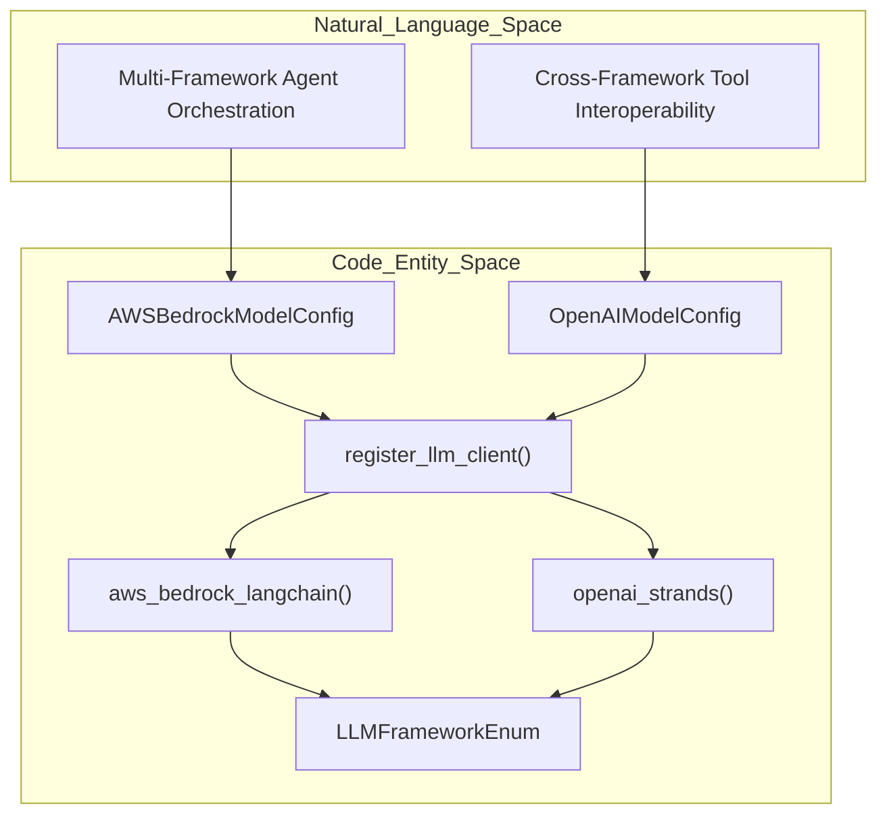
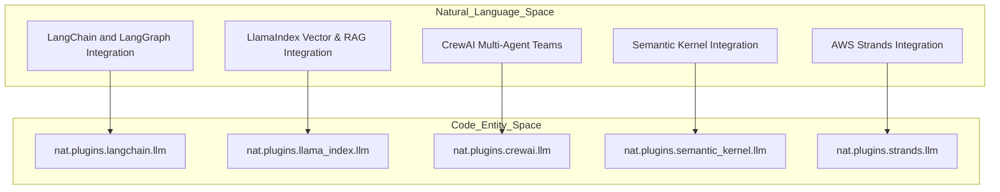

<!-- source: DeepWiki mcp.deepwiki.com · repo NVIDIA/NeMo-Agent-Toolkit · page 16 Framework Integrations · fetched 2026-10-26 -->

# Framework Integrations

Relevant source files

The following files were used as context for generating this wiki page:

- [packages/nvidia_nat_adk/src/nat/plugins/adk/llm.py](packages/nvidia_nat_adk/src/nat/plugins/adk/llm.py)
- [packages/nvidia_nat_agno/src/nat/plugins/agno/llm.py](packages/nvidia_nat_agno/src/nat/plugins/agno/llm.py)
- [packages/nvidia_nat_autogen/src/nat/plugins/autogen/llm.py](packages/nvidia_nat_autogen/src/nat/plugins/autogen/llm.py)
- [packages/nvidia_nat_autogen/tests/test_llm_autogen.py](packages/nvidia_nat_autogen/tests/test_llm_autogen.py)
- [packages/nvidia_nat_crewai/src/nat/plugins/crewai/llm.py](packages/nvidia_nat_crewai/src/nat/plugins/crewai/llm.py)
- [packages/nvidia_nat_langchain/src/nat/plugins/langchain/embedder.py](packages/nvidia_nat_langchain/src/nat/plugins/langchain/embedder.py)
- [packages/nvidia_nat_langchain/src/nat/plugins/langchain/llm.py](packages/nvidia_nat_langchain/src/nat/plugins/langchain/llm.py)
- [packages/nvidia_nat_langchain/tests/test_llm_langchain.py](packages/nvidia_nat_langchain/tests/test_llm_langchain.py)
- [packages/nvidia_nat_llama_index/src/nat/plugins/llama_index/embedder.py](packages/nvidia_nat_llama_index/src/nat/plugins/llama_index/embedder.py)
- [packages/nvidia_nat_llama_index/src/nat/plugins/llama_index/llm.py](packages/nvidia_nat_llama_index/src/nat/plugins/llama_index/llm.py)
- [packages/nvidia_nat_llama_index/tests/test_llm_llama_index.py](packages/nvidia_nat_llama_index/tests/test_llm_llama_index.py)
- [packages/nvidia_nat_semantic_kernel/src/nat/plugins/semantic_kernel/llm.py](packages/nvidia_nat_semantic_kernel/src/nat/plugins/semantic_kernel/llm.py)
- [packages/nvidia_nat_strands/src/nat/plugins/strands/llm.py](packages/nvidia_nat_strands/src/nat/plugins/strands/llm.py)
- [packages/nvidia_nat_strands/tests/test_strands_llm.py](packages/nvidia_nat_strands/tests/test_strands_llm.py)

This page serves as a high-level overview of the framework integration layer in the NVIDIA NeMo Agent Toolkit (NAT). The toolkit provides unified support across multiple popular AI agent frameworks including LangChain [`packages/nvidia_nat_langchain/src/nat/plugins/langchain/llm.py:154-161`](), LlamaIndex [`packages/nvidia_nat_llama_index/src/nat/plugins/llama_index/llm.py:85-88`](), CrewAI [`packages/nvidia_nat_crewai/src/nat/plugins/crewai/llm.py:75-78`](), Google ADK [`packages/nvidia_nat_adk/src/nat/plugins/adk/llm.py:33-42`](), AutoGen, Agno [`packages/nvidia_nat_agno/src/nat/plugins/agno/llm.py:83-86`](), Strands [`packages/nvidia_nat_strands/src/nat/plugins/strands/llm.py:140-143`](), Haystack, and Semantic Kernel [`packages/nvidia_nat_semantic_kernel/src/nat/plugins/semantic_kernel/llm.py:91-95`]().

For detailed technical specifics on how framework-specific wrappers, callback handlers, and thinking injection patterns work, see [Integration Architecture](#16.1). For comprehensive provider feature coverage and framework mappings, see [Framework Support Matrix](#16.2). For Microsoft Teams and Azure Bot deployment, see [Microsoft Agent 365 (A365) Integration](#16.3).

Sources: [packages/nvidia_nat_langchain/src/nat/plugins/langchain/llm.py:154-161](), [packages/nvidia_nat_llama_index/src/nat/plugins/llama_index/llm.py:85-88](), [packages/nvidia_nat_crewai/src/nat/plugins/crewai/llm.py:75-78](), [packages/nvidia_nat_adk/src/nat/plugins/adk/llm.py:33-42](), [packages/nvidia_nat_agno/src/nat/plugins/agno/llm.py:83-86](), [packages/nvidia_nat_strands/src/nat/plugins/strands/llm.py:140-143](), [packages/nvidia_nat_semantic_kernel/src/nat/plugins/semantic_kernel/llm.py:91-95]()

---

## Integration Architecture

NAT bridges different agent frameworks through a modular registration and client wrapping layer. Configuration classes are mapped to framework-native LLMs, embedders, and tools using plugin-based entry points and decorators such as `@register_llm_client` [`packages/nvidia_nat_langchain/src/nat/plugins/langchain/llm.py:154-161`]() and `@register_embedder_client` [`packages/nvidia_nat_langchain/src/nat/plugins/langchain/embedder.py:32-33`](). These wrappers handle framework-specific parameter conversions, automatic retry policies via `RetryMixin`, and chain-of-thought prompt injection via `ThinkingMixin` [`packages/nvidia_nat_langchain/src/nat/plugins/langchain/llm.py:132-149`]().

For details on wrapper mechanics, callback handlers, and custom injectors, see [Integration Architecture](#16.1).

### Diagram: Natural Language Space to Code Entity Space - Integration Architecture

Sources: [packages/nvidia_nat_langchain/src/nat/plugins/langchain/llm.py:154-161](), [packages/nvidia_nat_strands/src/nat/plugins/strands/llm.py:140-143]()

---

## Framework Support Matrix

The toolkit supports multi-framework workflows by allowing components from different ecosystems (e.g., LangChain agents utilizing LlamaIndex RAG tools or Semantic Kernel chat completions) to interoperate under a unified configuration. Each framework package registers its specific entry points and model adaptors under `nat.plugins` [`packages/nvidia_nat_semantic_kernel/src/nat/plugins/semantic_kernel/llm.py:91-95`]().

For a complete breakdown of supported providers and features per framework, see [Framework Support Matrix](#16.2).

### Diagram: Natural Language Space to Code Entity Space - Framework Support Mapping

Sources: [packages/nvidia_nat_langchain/src/nat/plugins/langchain/llm.py:154-161](), [packages/nvidia_nat_llama_index/src/nat/plugins/llama_index/llm.py:85-88](), [packages/nvidia_nat_crewai/src/nat/plugins/crewai/llm.py:75-78](), [packages/nvidia_nat_semantic_kernel/src/nat/plugins/semantic_kernel/llm.py:91-95](), [packages/nvidia_nat_strands/src/nat/plugins/strands/llm.py:140-143]()

---

## Microsoft Agent 365 (A365) Integration

NAT provides dedicated enterprise integration for Microsoft Teams and Azure Bot architectures via the `nvidia-nat-a365` package. This allows workflows to be surfaced natively in conversational channels with built-in telemetry, security context handling, and seamless deployment support through the `nat start a365` command.

For deployment guides, configuration options, and command references, see [Microsoft Agent 365 (A365) Integration](#16.3).

Sources: [packages/nvidia_nat_langchain/src/nat/plugins/langchain/llm.py:154-161]()

---

