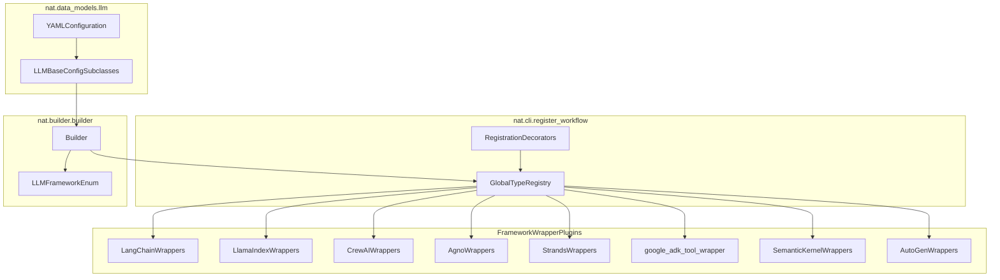
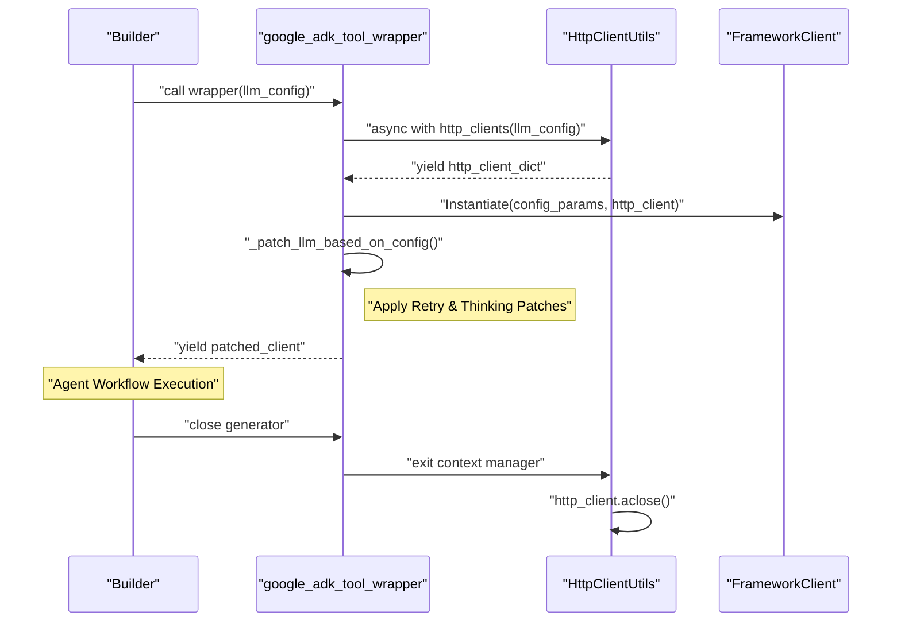
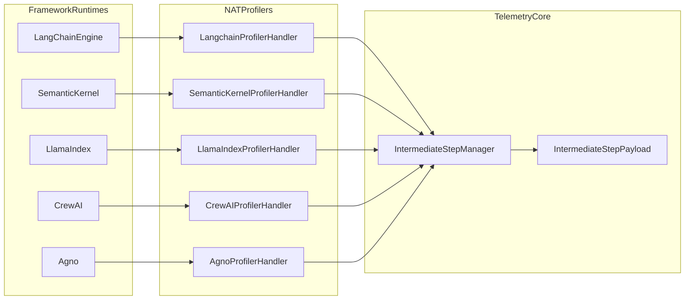

<!-- source: DeepWiki mcp.deepwiki.com · repo NVIDIA/NeMo-Agent-Toolkit · page 16.1 Integration Architecture · fetched 2026-10-26 -->

# Integration Architecture

Relevant source files

The following files were used as context for generating this wiki page:

- [packages/nvidia_nat_adk/src/nat/plugins/adk/tool_wrapper.py](packages/nvidia_nat_adk/src/nat/plugins/adk/tool_wrapper.py)
- [packages/nvidia_nat_adk/tests/test_adk_tool_wrapper.py](packages/nvidia_nat_adk/tests/test_adk_tool_wrapper.py)
- [packages/nvidia_nat_agno/tests/test_agno_callback_handler.py](packages/nvidia_nat_agno/tests/test_agno_callback_handler.py)
- [packages/nvidia_nat_crewai/src/nat/plugins/crewai/crewai_callback_handler.py](packages/nvidia_nat_crewai/src/nat/plugins/crewai/crewai_callback_handler.py)
- [packages/nvidia_nat_crewai/tests/test_crewai_callback_handler.py](packages/nvidia_nat_crewai/tests/test_crewai_callback_handler.py)
- [packages/nvidia_nat_crewai/tests/test_crewai_choice_extraction.py](packages/nvidia_nat_crewai/tests/test_crewai_choice_extraction.py)
- [packages/nvidia_nat_llama_index/src/nat/plugins/llama_index/callback_handler.py](packages/nvidia_nat_llama_index/src/nat/plugins/llama_index/callback_handler.py)
- [packages/nvidia_nat_llama_index/tests/test_llama_index_callback_handler.py](packages/nvidia_nat_llama_index/tests/test_llama_index_callback_handler.py)
- [packages/nvidia_nat_semantic_kernel/src/nat/plugins/semantic_kernel/callback_handler.py](packages/nvidia_nat_semantic_kernel/src/nat/plugins/semantic_kernel/callback_handler.py)
- [packages/nvidia_nat_semantic_kernel/tests/test_sk_callback_handler.py](packages/nvidia_nat_semantic_kernel/tests/test_sk_callback_handler.py)

## Purpose and Scope

This document describes the integration architecture that enables the NVIDIA NeMo Agent Toolkit (NAT) to work across multiple agentic frameworks (LangChain, LlamaIndex, CrewAI, Agno, Semantic Kernel, AutoGen, Strands, Haystack, and ADK). The architecture uses framework-specific wrappers for LLM providers, embedders, and tools, ensuring that NAT's unified configuration system can drive diverse underlying runtimes while injecting common features like retries and thinking patterns.

Sources:
- [packages/nvidia_nat_adk/src/nat/plugins/adk/tool_wrapper.py:27-31]()

## Architecture Overview

The integration architecture follows a plugin registration pattern. Framework-specific wrappers register themselves with the toolkit's registry system using decorators. The `Builder` system uses this registry to instantiate the appropriate framework-specific client based on the configuration's `type` discriminator and the requested `LLMFrameworkEnum`.

### Code Entity Relationship Diagram

The following diagram bridges the "Natural Language Space" of frameworks to the "Code Entity Space" of the NAT toolkit by associating system names with specific code entities.

Sources:
- [packages/nvidia_nat_adk/src/nat/plugins/adk/tool_wrapper.py:27-31]()

## Registration Decorator System

Integration packages use decorators like `@register_llm_client` and `@register_embedder_client` to register their wrapper functions. The `@register_tool_wrapper` decorator is used for framework-specific tool wrappers, such as `google_adk_tool_wrapper` [packages/nvidia_nat_adk/src/nat/plugins/adk/tool_wrapper.py:54-59]() for Google ADK. Each registration maps a combination of `config_type` and `wrapper_type` (the framework enum) to a specific factory function. These registrations are typically invoked during the toolkit's plugin discovery phase via entry points.

| Package | Framework Enum | Example Registration Function |
| :--- | :--- | :--- |
| `nvidia-nat-langchain` | `LANGCHAIN` | `aws_bedrock_langchain` |
| `nvidia-nat-agno` | `AGNO` | `nim_agno` |
| `nvidia-nat-semantic-kernel` | `SEMANTIC_KERNEL` | `openai_semantic_kernel` |
| `nvidia-nat-llama-index` | `LLAMA_INDEX` | `nim_llama_index` |
| `nvidia-nat-adk` | `ADK` | `google_adk_tool_wrapper` [packages/nvidia_nat_adk/src/nat/plugins/adk/tool_wrapper.py:54-59]() |

Sources:
- [packages/nvidia_nat_adk/src/nat/plugins/adk/tool_wrapper.py:54-59]()

## Framework Wrapper Pattern

Framework wrappers are implemented as `AsyncGenerator` functions. This allows NAT to manage the lifecycle of resources, such as `httpx.AsyncClient` instances, ensuring they are closed after the agent workflow completes. For example, `google_adk_tool_wrapper` [packages/nvidia_nat_adk/src/nat/plugins/adk/tool_wrapper.py:54-59]() wraps a NAT `Function` as a Google ADK `FunctionTool`. It provides `callable_ainvoke` [packages/nvidia_nat_adk/src/nat/plugins/adk/tool_wrapper.py:83-93]() for asynchronous invocation and `callable_astream` [packages/nvidia_nat_adk/src/nat/plugins/adk/tool_wrapper.py:94-105]() for streaming results. The `nat_function` decorator [packages/nvidia_nat_adk/src/nat/plugins/adk/tool_wrapper.py:106-112]() handles setting metadata and constructing the function signature from the input schema.

### Lifecycle and Data Flow

Sources:
- [packages/nvidia_nat_adk/src/nat/plugins/adk/tool_wrapper.py:54-112]()

## Thinking Injection Patterns

NAT provides a mechanism to inject "Thinking" (Chain-of-Thought) system prompts into frameworks that may not natively support them for specific models. This is implemented via specialized injector classes for each framework using the `patch_with_thinking` utility.

### Framework Injector Implementations

Each framework has a unique message format, requiring a specialized injector inheriting from `BaseThinkingInjector`:

1.  **LangChain**: Implements `LangchainThinkingInjector`. It handles `LanguageModelInput` and patches `invoke`, `ainvoke`, `stream`, and `astream`.
2.  **LlamaIndex**: Implements `LlamaIndexThinkingInjector`. It handles `Sequence[ChatMessage]` and patches `chat`, `stream_chat`, `achat`, and `astream_chat`.
3.  **CrewAI**: Implements `CrewAIThinkingInjector`. It handles `list[dict[str, str]]` and patches the `call` method of the `LLM` class.
4.  **Agno**: Implements `AgnoThinkingInjector`. It handles a list of Agno `Message` objects and patches `invoke`, `ainvoke`, `invoke_stream`, and `ainvoke_stream`.
5.  **Semantic Kernel**: Implements `SemanticKernelThinkingInjector`. It handles `ChatHistory` and patches `get_chat_message_contents` and `get_streaming_chat_message_contents` [packages/nvidia_nat_semantic_kernel/src/nat/plugins/semantic_kernel/callback_handler.py:72-78]().

Sources:
- [packages/nvidia_nat_semantic_kernel/src/nat/plugins/semantic_kernel/callback_handler.py:72-78]()

## Observability Integration

NAT integrates framework-specific observability tools by bridging their internal callback systems with NAT's telemetry system. This allows traces from disparate frameworks to be collected in a unified format via the `IntermediateStepManager` [packages/nvidia_nat_crewai/src/nat/plugins/crewai/crewai_callback_handler.py:53-53]().

### Framework Callback Handlers

Each integrated framework provides a `BaseProfilerCallback` implementation that intercepts LLM and tool calls and pushes `IntermediateStepPayload` objects to the `IntermediateStepManager`.

-   **LangChain**: `LangchainProfilerHandler` extends `AsyncCallbackHandler` and `BaseProfilerCallback`. It captures `LLM_START`, `LLM_NEW_TOKEN`, `LLM_END`, `FUNCTION_START`, and `FUNCTION_END` events. It extracts tool schemas from invocation parameters using `_extract_tools_schema`.
-   **LlamaIndex**: `LlamaIndexProfilerHandler` [packages/nvidia_nat_llama_index/src/nat/plugins/llama_index/callback_handler.py:43-43]() extends `BaseCallbackHandler` and `BaseProfilerCallback`. It handles `CBEventType.LLM` and `CBEventType.AGENT_STEP` events, mapping them to `LLM_START`/`LLM_END` and `TOOL_START`/`TOOL_END` respectively [packages/nvidia_nat_llama_index/src/nat/plugins/llama_index/callback_handler.py:120-160](). Token usage is extracted using `_extract_token_usage` [packages/nvidia_nat_llama_index/src/nat/plugins/llama_index/callback_handler.py:69-70](), which can handle various response formats [packages/nvidia_nat_llama_index/tests/test_llama_index_callback_handler.py:21-46]().
-   **CrewAI**: `CrewAIProfilerHandler` [packages/nvidia_nat_crewai/src/nat/plugins/crewai/crewai_callback_handler.py:39-40]() monkey-patches `crewai.tools.tool_usage.ToolUsage._use` and `litellm.completion` to intercept tool and LLM calls [packages/nvidia_nat_crewai/src/nat/plugins/crewai/crewai_callback_handler.py:66-74](). It generates `TOOL_START`/`TOOL_END` and `LLM_START`/`LLM_END` events [packages/nvidia_nat_crewai/src/nat/plugins/crewai/crewai_callback_handler.py:102-134](). It also correctly handles different CrewAI output message formats [packages/nvidia_nat_crewai/tests/test_crewai_choice_extraction.py:98-119]().
-   **Semantic Kernel**: `SemanticKernelProfilerHandler` [packages/nvidia_nat_semantic_kernel/src/nat/plugins/semantic_kernel/callback_handler.py:48-48]() monkey-patches `OpenAIChatCompletionBase` methods for LLM calls and `semantic_kernel.Kernel.invoke_function_call` for tool calls [packages/nvidia_nat_semantic_kernel/src/nat/plugins/semantic_kernel/callback_handler.py:94-105](). It ensures that patching occurs only once per provider type [packages/nvidia_nat_semantic_kernel/tests/test_sk_callback_handler.py:24-41]().
-   **Agno**: `AgnoProfilerHandler` also monkey-patches `litellm.completion` to capture LLM events, similar to CrewAI [packages/nvidia_nat_agno/tests/test_agno_callback_handler.py:48-56]().

### Framework Callback Diagram

Sources:
- [packages/nvidia_nat_crewai/src/nat/plugins/crewai/crewai_callback_handler.py:39-74]()
- [packages/nvidia_nat_llama_index/src/nat/plugins/llama_index/callback_handler.py:43-70]()
- [packages/nvidia_nat_semantic_kernel/src/nat/plugins/semantic_kernel/callback_handler.py:48-105]()

## Integration Support Matrix

The toolkit provides extensive support for various frameworks, often through specialized sub-packages that manage their own dependencies.

| Framework | Package Name | Wrapper Module |
| :--- | :--- | :--- |
| **LangChain** | `nvidia-nat-langchain` | `nat.plugins.langchain.llm` |
| **LlamaIndex** | `nvidia-nat-llama-index` | `nat.plugins.llama_index.llm` |
| **Agno** | `nvidia-nat-agno` | `nat.plugins.agno.llm` |
| **CrewAI** | `nvidia-nat-crewai` | `nat.plugins.crewai.llm` |
| **Semantic Kernel** | `nvidia-nat-semantic-kernel` | `nat.plugins.semantic_kernel.llm` |
| **ADK** | `nvidia-nat-adk` | `nat.plugins.adk.llm` |

Sources:
- [packages/nvidia_nat_adk/src/nat/plugins/adk/tool_wrapper.py:54-59]()

---

