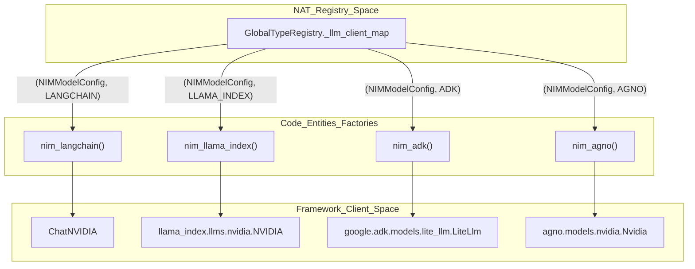
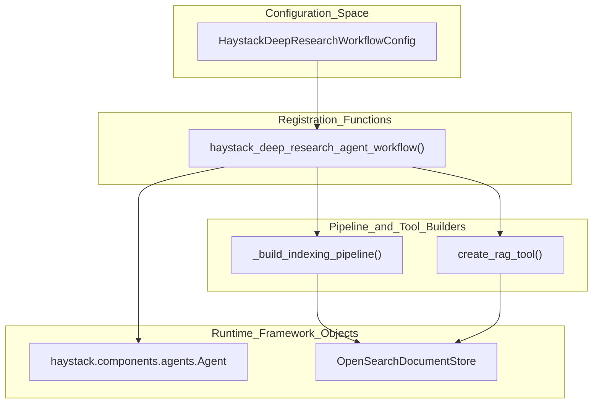

<!-- source: DeepWiki mcp.deepwiki.com · repo NVIDIA/NeMo-Agent-Toolkit · page 16.2 Framework Support Matrix · fetched 2026-10-26 -->

# Framework Support Matrix

Relevant source files

The following files were used as context for generating this wiki page:

- [.gitignore](.gitignore)
- [examples/frameworks/adk_demo/README.md](examples/frameworks/adk_demo/README.md)
- [examples/frameworks/adk_demo/src/nat_adk_demo/configs/config.yml](examples/frameworks/adk_demo/src/nat_adk_demo/configs/config.yml)
- [examples/frameworks/adk_demo/src/nat_adk_demo/configs/config_oai.yml](examples/frameworks/adk_demo/src/nat_adk_demo/configs/config_oai.yml)
- [examples/frameworks/adk_demo/src/nat_adk_demo/configs/eval_config.yml](examples/frameworks/adk_demo/src/nat_adk_demo/configs/eval_config.yml)
- [examples/frameworks/adk_demo/src/nat_adk_demo/data/eval.json](examples/frameworks/adk_demo/src/nat_adk_demo/data/eval.json)
- [examples/frameworks/adk_demo/tests/test_adk_demo_e2e.py](examples/frameworks/adk_demo/tests/test_adk_demo_e2e.py)
- [examples/frameworks/haystack_deep_research_agent/README.md](examples/frameworks/haystack_deep_research_agent/README.md)
- [examples/frameworks/haystack_deep_research_agent/src/nat_haystack_deep_research_agent/__init__.py](examples/frameworks/haystack_deep_research_agent/src/nat_haystack_deep_research_agent/__init__.py)
- [examples/frameworks/haystack_deep_research_agent/src/nat_haystack_deep_research_agent/configs/config.yml](examples/frameworks/haystack_deep_research_agent/src/nat_haystack_deep_research_agent/configs/config.yml)
- [examples/frameworks/haystack_deep_research_agent/src/nat_haystack_deep_research_agent/data/carbonara.md](examples/frameworks/haystack_deep_research_agent/src/nat_haystack_deep_research_agent/data/carbonara.md)
- [examples/frameworks/haystack_deep_research_agent/src/nat_haystack_deep_research_agent/data/sample_document.txt](examples/frameworks/haystack_deep_research_agent/src/nat_haystack_deep_research_agent/data/sample_document.txt)
- [examples/frameworks/haystack_deep_research_agent/src/nat_haystack_deep_research_agent/pipelines/__init__.py](examples/frameworks/haystack_deep_research_agent/src/nat_haystack_deep_research_agent/pipelines/__init__.py)
- [examples/frameworks/haystack_deep_research_agent/src/nat_haystack_deep_research_agent/pipelines/indexing.py](examples/frameworks/haystack_deep_research_agent/src/nat_haystack_deep_research_agent/pipelines/indexing.py)
- [examples/frameworks/haystack_deep_research_agent/src/nat_haystack_deep_research_agent/pipelines/rag.py](examples/frameworks/haystack_deep_research_agent/src/nat_haystack_deep_research_agent/pipelines/rag.py)
- [examples/frameworks/haystack_deep_research_agent/src/nat_haystack_deep_research_agent/register.py](examples/frameworks/haystack_deep_research_agent/src/nat_haystack_deep_research_agent/register.py)
- [examples/frameworks/haystack_deep_research_agent/tests/test_haystack_deep_research_agent.py](examples/frameworks/haystack_deep_research_agent/tests/test_haystack_deep_research_agent.py)
- [examples/frameworks/nat_autogen_demo/README.md](examples/frameworks/nat_autogen_demo/README.md)
- [examples/frameworks/nat_autogen_demo/pyproject.toml](examples/frameworks/nat_autogen_demo/pyproject.toml)
- [examples/frameworks/nat_autogen_demo/src/nat_autogen_demo/configs/config-eval.yml](examples/frameworks/nat_autogen_demo/src/nat_autogen_demo/configs/config-eval.yml)
- [examples/frameworks/nat_autogen_demo/src/nat_autogen_demo/configs/config.yml](examples/frameworks/nat_autogen_demo/src/nat_autogen_demo/configs/config.yml)
- [examples/frameworks/nat_autogen_demo/src/nat_autogen_demo/data/toy_data.json](examples/frameworks/nat_autogen_demo/src/nat_autogen_demo/data/toy_data.json)
- [examples/frameworks/nat_autogen_demo/src/nat_autogen_demo/register.py](examples/frameworks/nat_autogen_demo/src/nat_autogen_demo/register.py)
- [examples/frameworks/nat_autogen_demo/src/nat_autogen_demo/traffic_status_tool.py](examples/frameworks/nat_autogen_demo/src/nat_autogen_demo/traffic_status_tool.py)
- [examples/frameworks/strands_demo/bedrock_agentcore/.dockerignore](examples/frameworks/strands_demo/bedrock_agentcore/.dockerignore)
- [examples/frameworks/strands_demo/bedrock_agentcore/Dockerfile](examples/frameworks/strands_demo/bedrock_agentcore/Dockerfile)
- [examples/frameworks/strands_demo/bedrock_agentcore/README.md](examples/frameworks/strands_demo/bedrock_agentcore/README.md)
- [examples/frameworks/strands_demo/bedrock_agentcore/scripts/deploy_nat.py](examples/frameworks/strands_demo/bedrock_agentcore/scripts/deploy_nat.py)
- [examples/frameworks/strands_demo/bedrock_agentcore/scripts/get_agentcore_runtime_id.py](examples/frameworks/strands_demo/bedrock_agentcore/scripts/get_agentcore_runtime_id.py)
- [examples/frameworks/strands_demo/bedrock_agentcore/scripts/run_nat_no_OTEL.sh](examples/frameworks/strands_demo/bedrock_agentcore/scripts/run_nat_no_OTEL.sh)
- [examples/frameworks/strands_demo/bedrock_agentcore/scripts/run_nat_with_OTEL.sh](examples/frameworks/strands_demo/bedrock_agentcore/scripts/run_nat_with_OTEL.sh)
- [examples/frameworks/strands_demo/bedrock_agentcore/scripts/update_nat.py](examples/frameworks/strands_demo/bedrock_agentcore/scripts/update_nat.py)
- [examples/safety_and_security/retail_agent/pyproject.toml](examples/safety_and_security/retail_agent/pyproject.toml)
- [packages/nvidia_nat_autogen/pyproject.toml](packages/nvidia_nat_autogen/pyproject.toml)

This page documents the framework support matrix for the NVIDIA NeMo Agent Toolkit (NAT). It details which LLM providers and features are supported across the integrated agent frameworks, including LangChain, LlamaIndex, CrewAI, ADK, Agno, Semantic Kernel, AutoGen, Strands, and Haystack, as well as production deployment patterns such as AWS Bedrock AgentCore.

The toolkit uses a unified configuration system where framework-specific client implementations are mapped to common configuration types (e.g., `OpenAIModelConfig`, `NIMModelConfig`) via registration decorators [packages/nvidia_nat_langchain/src/nat/plugins/langchain/llm.py:154-154]().

---

## Provider Support Matrix

The following table summarizes the compatibility between LLM provider configurations and target frameworks. Support is defined by the existence of specific registration functions in the framework subpackages.

| Provider Config | LangChain | LlamaIndex | CrewAI | ADK | Agno | Semantic Kernel | AutoGen | Strands | Haystack |
|----------------|-----------|------------|--------|-----|------|-----------------|---------|---------|----------|
| `OpenAIModelConfig` | ✓ | ✓ | ✓ | ✓ | ✓ | ✓ | ✓ | ✓ | ✓ |
| `AzureOpenAIModelConfig` | ✓ | ✓ | ✓ | ✓ | ✗ | ✓ | ✓ | ✗ | ✓ |
| `NIMModelConfig` | ✓ | ✓ | ✓ | ✓ | ✓ | ✗ | ✓ | ✓ | ✓ |
| `DynamoModelConfig` | ✓ | ✗ | ✗ | ✓ | ✗ | ✗ | ✗ | ✗ | ✗ |
| `AWSBedrockModelConfig` | ✓ | ✓ | ✗ | ✗ | ✗ | ✗ | ✓ | ✓ | ✓ |
| `LiteLlmModelConfig` | ✓ | ✓ | ✓ | ✓ | ✓ | ✗ | ✓ | ✗ | ✓ |
| `HuggingFaceConfig` | ✓ | ✗ | ✗ | ✗ | ✗ | ✗ | ✗ | ✗ | ✗ |
| `OCIModelConfig` | ✓ | ✗ | ✗ | ✗ | ✗ | ✗ | ✗ | ✗ | ✗ |

**Universal Support**: `OpenAIModelConfig` is the most portable configuration, supported across all integrated frameworks [packages/nvidia_nat_langchain/src/nat/plugins/langchain/llm.py:223-223](), [packages/nvidia_nat_llama_index/src/nat/plugins/llama_index/llm.py:152-152](), [packages/nvidia_nat_crewai/src/nat/plugins/crewai/llm.py:157-157]().

**Specialized Features**:
- **Thinking Injection**: Supported in LangChain, LlamaIndex, CrewAI, Agno, and Semantic Kernel via framework-specific `BaseThinkingInjector` implementations [packages/nvidia_nat_langchain/src/nat/plugins/langchain/llm.py:89-126](), [packages/nvidia_nat_llama_index/src/nat/plugins/llama_index/llm.py:48-61](), [packages/nvidia_nat_agno/src/nat/plugins/agno/llm.py:45-61]().
- **Automatic Retries**: Applied via `patch_with_retry` for most framework clients when the configuration includes `RetryMixin` [packages/nvidia_nat_langchain/src/nat/plugins/langchain/llm.py:132-136](), [packages/nvidia_nat_llama_index/src/nat/plugins/llama_index/llm.py:63-67]().

Sources: [packages/nvidia_nat_langchain/src/nat/plugins/langchain/llm.py:89-168](), [packages/nvidia_nat_llama_index/src/nat/plugins/llama_index/llm.py:44-153](), [packages/nvidia_nat_crewai/src/nat/plugins/crewai/llm.py:41-158](), [packages/nvidia_nat_adk/src/nat/plugins/adk/llm.py:33-161](), [packages/nvidia_nat_agno/src/nat/plugins/agno/llm.py:41-158](), [packages/nvidia_nat_semantic_kernel/src/nat/plugins/semantic_kernel/llm.py:43-86]()

---

## Framework Registration Architecture

The toolkit leverages the `Builder` and `GlobalTypeRegistry` to instantiate framework-native LLM clients. Framework-specific subpackages register their factory functions using the `wrapper_type` parameter in the registration decorator [packages/nvidia_nat_langchain/src/nat/plugins/langchain/llm.py:154-154]().

### Registry Mapping Logic
The registration system maps a NAT configuration type (such as `NIMModelConfig`) to a framework-specific constructor function (such as `nim_langchain`). These bindings are loaded dynamically via entry points defined in each framework subpackage's `pyproject.toml`.

### Diagram: LLM Client Factory Mapping (Bridging Natural Language/Config Space to Code Entities)

Sources: [packages/nvidia_nat_langchain/src/nat/plugins/langchain/llm.py:196-220](), [packages/nvidia_nat_llama_index/src/nat/plugins/llama_index/llm.py:126-149](), [packages/nvidia_nat_adk/src/nat/plugins/adk/llm.py:88-119](), [packages/nvidia_nat_agno/src/nat/plugins/agno/llm.py:83-112]()

---

## Specialized Framework Integrations

### Strands and Bedrock AgentCore Deployment
The toolkit supports deploying Strands-based agents to AWS Bedrock AgentCore [examples/frameworks/strands_demo/bedrock_agentcore/README.md:18-21](). This deployment workflow utilizes:
1. **Secrets Management**: Storing the `NVIDIA_API_KEY` in AWS Secrets Manager for secure retrieval at runtime [examples/frameworks/strands_demo/bedrock_agentcore/README.md:37-40](), [examples/frameworks/strands_demo/bedrock_agentcore/scripts/run_nat_no_OTEL.sh:26-27]().
2. **Containerization**: A specialized `Dockerfile` optimized for AgentCore that installs NAT and required plugins (`opentelemetry`, `phoenix`, `weave`) using the `uv` package manager [examples/frameworks/strands_demo/bedrock_agentcore/Dockerfile:58-70]().
3. **Observability**: Full instrumentation via `aws-opentelemetry-distro`, mapping NAT spans to AWS CloudWatch log groups and metric namespaces [examples/frameworks/strands_demo/bedrock_agentcore/Dockerfile:78-97]().
4. **Execution Scripts**: Runtime scripts such as `run_nat_no_OTEL.sh` which fetch secrets from AWS Secrets Manager and invoke `nat serve` [examples/frameworks/strands_demo/bedrock_agentcore/scripts/run_nat_no_OTEL.sh:21-29]().

Sources: [examples/frameworks/strands_demo/bedrock_agentcore/README.md:18-21](), [examples/frameworks/strands_demo/bedrock_agentcore/Dockerfile:1-115](), [examples/frameworks/strands_demo/bedrock_agentcore/scripts/run_nat_no_OTEL.sh:21-29]()

### ADK (Agent Development Kit)
ADK support allows running Google ADK agents within the NAT environment [examples/frameworks/adk_demo/README.md:18-22](). NAT configurations for Azure OpenAI, LiteLLM, NIM, and OpenAI are wrapped into `google.adk.models.lite_llm.LiteLlm` instances [packages/nvidia_nat_adk/src/nat/plugins/adk/llm.py:41-160](). The ADK implementation for `DynamoModelConfig` supports per-request hint injection using a custom `httpx` transport wrapped in an `AsyncOpenAI` client [packages/nvidia_nat_adk/src/nat/plugins/adk/llm.py:163-195]().

Sources: [examples/frameworks/adk_demo/README.md:18-22](), [packages/nvidia_nat_adk/src/nat/plugins/adk/llm.py:41-195]()

### AutoGen Integration
NAT provides integration with Microsoft's AutoGen framework through the `nvidia-nat-autogen` subpackage [packages/nvidia_nat_autogen/pyproject.toml:29-45]().
- **Unified Tools**: Integrates both local and MCP tools into AutoGen agents using NAT's unified tool abstraction.
- **Registration**: AutoGen components are registered via the `nat_autogen` entry point [packages/nvidia_nat_autogen/pyproject.toml:44-45]().

Sources: [examples/frameworks/nat_autogen_demo/README.md:21-24](), [packages/nvidia_nat_autogen/pyproject.toml:29-45]()

### Haystack Integration
Haystack integration is exemplified by the `haystack_deep_research_agent` workflow [examples/frameworks/haystack_deep_research_agent/README.md:18-22](). This workflow builds upon Haystack pipelines to coordinate deep research tasks, indexing local documents into OpenSearch using `NvidiaDocumentEmbedder` components [examples/frameworks/haystack_deep_research_agent/src/nat_haystack_deep_research_agent/register.py:53-57](). The indexing pipeline relies on word-based chunking via `DocumentSplitter(split_by="word")` to respect token limits of NIM embedders [examples/frameworks/haystack_deep_research_agent/src/nat_haystack_deep_research_agent/pipelines/indexing.py:45-47](). RAG tools are built utilizing `OpenSearchEmbeddingRetriever` and `NvidiaChatGenerator` [examples/frameworks/haystack_deep_research_agent/src/nat_haystack_deep_research_agent/pipelines/rag.py:33-55]().

### Diagram: Framework Tool and Pipeline Resolution (Bridging Framework Concepts to Code Entities)

Sources: [examples/frameworks/haystack_deep_research_agent/README.md:18-22](), [examples/frameworks/haystack_deep_research_agent/src/nat_haystack_deep_research_agent/register.py:53-57](), [examples/frameworks/haystack_deep_research_agent/src/nat_haystack_deep_research_agent/pipelines/indexing.py:45-47](), [examples/frameworks/haystack_deep_research_agent/src/nat_haystack_deep_research_agent/pipelines/rag.py:33-55]()

---

## Framework Feature Matrix

| Feature | LangChain | LlamaIndex | CrewAI | ADK | Strands | Agno | Haystack | Semantic Kernel | AutoGen |
|---------|-----------|------------|--------|-----|---------|------|----------|-----------------|---------|
| **Thinking Injection** | `LangchainThinkingInjector` | `LlamaIndexThinkingInjector` | `CrewAIThinkingInjector` | ✗ | ✗ | `AgnoThinkingInjector` | ✗ | `SemanticKernelThinkingInjector` | ✗ |
| **Retry Support** | `patch_with_retry` | `patch_with_retry` | `patch_with_retry` | ✗ | ✗ | `patch_with_retry` | ✗ | `patch_with_retry` | ✓ |
| **Dynamo Hints** | ✓ | ✗ | ✗ | ✓ | ✗ | ✗ | ✗ | ✗ | ✗ |
| **SSL Verification** | `verify_ssl` | `verify_ssl` | `_handle_litellm_verify_ssl` | `_handle_litellm_verify_ssl` | ✗ | `verify_ssl` | ✗ | `verify_ssl` | ✓ |
| **Bedrock AgentCore** | ✗ | ✗ | ✗ | ✗ | ✓ | ✗ | ✗ | ✗ | ✗ |
| **Embedder Support** | `NVIDIAEmbeddings` | `NVIDIAEmbedding` | ✗ | ✗ | ✗ | ✗ | `NvidiaDocumentEmbedder` | ✗ | ✗ |

Sources: [packages/nvidia_nat_langchain/src/nat/plugins/langchain/llm.py:89-126](), [packages/nvidia_nat_llama_index/src/nat/plugins/llama_index/llm.py:48-80](), [packages/nvidia_nat_crewai/src/nat/plugins/crewai/llm.py:43-70](), [packages/nvidia_nat_adk/src/nat/plugins/adk/llm.py:163-184](), [packages/nvidia_nat_agno/src/nat/plugins/agno/llm.py:45-78](), [packages/nvidia_nat_semantic_kernel/src/nat/plugins/semantic_kernel/llm.py:43-86](), [examples/frameworks/strands_demo/bedrock_agentcore/README.md:18-21](), [packages/nvidia_nat_langchain/src/nat/plugins/langchain/embedder.py:57-64](), [packages/nvidia_nat_llama_index/src/nat/plugins/llama_index/embedder.py:51-66](), [examples/frameworks/haystack_deep_research_agent/src/nat_haystack_deep_research_agent/pipelines/rag.py:33-55]()

---

