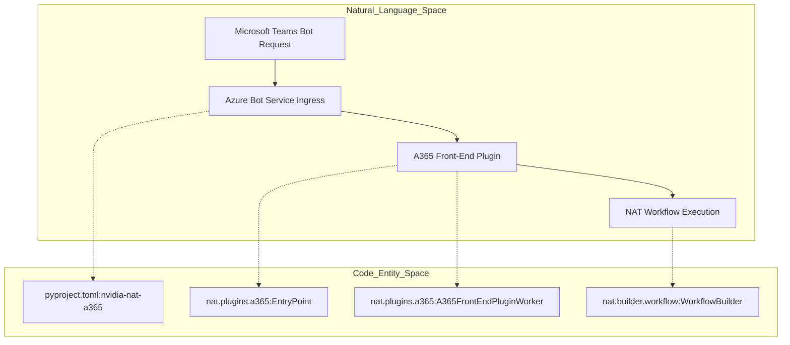
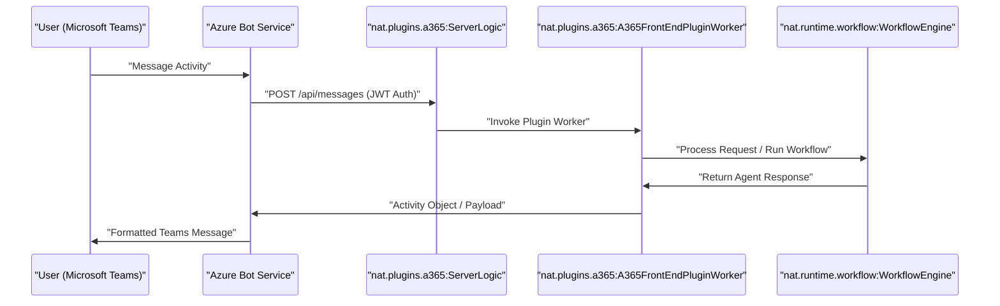
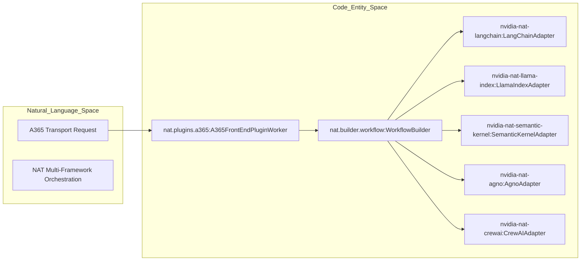

<!-- source: DeepWiki mcp.deepwiki.com · repo NVIDIA/NeMo-Agent-Toolkit · page 16.3 Microsoft Agent 365 (A365) Integration · fetched 2026-10-26 -->

# Microsoft Agent 365 (A365) Integration

Relevant source files

The following files were used as context for generating this wiki page:

- [README.md](README.md)
- [ci/markdown-link-check-config.json](ci/markdown-link-check-config.json)
- [ci/scripts/path_checks.py](ci/scripts/path_checks.py)
- [ci/vale/styles/config/vocabularies/nat/accept.txt](ci/vale/styles/config/vocabularies/nat/accept.txt)
- [docs/Makefile](docs/Makefile)
- [docs/source/build-workflows/memory.md](docs/source/build-workflows/memory.md)
- [docs/source/components/agents/auto-memory-wrapper/auto-memory-wrapper.md](docs/source/components/agents/auto-memory-wrapper/auto-memory-wrapper.md)
- [docs/source/components/integrations/index.md](docs/source/components/integrations/index.md)
- [docs/source/components/integrations/integrating-oci-generative-ai-models.md](docs/source/components/integrations/integrating-oci-generative-ai-models.md)
- [docs/source/conf.py](docs/source/conf.py)
- [docs/source/index.md](docs/source/index.md)
- [examples/README.md](examples/README.md)
- [examples/agents/auto_memory_wrapper/README.md](examples/agents/auto_memory_wrapper/README.md)
- [examples/memory/memanto/README.md](examples/memory/memanto/README.md)
- [packages/nvidia_nat_langchain/src/nat/plugins/langchain/agent/auto_memory_wrapper/agent.py](packages/nvidia_nat_langchain/src/nat/plugins/langchain/agent/auto_memory_wrapper/agent.py)

## Purpose and Scope

The `nvidia-nat-a365` package provides the integration layers required to deploy NVIDIA NeMo Agent Toolkit (NAT) workflows as Microsoft Teams bots and Azure Bot Service entities. This document details the architectural design, data flow, deployment mechanics via the `nat start a365` command, telemetry instrumentation, and framework interoperability.

Sources: [pyproject.toml:54](), [pyproject.toml:96]()

---

## Package Architecture and Component Mapping

The A365 integration operates as a specialized front-end plugin package within the NeMo Agent Toolkit architecture. It maps incoming Microsoft Bot Framework activities to NAT execution sessions while leveraging enterprise authentication via Microsoft Entra ID.

The following diagram bridges the Natural Language Space (descriptive system concepts) to the Code Entity Space (actual package modules, classes, and entry points):

**Natural Language to Code Entity Mapping: A365 Integration**

Sources: [pyproject.toml:54](), [pyproject.toml:96]()

---

## Data Flow and Message Handling

When an end user submits a message in Microsoft Teams, the request travels through the Azure Bot Service to the NAT A365 server endpoint, where it is authenticated, converted into a NAT input structure, processed by the agent workflow, and returned to the user.

**A365 Interaction Flow**

Sources: [pyproject.toml:54](), [pyproject.toml:96]()

---

## Deployment and CLI (`nat start a365`)

The toolkit provides the `nat start a365` command to bootstrap the A365 server component. This command initializes the underlying web framework (such as FastAPI or Starlette via Bot Framework adapters) and binds to the configured port.

### Environment Configuration

The server requires specific environment variables to establish trust with Microsoft Entra ID and the Azure Bot Service:

| Environment Variable | Description |
| :--- | :--- |
| `MICROSOFT_APP_ID` | Unique identifier (GUID) registered for the bot in Azure App Registrations. |
| `MICROSOFT_APP_PASSWORD` | Client secret associated with the bot registration. |
| `AZURE_TENANT_ID` | Tenant ID for enterprise single-tenant or multi-tenant Entra ID authentication. |

Sources: [pyproject.toml:54](), [pyproject.toml:96]()

---

## Telemetry and Observability

Bot interactions managed through the `nvidia-nat-a365` package integrate directly with the toolkit's OpenTelemetry infrastructure. 

*   **ATOF / ATIF Standards**: Supports the **Agentic Trajectory Interchange Format (ATIF)** and **Agentic Trajectory Observability Format (ATOF)** for recording complete execution steps, tool calls, and LLM reasoning traces.
*   **Exporters**: Telemetry data can be exported to platforms like Arize Phoenix and Arize AX using standard OTLP endpoints configured in the toolkit [examples/observability/simple_calculator_observability/tests/test_simple_calc_observability.py:141-149]().

Sources: [pyproject.toml:59](), [pyproject.toml:73-74](), [examples/observability/simple_calculator_observability/tests/test_simple_calc_observability.py:141-149]()

---

## Framework Interoperability

Because the NeMo Agent Toolkit uses a modular plugin system, workflows exposed via the A365 front-end can execute agents built across diverse frameworks without altering transport logic.

The following diagram maps the framework integration space to specific code entities and adapters:

**Framework Integration Architecture and Code Entity Mapping**

Sources: [pyproject.toml:54](), [pyproject.toml:56](), [pyproject.toml:62](), [pyproject.toml:66](), [pyproject.toml:84](), [pyproject.toml:96](), [packages/nvidia_nat_langchain/pyproject.toml:33](), [packages/nvidia_nat_llama_index/pyproject.toml:33](), [packages/nvidia_nat_agno/pyproject.toml:31]()

---

