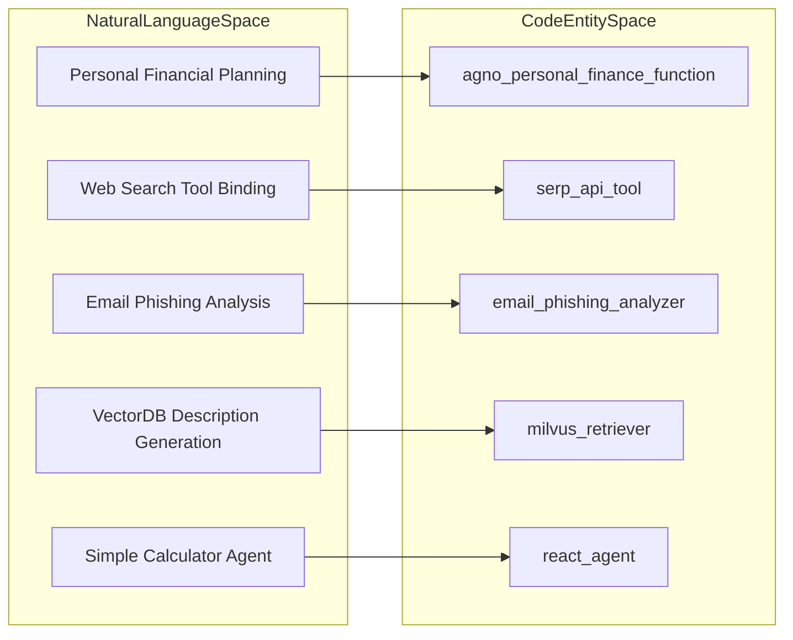

<!-- source: DeepWiki mcp.deepwiki.com · repo NVIDIA/NeMo-Agent-Toolkit · page 17 Examples and Use Cases · fetched 2026-10-26 -->

# Examples and Use Cases

Relevant source files

The following files were used as context for generating this wiki page:

- [examples/custom_functions/automated_description_generation/README.md](examples/custom_functions/automated_description_generation/README.md)
- [examples/evaluation_and_profiling/email_phishing_analyzer/README.md](examples/evaluation_and_profiling/email_phishing_analyzer/README.md)
- [examples/frameworks/agno_personal_finance/README.md](examples/frameworks/agno_personal_finance/README.md)
- [examples/frameworks/agno_personal_finance/src/nat_agno_personal_finance/agno_personal_finance_function.py](examples/frameworks/agno_personal_finance/src/nat_agno_personal_finance/agno_personal_finance_function.py)
- [examples/frameworks/agno_personal_finance/src/nat_agno_personal_finance/configs/config.yml](examples/frameworks/agno_personal_finance/src/nat_agno_personal_finance/configs/config.yml)
- [examples/getting_started/simple_calculator/README.md](examples/getting_started/simple_calculator/README.md)
- [examples/getting_started/simple_web_query/README.md](examples/getting_started/simple_web_query/README.md)

This page provides a high-level guide to the example workflows and use cases available in the NVIDIA NeMo Agent Toolkit (NAT). These examples demonstrate specific features, integration patterns, and production workflows that serve as technical blueprints for building custom agentic systems.

For detailed implementation of specific agent types, see [Agent Architecture Overview](#4.1). For framework-specific integration details, see [Integration Architecture](#16.1).

## Purpose and Scope

The NeMo Agent Toolkit examples showcase the building blocks of agentic systems, including tools, agents, workflows, and observability. The examples are categorized into core components, orchestration patterns, and platform integrations.

Key areas covered include:
- **Interactive Tutorials**: Step-by-step Jupyter notebooks for onboarding, multi-agent orchestration, and performance profiling.
- **Agent-to-Agent (A2A)**: Demonstrations of the A2A protocol for secure, cross-agent communication with OAuth2 support.
- **Component Walkthroughs**: Implementations of ReAct, ReWOO, and Tool Calling agents [examples/getting_started/simple_calculator/README.md:37-37]().
- **Advanced Blueprints**: Enterprise-ready blueprints like automated alert triage systems and security analyzers [examples/evaluation_and_profiling/email_phishing_analyzer/README.md:40-44]().
- **Optimization**: Use cases for GPU cluster sizing and hyperparameter selection using the toolkit's optimizer.
- **Framework Integrations**: Practical examples using external frameworks like LangChain and Agno for agent workflows [examples/frameworks/agno_personal_finance/README.md:41-43]().

Sources: [examples/evaluation_and_profiling/email_phishing_analyzer/README.md:40-44](), [examples/frameworks/agno_personal_finance/README.md:41-43](), [examples/getting_started/simple_calculator/README.md:37-37]()

## Example Organization

### Complexity Levels
Examples are categorized by difficulty and feature depth to guide users through the learning curve:
- 🟢 **Beginner**: Installation, basic configuration-only workflows, and simple tool calling [examples/getting_started/simple_calculator/README.md:20-22](), [examples/frameworks/agno_personal_finance/README.md:21-21]().
- 🟨 **Intermediate**: Multi-agent orchestration, A2A protocol integration, and email security analysis [examples/evaluation_and_profiling/email_phishing_analyzer/README.md:21-21]().
- 🛑 **Advanced**: Model selection optimization, GPU cluster sizing, and enterprise research blueprints.

### Repository Structure and Entities
The following diagram bridges natural language concepts to specific code entities and configuration files within the toolkit.

**Natural Language Space to Code Entity Space: Example Components**

```mermaid
graph TD
    subgraph "NaturalLanguageSpace"
        PersonalFinance["Personal Financial Planner"]
        EmailAnalyzer["Email Phishing Analyzer"]
        SimpleCalc["Simple Calculator"]
        SimpleWeb["Simple Web Query"]
        DescGen["Automated Description Generation"]
    end

    subgraph "CodeEntitySpace"
        FINANCE_CONFIG["examples/frameworks/agno_personal_finance/src/nat_agno_personal_finance/configs/config.yml:1-34"]
        FINANCE_FN["examples/frameworks/agno_personal_finance/src/nat_agno_personal_finance/agno_personal_finance_function.py:32-147"]
        PHISHING_CONFIG["examples/evaluation_and_profiling/email_phishing_analyzer/README.md:73-74"]
        CALC_CONFIG["examples/getting_started/simple_calculator/README.md:69-70"]
        WEB_CONFIG["examples/getting_started/simple_web_query/README.md:66-67"]
        DESC_CONFIG["examples/custom_functions/automated_description_generation/README.md:103-139"]
    end

    PersonalFinance --> FINANCE_CONFIG
    PersonalFinance --> FINANCE_FN
    EmailAnalyzer --> PHISHING_CONFIG
    SimpleCalc --> CALC_CONFIG
    SimpleWeb --> WEB_CONFIG
    DescGen --> DESC_CONFIG
```

Sources: [examples/frameworks/agno_personal_finance/src/nat_agno_personal_finance/configs/config.yml:1-33](), [examples/frameworks/agno_personal_finance/src/nat_agno_personal_finance/agno_personal_finance_function.py:32-146](), [examples/evaluation_and_profiling/email_phishing_analyzer/README.md:73-74](), [examples/getting_started/simple_calculator/README.md:69-70](), [examples/getting_started/simple_web_query/README.md:66-67](), [examples/custom_functions/automated_description_generation/README.md:103-139]()

## Core Example Workflows

### 17.1 Example Overview
The example overview provides a structured survey of available workflows organized by category and complexity, including Retrieval-Augmented Generation (RAG), automated alert triage, data visualization charts, and custom router functions. These templates allow developers to quickly bootstrap applications ranging from simple calculators to complex multi-step research agents.
For details, see [Example Overview](#17.1).

### 17.2 ReWOO Agent Example
The ReWOO example details the implementation of the Reasoning Without Observation (ReWOO) pattern. By decoupling the planning phase from execution, ReWOO reduces redundant LLM calls and speeds up execution for multi-step tasks utilizing calculator and internet search tools. The `simple_calculator` example demonstrates a `react_agent` that uses tools like `calculator__add`, `calculator__subtract`, `calculator__multiply`, `calculator__divide`, `calculator__compare`, and `current_datetime` for mathematical operations and time-based comparisons [examples/getting_started/simple_calculator/README.md:36-37]().
For details, see [ReWOO Agent Example](#17.2).

### 17.3 MCP Authentication Examples
Model Context Protocol (MCP) authentication examples demonstrate how to secure connections to protected MCP servers. These guides cover OAuth2 authorization code flows, service account patterns, and dual authentication mechanisms required for enterprise deployments.
For details, see [MCP Authentication Examples](#17.3).

### 17.4 Notebook Tutorials
A comprehensive series of Jupyter notebooks provides hands-on tutorials covering agent onboarding, multi-agent orchestration, trace visualization, and GPU cluster sizing. These notebooks bridge theory and practice by guiding users through live execution inside isolated development environments.
For details, see [Notebook Tutorials](#17.4).

### 17.5 Finetuning Examples
Finetuning walkthroughs demonstrate how to optimize agent performance using Reinforcement Learning with OpenPipe ART and Direct Preference Optimization (DPO) via NeMo Customizer. These patterns enable systematic alignment of LLMs for specialized agent reasoning tasks.
For details, see [Finetuning Examples](#17.5).

### 17.6 Memory and Object Store Examples
Memory and object store examples showcase integration patterns for stateful agent backends including Mem0, Zep Cloud, MemMachine, Synap, and traditional object stores or databases like S3, MySQL, and Redis. These configurations ensure robust state management across sessions.
For details, see [Memory and Object Store Examples](#17.6).

Sources: [examples/getting_started/simple_calculator/README.md:36-37]()

## System Integration Architecture

The diagram below bridges functional requirements like tool bindings and agent coordination to specific code entities and configuration files within the toolkit, ensuring traceability between natural language tasks and codebase symbols.

**Natural Language Space to Code Entity Space: Tool and Agent Workflow**

Sources: [examples/frameworks/agno_personal_finance/src/nat_agno_personal_finance/agno_personal_finance_function.py:38-39](), [examples/frameworks/agno_personal_finance/src/nat_agno_personal_finance/configs/config.yml:18-19](), [examples/evaluation_and_profiling/email_phishing_analyzer/README.md:40-41](), [examples/custom_functions/automated_description_generation/README.md:117-124](), [examples/getting_started/simple_calculator/README.md:37-37]()

## Specialized Use Cases

### Multi-Agent Orchestration
The toolkit supports complex routing where supervisor agents direct queries to specialized sub-agents. This pattern is demonstrated in assistant examples such as `agno_personal_finance`, combining research agents and planner agents to handle structured workflows with proper context injection [examples/frameworks/agno_personal_finance/src/nat_agno_personal_finance/agno_personal_finance_function.py:65-109](). The `agno_personal_finance` workflow uses a `serp_api_tool` configured via YAML to gather financial advice and investment strategies [examples/frameworks/agno_personal_finance/src/nat_agno_personal_finance/configs/config.yml:18-21]().

### Specialized Tool Usage
The toolkit provides examples of specialized tools across domains:
- **Email Phishing Analyzer**: The `email_phishing_analyzer` tool examines email content for suspicious patterns and phishing indicators using LLM-based analysis [examples/evaluation_and_profiling/email_phishing_analyzer/README.md:40-41](). It integrates with a `react_agent` that reasons about email content [examples/evaluation_and_profiling/email_phishing_analyzer/README.md:41-41]().
- **Automated Description Generation**: Automatically generates intelligent descriptions for VectorDB collections (such as Milvus) using document retrieval and LLM summarization [examples/custom_functions/automated_description_generation/README.md:46-49]().
- **Webpage Query Tool**: Retrieves and processes documentation from websites using web scraping and vector search to answer domain-specific questions [examples/getting_started/simple_web_query/README.md:36-38]().

Sources: [examples/frameworks/agno_personal_finance/src/nat_agno_personal_finance/agno_personal_finance_function.py:65-109](), [examples/frameworks/agno_personal_finance/src/nat_agno_personal_finance/configs/config.yml:18-21](), [examples/evaluation_and_profiling/email_phishing_analyzer/README.md:40-41](), [examples/custom_functions/automated_description_generation/README.md:46-49](), [examples/getting_started/simple_web_query/README.md:36-38]()

---

