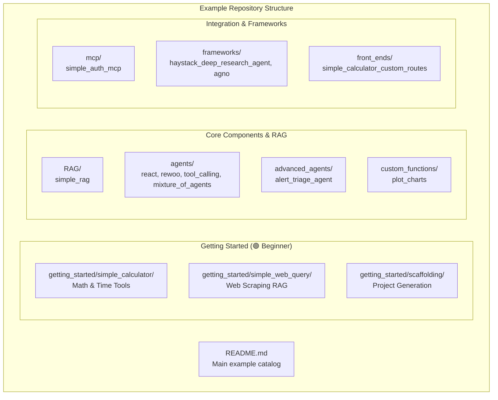
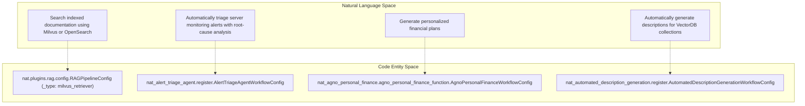
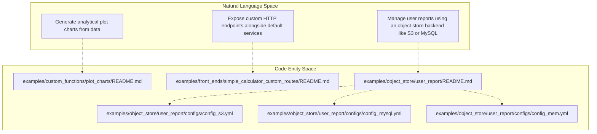

<!-- source: DeepWiki mcp.deepwiki.com · repo NVIDIA/NeMo-Agent-Toolkit · page 17.1 Example Overview · fetched 2026-10-26 -->

# Example Overview

Relevant source files

The following files were used as context for generating this wiki page:

- [examples/RAG/simple_rag/README.md](examples/RAG/simple_rag/README.md)
- [examples/RAG/simple_rag/configs/milvus_rag_tools_config.yml](examples/RAG/simple_rag/configs/milvus_rag_tools_config.yml)
- [examples/RAG/simple_rag/configs/rag_library_mode_config.yml](examples/RAG/simple_rag/configs/rag_library_mode_config.yml)
- [examples/advanced_agents/alert_triage_agent/src/nat_alert_triage_agent/register.py](examples/advanced_agents/alert_triage_agent/src/nat_alert_triage_agent/register.py)
- [examples/advanced_agents/alert_triage_agent/tests/test_alert_triage_agent_workflow.py](examples/advanced_agents/alert_triage_agent/tests/test_alert_triage_agent_workflow.py)
- [examples/control_flow/router_agent/src/nat_router_agent/configs/config.yml](examples/control_flow/router_agent/src/nat_router_agent/configs/config.yml)
- [examples/control_flow/router_agent/tests/test_control_flow_example_router_agent.py](examples/control_flow/router_agent/tests/test_control_flow_example_router_agent.py)
- [examples/control_flow/sequential_executor/src/nat_sequential_executor/configs/config.yml](examples/control_flow/sequential_executor/src/nat_sequential_executor/configs/config.yml)
- [examples/control_flow/sequential_executor/tests/test_example_sequential_executor.py](examples/control_flow/sequential_executor/tests/test_example_sequential_executor.py)
- [examples/custom_functions/automated_description_generation/src/nat_automated_description_generation/register.py](examples/custom_functions/automated_description_generation/src/nat_automated_description_generation/register.py)
- [examples/custom_functions/plot_charts/README.md](examples/custom_functions/plot_charts/README.md)
- [examples/custom_functions/plot_charts/tests/test_plot_charts_workflow.py](examples/custom_functions/plot_charts/tests/test_plot_charts_workflow.py)
- [examples/frameworks/agno_personal_finance/tests/test_agno_personal_finance_workflow.py](examples/frameworks/agno_personal_finance/tests/test_agno_personal_finance_workflow.py)
- [examples/frameworks/multi_frameworks/src/nat_multi_frameworks/configs/config.yml](examples/frameworks/multi_frameworks/src/nat_multi_frameworks/configs/config.yml)
- [examples/frameworks/multi_frameworks/src/nat_multi_frameworks/langchain_research_tool.py](examples/frameworks/multi_frameworks/src/nat_multi_frameworks/langchain_research_tool.py)
- [examples/frameworks/multi_frameworks/src/nat_multi_frameworks/llama_index_rag_tool.py](examples/frameworks/multi_frameworks/src/nat_multi_frameworks/llama_index_rag_tool.py)
- [examples/frameworks/multi_frameworks/src/nat_multi_frameworks/register.py](examples/frameworks/multi_frameworks/src/nat_multi_frameworks/register.py)
- [examples/frameworks/multi_frameworks/tests/test_multi_frameworks_workflow.py](examples/frameworks/multi_frameworks/tests/test_multi_frameworks_workflow.py)
- [examples/frameworks/semantic_kernel_demo/src/nat_semantic_kernel_demo/register.py](examples/frameworks/semantic_kernel_demo/src/nat_semantic_kernel_demo/register.py)
- [examples/frameworks/semantic_kernel_demo/tests/test_semantic_kernel_workflow.py](examples/frameworks/semantic_kernel_demo/tests/test_semantic_kernel_workflow.py)
- [examples/front_ends/simple_calculator_custom_routes/README.md](examples/front_ends/simple_calculator_custom_routes/README.md)
- [examples/getting_started/simple_calculator/tests/test_simple_calculator_workflow.py](examples/getting_started/simple_calculator/tests/test_simple_calculator_workflow.py)
- [examples/getting_started/simple_web_query/tests/test_simple_web_query_workflow.py](examples/getting_started/simple_web_query/tests/test_simple_web_query_workflow.py)
- [examples/object_store/user_report/README.md](examples/object_store/user_report/README.md)
- [examples/object_store/user_report/configs/config_mem.yml](examples/object_store/user_report/configs/config_mem.yml)
- [examples/object_store/user_report/configs/config_mysql.yml](examples/object_store/user_report/configs/config_mysql.yml)
- [examples/object_store/user_report/configs/config_s3.yml](examples/object_store/user_report/configs/config_s3.yml)
- [packages/nvidia_nat_rag/src/nat/plugins/rag/config.py](packages/nvidia_nat_rag/src/nat/plugins/rag/config.py)
- [packages/nvidia_nat_rag/tests/test_rag_function.py](packages/nvidia_nat_rag/tests/test_rag_function.py)
- [packages/nvidia_nat_rag/tests/test_tools.py](packages/nvidia_nat_rag/tests/test_tools.py)

This page provides a comprehensive survey of the examples available in the NVIDIA NeMo Agent Toolkit (NAT) repository. Examples are organized by category and complexity level to help users find relevant demonstrations of toolkit capabilities, ranging from Retrieval-Augmented Generation (RAG) and alert triage to plot charts, custom routes, and object store integrations. Each example includes a dedicated `README.md` with use case explanations and execution instructions [examples/README.md:20-20]().

## Example Repository Structure

The `examples/` directory is structured to guide users from basic concepts to complex platform integrations, advanced agents, and optimization workflows. The toolkit utilizes a meta-package structure where examples are often defined as individual packages with their own dependency management.

**Example Hierarchy Diagram**

Sources: [examples/README.md:30-61]()

## Example Categories and Complexity Levels

Examples are tagged with complexity indicators to assist in selecting appropriate starting points [examples/README.md:73-81]():
- **🟢 Beginner**: Minimal setup, fundamental concepts, single-feature focus.
- **🟨 Intermediate**: Multi-component integration, production patterns, authentication, function groups.
- **🛑 Advanced**: Complex architectures, enterprise features, vector databases, specialized RAG pipelines.

### Summary Table of Core Examples

| Example | Complexity | Key Features |
|---------|------------|-------------|
| `simple_calculator` | 🟢 Beginner | Mathematical agent with tools for arithmetic and time-based comparisons [examples/getting_started/simple_calculator/README.md:36-41](). |
| `simple_web_query` | 🟢 Beginner | Basic documentation agent that searches the internet to answer questions about LangSmith [examples/getting_started/simple_web_query/README.md:36-41](). |
| `simple_rag` | 🛑 Advanced | Milvus vector database integration, ReAct agent with RAG, Mem0 long-term memory [examples/RAG/simple_rag/README.md:59-65](). |
| `alert_triage_agent` | 🟨 Intermediate | Automated server alert triage with LangGraph, IPMI diagnostics, and root cause analysis [examples/advanced_agents/alert_triage_agent/tests/test_alert_triage_agent_workflow.py:23-53](). |
| `agno_personal_finance` | 🟢 Beginner | Personal financial planner using Agno framework and NVIDIA NIM for personalized financial plans [examples/frameworks/agno_personal_finance/README.md:40-45](). |
| `plot_charts` | 🟨 Intermediate | Custom function implementation for generating analytical plot charts via natural language instructions [examples/custom_functions/plot_charts/README.md:1-25](). |
| `simple_calculator_custom_routes` | 🟨 Intermediate | Custom FastAPI routes integrated alongside standard NAT endpoints [examples/front_ends/simple_calculator_custom_routes/README.md:44-51](). |
| `user_report` | 🟨 Intermediate | Demonstrates function groups and object store integration (S3, MySQL, Redis) for managing user reports [examples/object_store/user_report/README.md:45-54](). |
| `automated_description_generation` | 🟢 Beginner | Automated generation of intelligent descriptions for VectorDB collections using document retrieval and LLM-based summarization [examples/custom_functions/automated_description_generation/README.md:46-51](). |

Sources: [examples/getting_started/simple_calculator/README.md:36-41](), [examples/getting_started/simple_web_query/README.md:36-41](), [examples/RAG/simple_rag/README.md:59-65](), [examples/advanced_agents/alert_triage_agent/tests/test_alert_triage_agent_workflow.py:23-53](), [examples/frameworks/agno_personal_finance/README.md:40-45](), [examples/custom_functions/plot_charts/README.md:1-25](), [examples/front_ends/simple_calculator_custom_routes/README.md:44-51](), [examples/object_store/user_report/README.md:45-54](), [examples/custom_functions/automated_description_generation/README.md:46-51]()

## Key Use Cases and Walkthroughs

### Retrieval-Augmented Generation (RAG)
The `simple_rag` and `automated_description_generation` examples demonstrate advanced document retrieval patterns.
- **Milvus & OpenSearch Integration**: Store and query vector embeddings using vector store backends [examples/RAG/simple_rag/README.md:60-61]().
- **Embedding Pipelines**: Utilize text and document embedders configured via `builder` abstractions [packages/nvidia_nat_rag/tests/test_rag_function.py:86-90]().
- **Long-Term Memory**: Integrate platforms like Mem0 to allow agents to persist state across sessions [examples/RAG/simple_rag/README.md:63-63]().
- **Automated Description Generation**: Enhances multi-query collection workflows by automatically generating feature-rich descriptions that improve retrieval accuracy across multiple collections [examples/custom_functions/automated_description_generation/README.md:47-48]().

Sources: [examples/RAG/simple_rag/README.md:60-65](), [packages/nvidia_nat_rag/tests/test_rag_function.py:86-90](), [examples/custom_functions/automated_description_generation/README.md:47-48]()

### Alert Triage System
The `alert_triage_agent` example implements an event-driven workflow designed to handle high volumes of infrastructure monitoring alerts [examples/advanced_agents/alert_triage_agent/src/nat_alert_triage_agent/register.py:47-55]().
- **Maintenance Checks**: Queries a maintenance database prior to deep inspection to filter scheduled events [examples/advanced_agents/alert_triage_agent/src/nat_alert_triage_agent/register.py:133-135]().
- **Diagnostic Tooling**: Dispatches hardware checks, process monitors, and network tests [examples/advanced_agents/alert_triage_agent/src/nat_alert_triage_agent/register.py:32-41]().
- **Root Cause Categorization**: Produces structured reports detailing metrics, analysis, and failure types [examples/advanced_agents/alert_triage_agent/src/nat_alert_triage_agent/register.py:151-152]().

Sources: [examples/advanced_agents/alert_triage_agent/src/nat_alert_triage_agent/register.py:32-55](), [examples/advanced_agents/alert_triage_agent/src/nat_alert_triage_agent/register.py:133-152]()

### Custom Functions, Custom Routes, and Object Stores
- **Plot Charts**: Demonstrates custom function registration using `@register_function` to output structured visualization data [examples/custom_functions/plot_charts/README.md:1-25]().
- **Custom Routes**: Extends the FastAPI server application layer by mounting custom HTTP routes alongside default workflow endpoints [examples/front_ends/simple_calculator_custom_routes/README.md:44-51]().
- **Object Store Integration**: The `user_report` example showcases comprehensive integration with object storage systems including AWS S3, MinIO, MySQL, and Redis for storing and retrieving user report data [examples/object_store/user_report/README.md:49-50](). It also demonstrates the use of function groups for sharing configurations and resources across multiple functions [examples/object_store/user_report/README.md:46-47]().

Sources: [examples/custom_functions/plot_charts/README.md:1-25](), [examples/front_ends/simple_calculator_custom_routes/README.md:44-51](), [examples/object_store/user_report/README.md:46-54]()

## Natural Language Space to Code Entity Space Mappings

The following diagrams map natural language use case descriptions directly to the underlying code entities and configuration modules within the toolkit.

**Entity Mapping: Agentic & RAG Workflows**

Sources: [examples/RAG/simple_rag/README.md:60-61](), [examples/advanced_agents/alert_triage_agent/tests/test_alert_triage_agent_workflow.py:28-30](), [examples/custom_functions/automated_description_generation/README.md:46-51]()

**Entity Mapping: Custom Functions, Routes, and Storage**

Sources: [examples/custom_functions/plot_charts/README.md:1-25](), [examples/front_ends/simple_calculator_custom_routes/README.md:1-20](), [examples/object_store/user_report/README.md:55-87](), [examples/object_store/user_report/configs/config_s3.yml:23-29](), [examples/object_store/user_report/configs/config_mysql.yml:25-30](), [examples/object_store/user_report/configs/config_mem.yml:25-26]()

---

