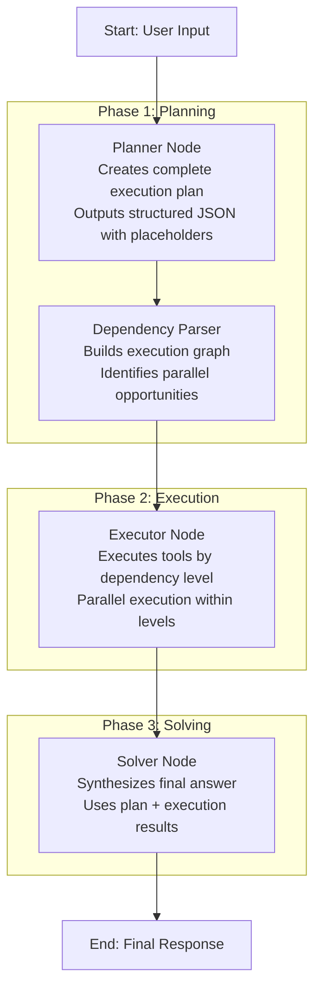
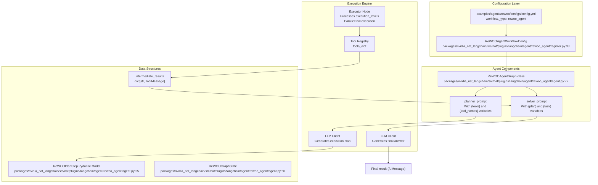
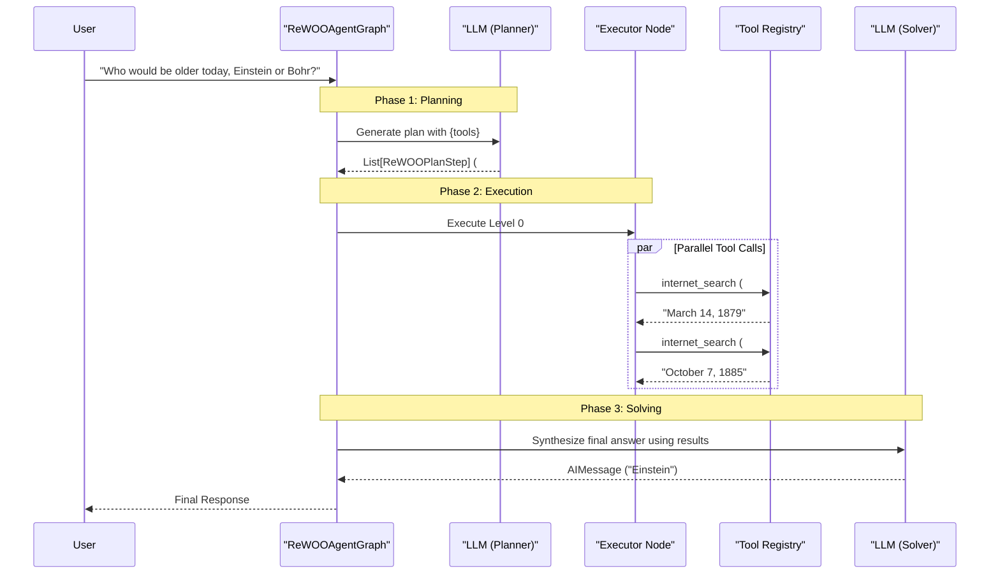

<!-- source: DeepWiki mcp.deepwiki.com · repo NVIDIA/NeMo-Agent-Toolkit · page 17.2 ReWOO Agent Example · fetched 2026-10-26 -->

# ReWOO Agent Example

<details>
<summary>Relevant source files</summary>

The following files were used as context for generating this wiki page:

- [examples/HITL/simple_calculator_hitl/README.md](examples/HITL/simple_calculator_hitl/README.md)
- [examples/MCP/simple_auth_mcp/README.md](examples/MCP/simple_auth_mcp/README.md)
- [examples/advanced_agents/alert_triage_agent/README.md](examples/advanced_agents/alert_triage_agent/README.md)
- [examples/agents/data/rewoo.json](examples/agents/data/rewoo.json)
- [examples/agents/rewoo/README.md](examples/agents/rewoo/README.md)
- [examples/evaluation_and_profiling/simple_calculator_eval/README.md](examples/evaluation_and_profiling/simple_calculator_eval/README.md)
- [examples/evaluation_and_profiling/simple_web_query_eval/README.md](examples/evaluation_and_profiling/simple_web_query_eval/README.md)
- [packages/nvidia_nat_langchain/src/nat/plugins/langchain/agent/react_agent/output_parser.py](packages/nvidia_nat_langchain/src/nat/plugins/langchain/agent/react_agent/output_parser.py)
- [packages/nvidia_nat_langchain/src/nat/plugins/langchain/agent/rewoo_agent/agent.py](packages/nvidia_nat_langchain/src/nat/plugins/langchain/agent/rewoo_agent/agent.py)
- [packages/nvidia_nat_langchain/tests/agent/test_rewoo.py](packages/nvidia_nat_langchain/tests/agent/test_rewoo.py)

</details>


This page provides a detailed technical walkthrough of the ReWOO (Reasoning Without Observation) agent example included in the NVIDIA NeMo Agent Toolkit. The example demonstrates the `rewoo_agent` workflow type, which implements a three-phase architecture separating planning, execution, and solving into distinct stages using calculator and internet search tools.

Sources: [examples/agents/rewoo/README.md:1-23](), [packages/nvidia_nat_langchain/src/nat/plugins/langchain/agent/rewoo_agent/agent.py:77-120]()

## Overview

The ReWOO agent example showcases an approach to agent reasoning where all planning is performed upfront before any tool execution begins. This contrasts with iterative agents like ReAct that interleave reasoning and observation. The example includes tools like `calculator` and `internet_search` to demonstrate multi-step reasoning requiring both mathematical computation and web research.

**Key Characteristics:**
- **Complexity Level**: Beginner [examples/agents/rewoo/README.md:20-20]()
- **Workflow Type**: `rewoo_agent` [examples/agents/rewoo/README.md:22-22]()
- **Execution Pattern**: Plan → Execute → Solve [examples/agents/rewoo/README.md:38-42]()

Sources: [examples/agents/rewoo/README.md:18-43]()

## ReWOO Three-Phase Architecture

The ReWOO agent implements a distinctive three-node graph architecture that separates concerns across planning, execution, and solving phases. The following diagrams illustrate the complete workflow architecture and map it to the underlying code entities.

### ReWOO Agent Execution Flow



Sources: [examples/agents/rewoo/README.md:44-59]()

### ReWOO Component Architecture (NL to Code Entity Space)

The following diagram bridges natural language concepts with concrete code entities and configuration properties in the codebase:



Sources: [examples/agents/rewoo/README.md:18-60](), [packages/nvidia_nat_langchain/src/nat/plugins/langchain/agent/rewoo_agent/agent.py:49-77]()

## Configuration

The ReWOO agent is configured through a YAML file located at `examples/agents/rewoo/configs/config.yml`.

### Configuration Schema

| Parameter | Type | Default | Description |
|-----------|------|---------|-------------|
| `tool_names` | `List[str]` | Required | List of tool names available to the agent [examples/agents/rewoo/README.md:91-91](). |
| `llm_name` | `str` | Required | Name of the LLM to use [examples/agents/rewoo/README.md:93-93](). |
| `verbose` | `bool` | `False` | When `True`, logs input, output, and intermediate steps [examples/agents/rewoo/README.md:95-95](). |
| `include_tool_input_schema_in_tool_description` | `bool` | `True` | Whether to include tool input schemas in tool descriptions [examples/agents/rewoo/README.md:97-97](). |
| `description` | `str` | `"ReWOO Agent Workflow"` | Description used when the agent is configured as a tool [examples/agents/rewoo/README.md:99-99](). |
| `planner_prompt` | `str` | Optional | Override for the planner prompt [examples/agents/rewoo/README.md:101-101](). |
| `solver_prompt` | `str` | Optional | Override for the solver prompt [examples/agents/rewoo/README.md:103-103](). |
| `tool_call_max_retries` | `int` | `3` | Number of retry attempts for tool calls [examples/agents/rewoo/README.md:105-105](). |
| `max_history` | `int` | `15` | Maximum number of messages in conversation history [examples/agents/rewoo/README.md:107-107](). |
| `log_response_max_chars` | `int` | `1000` | Max characters to display when logging tool responses [examples/agents/rewoo/README.md:109-109](). |
| `additional_planner_instructions` | `str` | `None` | Extra instructions for the planner [examples/agents/rewoo/README.md:111-111](). |
| `additional_solver_instructions` | `str` | `None` | Extra instructions for the solver [examples/agents/rewoo/README.md:113-113](). |
| `raise_tool_call_error` | `bool` | `True` | Whether to raise exceptions on tool call failures [examples/agents/rewoo/README.md:115-115](). |

Sources: [examples/agents/rewoo/README.md:85-115]()

## Installation and Setup

### Prerequisites

The ReWOO example requires the base NeMo Agent Toolkit installation plus example-specific dependencies:

```bash
uv pip install -e examples/agents
```

Sources: [examples/agents/rewoo/README.md:61-71]()

### API Key Configuration

Two API keys are required for the ReWOO example:

**NVIDIA API Key** (for LLM access):
```bash
export NVIDIA_API_KEY=<YOUR_API_KEY>
```

**Tavily API Key** (for internet search tool):
```bash
export TAVILY_API_KEY=<YOUR_TAVILY_API_KEY>
```

Sources: [examples/agents/rewoo/README.md:73-83]()

## Running the Example and Evaluation

### CLI Execution

Execute the workflow with a single input using the `nat run` command:

```bash
nat run --config_file=examples/agents/rewoo/configs/config.yml --input "Who would be older today, Einstein or Bohr?"
```

Sources: [examples/agents/rewoo/README.md:117-123]()

### Evaluation

The ReWOO example includes evaluation configurations and dataset definitions located in `examples/agents/data/rewoo.json`.

To run the evaluation:
```bash
nat eval --config_file=examples/agents/rewoo/configs/config.yml
```

Sources: [examples/agents/rewoo/README.md:34-34]()

## Example Execution Trace

The trace below demonstrates the ReWOO agent processing the query "Who would be older today, Einstein or Bohr?".

### Phase 1: Planning

The planner LLM generates a structured execution plan using `ReWOOPlanStep` models [packages/nvidia_nat_langchain/src/nat/plugins/langchain/agent/rewoo_agent/agent.py:55-58](). Plans are parsed into a Dependency Graph for parallel execution [examples/agents/rewoo/README.md:54-55](). The internal implementation uses `_parse_planner_output` and `_parse_planner_dependencies` to identify execution levels.

### Phase 2: Execution

**Level 0 Execution** (parallel):
- `#E1`: `internet_search` for Einstein's birthdate.
- `#E2`: `internet_search` for Bohr's birthdate.

Non-dependent tool calls are executed in parallel at each level [examples/agents/rewoo/README.md:55-55](). The `ReWOOGraphState` tracks `execution_levels` and `intermediate_results` [packages/nvidia_nat_langchain/src/nat/plugins/langchain/agent/rewoo_agent/agent.py:60-75](). The agent uses `_get_current_level_status` to manage the parallel tool call lifecycle [packages/nvidia_nat_langchain/src/nat/plugins/langchain/agent/rewoo_agent/agent.py:145-165]().

### Phase 3: Solving

The solver LLM synthesizes the final answer using the original task and all execution results [examples/agents/rewoo/README.md:56-56]().

Sources: [examples/agents/rewoo/README.md:53-57](), [packages/nvidia_nat_langchain/src/nat/plugins/langchain/agent/rewoo_agent/agent.py:55-75]()

### Execution Sequence Diagram



Sources: [examples/agents/rewoo/README.md:52-59](), [packages/nvidia_nat_langchain/src/nat/plugins/langchain/agent/rewoo_agent/agent.py:77-120]()

## Performance Characteristics

| Characteristic | ReWOO Behavior |
|---------------|----------------|
| **LLM Calls** | Fixed phases (Planner, Solver) [examples/agents/rewoo/README.md:38-39]() |
| **Tool Execution** | Parallel execution within dependency levels [examples/agents/rewoo/README.md:55-55]() |
| **Plan Stability** | No dynamic re-planning; deterministic execution [examples/agents/rewoo/README.md:40-40]() |
| **State Management** | Uses `ReWOOGraphState` to track `evidence_map` and `execution_levels` [packages/nvidia_nat_langchain/src/nat/plugins/langchain/agent/rewoo_agent/agent.py:60-75]() |

Sources: [examples/agents/rewoo/README.md:38-59](), [packages/nvidia_nat_langchain/src/nat/plugins/langchain/agent/rewoo_agent/agent.py:60-75]()

---

