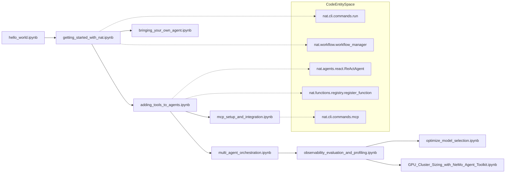
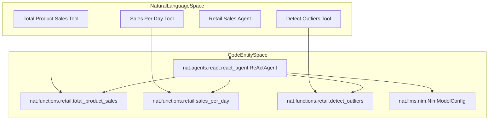
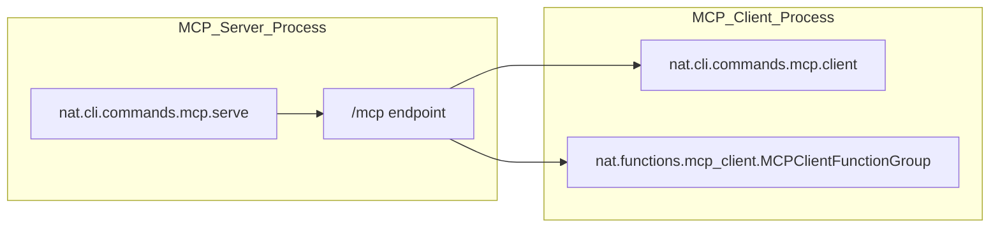
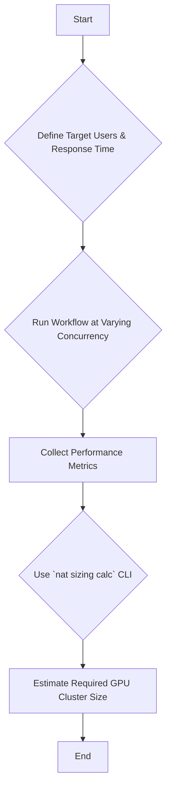

<!-- source: DeepWiki mcp.deepwiki.com · repo NVIDIA/NeMo-Agent-Toolkit · page 17.4 Notebook Tutorials · fetched 2026-10-26 -->

# Notebook Tutorials

<details>
<summary>Relevant source files</summary>

The following files were used as context for generating this wiki page:

- [.pre-commit-config.yaml](.pre-commit-config.yaml)
- [ci/release/update-version.sh](ci/release/update-version.sh)
- [docs/README.md](docs/README.md)
- [docs/source/versions1.json](docs/source/versions1.json)
- [examples/notebooks/README.md](examples/notebooks/README.md)
- [examples/notebooks/adding_tools_to_agents.ipynb](examples/notebooks/adding_tools_to_agents.ipynb)
- [examples/notebooks/bringing_your_own_agent.ipynb](examples/notebooks/bringing_your_own_agent.ipynb)
- [examples/notebooks/getting_started_with_nat.ipynb](examples/notebooks/getting_started_with_nat.ipynb)
- [examples/notebooks/hello_world.ipynb](examples/notebooks/hello_world.ipynb)
- [examples/notebooks/launchables/GPU_Cluster_Sizing_with_NeMo_Agent_Toolkit.ipynb](examples/notebooks/launchables/GPU_Cluster_Sizing_with_NeMo_Agent_Toolkit.ipynb)
- [examples/notebooks/mcp_setup_and_integration.ipynb](examples/notebooks/mcp_setup_and_integration.ipynb)
- [examples/notebooks/multi_agent_orchestration.ipynb](examples/notebooks/multi_agent_orchestration.ipynb)
- [examples/notebooks/observability_evaluation_and_profiling.ipynb](examples/notebooks/observability_evaluation_and_profiling.ipynb)
- [examples/notebooks/optimize_model_selection.ipynb](examples/notebooks/optimize_model_selection.ipynb)
- [examples/notebooks/pyproject.toml](examples/notebooks/pyproject.toml)
- [examples/notebooks/tests/test_notebooks_e2e.py](examples/notebooks/tests/test_notebooks_e2e.py)
- [packages/nvidia_nat_core/src/nat/meta/pypi.md](packages/nvidia_nat_core/src/nat/meta/pypi.md)

</details>


This page describes the Jupyter notebook tutorials included in the NVIDIA NeMo Agent Toolkit repository. These notebooks provide a hands-on, progressive introduction to the toolkit, covering installation, basic setup, multi-agent orchestration, observability, evaluation, profiling, and infrastructure sizing. They are located in `examples/notebooks/` and are designed to execute in standard Jupyter environments or Google Colab [examples/notebooks/README.md:18-33]().

Sources: [examples/notebooks/README.md:18-33]()

---

## Notebook Series Overview

The tutorial series consists of a linear progression of notebooks where each tutorial builds upon concepts established previously [examples/notebooks/README.md:24-31](). A separate standalone notebook handles GPU cluster sizing on dedicated hardware environments [examples/notebooks/launchables/GPU_Cluster_Sizing_with_NeMo_Agent_Toolkit.ipynb:7-13]().

**Pre-Commit Management:**
Repository notebooks utilize pre-commit hooks to purge output cells before committing changes, preventing oversized repository diffs [.pre-commit-config.yaml:50-55](). This mechanism is invoked via the `clear-notebook-output-cells` hook executing `ci/scripts/clear_notebook_output_cells.sh` [.pre-commit-config.yaml:50-55]().

### Learning Progression and Code Entity Mapping

Title: Notebook Learning Progression and Code Entity Mapping


Sources: [examples/notebooks/README.md:24-31](), [.pre-commit-config.yaml:50-55](), [examples/notebooks/getting_started_with_nat.ipynb:206-207]()

---

## Notebook Reference Table

| Notebook File | Introduced Concepts | Key Toolkit Features Used | Required API Keys |
|---|---|---|---|
| `hello_world.ipynb` | Minimal YAML workflow | `react_agent`, `wiki_search`, `nat run` [examples/notebooks/README.md:24]() | NVIDIA Build [examples/notebooks/getting_started_with_nat.ipynb:82-85]() |
| `getting_started_with_nat.ipynb` | Workflow structure, function registration | `nat workflow create`, `nat serve`, `run_workflow` [examples/notebooks/getting_started_with_nat.ipynb:206-207]() | NVIDIA Build [examples/notebooks/getting_started_with_nat.ipynb:82-85]() |
| `bringing_your_own_agent.ipynb` | Wrapping existing agents | `@register_function`, `FunctionBaseConfig`, `yield` [examples/notebooks/bringing_your_own_agent.ipynb:27-30]() | NVIDIA Build, Tavily [examples/notebooks/bringing_your_own_agent.ipynb:79-82]() |
| `adding_tools_to_agents.ipynb` | Custom tools, RAG retrieval | `@register_function`, `FunctionInfo`, LlamaIndex [examples/notebooks/README.md:27]() | NVIDIA Build [examples/notebooks/getting_started_with_nat.ipynb:82-85]() |
| `mcp_setup_and_integration.ipynb` | MCP server and client | `nat mcp serve`, `nat mcp client tool list` [examples/notebooks/README.md:28]() | NVIDIA Build [examples/notebooks/getting_started_with_nat.ipynb:82-85]() |
| `multi_agent_orchestration.ipynb` | Multi-agent systems, HITL | Router agent, sub-agents, `HumanPrompt` [examples/notebooks/multi_agent_orchestration.ipynb:52-57]() | NVIDIA Build [examples/notebooks/multi_agent_orchestration.ipynb:105-107]() |
| `observability_evaluation_and_profiling.ipynb` | Tracing, eval, profiling | Phoenix, `nat eval`, profiler plugin [examples/notebooks/observability_evaluation_and_profiling.ipynb:9-11]() | NVIDIA Build [examples/notebooks/observability_evaluation_and_profiling.ipynb:93-95]() |
| `optimize_model_selection.ipynb` | Model/prompt optimization | `nat optimize`, `nat eval`, LLM-as-a-judge [examples/notebooks/optimize_model_selection.ipynb:16-24]() | NVIDIA Build [examples/notebooks/optimize_model_selection.ipynb:100-102]() |
| `GPU_Cluster_Sizing_with_NeMo_Agent_Toolkit.ipynb` | Cluster sizing calculator | `nat sizing calc`, offline mode [examples/notebooks/launchables/GPU_Cluster_Sizing_with_NeMo_Agent_Toolkit.ipynb:7-11]() | NVIDIA NGC (optional) [examples/notebooks/launchables/GPU_Cluster_Sizing_with_NeMo_Agent_Toolkit.ipynb:7-13]() |

Sources: [examples/notebooks/README.md:24-31](), [examples/notebooks/getting_started_with_nat.ipynb:82-85](), [examples/notebooks/bringing_your_own_agent.ipynb:79-82]()

---

## Individual Notebook Details

### Hello World (`hello_world.ipynb`)

Executes a minimal configuration-only workflow via `nat run` [examples/notebooks/README.md:24]().

Sources: [examples/notebooks/README.md:24-25]()

---

### Getting Started (`getting_started_with_nat.ipynb`)

Covers the workflow development lifecycle using `nat workflow create` [examples/notebooks/getting_started_with_nat.ipynb:206-207](). Covers:

1. **Workflow Directory Structure** — generated `configs/`, `src/`, and `data/` layout [examples/notebooks/getting_started_with_nat.ipynb:223-228]().
2. **Configuration Schema** — top-level mapping keys: `general`, `llms`, `workflow`, `functions`, `embedders`, `retrievers`, `memory`, `object_stores`, `eval`, `authentication`, `tcc_strategies` [examples/notebooks/getting_started_with_nat.ipynb:202]().
3. **Function Registration** — decorator pattern using `@register_function` [examples/notebooks/getting_started_with_nat.ipynb:30]().
4. **Execution Interfaces** — `nat run` (CLI), `nat serve` (FastAPI), and embedded Python invocation [examples/notebooks/getting_started_with_nat.ipynb:33-35]().

Sources: [examples/notebooks/getting_started_with_nat.ipynb:1-228]()

---

### Adding Tools to Agents (`adding_tools_to_agents.ipynb`)

Extends workflow capabilities by integrating domain-specific tools over retail datasets [examples/notebooks/README.md:27]().

**Registered Tools:**
- `total_product_sales`: Aggregates units and revenue [examples/notebooks/observability_evaluation_and_profiling.ipynb:26]()
- `sales_per_day`: Temporal sales grouping [examples/notebooks/observability_evaluation_and_profiling.ipynb:27]()
- `detect_outliers`: Statistical anomaly detection [examples/notebooks/observability_evaluation_and_profiling.ipynb:28]()
- Catalog RAG retrieval tool [examples/notebooks/observability_evaluation_and_profiling.ipynb:29]()

### Retail Agent Data Flow and Code Entity Mapping

Title: Retail Agent Data Flow and Code Entity Mapping


Sources: [examples/notebooks/README.md:27](), [examples/notebooks/observability_evaluation_and_profiling.ipynb:26-30]()

---

### Bringing Your Own Agent (`bringing_your_own_agent.ipynb`)

Integrates external agents (e.g., LangChain `AgentExecutor`) into the toolkit architecture [examples/notebooks/bringing_your_own_agent.ipynb:11-14]().

**Migration Stages:**
1. **Workflow Function Conversion:** Wrap agent invocations inside a `@register_function`-decorated generator [examples/notebooks/bringing_your_own_agent.ipynb:27]().
2. **Configuration Binding:** Define custom configuration fields on a `FunctionBaseConfig` subclass [examples/notebooks/bringing_your_own_agent.ipynb:28]().
3. **Plugin Registration:** Expose via entry points in `pyproject.toml` [examples/notebooks/bringing_your_own_agent.ipynb:29]().
4. **Declarative YAML Instantiation:** Instantiate through `_type` parameters [examples/notebooks/bringing_your_own_agent.ipynb:30]().

Sources: [examples/notebooks/bringing_your_own_agent.ipynb:1-190]()

---

### MCP Setup and Integration (`mcp_setup_and_integration.ipynb`)

Demonstrates Model Context Protocol server and client interactions [examples/notebooks/README.md:28]().

**Server Integration:**
- Launches background server with `nat mcp serve` [examples/notebooks/README.md:28]().
- Lists exposed tools using `nat mcp client tool list` [examples/notebooks/README.md:28]().

**Client Integration:**
- Configures MCP client function groups within YAML [examples/notebooks/README.md:28]().

### MCP Communication Flow

Title: MCP Communication Flow Architecture


Sources: [examples/notebooks/README.md:28]()

---

### Multi-Agent Orchestration (`multi_agent_orchestration.ipynb`)

Illustrates the construction of multi-agent systems, including a supervisor agent that routes requests to specialized sub-agents [examples/notebooks/multi_agent_orchestration.ipynb:7-9](). This notebook demonstrates:

- **Mixture of Agents:** A supervisor agent routes queries to a data insight agent, a RAG agent, and a data visualization agent [examples/notebooks/multi_agent_orchestration.ipynb:52-57]().
- **Human-in-the-Loop (HITL):** Integration of human approval steps within the workflow [examples/notebooks/multi_agent_orchestration.ipynb:62]().
- **Multi-Framework Support:** Showcases the toolkit's ability to integrate agents from different frameworks [examples/notebooks/multi_agent_orchestration.ipynb:61]().

### Multi-Agent System Architecture

Title: Multi-Agent System Architecture

```mermaid
graph TD
    User["User Query"] --> SupervisorAgent["Supervisor Agent"]
    SupervisorAgent -- "Routes to" --> DataInsightAgent["Data Insight Agent"]
    SupervisorAgent -- "Routes to" --> RAGAgent["RAG Agent"]
    SupervisorAgent -- "Routes to" --> DataVisualizationAgent["Data Visualization Agent"]

    DataInsightAgent -- "Uses" --> SalesTools["Sales Data Tools"]
    RAGAgent -- "Uses" --> ProductCatalogRAG["Product Catalog RAG"]
    DataVisualizationAgent -- "Uses" --> PlottingTools["Plotting Tools"]
    DataVisualizationAgent -- "Requires" --> HITLApproval["Human-in-the-Loop Approval"]

    SalesTools --> "retail_sales_data.csv"
    ProductCatalogRAG --> "product_catalog.txt"
```
Sources: [examples/notebooks/multi_agent_orchestration.ipynb:1-63]()

---

### Observability, Evaluation, and Profiling (`observability_evaluation_and_profiling.ipynb`)

Covers three primary runtime assessment subsystems [examples/notebooks/observability_evaluation_and_profiling.ipynb:9-11]().

- **Observability:** Initializes Phoenix via `phoenix.launch_app()` and registers exporters in workflow telemetry configurations [examples/notebooks/observability_evaluation_and_profiling.ipynb:35-36]().
- **Evaluation:** Executes assessment benchmarks utilizing evaluators like `accuracy`, `groundedness`, and `relevance` [examples/notebooks/observability_evaluation_and_profiling.ipynb:40-43]().
- **Profiling:** Collects execution metrics via `nat eval` to detect bottlenecks [examples/notebooks/observability_evaluation_and_profiling.ipynb:45-48]().

Sources: [examples/notebooks/observability_evaluation_and_profiling.ipynb:1-50]()

---

### Model Selection and Optimization (`optimize_model_selection.ipynb`)

Automates parameter tuning and backbone selection [examples/notebooks/optimize_model_selection.ipynb:31]().

- **LLM-as-a-Judge:** Automated output critique pipelines [examples/notebooks/optimize_model_selection.ipynb:39]().
- **Genetic Optimizer:** Simultaneous tuning of prompts, models, and hyperparameters [examples/notebooks/optimize_model_selection.ipynb:23]().

Sources: [examples/notebooks/optimize_model_selection.ipynb:1-59]()

---

### GPU Cluster Sizing (`GPU_Cluster_Sizing_with_NeMo_Agent_Toolkit.ipynb`)

Estimates infrastructure requirements for target user concurrency and response latencies [examples/notebooks/launchables/GPU_Cluster_Sizing_with_NeMo_Agent_Toolkit.ipynb:7-9](). This notebook leverages the evaluation and profiling systems of the NeMo Agent Toolkit to perform these calculations [examples/notebooks/launchables/GPU_Cluster_Sizing_with_NeMo_Agent_Toolkit.ipynb:11]().

- **Metric Gathering:** Measures throughput across concurrency tiers [examples/notebooks/launchables/GPU_Cluster_Sizing_with_NeMo_Agent_Toolkit.ipynb:9]().
- **Sizing Calculation:** Computes required GPU count via the sizing calculator [examples/notebooks/launchables/GPU_Cluster_Sizing_with_NeMo_Agent_Toolkit.ipynb:9-11](). The `nat sizing calc` CLI command is used for this purpose [examples/notebooks/launchables/GPU_Cluster_Sizing_with_NeMo_Agent_Toolkit.ipynb:7-13]().

### GPU Cluster Sizing Process

Title: GPU Cluster Sizing Workflow Process


Sources: [examples/notebooks/launchables/GPU_Cluster_Sizing_with_NeMo_Agent_Toolkit.ipynb:1-184]()

---

### Versioning and Documentation Sync

The `update-version.sh` release script synchronizes package and documentation versions across the repository, updating notebook links and `versions1.json` [ci/release/update-version.sh:61-82]().

Sources: [ci/release/update-version.sh:1-83](), [docs/source/versions1.json:1-43]()

---

