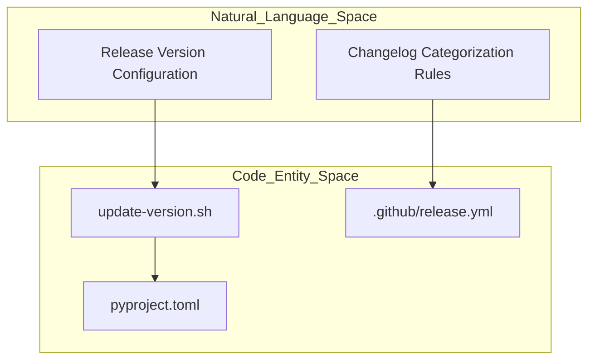
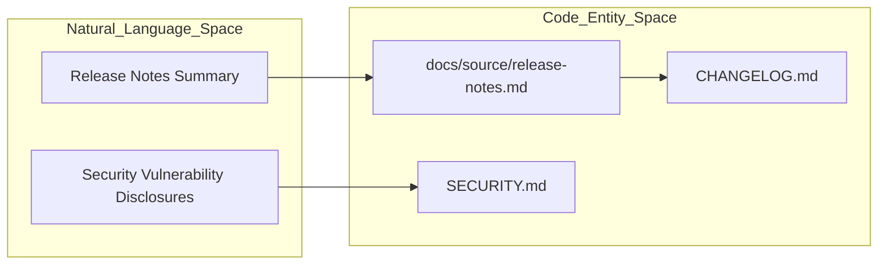

<!-- source: DeepWiki mcp.deepwiki.com · repo NVIDIA/NeMo-Agent-Toolkit · page 18 Reference · fetched 2026-10-26 -->

# Reference

Relevant source files

The following files were used as context for generating this wiki page:

- [.github/release.yml](.github/release.yml)
- [CHANGELOG.md](CHANGELOG.md)
- [SECURITY.md](SECURITY.md)
- [docs/source/build-workflows/about-building-workflows.md](docs/source/build-workflows/about-building-workflows.md)
- [docs/source/components/auth/api-authentication.md](docs/source/components/auth/api-authentication.md)
- [docs/source/extend/custom-components/memory.md](docs/source/extend/custom-components/memory.md)
- [docs/source/improve-workflows/profiler.md](docs/source/improve-workflows/profiler.md)
- [docs/source/release-notes.md](docs/source/release-notes.md)
- [docs/source/resources/security-considerations.md](docs/source/resources/security-considerations.md)
- [docs/source/run-workflows/observe/observe-workflow-with-mlflow.md](docs/source/run-workflows/observe/observe-workflow-with-mlflow.md)

This page serves as the parent reference section for the NVIDIA NeMo Agent Toolkit, providing high-level summaries of version history, release management, and versioning infrastructure. Detailed technical deep-dives are maintained in the child pages.

For details on the changelog, release notes, and feature evolution across versions v1.7.0–v1.9.0, see [Version History](#18.1) [CHANGELOG.md:21](), [docs/source/release-notes.md:18-37](). For details on versioning schemes, release scripts, and synchronization utilities, see [Version Management](#18.2) [CHANGELOG.md:37]().

## Overview and Version Architecture

The NeMo Agent Toolkit utilizes a standard semantic versioning approach (`major.minor.patch`) to track updates across meta-packages, optional dependencies, and framework adapters [CHANGELOG.md:21](). Version metadata, release categorization rules, and automated release configuration files coordinate version propagation across the codebase [CHANGELOG.md:18](), [.github/release.yml:16-40]().

**Diagram: Version Update Flow bridging natural language configurations to code-level metadata and release scripts [CHANGELOG.md:21](), [.github/release.yml:16-40]()**

**Sources:** [CHANGELOG.md:21](), [docs/source/release-notes.md:18-19](), [.github/release.yml:16-40]()

## Release and Health Management

Release stability is governed by structured release notes, security reporting workflows, and continuous integration checks [CHANGELOG.md:37](), [SECURITY.md:22-28](). Recent releases have introduced significant capabilities such as `HITLMiddleware` and `CircuitBreakerMiddleware`, alongside modularized optional plugin architectures [CHANGELOG.md:27-38](). Security vulnerabilities are managed via coordinated disclosure channels rather than public ticketing [SECURITY.md:22-28]().

**Diagram: Health and Release Management mapping documentation summaries and security reporting channels to codebase entities [docs/source/release-notes.md:18-37](), [SECURITY.md:22-41](), [CHANGELOG.md:18-40]()**

**Sources:** [CHANGELOG.md:18-40](), [docs/source/release-notes.md:1-39](), [SECURITY.md:22-41]()

## Related Child Pages

- **[Version History](#18.1)**: Review the complete changelog and release notes documenting features, improvements, and breaking changes (such as the removal of `local_sandbox` and introduction of `HITLMiddleware` and `CircuitBreakerMiddleware`) across v1.7.0–v1.9.0 [CHANGELOG.md:21-35](), [docs/source/release-notes.md:21-36]().
- **[Version Management](#18.2)**: Understand the versioning scheme, update scripts, migration guides for package simplification, and documentation synchronization workflows [CHANGELOG.md:37]().

---

**Sources:** [CHANGELOG.md:1-40](), [docs/source/release-notes.md:1-37](), [SECURITY.md:18-41](), [.github/release.yml:16-40]()

---

