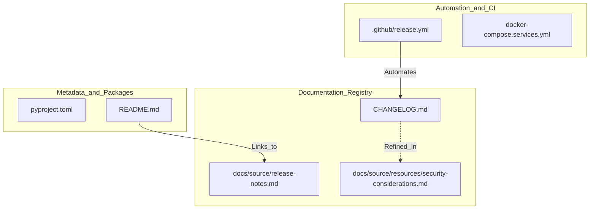
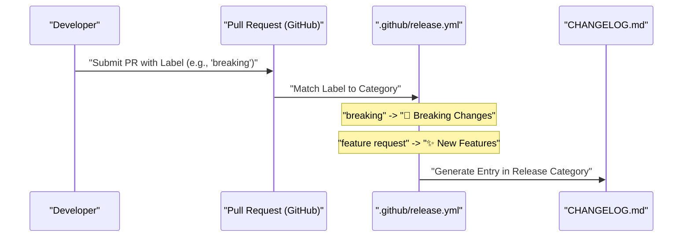
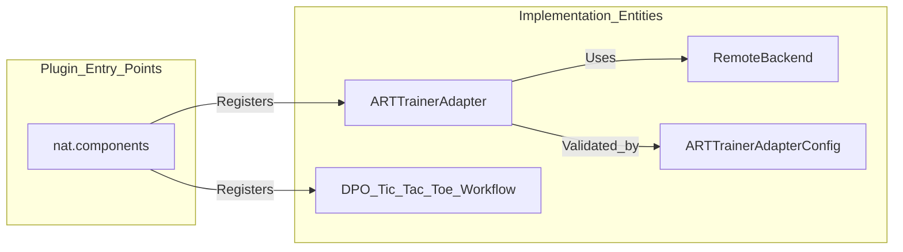

<!-- source: DeepWiki mcp.deepwiki.com · repo NVIDIA/NeMo-Agent-Toolkit · page 18.1 Version History · fetched 2026-10-26 -->

# Version History

Relevant source files

The following files were used as context for generating this wiki page:

- [.github/release.yml](.github/release.yml)
- [CHANGELOG.md](CHANGELOG.md)
- [SECURITY.md](SECURITY.md)
- [docs/source/build-workflows/about-building-workflows.md](docs/source/build-workflows/about-building-workflows.md)
- [docs/source/components/auth/api-authentication.md](docs/source/components/auth/api-authentication.md)
- [docs/source/extend/custom-components/memory.md](docs/source/extend/custom-components/memory.md)
- [docs/source/improve-workflows/profiler.md](docs/source/improve-workflows/profiler.md)
- [docs/source/release-notes.md](docs/source/release-notes.md)
- [docs/source/resources/security-considerations.md](docs/source/resources/security-considerations.md)
- [docs/source/run-workflows/observe/observe-workflow-with-mlflow.md](docs/source/run-workflows/observe/observe-workflow-with-mlflow.md)

This page documents the version tracking, release history, and changelog system of the NVIDIA NeMo Agent Toolkit. It covers how versions are numbered, key features introduced in recent releases (v1.7.0–v1.9.0), and the mechanisms used to synchronize version information across the codebase and documentation.

## Purpose and Scope

The NVIDIA NeMo Agent Toolkit follows a structured versioning approach to manage releases and maintain documentation across multiple versions. This page serves as a reference for:

- Understanding the semantic versioning scheme used by the toolkit [CHANGELOG.md:18-21]().
- Reviewing the changelog for the latest stable releases (**v1.9.0**, **v1.8.0**, and **v1.7.0**) [CHANGELOG.md:21](), [docs/source/release-notes.md:18-37]().
- Locating version information and release notes within the codebase [CHANGELOG.md:1-25](), [docs/source/release-notes.md:1-39]().
- Accessing documentation for specific toolkit versions [docs/source/release-notes.md:18-20]().

Sources: [CHANGELOG.md:18-21](), [docs/source/release-notes.md:18-39]()

## Release 1.9.0

The 1.9.0 release introduces major middleware enhancements (`HITLMiddleware`, `CircuitBreakerMiddleware`), MLflow OTLP telemetry exporting, LangChain runnable callback tracking, and important security and identity resolution updates [CHANGELOG.md:21-35](), [docs/source/release-notes.md:21-35]().

### 🚀 Notable Features, Improvements, and Breaking Changes

| Change Type | Feature / Change | Implementation Detail & Code Reference |
| :--- | :--- | :--- |
| **Breaking Change** | Removal of `local_sandbox` | Removed from runtime execution modules [CHANGELOG.md:23]() (`dagardner-nv`, PR #2194). |
| **Breaking Change** | User ID Parameter Isolation | Prevents exposing the `user_id` parameter directly to the LLM [CHANGELOG.md:24]() (`dagardner-nv`, PR #2190). |
| **Breaking Change** | Improved User Identity Resolution | Enhanced mechanisms for resolving user identities [CHANGELOG.md:25]() (`dagardner-nv`, PR #2197). |
| **New Feature** | `HITLMiddleware` | Added for human-in-the-loop function interception and approval flows [CHANGELOG.md:27]() (`ericevans-nv`, PR #2060). |
| **New Feature** | `CircuitBreakerMiddleware` | Added for tool fault tolerance during runtime execution [CHANGELOG.md:35]() (`sankhyanreyansh`, PR #2158). |
| **New Feature** | Preflight Authentication | Enabled preflight authentication for applicable authentication providers [CHANGELOG.md:28]() (`ericevans-nv`, PR #2078). |
| **New Feature** | LangChain Runnable Tracking | Tracks LangChain Runnable callbacks for enhanced telemetry [CHANGELOG.md:29]() (`WilliamK112`, PR #2100). |
| **New Feature** | MLflow OTLP Exporter | Added MLflow OTLP telemetry exporter, documentation, and example [CHANGELOG.md:30]() (`EnesYilmazcode`, PR #2112). This allows sending OpenTelemetry traces to an MLflow tracking server [docs/source/run-workflows/observe/observe-workflow-with-mlflow.md:19-20](). |
| **New Feature** | Export Runtime Context and Interactive HITL Models | Exports runtime context and interactive HITL models for plugin API [CHANGELOG.md:31]() (`DABH`, PR #2113). |
| **New Feature** | Opt-in Provider Hooks for IDs/Timestamps | Added opt-in provider hooks for generated IDs and timestamps [CHANGELOG.md:32]() (`DABH`, PR #2114). |
| **New Feature** | Export Interactive Prompt Content Models | Exports the interactive prompt content models for plugin API [CHANGELOG.md:33]() (`DABH`, PR #2145). |
| **New Feature** | Route Interaction Prompt IDs/Timestamps | Routes interaction prompt IDs and timestamps via providers [CHANGELOG.md:34]() (`DABH`, PR #2144). |
| **Improvement** | Optional Extras for LangChain | Split provider integrations into optional extras [CHANGELOG.md:38]() (`marcusds`, PR #1989). |
| **Improvement** | Configurable JobStore Pooling | Made `JobStore` connection pooling configurable [CHANGELOG.md:47]() (`jonthedecepticon`, PR #2150). |
| **Improvement** | Cache Middleware Bounding | Bounded cache size and enforced safe fuzzy threshold for `CacheMiddleware` [CHANGELOG.md:43]() (`ColinM-sys`, PR #1879). |
| **Improvement** | Content Safety Guard Handling | Improved content safety guard result handling [CHANGELOG.md:48]() (`ericevans-nv`, PR #2180). |
| **Improvement** | `output_verifier_tools` `fail_closed` config | Added a new boolean config `fail_closed` to `output_verifier_tools` [CHANGELOG.md:49]() (`dagardner-nv`, PR #2187). |
| **Improvement** | WebSocket Conversation Reconnection | Bound conversation reconnection to user identity for WebSockets [CHANGELOG.md:50]() (`ericevans-nv`, PR #2189). |
| **Improvement** | Configure WebSocket Identity Credentials | Added configuration for WebSocket identity credentials [CHANGELOG.md:52]() (`ericevans-nv`, PR #2196). |
| **Bug Fix** | OpenAI Chat Completions Tool-Call History Validation | Fixed validation for OpenAI chat completions tool-call history [CHANGELOG.md:56]() (`yczhang-nv`, PR #2077). |
| **Bug Fix** | LangChain `react_agent` Model Honoring | Ensured `ChatRequest.model` is honored in LangChain `react_agent` workflows [CHANGELOG.md:63]() (`marcusds`, PR #2036). |
| **Bug Fix** | `lru_cache` Memory Leaks | Resolved `lru_cache` memory leaks in `DiscoveryMetadata` and other components [CHANGELOG.md:64](), [CHANGELOG.md:68]() (`pranaysb`, PR #2105, PR #2118). |
| **Bug Fix** | MCP Client Recovery | Fixed recovery of the MCP client when the lifecycle worker dies [CHANGELOG.md:70]() (`Hokonoken`, PR #2121). |
| **Bug Fix** | LangChain `conversation_id` as `LangGraph thread_id` | Passed `conversation_id` as `LangGraph thread_id` [CHANGELOG.md:73]() (`Rahulreddy1020`, PR #2074). |

Sources: [CHANGELOG.md:21-75](), [docs/source/release-notes.md:21-37](), [docs/source/run-workflows/observe/observe-workflow-with-mlflow.md:19-20]()

## Release 1.8.0 (2026-06-16)

The 1.8.0 release introduces NeMo Guardrails support, experimental coding-agent adapters, Microsoft Agent 365 integration, and public plugin API stabilization [CHANGELOG.md:21-26]().

### 🚀 Notable Features and Improvements

| Feature | Description | Implementation Detail |
| :--- | :--- | :--- |
| **NeMo Guardrails** | Integration for input/output policy enforcement. | Added `NeMo Guardrails` policy middleware [CHANGELOG.md:23](), [CHANGELOG.md:29](). |
| **Coding-Agent Adapters** | Experimental adapters with NeMo-Relay telemetry. | Integration for external coding agents (Claude Code, Hermes, etc.) [CHANGELOG.md:35](). |
| **Microsoft Agent 365** | Integration plugin for Teams and Azure Bot. | Added `nvidia-nat-a365` package [docs/source/release-notes.md:31](), [CHANGELOG.md:34](). |
| **Public Plugin API** | Stabilized API for third-party tools. | Support for `nemo-agent-toolkit-tavily`, `nemo-agent-toolkit-redis`, and `nemo-agent-toolkit-atr` [CHANGELOG.md:45](). |

### 🚨 Breaking Changes & Migration

- **NeMo Guardrails Middleware:** Added policy middleware that may enforce `is_final` constraints and `call_next` suppression [CHANGELOG.md:29](), [CHANGELOG.md:32]().
- **Tavily Search Migration:** Support moved from core to the provider-managed `nemo-agent-toolkit-tavily` package [CHANGELOG.md:45]().
- **YAML Interpolation:** Bare `$VAR` is no longer supported; use braced form `${VAR}` for environment variable substitution.

Sources: [docs/source/release-notes.md:26-36](), [CHANGELOG.md:21-76]()

## Release 1.7.0 (2026-05-21)

The 1.7.0 release focuses on AI coding agent skills, package requirements, and telemetry enhancements [CHANGELOG.md:83-87]().

### 🚀 Notable Features and Improvements

| Feature | Description | Implementation Detail |
| :--- | :--- | :--- |
| **AI Coding Agent Skills** | Guidance for building and evaluating workflows. | Skill definitions for Cursor in `skills/` [CHANGELOG.md:85](). |
| **CLI Telemetry** | Consent-gated runtime telemetry for CLI. | Added to CLI commands for usage insights [CHANGELOG.md:86](). |

### 🚨 Breaking Changes & Migration

- **OpenAI 2.x Migration:** The toolkit now requires `openai >= 2.x` [CHANGELOG.md:89]().
- **Vanna Removal:** The `nvidia-nat-vanna` integration package has been removed [CHANGELOG.md:92]().

Sources: [CHANGELOG.md:83-95]()

## Versioning Scheme

The toolkit uses **semantic versioning** with the format `MAJOR.MINOR.PATCH` [CHANGELOG.md:18-21]().

### Version Formats

| Format | Example | Usage |
| :--- | :--- | :--- |
| **Full Version** | `1.9.0` | Python package versions, Git tags [CHANGELOG.md:21](). |
| **Short Version** | `1.9` | Documentation URLs, version switcher [docs/source/release-notes.md:21](). |
| **Nightly Build** | `1.9.0a20260521` | Alpha releases with YYYYMMDD datestamp [CHANGELOG.md:18-21](). |

Sources: [CHANGELOG.md:18-21](), [docs/source/release-notes.md:21]()

## Version Information Locations

The toolkit synchronizes versioning across package metadata, documentation indices, and tutorials using automated systems.

### Code-to-System Mapping

The following diagram bridges the natural language concepts of "Version Management" to the specific code entities and files responsible for tracking and updating them.

Toolkit Versioning Architecture

Sources: [CHANGELOG.md:18-80](), [docs/source/release-notes.md:18-33](), [.github/release.yml:16-40]()

### Release Labeling Flow

The toolkit uses a GitHub-integrated release labeling flow to categorize pull requests into changelog sections automatically via `.github/release.yml` [.github/release.yml:16-40]().

Release Categorization Pipeline

Sources: [CHANGELOG.md:19-21](), [.github/release.yml:16-40]()

## Advanced Finetuning and Plugin Evolution

Recent versions introduced specialized plugins for training and preference learning. The `nvidia-nat-openpipe-art` package provides the `ARTTrainerAdapter` class for reinforcement learning workflows. This package uses the `nat.components` entry point for discovery.

Additionally, the toolkit supports **Direct Preference Optimization (DPO)** using NeMo Customizer, as demonstrated in the Tic-Tac-Toe example. This workflow involves generating preference pairs (Chosen vs. Rejected responses) using a Test Time Compute (TTC) pipeline.

### Plugin Component Registry
The diagram below illustrates how finetuning adapters and components are registered and utilized within the toolkit's plugin system, linking natural language domain concepts to code entities.

Finetuning Plugin Architecture

Sources: [CHANGELOG.md:21-50]()

### Key Files

#### 1. Changelog (`CHANGELOG.md`)
The authoritative log of all notable changes, categorized by release version and change type (Breaking, Features, Improvements, Bug Fixes) [CHANGELOG.md:18-21]().

#### 2. Release Notes (`docs/source/release-notes.md`)
Human-readable summaries of major releases, highlighting key themes and known issues [docs/source/release-notes.md:18-37]().

#### 3. Security and Migration Guides (`docs/source/resources/security-considerations.md`)
Detailed instructions and security considerations for moving between versions, covering package renames, API removals, and environment variable interpolation changes.

Sources: [CHANGELOG.md:18-21](), [docs/source/release-notes.md:18-37](), [docs/source/resources/security-considerations.md:1-30]()

## Version Synchronization and Quality Control

Consistency is maintained through CI/CD pipelines and dependency management tools. The project enforces version ranges for critical dependencies and ensures external plugins are correctly integrated via the `nat.plugin_api` [CHANGELOG.md:52]().

### Plugin and Distribution Integrity
The packaging process ensures that core plugin APIs are shipped correctly within the `nvidia-nat-core` wheel to support the modular plugin architecture [CHANGELOG.md:52]().

Sources: [CHANGELOG.md:43-67]()

---

