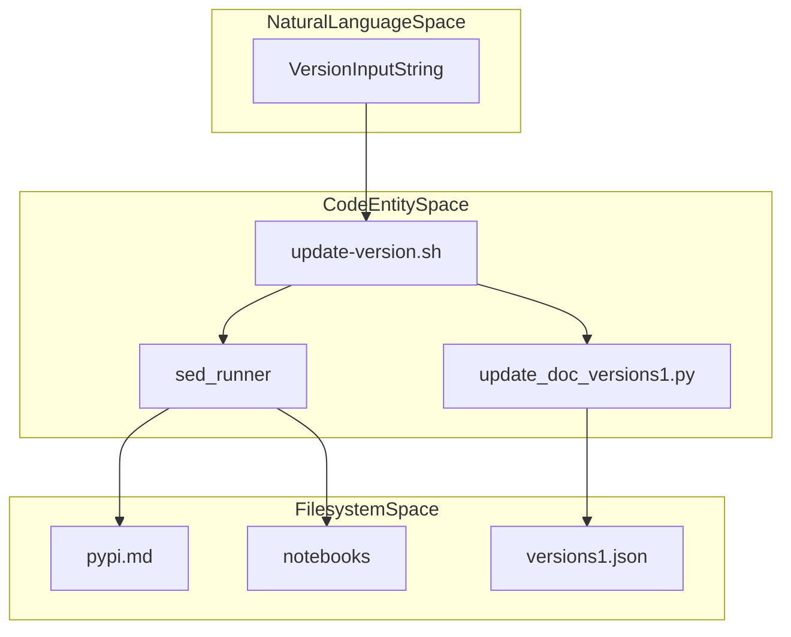
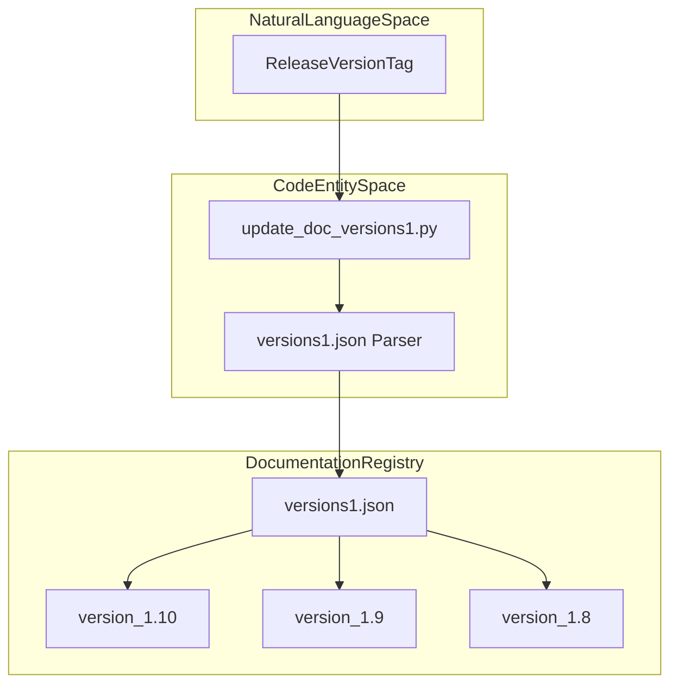

<!-- source: DeepWiki mcp.deepwiki.com · repo NVIDIA/NeMo-Agent-Toolkit · page 18.2 Version Management · fetched 2026-10-26 -->

# Version Management

Relevant source files

The following files were used as context for generating this wiki page:

- [.pre-commit-config.yaml](.pre-commit-config.yaml)
- [ci/release/update-version.sh](ci/release/update-version.sh)
- [docs/README.md](docs/README.md)
- [docs/source/build-workflows/embedders.md](docs/source/build-workflows/embedders.md)
- [docs/source/improve-workflows/finetuning/dpo_with_nemo_customizer.md](docs/source/improve-workflows/finetuning/dpo_with_nemo_customizer.md)
- [docs/source/resources/migration-guide.md](docs/source/resources/migration-guide.md)
- [docs/source/versions1.json](docs/source/versions1.json)
- [examples/finetuning/dpo_tic_tac_toe/README.md](examples/finetuning/dpo_tic_tac_toe/README.md)
- [examples/finetuning/rl_with_openpipe_art/README.md](examples/finetuning/rl_with_openpipe_art/README.md)
- [examples/finetuning/rl_with_openpipe_art/pyproject.toml](examples/finetuning/rl_with_openpipe_art/pyproject.toml)
- [examples/finetuning/rl_with_openpipe_art/src/rl_with_openpipe_art/configs/config.yml](examples/finetuning/rl_with_openpipe_art/src/rl_with_openpipe_art/configs/config.yml)
- [examples/finetuning/rl_with_openpipe_art/src/rl_with_openpipe_art/configs/config_post_train.yml](examples/finetuning/rl_with_openpipe_art/src/rl_with_openpipe_art/configs/config_post_train.yml)
- [examples/finetuning/rl_with_openpipe_art/src/rl_with_openpipe_art/llm_agents.py](examples/finetuning/rl_with_openpipe_art/src/rl_with_openpipe_art/llm_agents.py)
- [examples/finetuning/rl_with_openpipe_art/src/rl_with_openpipe_art/rl_with_openpipe_art.py](examples/finetuning/rl_with_openpipe_art/src/rl_with_openpipe_art/rl_with_openpipe_art.py)
- [examples/notebooks/getting_started_with_nat.ipynb](examples/notebooks/getting_started_with_nat.ipynb)
- [examples/notebooks/launchables/GPU_Cluster_Sizing_with_NeMo_Agent_Toolkit.ipynb](examples/notebooks/launchables/GPU_Cluster_Sizing_with_NeMo_Agent_Toolkit.ipynb)
- [examples/notebooks/observability_evaluation_and_profiling.ipynb](examples/notebooks/observability_evaluation_and_profiling.ipynb)
- [packages/nvidia_nat_core/src/nat/meta/pypi.md](packages/nvidia_nat_core/src/nat/meta/pypi.md)
- [packages/nvidia_nat_openpipe_art/pyproject.toml](packages/nvidia_nat_openpipe_art/pyproject.toml)
- [packages/nvidia_nat_openpipe_art/src/nat/plugins/openpipe/config.py](packages/nvidia_nat_openpipe_art/src/nat/plugins/openpipe/config.py)
- [packages/nvidia_nat_openpipe_art/src/nat/plugins/openpipe/remote_backend.py](packages/nvidia_nat_openpipe_art/src/nat/plugins/openpipe/remote_backend.py)
- [packages/nvidia_nat_openpipe_art/src/nat/plugins/openpipe/trainer_adapter.py](packages/nvidia_nat_openpipe_art/src/nat/plugins/openpipe/trainer_adapter.py)
- [packages/nvidia_nat_openpipe_art/tests/conftest.py](packages/nvidia_nat_openpipe_art/tests/conftest.py)
- [packages/nvidia_nat_openpipe_art/tests/test_trainer_adapter.py](packages/nvidia_nat_openpipe_art/tests/test_trainer_adapter.py)

## Purpose and Scope

Version Management encompasses the technical infrastructure for maintaining consistency across the toolkit's meta-packages, documentation registry, and release artifacts. This includes automated scripts for metadata updates, the JSON-based documentation registry, and structured migration paths for backward compatibility.

Sources: [ci/release/update-version.sh:1-22](), [docs/source/resources/migration-guide.md:18-23]()

## Versioning Scheme

The NeMo Agent Toolkit utilizes a structured versioning approach to manage its multi-package architecture.

### Semantic Versioning and Tags

Versions follow the semantic pattern `<major>.<minor>.<patch>` [ci/release/update-version.sh:17-21]().

| Format | Pattern | Entity | Example |
| :--- | :--- | :--- | :--- |
| **Full Version** | `<major>.<minor>.<patch>` | Git Tags, Python Wheels, PyPI | `1.10.0` |
| **Short Tag** | `<major>.<minor>` | Documentation URLs, Version Registry | `1.10` |
| **Nightly** | `<tag>a<YYYYMMDD>` | Development builds, Test packages | `v1.10.0a20250821` |

The toolkit extracts these components using `awk` to ensure consistency when updating documentation links [ci/release/update-version.sh:37-40]().

Sources: [ci/release/update-version.sh:17-40]()

### Version Determination Logic

The system relies on environment variables and Git state to determine the correct version string during the build process.

*   **Version Components**: The `update-version.sh` script splits the input version into `NEXT_MAJOR`, `NEXT_MINOR`, and `NEXT_PATCH` [ci/release/update-version.sh:37-39]().
*   **Short Tag Generation**: A `NEXT_SHORT_TAG` is derived as `<major>.<minor>` for documentation routing [ci/release/update-version.sh:40]().
*   **Version Matching**: The script supports two matching modes: exact (`==`) for full versions or compatible (`~=`) for short tags, depending on the `USE_FULL_VERSION` flag [ci/release/update-version.sh:66-72]().

Sources: [ci/release/update-version.sh:37-72]()

## Version Update Process

### Automated Version Propagation

The `update-version.sh` script is the central tool for synchronizing version strings across the repository's disparate file types.

Title: "Version Propagation Architecture"

Sources: [ci/release/update-version.sh:32-82]()

### The update-version.sh Script
Located at `ci/release/update-version.sh`, this script performs the following actions:
1. **Validation**: Ensures the input follows the three-part semantic versioning format [ci/release/update-version.sh:17-30]().
2. **Metadata Update**: Uses a cross-platform `sed_runner` to update documentation URLs in `pypi.md` [ci/release/update-version.sh:56-59]().
3. **Notebook Synchronization**: Scans the `examples/notebooks/` directory using `find` to update version-specific links within Jupyter Notebooks [ci/release/update-version.sh:61-64]().
4. **Registry Update**: Calls `update_doc_versions1.py` to add the new version to the documentation dropdown menu registry [ci/release/update-version.sh:77-82]().

Sources: [ci/release/update-version.sh:1-83]()

## Migration Guide

The migration guide outlines breaking changes and migration paths across toolkit versions, ensuring smooth upgrades for production deployments [docs/source/resources/migration-guide.md:18-23]().

### Version-Specific Changes

#### v1.9.0: Redis Package Migration
Redis memory and object store support moved from the in-repository `nvidia-nat-redis` implementation to the Redis-maintained `nemo-agent-toolkit-redis` package [docs/source/resources/migration-guide.md:30-35]().
*   The `nvidia-nat[redis]` extra and historical distribution names remain as compatibility wrappers [docs/source/resources/migration-guide.md:36]().
*   New projects should install directly: `pip install nemo-agent-toolkit-redis` [docs/source/resources/migration-guide.md:38-42]().
*   Requires `redis>=5.0.0,<6.0.0` [docs/source/resources/migration-guide.md:54]().

#### v1.8.0: Tavily Internet Search & YAML Interpolation (Breaking)
*   **Tavily Search**: Moved from `nvidia-nat[langchain]` to `nemo-agent-toolkit-tavily` [docs/source/resources/migration-guide.md:58-61](). Configs must migrate from `_type: tavily_internet_search` to a `function_group` with `_type: tavily` [docs/source/resources/migration-guide.md:62-84]().
*   **Environment Variable Interpolation**: Bare `$VAR` is no longer supported in workflow YAML files; use braced `${VAR}` or `${VAR:-default}` [docs/source/resources/migration-guide.md:88-99]().

#### v1.6.0: User Identity Resolution & Evaluator Package Split
*   **User Identity**: User IDs are now deterministic UUID v5 hashes derived from credentials, adhering to RFC 7519 precedence (`sub > email > preferred_username`) [docs/source/resources/migration-guide.md:103-108]().
*   **Evaluator Split**: Built-in evaluators (`trajectory`, `ragas`, performance metrics) moved to dedicated packages (`nvidia-nat-langchain`, `nvidia-nat-ragas`, `nvidia-nat-profiler`) [docs/source/resources/migration-guide.md:111-122]().

Sources: [docs/source/resources/migration-guide.md:30-132]()

## Documentation Synchronization

### Documentation Registry
The file `docs/source/versions1.json` serves as the source of truth for the documentation version switcher, mapping version strings (e.g., `"1.10"`) to URLs and marking the preferred version [docs/source/versions1.json:1-47]().

Title: "Documentation Registry Routing"

Sources: [docs/source/versions1.json:1-47](), [ci/release/update-version.sh:77-82]()

### Version-Specific Links in Metadata
The toolkit maintains documentation links in `packages/nvidia_nat_core/src/nat/meta/pypi.md`, which are updated automatically during releases to point to the correct version documentation on `docs.nvidia.com` [ci/release/update-version.sh:56-59]().

Sources: [ci/release/update-version.sh:56-59](), [packages/nvidia_nat_core/src/nat/meta/pypi.md:1-20]()

---

