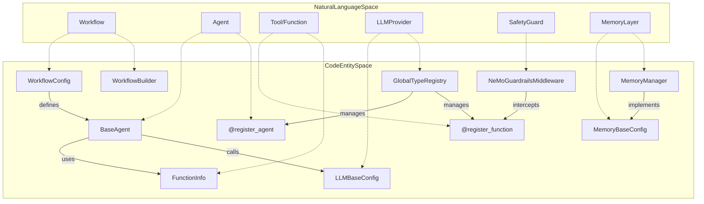
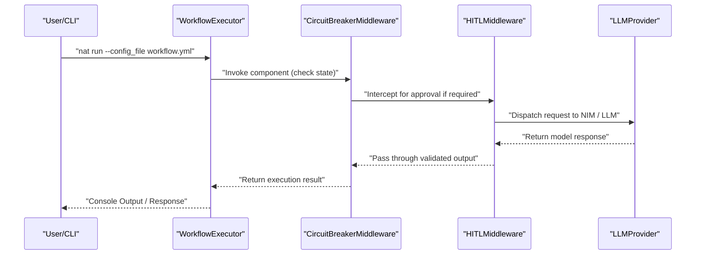

<!-- source: DeepWiki mcp.deepwiki.com · repo NVIDIA/NeMo-Agent-Toolkit · page 19 Glossary · fetched 2026-10-26 -->

# Glossary

Relevant source files

The following files were used as context for generating this wiki page:

- [.github/release.yml](.github/release.yml)
- [CHANGELOG.md](CHANGELOG.md)
- [README.md](README.md)
- [SECURITY.md](SECURITY.md)
- [ci/markdown-link-check-config.json](ci/markdown-link-check-config.json)
- [ci/scripts/path_checks.py](ci/scripts/path_checks.py)
- [ci/vale/styles/config/vocabularies/nat/accept.txt](ci/vale/styles/config/vocabularies/nat/accept.txt)
- [docs/Makefile](docs/Makefile)
- [docs/source/build-workflows/about-building-workflows.md](docs/source/build-workflows/about-building-workflows.md)
- [docs/source/build-workflows/memory.md](docs/source/build-workflows/memory.md)
- [docs/source/components/agents/auto-memory-wrapper/auto-memory-wrapper.md](docs/source/components/agents/auto-memory-wrapper/auto-memory-wrapper.md)
- [docs/source/components/auth/api-authentication.md](docs/source/components/auth/api-authentication.md)
- [docs/source/components/integrations/index.md](docs/source/components/integrations/index.md)
- [docs/source/components/integrations/integrating-oci-generative-ai-models.md](docs/source/components/integrations/integrating-oci-generative-ai-models.md)
- [docs/source/conf.py](docs/source/conf.py)
- [docs/source/extend/custom-components/memory.md](docs/source/extend/custom-components/memory.md)
- [docs/source/improve-workflows/profiler.md](docs/source/improve-workflows/profiler.md)
- [docs/source/index.md](docs/source/index.md)
- [docs/source/release-notes.md](docs/source/release-notes.md)
- [docs/source/resources/security-considerations.md](docs/source/resources/security-considerations.md)
- [docs/source/run-workflows/observe/observe-workflow-with-mlflow.md](docs/source/run-workflows/observe/observe-workflow-with-mlflow.md)
- [examples/README.md](examples/README.md)
- [examples/agents/auto_memory_wrapper/README.md](examples/agents/auto_memory_wrapper/README.md)
- [examples/memory/memanto/README.md](examples/memory/memanto/README.md)
- [packages/nvidia_nat_langchain/src/nat/plugins/langchain/agent/auto_memory_wrapper/agent.py](packages/nvidia_nat_langchain/src/nat/plugins/langchain/agent/auto_memory_wrapper/agent.py)

This page provides technical definitions for codebase-specific terms, jargon, abbreviations, and domain concepts used throughout the NVIDIA NeMo Agent Toolkit (NAT). It serves as an onboarding reference mapping high-level concepts and natural language terminology to their concrete implementations and code entities within the codebase.

## Purpose and Scope

The scope of this glossary covers all core subpackages, plugins, architectural middleware patterns, telemetry formats, and integrations (v1.7.0 through v1.9.0). It is targeted at software engineers and technical contributors seeking precise definitions and code pointers for system entities.

Sources: [README.md:40-64](), [docs/source/release-notes.md:18-39]()

## Core System Entities and Component Mappings

The NeMo Agent Toolkit uses a plugin-based architecture and Builder pattern to map declarative configurations to executable Python components.

### Natural Language to Code Entity Mapping

The following diagram bridges conceptual terms used in user documentation to their concrete classes and registration decorators in the source code.

**Concept to Code Mapping**

Sources: [CHANGELOG.md:21-75](), [docs/source/index.md:20-72]()

### Definitions Table

| Term | Definition | Code Pointer |
| :--- | :--- | :--- |
| **NAT** | **NVIDIA NeMo Agent Toolkit**: The unifying library providing framework-agnostic agent orchestration, profiling, and observability. | [README.md:20-38]() |
| **Workflow** | High-level orchestration logic defining how agents, tools, and LLMs interact to fulfill tasks. | [docs/source/build-workflows/about-building-workflows.md:20-22]() |
| **Builder** | Design pattern used to instantiate complex components (LLMs, Agents) from configurations via a global registry. | [packages/nvidia_nat_core/src/nat/builder/context.py:42-52]() |
| **Registry** | Global mapping of string identifiers to Python classes or factory functions using plugin entry points. | [packages/nvidia_nat_core/src/nat/builder/context.py:42-52]() |
| **HITLMiddleware** | Human-In-The-Loop middleware introduced in v1.9.0 that intercepts function execution for user review and approval. | [CHANGELOG.md:23-27]() |
| **CircuitBreakerMiddleware** | Middleware protecting agent pipelines from cascading failures by isolating failing components through `CLOSED`, `OPEN`, and `HALF_OPEN` states. | [CHANGELOG.md:31-35]() |

Sources: [README.md:20-38](), [CHANGELOG.md:21-35](), [docs/source/build-workflows/about-building-workflows.md:20-22](), [packages/nvidia_nat_core/src/nat/builder/context.py:42-52]()

## Domain Concepts and Key Terminology

### Architecture and Interoperability
*   **NeMo Relay:** A telemetry bridge that ingests and normalizes traces from external coding agents into the native NAT observability pipeline.
*   **A365 (Microsoft Agent 365):** The `nvidia-nat-a365` integration package enabling NAT workflows to deploy as enterprise bots in Microsoft Teams and Azure Bot Service. [ci/scripts/path_checks.py:138-141]()
*   **NeMo Guardrails:** Policy-driven safety layer that enforces input and output validation rails at function boundaries. [ci/vale/styles/config/vocabularies/nat/accept.txt:90]()

### Memory and Storage Backends
*   **Synap:** A managed third-party memory layer integrated via the `maximem-synap-nemo-agent-toolkit` package supporting user and customer scoping. [ci/vale/styles/config/vocabularies/nat/accept.txt:185]()
*   **nemo-agent-toolkit-redis:** The official Redis-maintained plugin supplying Redis-backed memory storage and object state management. [README.md:45]()

### Telemetry Standards
*   **ATIF (Agentic Trajectory Interchange Format):** A standardized format for recording, exporting, and replaying agent execution steps and tool invocations. [ci/vale/styles/config/vocabularies/nat/accept.txt:17]()
*   **ATOF (Agentic Trajectory Observability Format):** A lightweight trajectory specification used across external agent adapters and ingestion bridges like NeMo Relay. [ci/vale/styles/config/vocabularies/nat/accept.txt:18]()

Sources: [README.md:45](), [ci/scripts/path_checks.py:138-141](), [ci/vale/styles/config/vocabularies/nat/accept.txt:17-18](), [ci/vale/styles/config/vocabularies/nat/accept.txt:90](), [ci/vale/styles/config/vocabularies/nat/accept.txt:185]()

## Data Flow: From Request to Inference

The following sequence diagram tracks execution flow through validation, safety checks, and middleware interception.

**Inference Data Flow**

Sources: [README.md:40-64](), [CHANGELOG.md:21-35]()

## Technical Abbreviations

| Abbreviation | Full Term | Context in NAT |
| :--- | :--- | :--- |
| **NAT** | NeMo Agent Toolkit | Core library identifier. [README.md:20-38]() |
| **MCP** | Model Context Protocol | Standardized bidirectional tool discovery protocol. [docs/source/index.md:68-71]() |
| **NIM** | NVIDIA Inference Microservice | Optimized enterprise LLM hosting microservice. [README.md:40-64]() |
| **A365** | Agent 365 (Microsoft) | Integration package for Microsoft Teams & Azure Bot. [ci/scripts/path_checks.py:138-141]() |
| **ATIF** | Agentic Trajectory Interchange Format | Trajectory recording specification. [ci/vale/styles/config/vocabularies/nat/accept.txt:17]() |
| **ATOF** | Agentic Trajectory Observability Format | Lightweight observability format. [ci/vale/styles/config/vocabularies/nat/accept.txt:18]() |
| **HITL** | Human-In-The-Loop | User review and gating mechanism. [CHANGELOG.md:23-27]() |
| **TTC** | Test-Time Compute | Search, edit, score, and select strategy pipeline. [ci/scripts/path_checks.py:192]() |

Sources: [README.md:40-64](), [CHANGELOG.md:23-27](), [docs/source/index.md:68-71](), [ci/scripts/path_checks.py:138-141](), [ci/scripts/path_checks.py:192](), [ci/vale/styles/config/vocabularies/nat/accept.txt:17-18]()