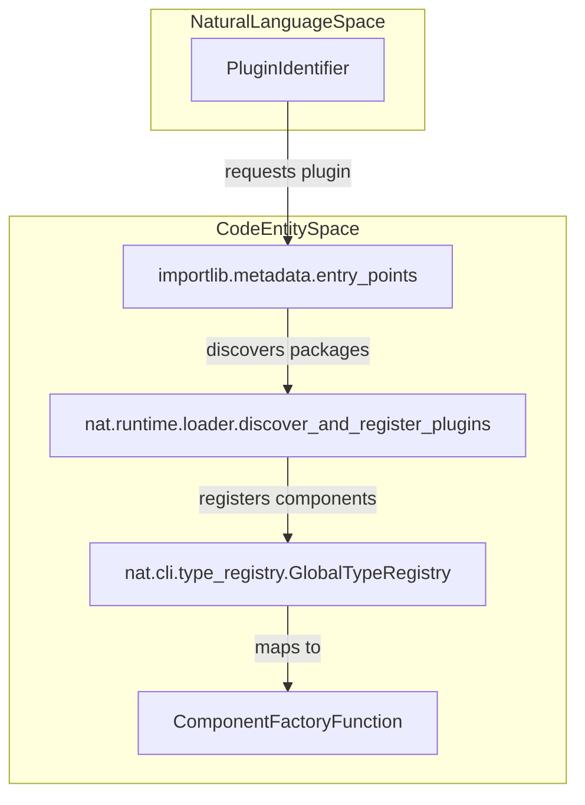
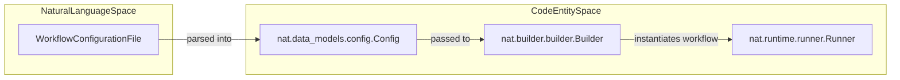

<!-- source: DeepWiki mcp.deepwiki.com · repo NVIDIA/NeMo-Agent-Toolkit · page 2 Architecture · fetched 2026-10-26 -->

# Architecture

Relevant source files

The following files were used as context for generating this wiki page:

- [examples/dynamo_integration/react_benchmark_agent/uv.lock](examples/dynamo_integration/react_benchmark_agent/uv.lock)
- [examples/frameworks/agno_personal_finance/pyproject.toml](examples/frameworks/agno_personal_finance/pyproject.toml)
- [examples/frameworks/haystack_deep_research_agent/pyproject.toml](examples/frameworks/haystack_deep_research_agent/pyproject.toml)
- [examples/frameworks/multi_frameworks/pyproject.toml](examples/frameworks/multi_frameworks/pyproject.toml)
- [examples/safety_and_security/retail_agent/uv.lock](examples/safety_and_security/retail_agent/uv.lock)
- [packages/nvidia_nat_agno/pyproject.toml](packages/nvidia_nat_agno/pyproject.toml)
- [packages/nvidia_nat_langchain/pyproject.toml](packages/nvidia_nat_langchain/pyproject.toml)
- [packages/nvidia_nat_llama_index/pyproject.toml](packages/nvidia_nat_llama_index/pyproject.toml)
- [packages/nvidia_nat_weave/pyproject.toml](packages/nvidia_nat_weave/pyproject.toml)
- [pyproject.toml](pyproject.toml)
- [uv.lock](uv.lock)

## Purpose and Scope

This document provides a high-level overview of the NVIDIA NeMo Agent Toolkit (NAT) architectural design, component relationships, and system organization [pyproject.toml:28-28](). It outlines the modular framework design, plugin architecture, component instantiation patterns, and configuration management strategy. 

As a PARENT page, this document summarizes high-level concepts and points to dedicated child pages for deep technical details:
- [Package Structure and Dependencies](#2.1) — Document the meta-package architecture, core packages, framework integration packages, and optional dependencies system.
- [Plugin and Entry Point System](#2.2) — Explain how the plugin discovery system works using entry points, registration decorators, and the plugin loading lifecycle.
- [Builder and Registry System](#2.3) — Detail the Builder pattern for component instantiation and the type registry for mapping configurations to factories.
- [Configuration System](#2.4) — Describe YAML-based configuration, Pydantic models, field validators, configuration composition patterns, config inheritance, file-based prompt loading, and gated fields.

Sources: [pyproject.toml:28-28]()

---

## System Architecture Overview

NeMo Agent Toolkit is structured around a minimal core (`nvidia-nat-core`) and a flexible set of optional feature packages and framework adapters [pyproject.toml:53-89](). This architecture separates clean domain abstractions from vendor-specific implementations, allowing developers to target multiple LLM vendors and agent frameworks without rewriting core business logic.

### Component Relationship Diagram

```mermaid
graph TB
    subgraph DistributionLayer
        nvidia_nat["nvidia-nat"] -->|"depends on"| nvidia_nat_core["nvidia-nat-core"]
    end
    
    subgraph FrameworkPlugins
        nvidia_nat_langchain["nvidia-nat-langchain"] --> nvidia_nat_core
        nvidia_nat_llama_index["nvidia-nat-llama-index"] --> nvidia_nat_core
        nvidia_nat_crewai["nvidia-nat-crewai"] --> nvidia_nat_core
        nvidia_nat_adk["nvidia-nat-adk"] --> nvidia_nat_core
        nvidia_nat_agno["nvidia-nat-agno"] --> nvidia_nat_core
        nvidia_nat_semantic_kernel["nvidia-nat-semantic-kernel"] --> nvidia_nat_core
        nvidia_nat_autogen["nvidia-nat-autogen"] --> nvidia_nat_core
    end
    
    subgraph PlatformPlugins
        nvidia_nat_weave["nvidia-nat-weave"] --> nvidia_nat_core
        nvidia_nat_opentelemetry["nvidia-nat-opentelemetry"] --> nvidia_nat_core
        nvidia_nat_phoenix["nvidia-nat-phoenix"] --> nvidia_nat_core
        nvidia_nat_eval["nvidia-nat-eval"] --> nvidia_nat_core
        nvidia_nat_profiler["nvidia-nat-profiler"] --> nvidia_nat_eval
        nvidia_nat_atif["nvidia-nat-atif"] --> nvidia_nat_core
        nvidia_nat_app["nvidia-nat-app"] --> nvidia_nat_core
    end
    
    subgraph ExternalProviderPlugins
        nvidia_nat_a365["nvidia-nat-a365"] --> nvidia_nat_core
    end
    
    subgraph CoreExecutionEntities
        Builder["nat.builder.builder.Builder"]
        ContextState["nat.builder.context.ContextState"]
        Runner["nat.runtime.runner.Runner"]
    end
    
    nvidia_nat_core --> Builder
    nvidia_nat_core --> ContextState
    nvidia_nat_core --> Runner
```

Sources: [pyproject.toml:46-129](), [packages/nvidia_nat_core/src/nat/runtime/runner.py:39-101](), [packages/nvidia_nat_core/src/nat/builder/context.py:67-140]()

---

## Package Structure and Dependencies

The toolkit is distributed via a meta-package (`nvidia-nat`) that depends on `nvidia-nat-core` and exposes extensive optional dependency extras for custom use cases [pyproject.toml:25-89](). Framework wrappers (such as LangChain, LlamaIndex, and Agno) and observability backends are packaged separately to keep runtime footprints lean.

For comprehensive details on package layout, subpackages, and optional dependency resolution, see [Package Structure and Dependencies](#2.1).

Sources: [pyproject.toml:25-89]()

---

## Plugin and Entry Point System

NAT relies on standard Python entry points under the `nat.components` group to discover plugins and extensions dynamically [packages/nvidia_nat_langchain/pyproject.toml:109-111](). This decentralized loading model allows third-party packages and framework integrations to register tools, middleware, and LLM providers without modifying core codebase files.

### Plugin Discovery Mapping

For detailed explanations of the entry point schema, registration decorators, and plugin loading lifecycle, see [Plugin and Entry Point System](#2.2).

Sources: [packages/nvidia_nat_langchain/pyproject.toml:109-111]()

---

## Builder and Registry System

Component instantiation is governed by a Builder pattern combined with global type registries. The configuration maps cleanly to factories through `GlobalTypeRegistry`, while `Builder` orchestrates the creation of complex object graphs. Execution context and concurrency state isolation are managed via `ContextState` [packages/nvidia_nat_core/src/nat/builder/context.py:67-140](), and runtime execution flow is handled by `Runner` [packages/nvidia_nat_core/src/nat/runtime/runner.py:39-101]().

For deep architectural details on instantiation mechanics and registry design, see [Builder and Registry System](#2.3).

Sources: [packages/nvidia_nat_core/src/nat/runtime/runner.py:39-101](), [packages/nvidia_nat_core/src/nat/builder/context.py:67-140]()

---

## Configuration System

Workflows are defined declaratively via YAML configurations backed by robust Pydantic models. This ensures strict validation, type safety, and automatic schema generation. The configuration layer supports inheritance, composition patterns, file-based prompt loading, and gated fields.

### Configuration Processing Mapping

For detailed information on configuration patterns, inheritance, and field validation, see [Configuration System](#2.4).

Sources: [pyproject.toml:28-28]()

---

# Summary

The NVIDIA NeMo Agent Toolkit architecture is engineered for modularity, plugin extensibility, and clean separation of concerns. By combining a flexible meta-package layout, dynamic entry-point discovery, Pydantic-backed configuration schemas, and a robust Builder instantiation pattern, NAT provides a stable foundation for building multi-framework AI agent workflows.

For detailed documentation on specific architectural areas, visit the child pages:
- [Package Structure and Dependencies](#2.1)
- [Plugin and Entry Point System](#2.2)
- [Builder and Registry System](#2.3)
- [Configuration System](#2.4)

---

