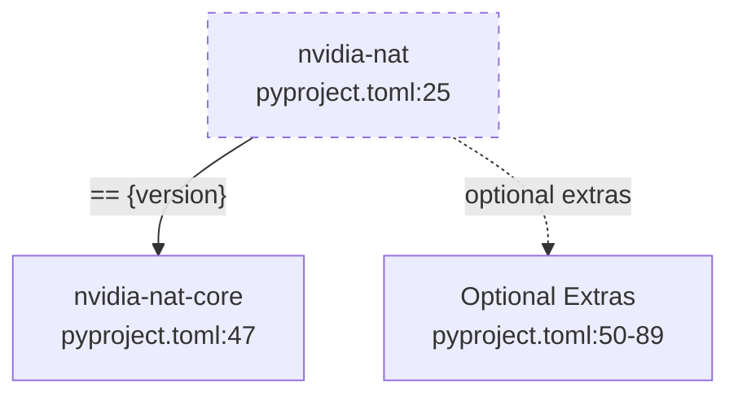
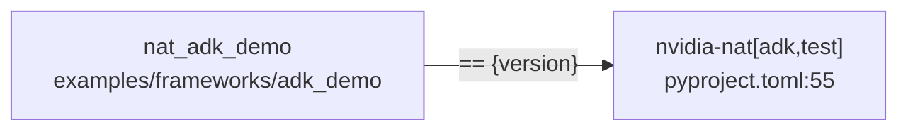
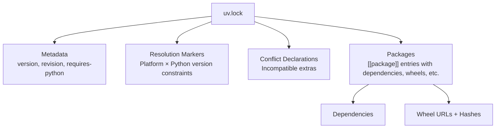
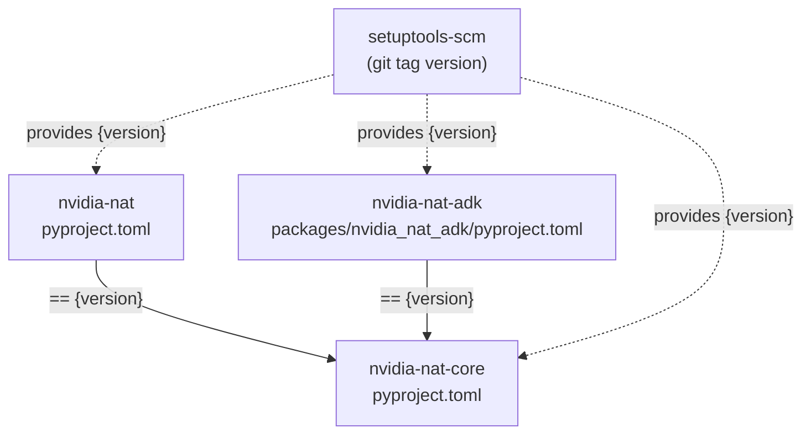
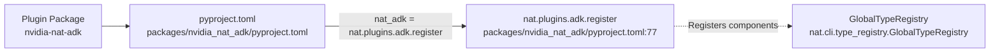

<!-- source: DeepWiki mcp.deepwiki.com · repo NVIDIA/NeMo-Agent-Toolkit · page 2.1 Package Structure and Dependencies · fetched 2026-10-26 -->

# Package Structure and Dependencies

<details>
<summary>Relevant source files</summary>

The following files were used as context for generating this wiki page:

- [examples/custom_functions/automated_description_generation/pyproject.toml](examples/custom_functions/automated_description_generation/pyproject.toml)
- [examples/documentation_guides/workflows/text_file_ingest/pyproject.toml](examples/documentation_guides/workflows/text_file_ingest/pyproject.toml)
- [examples/dynamo_integration/react_benchmark_agent/uv.lock](examples/dynamo_integration/react_benchmark_agent/uv.lock)
- [examples/evaluation_and_profiling/email_phishing_analyzer/pyproject.toml](examples/evaluation_and_profiling/email_phishing_analyzer/pyproject.toml)
- [examples/frameworks/adk_demo/uv.lock](examples/frameworks/adk_demo/uv.lock)
- [examples/frameworks/agno_personal_finance/pyproject.toml](examples/frameworks/agno_personal_finance/pyproject.toml)
- [examples/frameworks/agno_personal_finance/uv.lock](examples/frameworks/agno_personal_finance/uv.lock)
- [examples/frameworks/haystack_deep_research_agent/pyproject.toml](examples/frameworks/haystack_deep_research_agent/pyproject.toml)
- [examples/frameworks/multi_frameworks/pyproject.toml](examples/frameworks/multi_frameworks/pyproject.toml)
- [examples/getting_started/simple_web_query/pyproject.toml](examples/getting_started/simple_web_query/pyproject.toml)
- [examples/observability/simple_calculator_observability/pyproject.toml](examples/observability/simple_calculator_observability/pyproject.toml)
- [examples/safety_and_security/retail_agent/uv.lock](examples/safety_and_security/retail_agent/uv.lock)
- [packages/nvidia_nat_a2a/uv.lock](packages/nvidia_nat_a2a/uv.lock)
- [packages/nvidia_nat_adk/pyproject.toml](packages/nvidia_nat_adk/pyproject.toml)
- [packages/nvidia_nat_adk/uv.lock](packages/nvidia_nat_adk/uv.lock)
- [packages/nvidia_nat_agno/pyproject.toml](packages/nvidia_nat_agno/pyproject.toml)
- [packages/nvidia_nat_agno/uv.lock](packages/nvidia_nat_agno/uv.lock)
- [packages/nvidia_nat_autogen/uv.lock](packages/nvidia_nat_autogen/uv.lock)
- [packages/nvidia_nat_core/uv.lock](packages/nvidia_nat_core/uv.lock)
- [packages/nvidia_nat_crewai/pyproject.toml](packages/nvidia_nat_crewai/pyproject.toml)
- [packages/nvidia_nat_crewai/uv.lock](packages/nvidia_nat_crewai/uv.lock)
- [packages/nvidia_nat_data_flywheel/uv.lock](packages/nvidia_nat_data_flywheel/uv.lock)
- [packages/nvidia_nat_eval/uv.lock](packages/nvidia_nat_eval/uv.lock)
- [packages/nvidia_nat_fastmcp/uv.lock](packages/nvidia_nat_fastmcp/uv.lock)
- [packages/nvidia_nat_langchain/pyproject.toml](packages/nvidia_nat_langchain/pyproject.toml)
- [packages/nvidia_nat_llama_index/pyproject.toml](packages/nvidia_nat_llama_index/pyproject.toml)
- [packages/nvidia_nat_mcp/uv.lock](packages/nvidia_nat_mcp/uv.lock)
- [packages/nvidia_nat_mem0ai/pyproject.toml](packages/nvidia_nat_mem0ai/pyproject.toml)
- [packages/nvidia_nat_mem0ai/uv.lock](packages/nvidia_nat_mem0ai/uv.lock)
- [packages/nvidia_nat_openpipe_art/uv.lock](packages/nvidia_nat_openpipe_art/uv.lock)
- [packages/nvidia_nat_phoenix/pyproject.toml](packages/nvidia_nat_phoenix/pyproject.toml)
- [packages/nvidia_nat_redis/pyproject.toml](packages/nvidia_nat_redis/pyproject.toml)
- [packages/nvidia_nat_semantic_kernel/pyproject.toml](packages/nvidia_nat_semantic_kernel/pyproject.toml)
- [packages/nvidia_nat_test/pyproject.toml](packages/nvidia_nat_test/pyproject.toml)
- [packages/nvidia_nat_weave/pyproject.toml](packages/nvidia_nat_weave/pyproject.toml)
- [pyproject.toml](pyproject.toml)
- [uv.lock](uv.lock)

</details>


This page details the meta-package architecture, core packages, framework integration packages, and optional dependencies system of the NVIDIA NeMo Agent Toolkit (`nvidia-nat`). It explains how the modular design enables flexible installation, how dependencies are managed via `uv`, and how plugin packages register components for runtime discovery.

## Package Organization

The NeMo Agent Toolkit employs a modular meta-package design, with multiple individual packages for core functionality and framework integrations. This design promotes separation of concerns, individual package maintenance, and selective installation.

### Meta-Package Pattern

The `nvidia-nat` package acts as a meta-package containing no source code itself. Instead, it serves as a central installation point that pulls in the core package as a strict dependency and exposes optional "extras" for additional plugins.

**Meta-Package Architecture and Code Entities**


The meta-package declares only one mandatory dependency on `nvidia-nat-core == {version}` while offering many optional extras, allowing users to install only the features they require.

Sources: [pyproject.toml:24-30](), [pyproject.toml:45-89]()

### Core Package: nvidia-nat-core

The `nvidia-nat-core` package provides the foundational building blocks:
- Base agent classes and workforce abstractions
- LLM interface definitions and configuration models (e.g., `NIMModelConfig`, `OpenAIModelConfig`)
- Core tool and function registration systems
- Builder and type registry patterns for component instantiation (`GlobalTypeRegistry`)
- The command line interface `nat` command entrypoint

This package is central to the toolkit and is a required dependency for all other packages.

Sources: [pyproject.toml:45-49](), [pyproject.toml:61-61]()

### Framework Integration Packages

Plugin packages furnish integration with external agent frameworks, services, or observability platforms. They depend on `nvidia-nat-core` and register their components via standard setuptools entry points.

**Package Dependency Hierarchy and Code Entity Mapping**

```mermaid
graph TB
    CORE["nvidia-nat-core<br/>pyproject.toml:61"]
    
    subgraph "Framework Integration"
        LANG["nvidia-nat-langchain<br/>pyproject.toml:66"]
        LLAMA["nvidia-nat-llama-index<br/>pyproject.toml:67"]
        CREW["nvidia-nat-crewai<br/>pyproject.toml:62"]
        AGNO["nvidia-nat-agno<br/>pyproject.toml:56"]
        SK["nvidia-nat-semantic-kernel<br/>pyproject.toml:84"]
        ADK["nvidia-nat-adk<br/>packages/nvidia_nat_adk/pyproject.toml:31"]
        AUTOGEN["nvidia-nat-autogen<br/>pyproject.toml:58"]
    end
    
    subgraph "Observability and Performance"
        PHOENIX["nvidia-nat-phoenix<br/>pyproject.toml:74"]
        WEAVE["nvidia-nat-weave<br/>pyproject.toml:87"]
        OTEL["nvidia-nat-opentelemetry<br/>pyproject.toml:73"]
        APP["nvidia-nat-app<br/>pyproject.toml:57"]
        PROFILER["nvidia-nat-profiler<br/>pyproject.toml:75"]
        ATIF["nvidia-nat-atif<br/>pyproject.toml:59"]
    end
    
    subgraph "Protocols and Services"
        MCP["nvidia-nat-mcp<br/>pyproject.toml:68"]
        A2A["nvidia-nat-a2a<br/>pyproject.toml:53"]
        FASTMCP["nvidia-nat-fastmcp<br/>pyproject.toml:65"]
        REDIS["nvidia-nat-redis<br/>pyproject.toml:79"]
        MYSQL["nvidia-nat-mysql<br/>pyproject.toml:78"]
        S3["nvidia-nat-s3<br/>pyproject.toml:80"]
        A365["nvidia-nat-a365<br/>pyproject.toml:54"]
    end
    
    LANG -->|"== {version}"| CORE
    LLAMA -->|"== {version}"| CORE
    CREW -->|"== {version}"| CORE
    AGNO -->|"== {version}"| CORE
    SK -->|"== {version}"| CORE
    ADK -->|"== {version}"| CORE
    PHOENIX -->|"== {version}"| CORE
    WEAVE -->|"== {version}"| CORE
    OTEL -->|"== {version}"| CORE
    APP -->|"== {version}"| CORE
    PROFILER -->|"== {version}"| CORE
    MCP -->|"== {version}"| CORE
    A2A -->|"== {version}"| CORE
    FASTMCP -->|"== {version}"| CORE
    REDIS -->|"== {version}"| CORE
    MYSQL -->|"== {version}"| CORE
    S3 -->|"== {version}"| CORE
    A365 -->|"== {version}"| CORE
```


Sources: [pyproject.toml:53-88](), [packages/nvidia_nat_adk/pyproject.toml:31-60]()

### Key Framework Plugin Packages and Their Entry Points

| Plugin Package | Path | Purpose | Entry Point Name |
|---|---|---|---|
| `nvidia-nat-langchain` | `packages/nvidia_nat_langchain/` | LangChain and LangGraph support | `nat_langchain`, `nat_langchain_tools` [packages/nvidia_nat_langchain/pyproject.toml:109-111]() |
| `nvidia-nat-llama-index` | `packages/nvidia_nat_llama_index/` | LlamaIndex integration | `nat_llama_index` [packages/nvidia_nat_llama_index/pyproject.toml:90-91]() |
| `nvidia-nat-crewai` | `packages/nvidia_nat_crewai/` | CrewAI integration | `nat_crewai` |
| `nvidia-nat-agno` | `packages/nvidia_nat_agno/` | Agno integration | `nat_agno`, `nat_agno_tools` [packages/nvidia_nat_agno/pyproject.toml:79]() |
| `nvidia-nat-semantic-kernel` | `packages/nvidia_nat_semantic_kernel/` | Semantic Kernel integration | `nat_semantic_kernel` [packages/nvidia_nat_semantic_kernel/pyproject.toml:87-88]() |
| `nvidia-nat-adk` | `packages/nvidia_nat_adk/` | Google ADK integration | `nat_adk` [packages/nvidia_nat_adk/pyproject.toml:77]() |
| `nvidia-nat-app` | `packages/nvidia_nat_app/` | Agent Performance Primitives | `nat_app` |
| `nvidia-nat-weave` | `packages/nvidia_nat_weave/` | W&B Weave integration | `nat_weave` [packages/nvidia_nat_weave/pyproject.toml:88-89]() |
| `nvidia-nat-a365` | `packages/nvidia_nat_a365/` | MS Agent 365 (Teams) integration | `nat_a365` |

Each declares exact dependency pins on `nvidia-nat-core == {version}` for compatibility.

Sources: [pyproject.toml:53-88](), [packages/nvidia_nat_adk/pyproject.toml:76-77]()

### Example Packages

Example workflows and demos are provided as separate installable packages under the `examples/` directory. These examples are tracked in the meta-package extra configurations for discovery and testing.

**Example Dependency Flow**


Examples that include Python code contain their own `pyproject.toml` or `uv.lock` defining dependencies and entry points for workflow registration [examples/frameworks/adk_demo/uv.lock:1-10]().

Sources: [pyproject.toml:130-182](), [examples/frameworks/adk_demo/uv.lock:1-10]()

---

## Dependency Management

NVIDIA NeMo Agent Toolkit employs the `uv` dependency manager to produce reproducible builds and manage complex dependency graphs.

### Universal Lock File (`uv.lock`)

The `uv.lock` file captures all package versions along with hashes, sources, and platform-specific resolution markers.

**Lock File Structure**


Key fields:
- `requires-python = ">=3.11, <3.14"` bounds Python compatibility [uv.lock:3]()
- `resolution-markers` control conditional dependencies per Python version and OS platform [uv.lock:4-11]()
- `conflicts` define mutually exclusive extras to avoid incompatibilities [uv.lock:12-27]()

Sources: [uv.lock:1-37]()

### Version Pinning Strategy

All internal packages have strictly pinned dependencies on `nvidia-nat-core` using exact `== {version}` matching.

**Version Propagation Diagram**


The `{version}` placeholder is dynamically set at build time by `setuptools-scm` based on the current git tag [packages/nvidia_nat_adk/pyproject.toml:25-27]().

Sources: [pyproject.toml:21-22](), [packages/nvidia_nat_adk/pyproject.toml:25-27](), [packages/nvidia_nat_adk/pyproject.toml:56-56]()

### setuptools_dynamic_dependencies

The toolkit uses the `setuptools_dynamic_dependencies` plugin for dynamic resolution of dependency versions during build [packages/nvidia_nat_adk/pyproject.toml:17-17]().

**Example snippet from `nvidia-nat-adk` (`packages/nvidia_nat_adk/pyproject.toml:51-60`):**
```toml
[tool.setuptools_dynamic_dependencies]
dependencies = [
  "nvidia-nat-core == {version}",
  "google-adk>=1.28.1,<2.0.0",
  "litellm>=1.83.0,<1.85.0",
  "opentelemetry-exporter-otlp<1.42.0",
]
```

Sources: [packages/nvidia_nat_adk/pyproject.toml:17-17](), [packages/nvidia_nat_adk/pyproject.toml:51-60]()

---

## Optional Extras System

The toolkit provides flexible installation options via Python package extras.

### Individual Extras

Each plugin package is available as an optional extra under the meta-package.

```bash
pip install "nvidia-nat[adk]"
```

Sources: [pyproject.toml:50-89]()

### Aggregated Extras (the `most` extra)

The `most` extra bundles many plugin packages into a single installation for convenience.

**The "Most" Extra Bundle**
```mermaid
graph TB
    MOST["most extra<br/>nvidia-nat[most]<br/>pyproject.toml:94"]
    INTEGRATIONS[
      "a2a, a365, adk, agno, autogen, crewai, langchain, llama-index, semantic-kernel, strands"
    ]
    OBSERVABILITY[
      "atif, opentelemetry, phoenix, profiler, weave"
    ]
    SERVICES[
      "mysql, redis, s3, security, fastmcp, mcp"
    ]
    COREFEATS[
      "async_endpoints, gunicorn, defense, guardrails"
    ]
    
    MOST --> INTEGRATIONS
    MOST --> OBSERVABILITY
    MOST --> SERVICES
    MOST --> COREFEATS
```

Sources: [pyproject.toml:94-128]()

### Dependency Conflicts

The root and package `uv.lock` files explicitly declare conflicting extras to prevent broken environments, often due to differing `protobuf` or framework requirements [uv.lock:12-27]().

**Conflict declarations in lock file (`uv.lock:12-27`):**
- `{ package = "nvidia-nat", extra = "adk" }` vs `{ package = "nvidia-nat", extra = "openpipe-art" }` [uv.lock:12-15]()
- `{ package = "nvidia-nat", extra = "crewai" }` vs `{ package = "nvidia-nat", extra = "openpipe-art" }` [uv.lock:15-18]()
- `{ package = "nvidia-nat", extra = "most" }` vs `{ package = "nvidia-nat", extra = "openpipe-art" }` [uv.lock:18-21]()
- `{ package = "nvidia-nat", extra = "autogen" }` vs `{ package = "nvidia-nat", extra = "rag" }` [uv.lock:21-24]()
- `{ package = "nvidia-nat", extra = "most" }` vs `{ package = "nvidia-nat", extra = "rag" }` [uv.lock:24-27]()

Sources: [uv.lock:12-27]()

---

## Package Registration via Entry Points

Plugins register components under the `nat.components` entry point group, enabling dynamic discovery.

**Plugin Discovery and Code Entity Mapping**


| Package | Entry Point Name | Entry Point Target |
|---|---|---|
| `nvidia-nat-adk` | `nat_adk` | `nat.plugins.adk.register` [packages/nvidia_nat_adk/pyproject.toml:77]() |
| `nvidia-nat-langchain` | `nat_langchain` | `nat.plugins.langchain.register` [packages/nvidia_nat_langchain/pyproject.toml:110]() |
| `nvidia-nat-agno` | `nat_agno` | `nat.plugins.agno.register` [packages/nvidia_nat_agno/pyproject.toml:79]() |
| `nvidia-nat-semantic-kernel` | `nat_semantic_kernel` | `nat.plugins.semantic_kernel.register` [packages/nvidia_nat_semantic_kernel/pyproject.toml:88]() |
| `nvidia-nat-weave` | `nat_weave` | `nat.plugins.weave.register` [packages/nvidia_nat_weave/pyproject.toml:89]() |

Sources: [packages/nvidia_nat_adk/pyproject.toml:76-77](), [packages/nvidia_nat_test/src/nat/test/plugin.py:78-86]()

---

