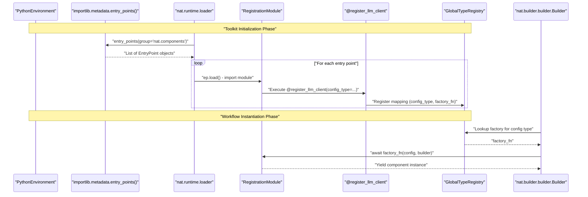
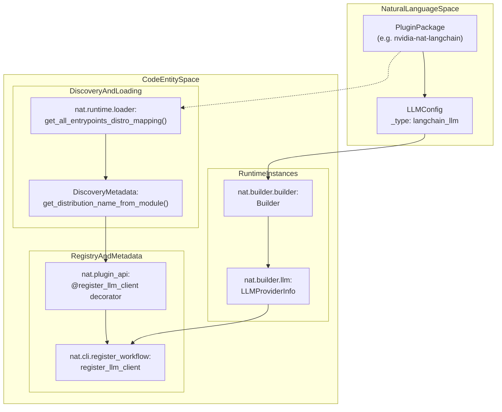

<!-- source: DeepWiki mcp.deepwiki.com · repo NVIDIA/NeMo-Agent-Toolkit · page 2.2 Plugin and Entry Point System · fetched 2026-10-26 -->

# Plugin and Entry Point System

Relevant source files

The following files were used as context for generating this wiki page:

- [docs/source/extend/custom-components/telemetry-exporters.md](docs/source/extend/custom-components/telemetry-exporters.md)
- [docs/source/extend/plugin-api.md](docs/source/extend/plugin-api.md)
- [packages/nvidia_nat_core/src/nat/middleware/circuit_breaker/__init__.py](packages/nvidia_nat_core/src/nat/middleware/circuit_breaker/__init__.py)
- [packages/nvidia_nat_core/src/nat/middleware/circuit_breaker/circuit_breaker_middleware.py](packages/nvidia_nat_core/src/nat/middleware/circuit_breaker/circuit_breaker_middleware.py)
- [packages/nvidia_nat_core/src/nat/middleware/circuit_breaker/circuit_breaker_middleware_config.py](packages/nvidia_nat_core/src/nat/middleware/circuit_breaker/circuit_breaker_middleware_config.py)
- [packages/nvidia_nat_core/src/nat/middleware/circuit_breaker/register.py](packages/nvidia_nat_core/src/nat/middleware/circuit_breaker/register.py)
- [packages/nvidia_nat_core/src/nat/plugin_api/__init__.py](packages/nvidia_nat_core/src/nat/plugin_api/__init__.py)
- [packages/nvidia_nat_core/tests/nat/middleware/test_circuit_breaker_middleware.py](packages/nvidia_nat_core/tests/nat/middleware/test_circuit_breaker_middleware.py)
- [packages/nvidia_nat_core/tests/nat/test_plugin_api.py](packages/nvidia_nat_core/tests/nat/test_plugin_api.py)
- [skills/nat-telemetry/references/telemetry.md](skills/nat-telemetry/references/telemetry.md)

The NVIDIA NeMo Agent Toolkit employs a plugin architecture based on Python entry points and registration decorators to enable flexible, modular, and automatic discovery and loading of components at runtime. This system empowers the toolkit to dynamically integrate LLM clients, functions (tools), workflows, memory backends, telemetry exporters, CLI commands, and more, originating from any installed package without requiring manual registration or direct imports. This design supports independent installation of subpackages (e.g., `nvidia-nat-langchain`, `nvidia-nat-mcp`, `nvidia-nat-zep-cloud`) as well as seamless integration of third-party extensions. 

Sources: `[packages/nvidia_nat_core/src/nat/plugin_api/__init__.py:15-33]()`, `[docs/source/extend/plugin-api.md:18-30]()`

---

## Entry Point Groups

The plugin system centers around Python entry point groups defined in the `pyproject.toml` of various subpackages. The toolkit uses Python's standard packaging mechanism to discover installed plugins across the environment.

| Entry Point Group | Purpose | Load Timing | Examples |
|-------------------|---------|-------------|----------|
| `nat.components`  | Modules exposing component registration code with `@register_*` decorators | Early initialization, before config parsing | `nvidia_nat_langchain`, `nvidia_nat_mcp`, `nvidia_nat_zep_cloud` |
| `nat.cli`          | Click command groups extending the `nat` CLI | CLI startup | `nat a2a serve`, `nat fastmcp server` |

Subpackages use these entry points to hook their registration logic into the core toolkit.

### Distribution Discovery and Metadata
The toolkit tracks the origin of registered components using `DiscoveryMetadata`. This class facilitates mapping Python modules back to their parent distribution packages using `importlib.metadata`. This metadata is used for discovery features, version tracking, and developer notes.

Sources: `[docs/source/extend/plugin-api.md:67-69]`, `[packages/nvidia_nat_core/src/nat/plugin_api/__init__.py:15-33]()`

---

## Registration Decorators

Registration decorators bind Pydantic configuration classes to factory functions. These decorators populate a registry that maps a string-based `name` or `_type` to its corresponding implementation logic. External plugin packages should import these public authoring APIs from `nat.plugin_api` to ensure compatibility across toolkit versions.

### Supported Plugin Types and Their Registration Decorators

| Plugin Type               | Decorator                             | Purpose |
|---------------------------|-------------------------------------|---------|
| Functions (Tools)         | `@register_function`                 | Registers a new tool or function implementation. `[packages/nvidia_nat_core/src/nat/plugin_api/__init__.py:53-53]()` |
| Evaluators                | `@register_evaluator`                | Registers a metric or trajectory evaluator. `[packages/nvidia_nat_core/src/nat/plugin_api/__init__.py:52-52]()` |
| LLM Clients               | `@register_llm_client`               | Registers a client for a specific LLM framework. `[packages/nvidia_nat_core/src/nat/plugin_api/__init__.py:55-55]()` |
| LLM Providers             | `@register_llm_provider`             | Registers the configuration schema for an LLM provider. `[packages/nvidia_nat_core/src/nat/plugin_api/__init__.py:56-56]()` |
| Memory Plugins            | `@register_memory`                   | Registers a memory backend (e.g., Zep, Mem0). `[packages/nvidia_nat_core/src/nat/plugin_api/__init__.py:57-57]()` |
| Middleware                | `@register_middleware`               | Registers custom middleware for call interception. `[packages/nvidia_nat_core/src/nat/plugin_api/__init__.py:58-58]()` |
| Telemetry Exporters       | `@register_telemetry_exporter`       | Registers an OTEL exporter. `[packages/nvidia_nat_core/src/nat/plugin_api/__init__.py:64-64]()` |
| Dataset Loaders           | `@register_dataset_loader`           | Registers support for additional dataset formats. `[packages/nvidia_nat_core/src/nat/plugin_api/__init__.py:48-48]()` |
| Object Stores             | `@register_object_store`             | Registers persistent object storage backends. `[packages/nvidia_nat_core/src/nat/plugin_api/__init__.py:59-59]()` |

Sources: `[packages/nvidia_nat_core/src/nat/plugin_api/__init__.py:46-65]()`, `[docs/source/extend/plugin-api.md:36-39]()`, `[packages/nvidia_nat_core/tests/nat/test_plugin_api.py:91-108]()`

---

## Plugin Loading Lifecycle

The plugin system operates in two main phases:

1. **Packaging Time:** Subpackages declare their plugin entry points in `pyproject.toml` under the `nat.components` or `nat.cli` group.
2. **Runtime Discovery:** On Toolkit initialization, the runtime loader enumerates all entry points using `importlib.metadata`, imports the referenced modules, and triggers the registration decorators within them.

### Plugin Loading Sequence Diagram

Title: "Plugin Loading Sequence"

Sources: `[packages/nvidia_nat_core/src/nat/plugin_api/__init__.py:35-50]()`, `[docs/source/extend/plugin-api.md:18-30]()`

---

## Code Entity Architecture and Data Flow

This diagram bridges the gap between Natural Language concepts and the actual Code Entities used in the plugin system.

Title: "Natural Language to Code Entity Mapping"

Sources: `[docs/source/extend/plugin-api.md:31-60]()`, `[packages/nvidia_nat_core/src/nat/plugin_api/__init__.py:15-65]()`

### Key Code Entities Description

| Component             | Module / Class                                   | Purpose                                                    |
|-----------------------|-------------------------------------------------|------------------------------------------------------------|
| Entry Point Loader    | `nat.runtime.loader`                             | Discovers and imports plugin modules via entry points. `[packages/nvidia_nat_core/src/nat/plugin_api/__init__.py:15-33]()` |
| Discovery Metadata    | `DiscoveryMetadata`                             | Stores distribution info, version, and component type. `[packages/nvidia_nat_core/src/nat/plugin_api/__init__.py:15-33]()` |
| Public Plugin API     | `nat.plugin_api`                                | Stable facade for decorators like `@register_function`. `[packages/nvidia_nat_core/src/nat/plugin_api/__init__.py:15-18]()` |
| Component Builder     | `nat.builder.builder.Builder`                   | Orchestrates component instantiation using the registry. `[packages/nvidia_nat_core/src/nat/plugin_api/__init__.py:35-35]()` |

Sources: `[docs/source/extend/plugin-api.md:31-60]()`, `[packages/nvidia_nat_core/src/nat/plugin_api/__init__.py:15-65]()`

---

