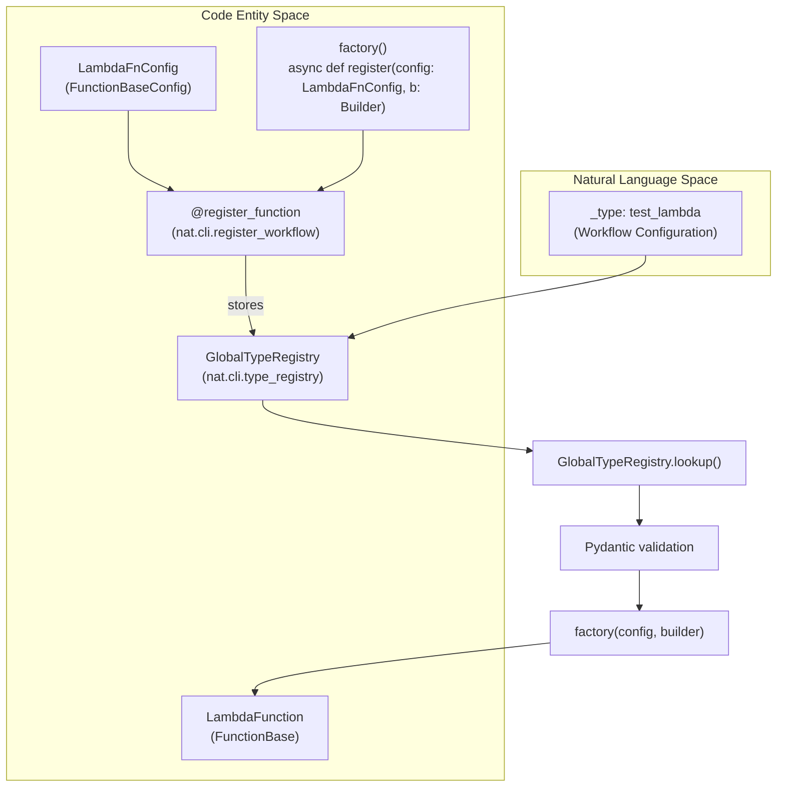
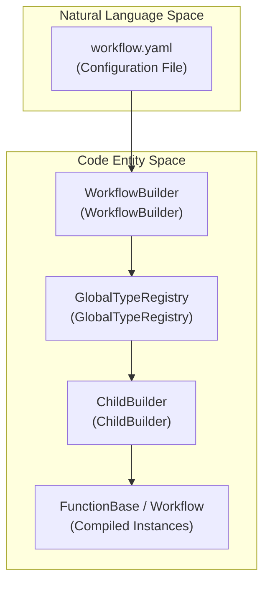
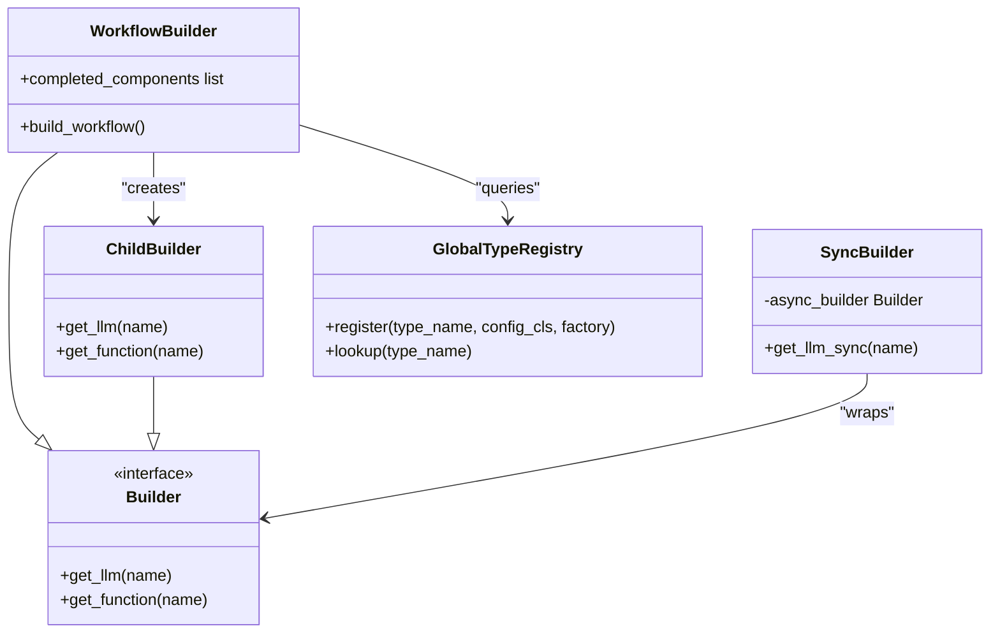
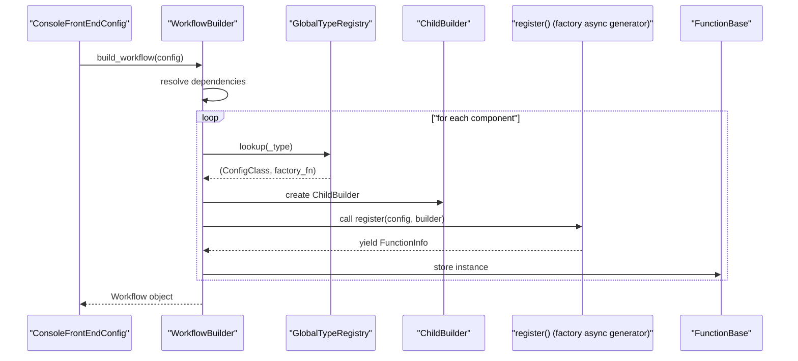

<!-- source: DeepWiki mcp.deepwiki.com · repo NVIDIA/NeMo-Agent-Toolkit · page 2.3 Builder and Registry System · fetched 2026-10-26 -->

# Builder and Registry System

Relevant source files

The following files were used as context for generating this wiki page:

- [packages/nvidia_nat_core/src/nat/builder/function.py](packages/nvidia_nat_core/src/nat/builder/function.py)
- [packages/nvidia_nat_core/src/nat/builder/function_base.py](packages/nvidia_nat_core/src/nat/builder/function_base.py)
- [packages/nvidia_nat_core/src/nat/builder/per_user_workflow_builder.py](packages/nvidia_nat_core/src/nat/builder/per_user_workflow_builder.py)
- [packages/nvidia_nat_core/src/nat/builder/workflow_builder.py](packages/nvidia_nat_core/src/nat/builder/workflow_builder.py)
- [packages/nvidia_nat_core/src/nat/middleware/dynamic/dynamic_function_middleware.py](packages/nvidia_nat_core/src/nat/middleware/dynamic/dynamic_function_middleware.py)
- [packages/nvidia_nat_core/src/nat/observability/mixin/type_introspection_mixin.py](packages/nvidia_nat_core/src/nat/observability/mixin/type_introspection_mixin.py)
- [packages/nvidia_nat_core/src/nat/utils/type_converter.py](packages/nvidia_nat_core/src/nat/utils/type_converter.py)
- [packages/nvidia_nat_core/src/nat/utils/type_utils.py](packages/nvidia_nat_core/src/nat/utils/type_utils.py)
- [packages/nvidia_nat_core/tests/nat/builder/test_function.py](packages/nvidia_nat_core/tests/nat/builder/test_function.py)
- [packages/nvidia_nat_core/tests/nat/middleware/test_dynamic_middleware.py](packages/nvidia_nat_core/tests/nat/middleware/test_dynamic_middleware.py)
- [packages/nvidia_nat_core/tests/nat/middleware/test_middleware_components.py](packages/nvidia_nat_core/tests/nat/middleware/test_middleware_components.py)
- [packages/nvidia_nat_core/tests/nat/observability/mixin/test_type_introspection_mixin.py](packages/nvidia_nat_core/tests/nat/observability/mixin/test_type_introspection_mixin.py)
- [packages/nvidia_nat_core/tests/nat/utils/test_converter.py](packages/nvidia_nat_core/tests/nat/utils/test_converter.py)
- [packages/nvidia_nat_core/tests/nat/utils/test_type_utils.py](packages/nvidia_nat_core/tests/nat/utils/test_type_utils.py)

This page details the runtime component assembly system of the NVIDIA NeMo Agent Toolkit, covering the type registry for mapping configurations to factories, the builder pattern families (`WorkflowBuilder`, `ChildBuilder`, `SyncBuilder`), the function introspection and type-conversion layer (`FunctionBase`, `DecomposedType`, `TypeIntrospectionMixin`), and component lifecycle management.

Sources: `[packages/nvidia_nat_core/src/nat/builder/workflow_builder.py:30-47]()`, `[packages/nvidia_nat_core/src/nat/builder/function_base.py:41-94]()`

---

## Overview

When the runtime receives a workflow configuration, it cannot directly construct components because concrete implementations are decoupled as plugins across multiple packages. The builder and registry system bridges this gap by translating string identifiers (`_type` fields in YAML configuration) into executable factory functions inside managed asynchronous builders.

### Key Responsibilities and Components

| Responsibility | Code Entity / Class | Module Path |
|---|---|---|
| Map `_type` strings to config classes & factories | `GlobalTypeRegistry` | `nat.cli.type_registry` |
| Orchestrate top-level workflow component graph | `WorkflowBuilder` | `nat.builder.workflow_builder` |
| Provide sub-component resolution contexts | `ChildBuilder` | `nat.builder.child_builder` |
| Synchronous wrapper for async builder operations | `SyncBuilder` | `nat.builder.sync_builder` |

Sources: `[packages/nvidia_nat_core/src/nat/builder/workflow_builder.py:30-47]()`

---

## GlobalTypeRegistry

`GlobalTypeRegistry` acts as a singleton lookup table for all registered component types. Component registration decorators (such as `@register_function`, `@register_llm_client`, `@register_evaluator`) populate this registry during package import time.

Each registry entry associates:
- A unique `_type` string (declared via configuration classes like `FunctionBaseConfig`).
- A Pydantic configuration class responsible for validating YAML parameters.
- An async factory function or async generator that produces live component instances from the validated configuration.

### Component Registration and Resolution Flow

The following diagram bridges natural language configuration space with code entity resolution across entry points, metadata structures, and the registry.

Title: "Component Registration and Resolution Flow"

Sources: `[packages/nvidia_nat_core/tests/nat/builder/test_function.py:36-70]()`, `[packages/nvidia_nat_core/src/nat/builder/workflow_builder.py:46-47]()`

---

## Workflow Configuration to Builder Instantiation

Workflow execution begins by parsing structured configurations and feeding them into the builder pipeline.

Title: "Workflow Configuration to Builder Instantiation"

Sources: `[packages/nvidia_nat_core/src/nat/builder/workflow_builder.py:30-47]()`

---

## Function, FunctionBase, and TypeIntrospectionMixin

The toolkit relies on `FunctionBase`, `Function`, and type inspection utilities to provide a unified interface for tool execution, middleware wrapping, and runtime type introspection.

- **`FunctionBase`**: Abstract base class providing core type-generic handling (`InputT`, `StreamingOutputT`, `SingleOutputT`), schema management, and converters `[packages/nvidia_nat_core/src/nat/builder/function_base.py:41-94]`.
- **`DecomposedType`**: Parses complex type annotations, generic parameters, and optionals, generating appropriate Pydantic validation schemas `[packages/nvidia_nat_core/src/nat/utils/type_utils.py:90-151]`.
- **`TypeIntrospectionMixin`**: Combines `DecomposedType` utilities with MRO class traversal to infer input and output types across complex generic inheritance hierarchies `[packages/nvidia_nat_core/src/nat/observability/mixin/type_introspection_mixin.py:35-64]`.

Sources: `[packages/nvidia_nat_core/src/nat/builder/function_base.py:41-94]()`, `[packages/nvidia_nat_core/src/nat/utils/type_utils.py:90-151]()`, `[packages/nvidia_nat_core/src/nat/observability/mixin/type_introspection_mixin.py:35-64]()`

---

## Builder Class Relationships

Title: "Builder Class Hierarchy and Registry Association"

Sources: `[packages/nvidia_nat_core/src/nat/builder/workflow_builder.py:30-47]()`

---

## End-to-End Assembly Sequence

Title: "Workflow Assembly Sequence"

Sources: `[packages/nvidia_nat_core/src/nat/builder/workflow_builder.py:30-47]()`, `[packages/nvidia_nat_core/tests/nat/builder/test_function.py:56-70]()`

---

