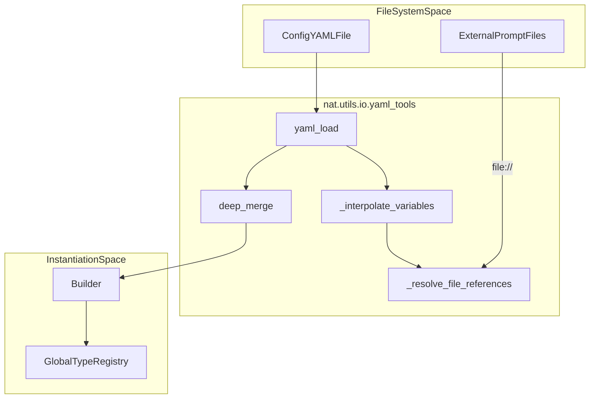
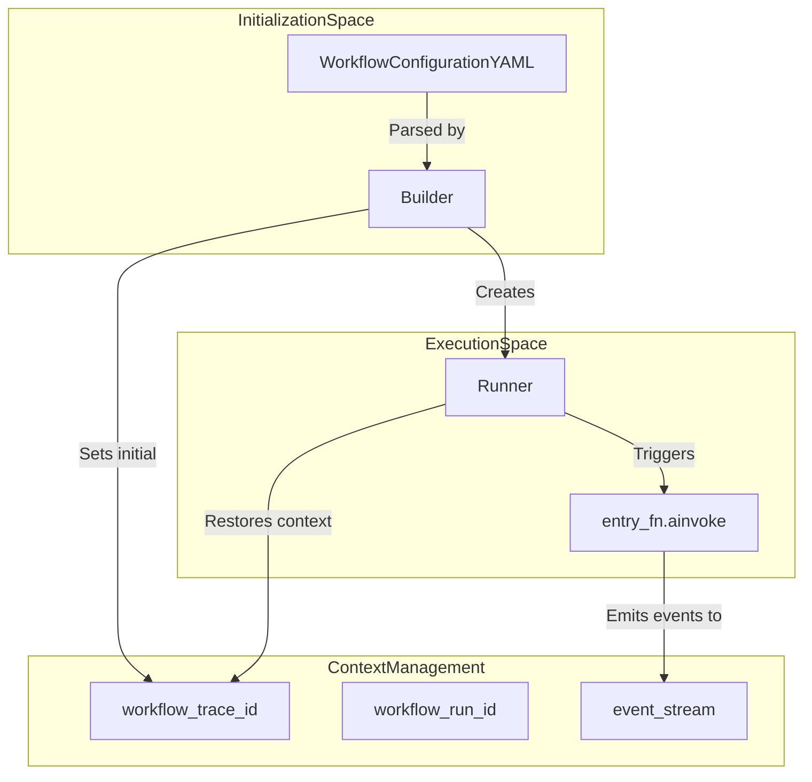
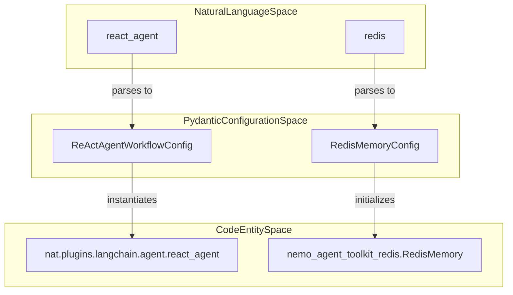
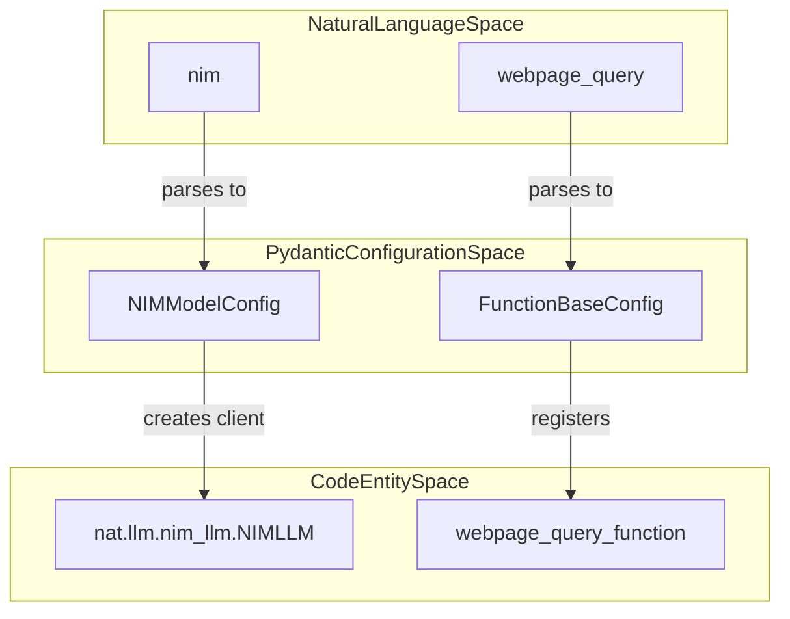

<!-- source: DeepWiki mcp.deepwiki.com · repo NVIDIA/NeMo-Agent-Toolkit · page 2.4 Configuration System · fetched 2026-10-26 -->

# Configuration System

<details>
<summary>Relevant source files</summary>

The following files were used as context for generating this wiki page:

- [docs/source/build-workflows/workflow-configuration.md](docs/source/build-workflows/workflow-configuration.md)
- [docs/source/improve-workflows/optimizer.md](docs/source/improve-workflows/optimizer.md)
- [examples/prompt_from_file/README.md](examples/prompt_from_file/README.md)
- [examples/prompt_from_file/configs/config.yml](examples/prompt_from_file/configs/config.yml)
- [examples/prompt_from_file/prompts/system_prompt.txt](examples/prompt_from_file/prompts/system_prompt.txt)
- [examples/prompt_from_file/pyproject.toml](examples/prompt_from_file/pyproject.toml)
- [packages/nvidia_nat_core/src/nat/utils/io/yaml_tools.py](packages/nvidia_nat_core/src/nat/utils/io/yaml_tools.py)
- [packages/nvidia_nat_core/tests/nat/utils/test_yaml_tools.py](packages/nvidia_nat_core/tests/nat/utils/test_yaml_tools.py)

</details>


## Purpose and Scope

The NVIDIA NeMo Agent Toolkit (NAT) employs a robust, YAML-based declarative configuration system backed by Pydantic models. This architecture cleanly separates AI agent orchestration from Python implementation code, enabling flexible definition, composition, and validation of the entire agentic stack. By leveraging Pydantic schemas and custom loader utilities, the toolkit ensures that configuration errors, type mismatches, and missing environment variables are intercepted at startup rather than during asynchronous workflow execution.

The configuration system manages:
- **LLM Providers**: Model parameters, base URLs (local vs. remote inference endpoints), and vendor-specific configuration.
- **Tools and Functions**: Specialized search connectors, utility functions, and business logic defined via configuration objects.
- **Workflows**: Top-level agent orchestration patterns such as `react_agent`.
- **Memory Systems**: State persistence backends and conversation history storage.
- **Embedders**: Vector embedding providers used for document retrieval and RAG tasks.

Sources: [docs/source/build-workflows/workflow-configuration.md:18-84](), [packages/nvidia_nat_core/src/nat/utils/io/yaml_tools.py:28-198]()

---

## YAML Configuration Structure and Processing

Configurations are organized into top-level sections that map directly to toolkit registries. Each component entry within a section must specify a `_type` field, which acts as a discriminator for the `Builder` to instantiate the appropriate underlying factory or class.

The configuration loader (`yaml_load`) processes raw YAML files by executing variable interpolation, resolving file-based references, and handling hierarchical inheritance [packages/nvidia_nat_core/src/nat/utils/io/yaml_tools.py:155-198]().

| Section Name | Purpose | Configuration Model Base |
|--------------|---------|--------------------------|
| `llms`       | LLM providers and connection parameters | `LLMBaseConfig` |
| `functions`  | Tools, web scrapers, and API connectors | `FunctionBaseConfig` |
| `embedders`  | Vector embedding model providers | `EmbedderBaseConfig` |
| `memory`     | Conversation history and state stores | `MemoryBaseConfig` |
| `retrievers` | Data retrieval and vector database backends | `RetrieverBaseConfig` |
| `workflow`   | Top-level agent logic and control flow | `FunctionBaseConfig` |
| `general`    | Global application settings and telemetry | `GeneralConfig` |

### Component References (Dependency Injection)

NAT uses name-based references to handle dependencies between components. Components are initialized in strict order based on dependency tree resolution:
- **`LLMRef`**: Refers to a registered LLM entry in the `llms` section [docs/source/build-workflows/workflow-configuration.md:28]().
- **`FunctionRef`**: Refers to a registered tool or function entry in the `functions` section [docs/source/build-workflows/workflow-configuration.md:27]().
- **`EmbedderRef`**: Refers to an entry in the `embedders` section [docs/source/build-workflows/workflow-configuration.md:29]().

### Data Flow: YAML Loading and Resolution

Diagram Title: YAML Loading and Resolution Pipeline


Sources: [docs/source/build-workflows/workflow-configuration.md:25-67](), [packages/nvidia_nat_core/src/nat/utils/io/yaml_tools.py:28-198]()

---

## Pydantic Models, Mixins, and Gated Fields

Every component configurable via YAML is backed by a Pydantic model inheriting from `HashableBaseModel` or `BaseModel` [packages/nvidia_nat_core/tests/nat/utils/test_yaml_tools.py:26-27](). This guarantees validation at load time, providing descriptive errors when mandatory attributes are omitted or types mismatch.

### Configuration Inheritance and Mixins

NAT uses mixin classes to compose shared configuration attributes across disparate components:
- **`FunctionBaseConfig`**: The base schema for tools, workflows, and functional blocks, requiring a unique configuration identifier [packages/nvidia_nat_core/tests/nat/utils/test_yaml_tools.py:28]().
- **`RetryMixin`**: Standardizes retry behaviors across service clients (`do_auto_retry`, `num_retries`, `retry_on_status_codes`).
- **`ThinkingMixin`**: Handles reasoning token allocations and specialized LLM thinking modes.
- **`SSLVerificationMixin`**: Enforces consistent TLS/SSL verification parameters for network endpoints.

### Field Validators and Gated Fields
Pydantic `@model_validator` and `@field_validator` decorators enforce complex cross-field dependencies and boundary conditions. Gated fields ensure specific configuration attributes become active or required solely based on the state of a discriminator field (e.g., enabling specialized generation parameters when `api_type` switches between `responses` and `tool_calling`).

Sources: [packages/nvidia_nat_core/tests/nat/utils/test_yaml_tools.py:26-34](), [packages/nvidia_nat_core/src/nat/data_models/optimizable.py:62-94]()

---

## Configuration Composition Patterns

### File-Based Prompt Loading
The toolkit supports loading system instructions and prompt templates from external text or markdown files using the `file://` protocol prefix [packages/nvidia_nat_core/src/nat/utils/io/yaml_tools.py:31-115(), examples/prompt_from_file/README.md:18-56](). 
- **Rules**: Any string field can reference a file regardless of its name; values must start with `file://`; values inside lists are not resolved; paths are resolved relative to the configuration file workspace; allowed file extensions include `.txt`, `.md`, `.j2`, `.jinja2`, `.jinja`, `.prompt`, `.tpl`, and `.template` [packages/nvidia_nat_core/src/nat/utils/io/yaml_tools.py:31-35(), examples/prompt_from_file/README.md:50-56]().

```yaml
# Example file-based prompt loading in workflow config
workflow:
  _type: react_agent
  system_prompt: file://../prompts/system_prompt.txt
```

### Config Inheritance
Hierarchical composition allows configuration files to specify a `base` key [packages/nvidia_nat_core/src/nat/utils/io/yaml_tools.py:155-198](). The base configuration is loaded and merged with the overlay configuration using `deep_merge()`, reducing duplication across similar environments [packages/nvidia_nat_core/src/nat/utils/io/yaml_tools.py:30](). Circular inheritance chains are detected and prevented during loading [packages/nvidia_nat_core/src/nat/utils/io/yaml_tools.py:155-198]().

### Variable Interpolation
Environment variables are interpolated using `_interpolate_variables` supporting default values in the format `${VAR:-default_value}` [packages/nvidia_nat_core/src/nat/utils/io/yaml_tools.py:118-135]().

Sources: [packages/nvidia_nat_core/src/nat/utils/io/yaml_tools.py:28-198](), [examples/prompt_from_file/configs/config.yml:28-36]()

---

## Runtime Configuration Context

During execution, configuration states are preserved in thread-local and async-local context variables. This context tracks workflow identifiers, run states, and event streams. The `Runner` re-establishes this context during execution to ensure consistency between initialization and runtime invocation.

### Visualizing Runtime Context Flow

Diagram Title: Runtime Configuration Context Flow


Sources: [docs/source/build-workflows/workflow-configuration.md:25-67](), [packages/nvidia_nat_core/src/nat/utils/io/yaml_tools.py:155-198]()

---

## Natural Language Space to Code Entity Mapping

These diagrams bridge the gap between high-level YAML configuration definitions and the underlying Python implementation classes and runtime execution objects.

Diagram Title: Natural Language to Code Entity Mapping Workflow and Memory


Diagram Title: Natural Language to Code Entity Mapping LLM and Functions


Sources: [docs/source/build-workflows/workflow-configuration.md:25-67](), [packages/nvidia_nat_core/src/nat/data_models/optimizable.py:62-94](), [packages/nvidia_nat_core/src/nat/utils/io/yaml_tools.py:155-198]()

---

