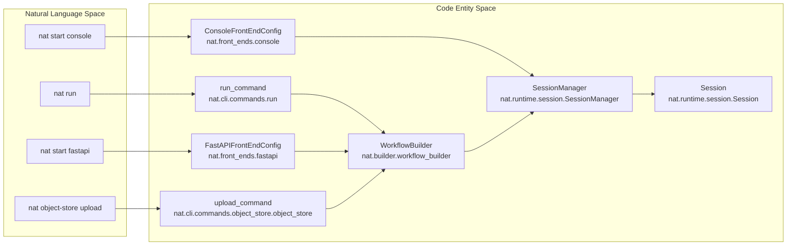

<!-- source: DeepWiki mcp.deepwiki.com · repo NVIDIA/NeMo-Agent-Toolkit · page 3 Command Line Interface · fetched 2026-10-26 -->

# Command Line Interface

Relevant source files

The following files were used as context for generating this wiki page:

- [docs/source/reference/cli.md](docs/source/reference/cli.md)
- [packages/nvidia_nat_core/src/nat/cli/commands/object_store/object_store.py](packages/nvidia_nat_core/src/nat/cli/commands/object_store/object_store.py)
- [packages/nvidia_nat_core/tests/nat/cli/commands/test_object_store_command.py](packages/nvidia_nat_core/tests/nat/cli/commands/test_object_store_command.py)
- [packages/nvidia_nat_mysql/tests/test_mysql_object_store_cli.py](packages/nvidia_nat_mysql/tests/test_mysql_object_store_cli.py)

The Command Line Interface (CLI) serves as पहुँच the primary gateway for interacting with the NVIDIA NeMo Agent Toolkit. Using the unified `nat` command, users can execute workflows, launch servers exposing agents over various protocols, run evaluation experiments, optimize agent configurations, and manage components such as workflows, tool registries, and object stores [docs/source/reference/cli.md:18-27]().

This page presents a high-level overview of the CLI's architecture, its command organization, common usage patterns, and how CLI commands map to internal code structures. For detailed usage instructions, options, and examples for each CLI command, refer to [CLI Commands Reference](#3.1). For understanding how workflows are executed across different execution modes, see [Workflow Execution Modes](#3.2).

---

## CLI Architecture

The `nat` CLI applies a command-group architecture. The main entry point (`nat`) delegates to top-level command groups that correspond to related sets of functionality or protocols [docs/source/reference/cli.md:28-94](). Each command group contains subcommands tailored to specific purposes like running workflows, serving HTTP APIs, managing object stores, or interacting with protocol clients and servers [docs/source/reference/cli.md:28-94, packages/nvidia_nat_core/src/nat/cli/commands/object_store/object_store.py:174-177]().

### Diagram: CLI Command Hierarchy and Organization

```mermaid
graph TB
    subgraph "CLI Entry Point"
        NAT["nat CLI Entry Point<br/>nat.cli"]
    end
    
    subgraph "Primary Execution Commands"
        RUN["nat run<br/>nat.cli.commands.run"]
        SERVE["nat serve<br/>nat.cli.commands.serve"]
        EVAL["nat eval<br/>nat.cli.commands.eval"]
        OPTIMIZE["nat optimize<br/>nat.cli.commands.optimize"]
    end
    
    subgraph "Protocol and Specialized Commands"
        A2A["nat a2a<br/>nat.plugins.a2a"]
        MCP["nat mcp<br/>nat.plugins.mcp"]
        FASTMCP["nat fastmcp<br/>nat.plugins.fastmcp"]
        OBJECTSTORE["nat object-store<br/>nat.cli.commands.object_store"]
    end
    
    subgraph "Management Utilities"
        WORKFLOW["nat workflow<br/>nat.cli.commands.workflow"]
        REGISTRY["nat registry<br/>nat.cli.commands.registry"]
        INFO["nat info<br/>nat.cli.commands.info"]
    end
    
    NAT --> RUN
    NAT --> SERVE
    NAT --> EVAL
    NAT --> OPTIMIZE
    NAT --> A2A
    NAT --> MCP
    NAT --> FASTMCP
    NAT --> OBJECTSTORE
    NAT --> WORKFLOW
    NAT --> REGISTRY
    NAT --> INFO
```

Sources: [docs/source/reference/cli.md:18-94](), [packages/nvidia_nat_core/src/nat/cli/commands/object_store/object_store.py:174-177]()

---

## Command Structure Overview

The toolkit organizes its command-line features into logical groupings. Users can perform rapid testing via `nat run`, spin up production services using `nat serve` or `nat start fastapi`, and manage multi-agent topologies and object stores using dedicated protocol utilities [docs/source/reference/cli.md:28-94, packages/nvidia_nat_core/src/nat/cli/commands/object_store/object_store.py:174-177]().

### Protocol Serving and Management Commands

| Command Group | Functionality | Code Entity / Module Source |
|---------------|---------------|-----------------------------|
| `a2a`         | Agent-to-Agent protocol utilities for serving and calling remote agents | `nat.plugins.a2a` [docs/source/reference/cli.md:96-106]() |
| `mcp`         | Model Context Protocol client and server utilities | `nat.plugins.mcp` [docs/source/reference/cli.md:55-61]() |
| `fastmcp`     | High-performance MCP-native serving for workflows | `nat.plugins.fastmcp` [docs/source/reference/cli.md:44-51]() |
| `object-store`| Manage object store operations including uploading directories and deleting keys across S3, MySQL, and Redis | `nat.cli.commands.object_store.object_store` [packages/nvidia_nat_core/src/nat/cli/commands/object_store/object_store.py:174-177]() |
| `workflow`    | Manage local workflows (creation, deletion, reinstallation) | `nat.cli.commands.workflow` [docs/source/reference/cli.md:90-94]() |
| `registry`    | Share and retrieve reusable components | `nat.cli.commands.registry` [docs/source/reference/cli.md:73-77]() |

For detailed documentation on specific arguments, options, and subcommand flags, see [CLI Commands Reference](#3.1).

Sources: [docs/source/reference/cli.md:28-106](), [packages/nvidia_nat_core/src/nat/cli/commands/object_store/object_store.py:174-177]()

---

## CLI Commands to Code Entity Mapping

This diagram bridges user-facing CLI commands to their underlying Python classes, modules, and runtime execution structures within the codebase.

### Diagram: Natural Language CLI Commands to Code Entity Space

Sources: [docs/source/reference/cli.md:165-172](), [packages/nvidia_nat_core/src/nat/cli/commands/object_store/object_store.py:97-140]()

---

## Workflow Execution Modes

Workflows configured via YAML or JSON can be executed through several distinct operational modes depending on deployment needs:
- **Direct CLI Execution**: Executing a workflow once via `nat run` [docs/source/reference/cli.md:78-78]().
- **Server Mode**: Serving workflows over HTTP endpoints using FastAPI (`nat serve` or `nat start fastapi`) [docs/source/reference/cli.md:79-85]().
- **Embedded Python**: Invoking workflows programmatically within Python applications [examples/notebooks/getting_started_with_nat.ipynb:35-35]().
- **Real-Time Streaming and WebSocket**: Interacting with agents via WebSocket connections and streaming back events.

For a comprehensive explanation of how to configure and run these modes, see [Workflow Execution Modes](#3.2).

Sources: [docs/source/reference/cli.md:78-87](), [examples/notebooks/getting_started_with_nat.ipynb:33-36]()

---

# For Further Details

- For complete command-line reference documentation, options, and examples, see [CLI Commands Reference](#3.1).
- For details on workflow execution modes and runtime lifecycles, see [Workflow Execution Modes](#3.2).

---

