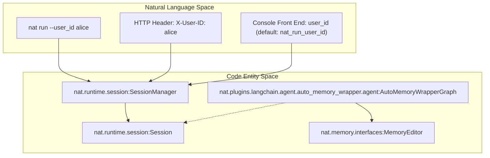
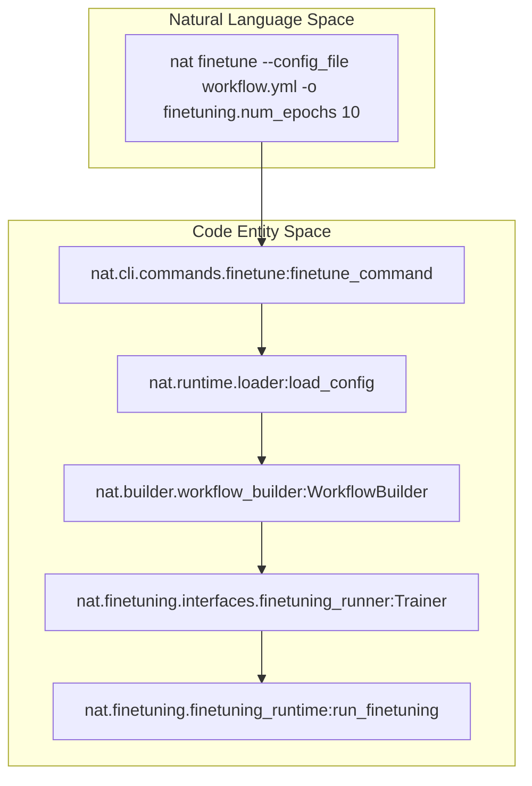

<!-- source: DeepWiki mcp.deepwiki.com · repo NVIDIA/NeMo-Agent-Toolkit · page 3.1 CLI Commands Reference · fetched 2026-10-26 -->

# CLI Commands Reference

<details>
<summary>Relevant source files</summary>

The following files were used as context for generating this wiki page:

- [docs/source/reference/cli.md](docs/source/reference/cli.md)
- [packages/nvidia_nat_core/src/nat/cli/commands/object_store/object_store.py](packages/nvidia_nat_core/src/nat/cli/commands/object_store/object_store.py)
- [packages/nvidia_nat_core/tests/nat/cli/commands/test_object_store_command.py](packages/nvidia_nat_core/tests/nat/cli/commands/test_object_store_command.py)
- [packages/nvidia_nat_mysql/tests/test_mysql_object_store_cli.py](packages/nvidia_nat_mysql/tests/test_mysql_object_store_cli.py)

</details>


This page provides a detailed technical reference for the `nat` command-line interface. The toolkit utilizes a modular CLI architecture where core commands are extended by optional packages such as `nvidia-nat-mcp`, `nvidia-nat-a2a`, and `nvidia-nat-fastmcp` [docs/source/reference/cli.md:22-26]().

Sources: [docs/source/reference/cli.md:22-26]()

---

## Command Hierarchy

The `nat` CLI is structured as a tree of command groups and subcommands, primarily implemented using the `click` library. The entry point allows plugins to extend the interface dynamically through the `nat.cli` entry point group [docs/source/extend/plugins.md:43-43]().

**Diagram: nat CLI Command Tree**

```mermaid
graph TD
    nat["nat"]
    nat --> run["run"]
    nat --> serve["serve"]
    nat --> eval["eval"]
    nat --> finetune["finetune"]
    nat --> optimize["optimize"]
    nat --> validate["validate"]
    nat --> uninstall["uninstall"]

    nat --> start_group["start"]
    start_group --> start_console["console"]
    start_group --> start_fastapi["fastapi"]
    start_group --> start_a2a["a2a"]
    start_group --> start_mcp["mcp"]
    start_group --> start_fastmcp["fastmcp"]
    start_group --> start_a365["a365"]

    nat --> mcp_group["mcp"]
    mcp_group --> mcp_serve["serve"]
    mcp_group --> mcp_client_group["client"]
    mcp_client_group --> mcp_client_ping["ping"]
    mcp_client_group --> mcp_client_tool_group["tool"]
    mcp_client_tool_group --> mcp_client_tool_list["list"]
    mcp_client_tool_group --> mcp_client_tool_call["call"]

    nat --> fastmcp_group["fastmcp"]
    fastmcp_group --> fastmcp_serve["serve"]
    fastmcp_group --> fastmcp_server_group["server"]
    fastmcp_server_group --> fastmcp_server_run["run"]
    fastmcp_server_group --> fastmcp_server_dev["dev"]
    fastmcp_server_group --> fastmcp_server_install_group["install"]
    fastmcp_server_install_group --> fastmcp_server_install_cursor["cursor"]
    fastmcp_server_install_group --> fastmcp_server_install_nat_workflow["nat-workflow"]

    nat --> a2a_group["a2a"]
    a2a_group --> a2a_serve["serve"]
    a2a_group --> a2a_client_group["client"]
    a2a_client_group --> a2a_client_discover["discover"]
    a2a_client_group --> a2a_client_get_info["get_info"]
    a2a_client_group --> a2a_client_get_skills["get_skills"]
    a2a_client_group --> a2a_client_call["call"]

    nat --> info_group["info"]
    info_group --> info_channels["channels"]
    info_group --> info_components["components"]

    nat --> configure_group["configure"]
    configure_group --> configure_channel_group["channel"]
    configure_channel_group --> configure_channel_add["add"]
    configure_channel_group --> configure_channel_remove["remove"]
    configure_channel_group --> configure_channel_update["update"]

    nat --> registry_group["registry"]
    registry_group --> registry_publish["publish"]
    registry_group --> registry_pull["pull"]
    registry_group --> registry_remove["remove"]
    registry_group --> registry_search["search"]

    nat --> workflow_group["workflow"]
    workflow_group --> workflow_create["create"]
    workflow_group --> workflow_delete["delete"]
    workflow_group --> workflow_reinstall["reinstall"]

    nat --> object_store_group["object-store"]
    object_store_group --> object_store_mysql_group["mysql"]
    object_store_mysql_group --> object_store_mysql_upload["upload"]
    object_store_mysql_group --> object_store_mysql_delete["delete"]
    object_store_group --> object_store_redis_group["redis"]
    object_store_redis_group --> object_store_redis_upload["upload"]
    object_store_redis_group --> object_store_redis_delete["delete"]
    object_store_group --> object_store_s3_group["s3"]
    object_store_s3_group --> object_store_s3_upload["upload"]
    object_store_s3_group --> object_store_s3_delete["delete"]

    nat --> sizing_group["sizing"]
    sizing_group --> sizing_calc["calc"]
```



Sources: [docs/source/reference/cli.md:28-94]()

---

## Workflow Execution Commands

These commands are the primary entry points for running and serving agentic workflows defined in YAML or JSON configuration files.

### `nat run`
An alias for `nat start console` [docs/source/reference/cli.md:84-84](). It executes a workflow in a local terminal session. This command is typically used for rapid development and testing [docs/source/reference/cli.md:214-214]().

```bash
nat run --config_file workflow.yml --input "List five subspecies of Aardvarks"
```

| Option | Type | Description |
| :--- | :--- | :--- |
| `--config_file` | `FILE` | **(Required)** Path to the workflow configuration [docs/source/reference/cli.md:117-118](). |
| `--input` | `TEXT` | Initial user input for the workflow [docs/source/reference/cli.md:214-214](). |
| `--user_id` | `TEXT` | User ID for memory isolation; defaults to `nat_run_user_id` in console mode [docs/source/build-workflows/memory.md:97-97](). |
| `--conversation_id` | `TEXT` | ID to isolate separate conversations for the same user [docs/source/build-workflows/memory.md:100-100](). |
| `--override` | `TEXT TEXT` | Overrides configuration values using dot notation [docs/source/reference/cli.md:119-120](). |

Sources: [docs/source/reference/cli.md:112-126](), [docs/source/build-workflows/memory.md:92-102](), [examples/agents/auto_memory_wrapper/README.md:178-186]()

### `nat serve`
An alias for `nat start fastapi` [docs/source/reference/cli.md:85-85](). It launches a FastAPI-based web server to expose the workflow as a microservice [docs/source/reference/cli.md:167-170]().

| Option | Type | Description |
| :--- | :--- | :--- |
| `--host` | `TEXT` | Host to bind the server to [docs/source/reference/cli.md:184-184](). |
| `--port` | `INTEGER` | Port to bind the server to [docs/source/reference/cli.md:185-185](). |
| `--workers` | `INTEGER` | Number of worker processes to run [docs/source/reference/cli.md:187-187](). |
| `--reload` | `BOOLEAN` | Enable auto-reload for development [docs/source/reference/cli.md:186-186](). |
| `--root_path` | `TEXT` | The root path for the API [docs/source/reference/cli.md:183-183](). |

Sources: [docs/source/reference/cli.md:165-200]()

---

## Session and Multi-Tenancy Data Flow

When executing via CLI or Server, the `SessionManager` coordinates user context. Components like the `auto_memory_agent` rely on this context to resolve user identities [docs/source/build-workflows/memory.md:92-95](). The `SessionManager` extracts the `user_id` from sources such as the `X-User-ID` HTTP header or CLI arguments [docs/source/build-workflows/memory.md:94-97]().

**Diagram: Session Context and Memory Data Flow bridging Natural Language Space to Code Entity Space**



Sources: [packages/nvidia_nat_core/src/nat/runtime/session.py:94-110](), [packages/nvidia_nat_langchain/src/nat/plugins/langchain/agent/auto_memory_wrapper/agent.py:40-68](), [docs/source/build-workflows/memory.md:92-102](), [packages/nvidia_nat_core/src/nat/front_ends/console/console_front_end_config.py:28-28]()

---

## Finetuning Command

### `nat finetune`
The `nat finetune` command runs fine-tuning on a workflow using collected execution trajectories [packages/nvidia_nat_core/src/nat/cli/commands/finetune.py:34-34](). It loads configuration settings, initializes trainers and trajectory builders, collects evaluation datasets, and submits training jobs [packages/nvidia_nat_core/src/nat/cli/commands/finetune.py:107-113]().

```bash
nat finetune --config_file workflow.yml -o finetuning.num_epochs 10
```

| Option | Type | Description |
| :--- | :--- | :--- |
| `--config_file` | `PATH` | **(Required)** Path to configuration file containing fine-tuning settings [packages/nvidia_nat_core/src/nat/cli/commands/finetune.py:36-40](). |
| `--dataset` | `PATH` | JSON file with questions and ground-truth answers overriding config settings [packages/nvidia_nat_core/src/nat/cli/commands/finetune.py:41-46](). |
| `--result_json_path` | `STR` | JSON path to extract results from workflow output (default: `$`) [packages/nvidia_nat_core/src/nat/cli/commands/finetune.py:47-54](). |
| `--endpoint` | `STR` | Optional remote endpoint for running the workflow [packages/nvidia_nat_core/src/nat/cli/commands/finetune.py:55-60](). |
| `--override`, `-o` | `TEXT TEXT` | Override config values using dot notation [packages/nvidia_nat_core/src/nat/cli/commands/finetune.py:67-71](). |
| `--validation_dataset` | `PATH` | Validation dataset path for periodic checks [packages/nvidia_nat_core/src/nat/cli/commands/finetune.py:72-77](). |

**Diagram: Finetuning Runtime Execution bridging Natural Language Space to Code Entity Space**



Sources: [packages/nvidia_nat_core/src/nat/cli/commands/finetune.py:34-143](), [packages/nvidia_nat_core/src/nat/finetuning/finetuning_runtime.py:28-159]()

---

## MCP and A2A Command Groups

### MCP (Model Context Protocol)
The `nat mcp` group handles Model Context Protocol (MCP) integrations [docs/source/reference/cli.md:55-61]().

*   **`nat mcp serve`**: Exposes workflow functions as MCP tools [docs/source/reference/cli.md:61-61]().
*   **`nat mcp client tool list`**: Retrieves available tools from a remote server [docs/source/reference/cli.md:60-60]().

### A2A (Agent-to-Agent)
The `nat a2a` group manages Agent-to-Agent protocol communication [docs/source/reference/cli.md:98-103]().

*   **`nat a2a serve`**: Starts an A2A server to expose a workflow as a discoverable agent [docs/source/reference/cli.md:106-107]().
*   **`nat a2a client discover`**: Fetches `AgentCard` information from a remote agent [docs/source/reference/cli.md:155-155]().

Sources: [docs/source/reference/cli.md:55-158]()

---

## Performance and Monitoring Commands

### `nat sizing calc`
Estimates required GPU cluster size based on target user concurrency and response time metrics [docs/source/reference/cli.md:81-81](). This command utilizes the evaluation and profiling systems [examples/notebooks/launchables/GPU_Cluster_Sizing_with_NeMo_Agent_Toolkit.ipynb:9-11]().

### `nat eval`
Runs batch evaluation against datasets to measure workflow accuracy and performance [docs/source/reference/cli.md:42-42](). It supports various dataset formats including `json`, `jsonl`, `csv`, and `parquet` [docs/source/extend/plugins.md:44-44]().

### `nat optimize`
Launches the hyperparameter optimizer for tuning configuration parameters and prompts [docs/source/reference/cli.md:72-72]().

Sources: [docs/source/reference/cli.md:42-81](), [examples/notebooks/launchables/GPU_Cluster_Sizing_with_NeMo_Agent_Toolkit.ipynb:9-11]()

---

## Summary of Management Commands

*   **`nat workflow create`**: Scaffolds a new workflow directory structure [docs/source/reference/cli.md:91-91]().
*   **`nat object-store`**: Manages state across `mysql`, `redis`, and `s3` backends [docs/source/reference/cli.md:62-71](). Redis support is provided by the `nemo-agent-toolkit-redis` plugin [docs/source/build-workflows/memory.md:28-28](). Supported operations include uploading directories (`nat object-store <store> upload <local_dir>`) and deleting keys (`nat object-store <store> delete <keys>`) [packages/nvidia_nat_core/src/nat/cli/commands/object_store/object_store.py:113-171]().
*   **`nat info components`**: Lists all registered agents, LLMs, and tools in the current environment [docs/source/reference/cli.md:54-54]().
*   **`nat validate`**: Validates configuration files against Pydantic schemas [docs/source/reference/cli.md:89-89]().

Sources: [docs/source/reference/cli.md:1-94](), [docs/source/build-workflows/memory.md:27-28](), [packages/nvidia_nat_core/src/nat/cli/commands/object_store/object_store.py:113-171]()

---

