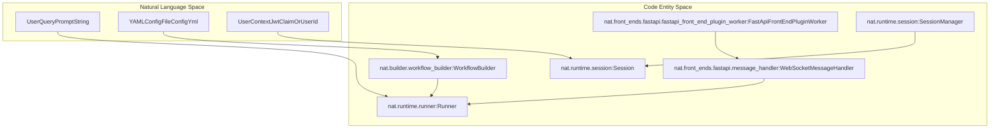
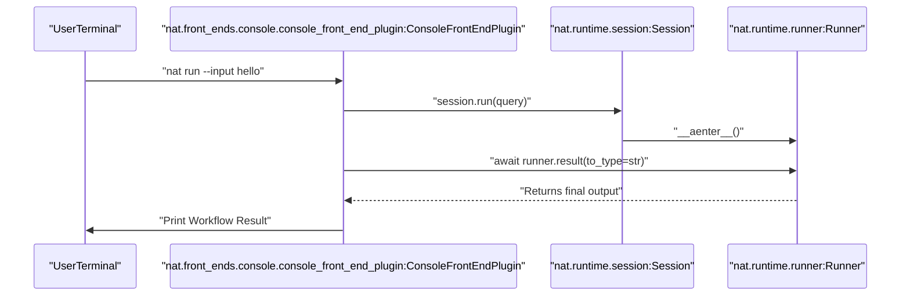
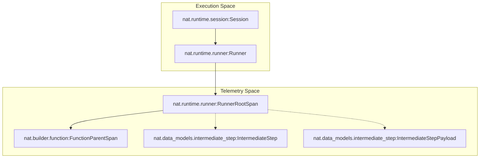

<!-- source: DeepWiki mcp.deepwiki.com · repo NVIDIA/NeMo-Agent-Toolkit · page 3.2 Workflow Execution Modes · fetched 2026-10-26 -->

# Workflow Execution Modes

Relevant source files

The following files were used as context for generating this wiki page:

- [examples/front_ends/simple_auth/src/nat_simple_auth/configs/config.yml](examples/front_ends/simple_auth/src/nat_simple_auth/configs/config.yml)
- [packages/nvidia_nat_core/src/nat/data_models/authentication.py](packages/nvidia_nat_core/src/nat/data_models/authentication.py)
- [packages/nvidia_nat_core/src/nat/front_ends/console/authentication_flow_handler.py](packages/nvidia_nat_core/src/nat/front_ends/console/authentication_flow_handler.py)
- [packages/nvidia_nat_core/src/nat/front_ends/console/console_front_end_config.py](packages/nvidia_nat_core/src/nat/front_ends/console/console_front_end_config.py)
- [packages/nvidia_nat_core/src/nat/front_ends/console/console_front_end_plugin.py](packages/nvidia_nat_core/src/nat/front_ends/console/console_front_end_plugin.py)
- [packages/nvidia_nat_core/src/nat/runtime/session.py](packages/nvidia_nat_core/src/nat/runtime/session.py)
- [packages/nvidia_nat_core/tests/nat/front_ends/auth_flow_handlers/test_console_flow_handler.py](packages/nvidia_nat_core/tests/nat/front_ends/auth_flow_handlers/test_console_flow_handler.py)
- [packages/nvidia_nat_core/tests/nat/front_ends/auth_flow_handlers/test_websocket_flow_handler.py](packages/nvidia_nat_core/tests/nat/front_ends/auth_flow_handlers/test_websocket_flow_handler.py)
- [packages/nvidia_nat_core/tests/nat/runtime/test_session_manager.py](packages/nvidia_nat_core/tests/nat/runtime/test_session_manager.py)
- [packages/nvidia_nat_langchain/tests/agent/test_auto_memory_wrapper.py](packages/nvidia_nat_langchain/tests/agent/test_auto_memory_wrapper.py)

## Purpose and Scope

This page details the various execution modes provided by the NVIDIA NeMo Agent Toolkit (NAT) for running agent workflows. It covers the technical implementation, data flow, key classes, and functions involved in each mode: direct CLI execution via `ConsoleFrontEndPlugin` [packages/nvidia_nat_core/src/nat/front_ends/console/console_front_end_plugin.py:100-106](), server modes (HTTP REST, WebSocket, streaming), embedded Python execution, and stateful per-user execution using `Session` and `SessionManager` [packages/nvidia_nat_core/src/nat/runtime/session.py:94-110]().

For CLI command references, see section 3.1. For server architecture details, see section 6.1.

Sources:
- [packages/nvidia_nat_core/src/nat/front_ends/console/console_front_end_plugin.py:100-106]()
- [packages/nvidia_nat_core/src/nat/runtime/session.py:94-110]()

---

## Execution Modes Overview

NAT supports multiple workflow execution modes designed for diverse use cases and deployment targets:

| Mode | Entry Point / Command | Use Case | State Management |
|:---|:---|:---|:---|
| **Direct CLI** | `nat run` | One-off execution, local testing, scripts | Stateless (single run) |
| **Server HTTP** | `nat serve` (REST) | Synchronous API integration | Per-request |
| **Server WS** | `nat serve` (WebSocket) | Interactive chat, streaming, HITL | Session-based (persistent) |
| **Embedded Python** | `Runner` / `Session` | Programmatic API usage, notebooks | Caller-managed |
| **Protocol / A2A** | `nat a2a serve` | Inter-agent communication protocols | Protocol-defined |

Sources:
- [packages/nvidia_nat_core/src/nat/front_ends/console/console_front_end_plugin.py:100-157]()
- [packages/nvidia_nat_core/src/nat/runtime/session.py:94-121]()

---

## Architecture and Data Flow

All execution modes share the unified `WorkflowBuilder` pattern that constructs workflow instances based on YAML configuration while supporting an extensible middleware chain.

### Conceptual Mapping Diagram: Natural Language Space to Code Entity Space

This mapping illustrates how natural language queries, YAML configurations, and session identifiers map directly to internal framework components such as the workflow builder, runtime runner, and session management layers.

Sources:
- [packages/nvidia_nat_core/src/nat/front_ends/fastapi/message_handler.py:33-40]()
- [packages/nvidia_nat_core/src/nat/runtime/session.py:65-75]()
- [packages/nvidia_nat_core/src/nat/front_ends/fastapi/fastapi_front_end_plugin_worker.py:30-45]()

---

## Direct CLI Execution (`nat run`)

The `nat run` command provides one-shot workflow execution from the terminal. The underlying console plugin loads the workflow configuration, instantiates components, and processes input queries interactively or batch-wise.

### Implementation Details

- The `ConsoleFrontEndPlugin` initializes a `SessionManager` and starts a session context for the run [packages/nvidia_nat_core/src/nat/front_ends/console/console_front_end_plugin.py:100-106]().
- For each query, it enters a runner context via `session.run(query)` and awaits the result [packages/nvidia_nat_core/src/nat/front_ends/console/console_front_end_plugin.py:143-152]().
- **HITL in CLI**: The CLI supports Human-in-the-Loop through `prompt_for_input_cli`, which uses `click.prompt` or a timed `sys.stdin` select loop for text inputs [packages/nvidia_nat_core/src/nat/front_ends/console/console_front_end_plugin.py:62-94]().
- CLI execution handles preflight authentication via `_run_preflight_auth` for providers configured with `preflight_auth=True` [packages/nvidia_nat_core/src/nat/front_ends/console/console_front_end_plugin.py:108-122]().

### Sequence Diagram: CLI Execution Flow

Sources:
- [packages/nvidia_nat_core/src/nat/front_ends/console/console_front_end_plugin.py:62-97]()
- [packages/nvidia_nat_core/src/nat/front_ends/console/console_front_end_plugin.py:130-160]()

---

## Server Mode (`nat serve`)

In server mode, workflows are deployed as HTTP services using FastAPI, supporting both REST endpoints and WebSocket streaming connections.

### HTTP REST API Mode

- The `FastApiFrontEndPluginWorker` configures routes for chat and generation tasks.
- Incoming requests are handled by `SessionManager`, which isolates execution per request or per user session.

### WebSocket and Streaming Mode

- Long-lived connections are managed by `WebSocketMessageHandler` [packages/nvidia_nat_core/src/nat/front_ends/fastapi/message_handler.py:89-130]() and registered via `websocket_endpoint` [packages/nvidia_nat_core/src/nat/front_ends/fastapi/routes/websocket.py:70-130]().
- **Authentication & Restoration**: Before execution, identity credentials (cookies, JWTs, API keys, or trusted headers) are extracted and verified [packages/nvidia_nat_core/src/nat/runtime/user_manager.py:54-132](). If a `conversation_id` is supplied, active conversation state and pending HITL prompts are restored.

Sources:
- [packages/nvidia_nat_core/src/nat/front_ends/fastapi/message_handler.py:89-130]()
- [packages/nvidia_nat_core/src/nat/front_ends/fastapi/routes/websocket.py:70-130]()
- [packages/nvidia_nat_core/src/nat/runtime/user_manager.py:54-132]()

---

## Per-User Execution Mode

Per-user mode provides user-isolated, stateful workflow instances, making it ideal for multi-tenant applications.

### User Identification and State Isolation

- `UserInfo` models user credentials (basic auth, API keys, JWT claims) and derives a deterministic UUID (`user_id`) using UUID v5 namespaces [packages/nvidia_nat_core/src/nat/data_models/user_info.py:105-146]().
- `SessionManager` tracks per-user builders using `PerUserBuilderInfo` and manages session stores, ensuring users cannot access other tenants' workflow state or pending HITL interaction prompts [packages/nvidia_nat_core/src/nat/runtime/session.py:58-92]().

Sources:
- [packages/nvidia_nat_core/src/nat/data_models/user_info.py:105-146]()
- [packages/nvidia_nat_core/src/nat/runtime/session.py:58-92]()

---

## Embedded Python Execution

Developers can embed NAT workflows directly inside custom Python applications or Jupyter notebooks by invoking the runtime classes programmatically.

### Technical Details

- **Session Creation**: Instantiate a session context using `session_manager.session(...)`, which coordinates context propagation and callback handlers [packages/nvidia_nat_core/src/nat/runtime/session.py:134-168]().
- **Runner Execution**: Within the session async context, call `session.run(payload)` to obtain a `Runner` instance [packages/nvidia_nat_core/src/nat/runtime/session.py:135-168]().
- **Type Casting**: Use `runner.result(to_type=...)` to cast outputs into desired Pydantic models or primitive types [packages/nvidia_nat_core/src/nat/front_ends/console/console_front_end_plugin.py:150-150]().

Sources:
- [packages/nvidia_nat_core/src/nat/runtime/session.py:134-168]()
- [packages/nvidia_nat_core/src/nat/front_ends/console/console_front_end_plugin.py:143-152]()

---

## Observability and Trace IDs

Regardless of the execution mode chosen, telemetry and span collection operate uniformly across all runtimes.

### Trace Entity Mapping: Execution Space to Telemetry Hierarchy

This diagram bridges runtime execution classes to their corresponding OpenTelemetry spans and trajectory export formats.

Sources:
- [packages/nvidia_nat_core/src/nat/runtime/session.py:112-168]()
- [packages/nvidia_nat_core/src/nat/builder/context.py:35-45]()

---

