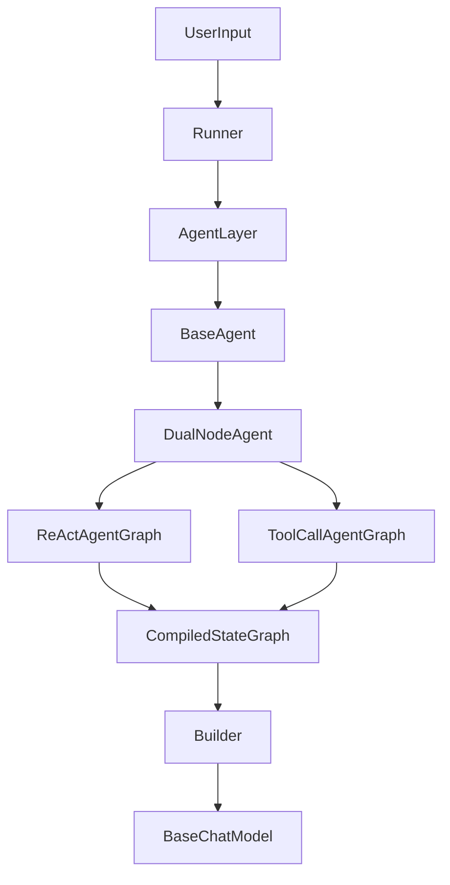
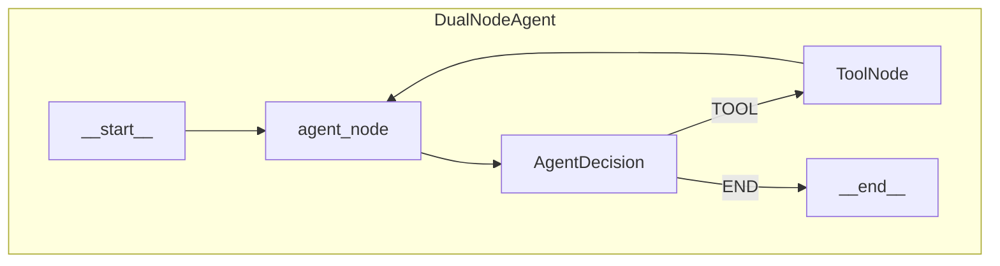

<!-- source: DeepWiki mcp.deepwiki.com · repo NVIDIA/NeMo-Agent-Toolkit · page 4 Agent Workflows · fetched 2026-10-26 -->

# Agent Workflows

<details>
<summary>Relevant source files</summary>

The following files were used as context for generating this wiki page:

- [packages/nvidia_nat_core/src/nat/data_models/api_server.py](packages/nvidia_nat_core/src/nat/data_models/api_server.py)
- [packages/nvidia_nat_core/src/nat/llm/utils/constants.py](packages/nvidia_nat_core/src/nat/llm/utils/constants.py)
- [packages/nvidia_nat_core/src/nat/utils/io/model_processing.py](packages/nvidia_nat_core/src/nat/utils/io/model_processing.py)
- [packages/nvidia_nat_core/tests/nat/data_models/test_api_server.py](packages/nvidia_nat_core/tests/nat/data_models/test_api_server.py)
- [packages/nvidia_nat_langchain/src/nat/plugins/langchain/agent/base.py](packages/nvidia_nat_langchain/src/nat/plugins/langchain/agent/base.py)
- [packages/nvidia_nat_langchain/src/nat/plugins/langchain/agent/dual_node.py](packages/nvidia_nat_langchain/src/nat/plugins/langchain/agent/dual_node.py)
- [packages/nvidia_nat_langchain/src/nat/plugins/langchain/agent/react_agent/agent.py](packages/nvidia_nat_langchain/src/nat/plugins/langchain/agent/react_agent/agent.py)
- [packages/nvidia_nat_langchain/src/nat/plugins/langchain/agent/react_agent/prompt.py](packages/nvidia_nat_langchain/src/nat/plugins/langchain/agent/react_agent/prompt.py)
- [packages/nvidia_nat_langchain/src/nat/plugins/langchain/agent/react_agent/register.py](packages/nvidia_nat_langchain/src/nat/plugins/langchain/agent/react_agent/register.py)
- [packages/nvidia_nat_langchain/src/nat/plugins/langchain/agent/react_agent/register_per_user_agent.py](packages/nvidia_nat_langchain/src/nat/plugins/langchain/agent/react_agent/register_per_user_agent.py)
- [packages/nvidia_nat_langchain/src/nat/plugins/langchain/agent/tool_calling_agent/agent.py](packages/nvidia_nat_langchain/src/nat/plugins/langchain/agent/tool_calling_agent/agent.py)
- [packages/nvidia_nat_langchain/src/nat/plugins/langchain/agent/tool_calling_agent/register.py](packages/nvidia_nat_langchain/src/nat/plugins/langchain/agent/tool_calling_agent/register.py)
- [packages/nvidia_nat_langchain/tests/agent/test_base.py](packages/nvidia_nat_langchain/tests/agent/test_base.py)
- [packages/nvidia_nat_langchain/tests/agent/test_react.py](packages/nvidia_nat_langchain/tests/agent/test_react.py)
- [packages/nvidia_nat_langchain/tests/agent/test_tool_calling.py](packages/nvidia_nat_langchain/tests/agent/test_tool_calling.py)

</details>


This page provides a high-level overview of the built-in agent architectures and workflow types available in the NVIDIA NeMo Agent Toolkit. It outlines their architectural designs, operational models, selection criteria, and YAML configuration patterns. 

For comprehensive technical details, implementation specifics, and advanced configurations, refer to the linked child pages at the end of this document.

---

## What Is an Agent Workflow?

In the NeMo Agent Toolkit, a workflow functions as the top-level executable entity receiving user input and generating a response. When configured with an agent, the toolkit dynamically constructs a control-flow graph using LangGraph, binds the specified LLM clients, and wires auxiliary tool functions to establish multi-step reasoning pipelines.

These agents act as system orchestrators, managing both the reasoning loops of the LLM and calls to external tools or embedded functions. All built-in agents inherit from base classes defined in `nvidia_nat_langchain`, specifically `BaseAgent` [packages/nvidia_nat_langchain/src/nat/plugins/langchain/agent/base.py:138-155]() or specialized graph implementations like `DualNodeAgent` [packages/nvidia_nat_langchain/src/nat/plugins/langchain/agent/dual_node.py:33-44]() for specific interaction patterns. For details on base agent architectures, see [Agent Architecture Overview](#4.1).

Sources: [packages/nvidia_nat_langchain/src/nat/plugins/langchain/agent/base.py:138-155](), [packages/nvidia_nat_langchain/src/nat/plugins/langchain/agent/dual_node.py:33-44]()

---

## Built-In Agent Types Overview

| Workflow `_type` | Graph Nodes Used | Reasoning Model Characteristics | Child Page Reference |
|------------------|------------------|---------------------------------|----------------------|
| `react_agent` | `agent`, `tool` | Iterative reasoning with interleaved tool call and observation loop [packages/nvidia_nat_langchain/src/nat/plugins/langchain/agent/react_agent/agent.py:105-124]() | [ReAct Agent](#4.2) |
| `rewoo_agent` | `planner`, `executor`, `solver` | Up-front complete plan generation, then parallel execution and final synthesis | [ReWOO Agent](#4.3) |
| `tool_calling_agent` | `agent`, `tool` | Utilizes LLM native tool-calling APIs with structured function schemas [packages/nvidia_nat_langchain/src/nat/plugins/langchain/agent/tool_calling_agent/agent.py:55-73]() | [Tool Calling Agent](#4.4) |
| `responses_api_agent` | N/A (specialized) | Designed for OpenAI Responses API and code interpreter workflow | [Responses API Agent](#4.7) |
| `router_agent` | `router_node`, sub-graphs | Routes input to multiple specialized sub-agents dynamically | [Router and Sequential Agents](#4.5) |
| `sequential_executor` | Multiple nodes | Fixed linear execution of a chain of specified functions | [Router and Sequential Agents](#4.5) |
| `parallel_executor` | Parallel nodes | Fans out input to tools concurrently and aggregates text blocks | [Router and Sequential Agents](#4.5) |
| `langgraph_wrapper` | Varies | Allows wrapping third-party LangGraph agents with toolkit NAT features | [LangGraph Wrapper and Existing Agents](#4.6) |
| `reasoning_agent` | `reasoning`, `delegate` | Injects task-specific planning before delegating to another agent | [Reasoning Agent](#4.8) |
| `auto_memory_agent`| `memory_wrapper` | Automatically captures and retrieves context without explicit tool calls | [Auto Memory Wrapper Agent](#4.9) |
| `mixture_of_agents` | `orchestrator`, sub-agents | Master orchestrator routes queries to specialized sub-agents | [Mixture of Agents](#4.10) |
| `experimental_adapter` | Relay Bridge | Adapters for external agents like Claude Code or Cursor | [Experimental Agent Adapters](#4.11) |

Sources: [packages/nvidia_nat_langchain/src/nat/plugins/langchain/agent/react_agent/agent.py:105-124](), [packages/nvidia_nat_langchain/src/nat/plugins/langchain/agent/tool_calling_agent/agent.py:55-73]()

---

## Positioning Agents in the Toolkit Architecture

The following diagram bridges the natural language processing space down to concrete code entities, mapping system orchestrators and execution layers to their corresponding classes in the codebase.

### Diagram: Agent Execution Path from Natural Language to Code Entities



Sources: [packages/nvidia_nat_langchain/src/nat/plugins/langchain/agent/base.py:138-155](), [packages/nvidia_nat_langchain/src/nat/plugins/langchain/agent/react_agent/agent.py:105-124](), [packages/nvidia_nat_langchain/src/nat/plugins/langchain/agent/tool_calling_agent/agent.py:55-73](), [packages/nvidia_nat_langchain/src/nat/plugins/langchain/agent/dual_node.py:33-44]()

---

## Choosing an Agent Type

Agent type selection depends on your use case requirements and interaction model:

| Use Case Scenario | Recommended Agent Type | Corresponding Child Page |
|:-----------------------------------------------------------|:---------------------------|:---------------------------|
| Generic question answering with iterative tool usage | `react_agent` | [ReAct Agent](#4.2) |
| Multi-step tasks with all steps planned in advance | `rewoo_agent` | [ReWOO Agent](#4.3) |
| Leveraging LLMs with built-in native function calling | `tool_calling_agent` | [Tool Calling Agent](#4.4) |
| Interfacing with the OpenAI Responses API and code interpreter | `responses_api_agent` | [Responses API Agent](#4.7) |
| Concurrent execution of independent analysis tools | `parallel_executor` | [Router and Sequential Agents](#4.5) |
| Linear, fixed sequence of function calls | `sequential_executor` | [Router and Sequential Agents](#4.5) |
| Incorporating existing LangGraph agents into NAT | `langgraph_wrapper` | [LangGraph Wrapper and Existing Agents](#4.6) |
| Complex tasks requiring explicit pre-planning phases | `reasoning_agent` | [Reasoning Agent](#4.8) |
| Context retention without explicit memory tool calls | `auto_memory_agent` | [Auto Memory Wrapper Agent](#4.9) |
| Hierarchical agent teams with a master orchestrator | `mixture_of_agents` | [Mixture of Agents](#4.10) |
| Integration with external coding agents (Claude/Cursor) | `experimental_adapter` | [Experimental Agent Adapters](#4.11) |

### Trade-offs Summary

- **ReAct Agent**: Provides flexible iterative reasoning, alternating between thinking and acting. It supports description-based parsing or native tool calls via `use_native_tool_calling` [packages/nvidia_nat_langchain/src/nat/plugins/langchain/agent/react_agent/register.py:95-99](). For details, see [ReAct Agent](#4.2).
- **ReWOO Agent**: Plans the complete execution upfront before executing tools in parallel, concluding with a final synthesis step. This improves latency profiles for independent multi-tool workflows. For details, see [ReWOO Agent](#4.3).
- **Tool Calling Agent**: Purpose-built for LLMs supporting native function calling. It binds tools directly to the LLM to pass schemas at runtime via `llm.bind_tools(tools)` [packages/nvidia_nat_langchain/src/nat/plugins/langchain/agent/tool_calling_agent/agent.py:128-128]() and includes truncation recovery mechanisms via `TruncationRetryConfig` [packages/nvidia_nat_langchain/src/nat/plugins/langchain/agent/tool_calling_agent/register.py:49-78](). For details, see [Tool Calling Agent](#4.4).

Sources: [packages/nvidia_nat_langchain/src/nat/plugins/langchain/agent/react_agent/register.py:95-99](), [packages/nvidia_nat_langchain/src/nat/plugins/langchain/agent/tool_calling_agent/agent.py:128-128](), [packages/nvidia_nat_langchain/src/nat/plugins/langchain/agent/tool_calling_agent/register.py:49-78]()

---

## LangGraph Control Flow Architecture

Built-in agents such as `ReActAgentGraph` and `ToolCallAgentGraph` utilize a dual-node graph architecture provided by `DualNodeAgent`.

### Diagram: Dual-Node Agent Graph Structure (Code Entities)



Sources: [packages/nvidia_nat_langchain/src/nat/plugins/langchain/agent/base.py:131-135](), [packages/nvidia_nat_langchain/src/nat/plugins/langchain/agent/react_agent/agent.py:114-142](), [packages/nvidia_nat_langchain/src/nat/plugins/langchain/agent/tool_calling_agent/agent.py:99-117]()

---

## YAML Agent Configuration Pattern

Agent workflows are declared under the `workflow` block inside YAML configuration files.

### Example: ReAct Agent
```yaml
workflow:
  _type: react_agent
  tool_names: [wikipedia_search, current_datetime, code_generation]
  llm_name: nim_llm
  verbose: true
  parse_agent_response_max_retries: 2
```
Sources: [packages/nvidia_nat_langchain/src/nat/plugins/langchain/agent/react_agent/register.py:61-111]()

### Example: Tool Calling Agent
```yaml
workflow:
  _type: tool_calling_agent
  tool_names: [test]
  llm_name: test
  verbose: true
  handle_tool_errors: true
```
Sources: [packages/nvidia_nat_langchain/src/nat/plugins/langchain/agent/tool_calling_agent/register.py:80-104]()

---

## BaseAgent Shared Utilities

All built-in agents inherit from `BaseAgent`, which supplies common utility methods for state management and LLM token streaming [packages/nvidia_nat_langchain/src/nat/plugins/langchain/agent/base.py:138-155]():

- `_stream_llm(runnable, inputs, config)` — Streams tokens from the LLM, maintaining `tool_calls` integrity by accumulating `AIMessageChunk` items via the `+` operator [packages/nvidia_nat_langchain/src/nat/plugins/langchain/agent/base.py:156-180]().
- `_chunk_to_message(chunk)` — Reconstructs an `AIMessage` from accumulated streaming chunks to preserve tool call wire formats [packages/nvidia_nat_langchain/src/nat/plugins/langchain/agent/base.py:82-102]().
- `AgentDecision` — Enum defining `TOOL` and `END` routing states [packages/nvidia_nat_langchain/src/nat/plugins/langchain/agent/base.py:131-135]().

Sources: [packages/nvidia_nat_langchain/src/nat/plugins/langchain/agent/base.py:82-180]()

---

## Further Reading: Child Pages

For deep technical dives into each agent implementation, see the child pages:

- [Agent Architecture Overview](#4.1) — Explain the base agent architecture, common patterns, and how agents interact with LLMs and tools
- [ReAct Agent](#4.2) — Document the ReAct (Reasoning and Acting) agent pattern with iterative reasoning and tool usage
- [ReWOO Agent](#4.3) — Explain the ReWOO (Reasoning Without Observation) agent with separate planning, execution, and solving phases
- [Tool Calling Agent](#4.4) — Describe the Tool Calling agent that uses native LLM function calling capabilities
- [Router and Sequential Agents](#4.5) — Document the Router agent, Sequential executor, Parallel executor, and Hybrid control flow patterns
- [LangGraph Wrapper and Existing Agents](#4.6) — Explain how to integrate existing LangGraph agents into the toolkit using the langgraph_wrapper workflow type
- [Responses API Agent](#4.7) — Document the Responses API agent type that binds tools directly to the LLM using OpenAI's Responses API
- [Reasoning Agent](#4.8) — Document the reasoning agent wrapper that injects task-specific planning before delegating to another agent
- [Auto Memory Wrapper Agent](#4.9) — Document the auto_memory_agent that wraps any agent to provide automatic memory capture and retrieval, with Zep, Mem0, and Redis backends
- [Mixture of Agents](#4.10) — Document the Mixture of Agents pattern where a master orchestrator routes queries to specialized sub-agents
- [Experimental Agent Adapters](#4.11) — Document the experimental agent workflow adapters for external coding agents (Claude Code, Hermes, Codex, Cursor, OpenClaw) integrating via NeMo Relay

Sources:
- [packages/nvidia_nat_langchain/src/nat/plugins/langchain/agent/base.py:82-180]()
- [packages/nvidia_nat_langchain/src/nat/plugins/langchain/agent/react_agent/agent.py:105-124]()
- [packages/nvidia_nat_langchain/src/nat/plugins/langchain/agent/tool_calling_agent/agent.py:55-112]()
- [packages/nvidia_nat_langchain/src/nat/plugins/langchain/agent/tool_calling_agent/register.py:78-101]()

---

