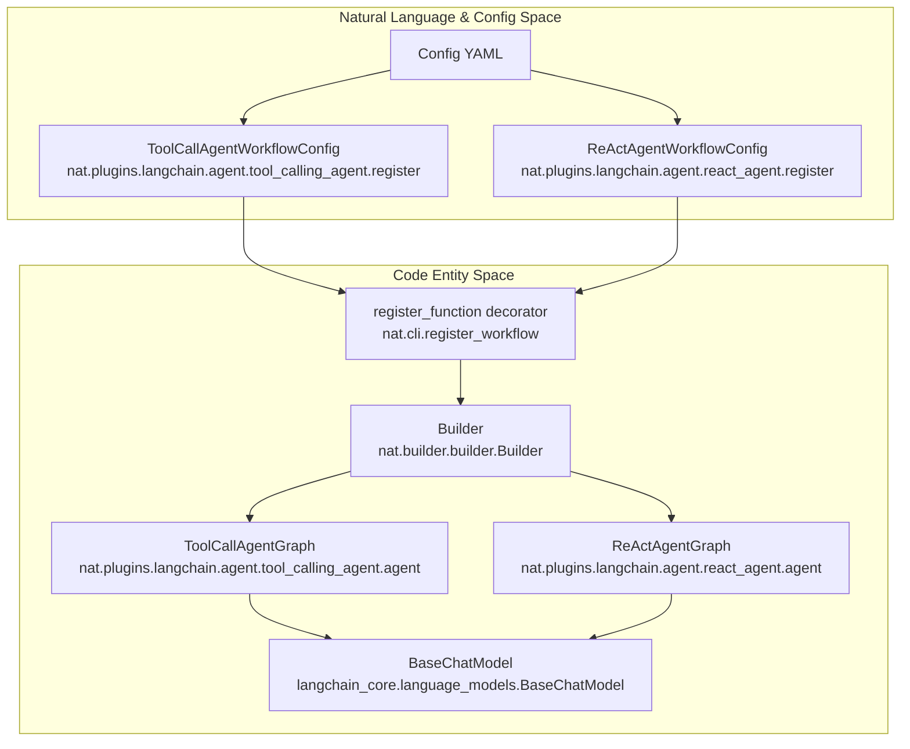
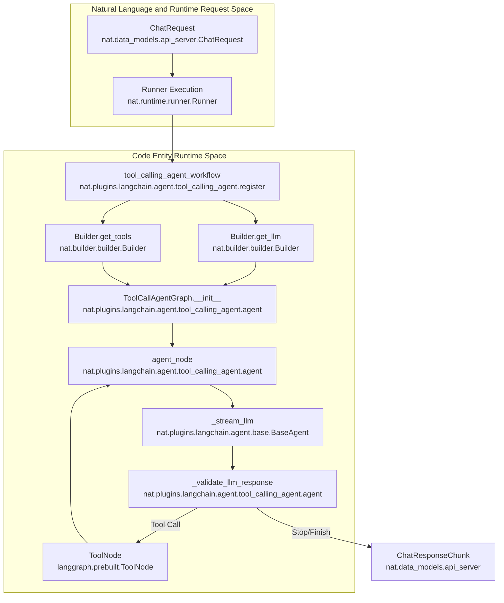

<!-- source: DeepWiki mcp.deepwiki.com · repo NVIDIA/NeMo-Agent-Toolkit · page 4.1 Agent Architecture Overview · fetched 2026-10-26 -->

# Agent Architecture Overview

Relevant source files

The following files were used as context for generating this wiki page:

- [packages/nvidia_nat_core/src/nat/data_models/api_server.py](packages/nvidia_nat_core/src/nat/data_models/api_server.py)
- [packages/nvidia_nat_core/src/nat/llm/utils/constants.py](packages/nvidia_nat_core/src/nat/llm/utils/constants.py)
- [packages/nvidia_nat_core/src/nat/utils/io/model_processing.py](packages/nvidia_nat_core/src/nat/utils/io/model_processing.py)
- [packages/nvidia_nat_core/tests/nat/data_models/test_api_server.py](packages/nvidia_nat_core/tests/nat/data_models/test_api_server.py)
- [packages/nvidia_nat_langchain/src/nat/plugins/langchain/agent/base.py](packages/nvidia_nat_langchain/src/nat/plugins/langchain/agent/base.py)
- [packages/nvidia_nat_langchain/src/nat/plugins/langchain/agent/dual_node.py](packages/nvidia_nat_langchain/src/nat/plugins/langchain/agent/dual_node.py)
- [packages/nvidia_nat_langchain/src/nat/plugins/langchain/agent/react_agent/agent.py](packages/nvidia_nat_langchain/src/nat/plugins/langchain/agent/react_agent/agent.py)
- [packages/nvidia_nat_langchain/src/nat/plugins/langchain/agent/react_agent/prompt.py](packages/nvidia_nat_langchain/src/nat/plugins/langchain/agent/react_agent/prompt.py)
- [packages/nvidia_nat_langchain/src/nat/plugins/langchain/agent/react_agent/register.py](packages/nvidia_nat_langchain/src/nat/plugins/langchain/agent/react_agent/register.py)
- [packages/nvidia_nat_langchain/src/nat/plugins/langchain/agent/react_agent/register_per_user_agent.py](packages/nvidia_nat_langchain/src/nat/plugins/langchain/agent/react_agent/register_per_user_agent.py)
- [packages/nvidia_nat_langchain/src/nat/plugins/langchain/agent/tool_calling_agent/agent.py](packages/nvidia_nat_langchain/src/nat/plugins/langchain/agent/tool_calling_agent/agent.py)
- [packages/nvidia_nat_langchain/src/nat/plugins/langchain/agent/tool_calling_agent/register.py](packages/nvidia_nat_langchain/src/nat/plugins/langchain/agent/tool_calling_agent/register.py)
- [packages/nvidia_nat_langchain/tests/agent/test_base.py](packages/nvidia_nat_langchain/tests/agent/test_base.py)
- [packages/nvidia_nat_langchain/tests/agent/test_react.py](packages/nvidia_nat_langchain/tests/agent/test_react.py)
- [packages/nvidia_nat_langchain/tests/agent/test_tool_calling.py](packages/nvidia_nat_langchain/tests/agent/test_tool_calling.py)

## Purpose and Scope

This document details the foundational agent architecture of the NVIDIA NeMo Agent Toolkit (NAT), covering configuration, instantiation, execution, and interaction models. It explains base agent abstractions (`BaseAgent`, `DualNodeAgent`), workflow lifecycles from YAML configuration to runtime compilation via LangGraph, and how agents interface with LLMs and tools.

Sources: [packages/nvidia_nat_langchain/src/nat/plugins/langchain/agent/base.py:138-154](), [packages/nvidia_nat_langchain/src/nat/plugins/langchain/agent/dual_node.py:16-42]()

---

## Base Agent Concepts and Abstractions

The NeMo Agent Toolkit provides a framework-agnostic agent architecture separating agent workflow logic from specific execution engines. Agents are structured as workflows (directed graphs orchestrating LLM invocations and function calls).

| Agent Type | Pattern | Key Characteristics | Code Reference |
| :--- | :--- | :--- | :--- |
| `react_agent` | Reasoning + Acting | Iterative thought-action-observation loops with dynamic text-based tool selection | [packages/nvidia_nat_langchain/src/nat/plugins/langchain/agent/react_agent/agent.py:114-133]() |
| `tool_calling_agent` | Native Function Calling | Uses native LLM function calling (JSON schemas) for precise tool selection | [packages/nvidia_nat_langchain/src/nat/plugins/langchain/agent/tool_calling_agent/agent.py:99-117]() |
| `per_user_react_agent` | Isolated State | Per-user version of the ReAct agent where each user gets an isolated instance | [packages/nvidia_nat_langchain/src/nat/plugins/langchain/agent/react_agent/register_per_user_agent.py:31-36]() |

Base classes like `BaseAgent` and `DualNodeAgent` handle:
*   **LLM Streaming**: Methods like `_stream_llm` accumulate `AIMessageChunk` items via the `+` operator to preserve `tool_calls` and wire-format metadata [packages/nvidia_nat_langchain/src/nat/plugins/langchain/agent/base.py:82-102](), [packages/nvidia_nat_langchain/src/nat/plugins/langchain/agent/base.py:156-175]().
*   **Tool Execution**: Standardized tool calling with built-in logging [packages/nvidia_nat_langchain/src/nat/plugins/langchain/agent/base.py:119-128]().
*   **Graph Construction**: Assembling `agent` and `tool` nodes using LangGraph `StateGraph` [packages/nvidia_nat_langchain/src/nat/plugins/langchain/agent/dual_node.py:16-42]().

Sources: [packages/nvidia_nat_langchain/src/nat/plugins/langchain/agent/base.py:138-154](), [packages/nvidia_nat_langchain/src/nat/plugins/langchain/agent/react_agent/agent.py:114-133](), [packages/nvidia_nat_langchain/src/nat/plugins/langchain/agent/tool_calling_agent/agent.py:99-117](), [packages/nvidia_nat_langchain/src/nat/plugins/langchain/agent/dual_node.py:16-42]()

---

## Workflow Configuration Architecture

Workflows are declared via YAML files and validated through Pydantic models. 
*   **Workflow Config**: Defines agent parameters such as `tool_names`, `max_iterations`, `max_history`, and `handle_tool_errors` [packages/nvidia_nat_langchain/src/nat/plugins/langchain/agent/tool_calling_agent/register.py:80-104]().
*   **Truncation Retries**: `TruncationRetryConfig` handles recovering from truncated outputs (`finish_reason='length'`) by scaling `max_tokens` [packages/nvidia_nat_langchain/src/nat/plugins/langchain/agent/tool_calling_agent/register.py:49-78]().

### Diagram: Natural Language to Code Entity Mapping (Configuration Space)

Sources: [packages/nvidia_nat_langchain/src/nat/plugins/langchain/agent/tool_calling_agent/register.py:80-135](), [packages/nvidia_nat_langchain/src/nat/plugins/langchain/agent/tool_calling_agent/agent.py:99-151](), [packages/nvidia_nat_langchain/src/nat/plugins/langchain/agent/react_agent/agent.py:114-133]()

---

## Workflow Lifecycle and Runtime

### Diagram: Natural Language to Code Entity Mapping (Runtime Execution)

**Instantiation Phase**:
*   The `Builder` resolves named LLMs and tools from the registry using `get_llm` and `get_tools` [packages/nvidia_nat_langchain/src/nat/plugins/langchain/agent/tool_calling_agent/register.py:122-125]().
*   ReAct agents format tool schemas into the system prompt [packages/nvidia_nat_langchain/src/nat/plugins/langchain/agent/react_agent/agent.py:114-133]().

**Execution Phase**:
*   **State Management**: Agents utilize schemas like `ReActGraphState` or `ToolCallAgentGraphState` [packages/nvidia_nat_langchain/src/nat/plugins/langchain/agent/tool_calling_agent/agent.py:50-52](), [packages/nvidia_nat_langchain/src/nat/plugins/langchain/agent/react_agent/agent.py:106-112]().
*   **Streaming & Error Recovery**: `_stream_llm` supports real-time token delivery. Truncation or empty responses trigger recovery mechanisms [packages/nvidia_nat_langchain/src/nat/plugins/langchain/agent/tool_calling_agent/agent.py:148-151](), [packages/nvidia_nat_langchain/src/nat/plugins/langchain/agent/tool_calling_agent/register.py:49-69]().

Sources: [packages/nvidia_nat_langchain/src/nat/plugins/langchain/agent/react_agent/agent.py:106-133](), [packages/nvidia_nat_langchain/src/nat/plugins/langchain/agent/tool_calling_agent/agent.py:50-151](), [packages/nvidia_nat_langchain/src/nat/plugins/langchain/agent/base.py:156-175](), [packages/nvidia_nat_langchain/src/nat/plugins/langchain/agent/tool_calling_agent/register.py:105-135]()

---

## Agent Component Architecture and Execution Modes

*   **Native Tool Calling**: `ToolCallAgentGraph` binds tools directly via `llm.bind_tools(tools)` [packages/nvidia_nat_langchain/src/nat/plugins/langchain/agent/tool_calling_agent/agent.py:128-128]().
*   **Prompt Formatting**: ReAct agents embed tool names, descriptions, and optional input schemas into prompt templates [packages/nvidia_nat_langchain/src/nat/plugins/langchain/agent/react_agent/agent.py:114-133](), [packages/nvidia_nat_langchain/src/nat/plugins/langchain/agent/react_agent/register.py:89-90]().
*   **Return Direct**: Selected tools can bypass LLM post-processing via `return_direct` [packages/nvidia_nat_langchain/src/nat/plugins/langchain/agent/tool_calling_agent/register.py:101-102]().
*   **Execution Modes**: Supported via direct CLI (`nat run`), FastAPI server REST endpoints serving `ChatRequest` and returning `ChatResponse`, streaming via `_stream_llm`, and per-user isolation using `register_per_user_function` [packages/nvidia_nat_langchain/src/nat/plugins/langchain/agent/react_agent/register_per_user_agent.py:39-43]().

Sources: [packages/nvidia_nat_langchain/src/nat/plugins/langchain/agent/tool_calling_agent/agent.py:99-151](), [packages/nvidia_nat_langchain/src/nat/plugins/langchain/agent/react_agent/register.py:89-90](), [packages/nvidia_nat_langchain/src/nat/plugins/langchain/agent/base.py:156-175](), [packages/nvidia_nat_langchain/src/nat/plugins/langchain/agent/react_agent/register_per_user_agent.py:39-110]()

---

