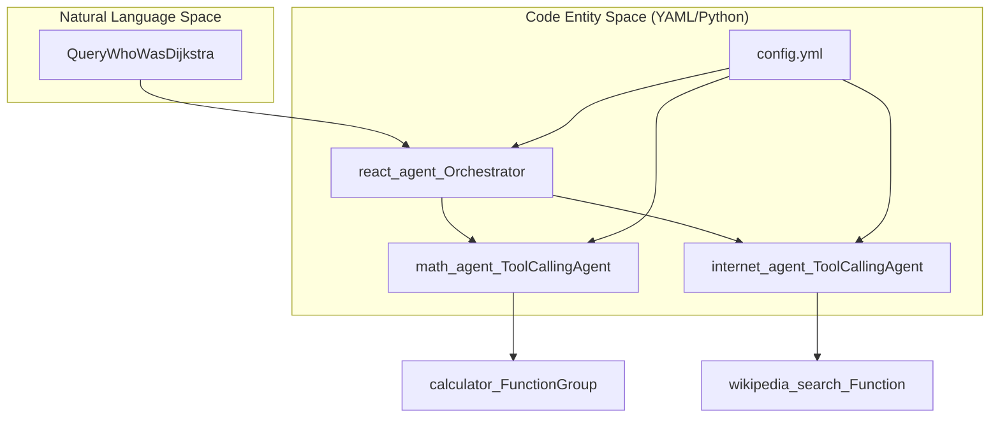
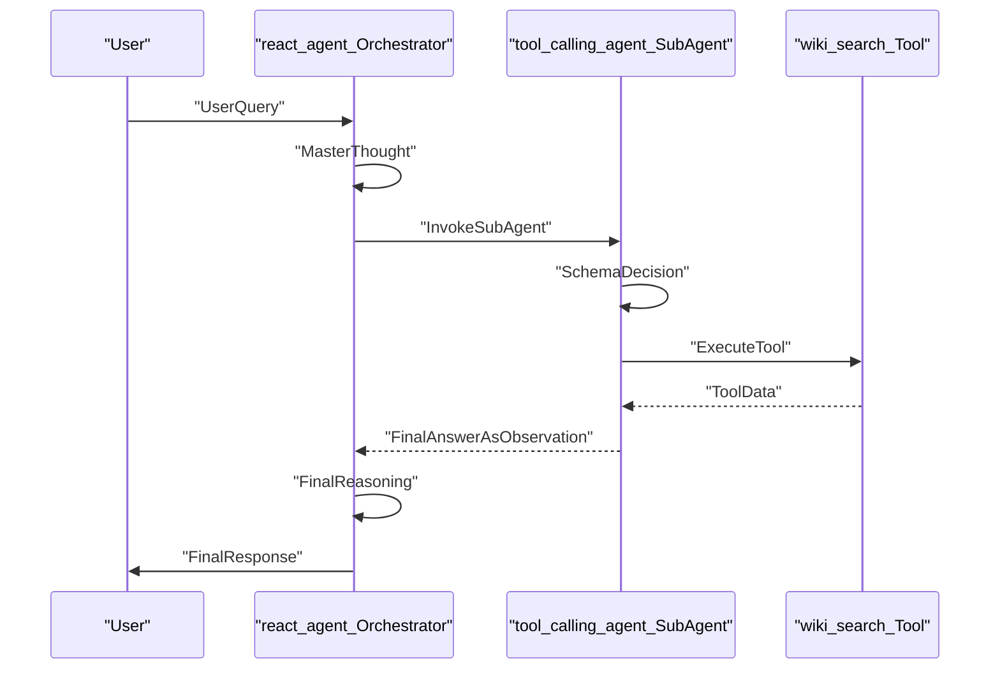
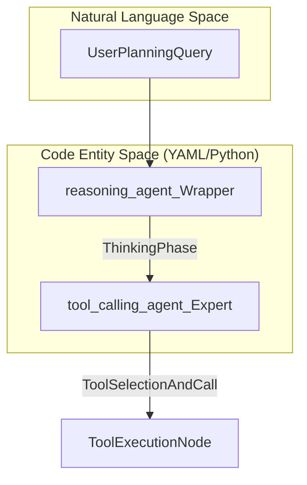

<!-- source: DeepWiki mcp.deepwiki.com · repo NVIDIA/NeMo-Agent-Toolkit · page 4.10 Mixture of Agents · fetched 2026-10-26 -->

# Mixture of Agents

Relevant source files

The following files were used as context for generating this wiki page:

- [examples/agents/mixture_of_agents/README.md](examples/agents/mixture_of_agents/README.md)
- [examples/agents/mixture_of_agents/configs/config.yml](examples/agents/mixture_of_agents/configs/config.yml)
- [examples/agents/react/README.md](examples/agents/react/README.md)
- [examples/agents/tool_calling/README.md](examples/agents/tool_calling/README.md)
- [examples/front_ends/simple_calculator_custom_routes/configs/config-metadata.yml](examples/front_ends/simple_calculator_custom_routes/configs/config-metadata.yml)
- [examples/front_ends/simple_calculator_custom_routes/tests/test_simple_calculator_custom_routes.py](examples/front_ends/simple_calculator_custom_routes/tests/test_simple_calculator_custom_routes.py)
- [examples/getting_started/simple_calculator/src/nat_simple_calculator/configs/config.yml](examples/getting_started/simple_calculator/src/nat_simple_calculator/configs/config.yml)
- [examples/getting_started/simple_web_query/src/nat_simple_web_query/configs/config.yml](examples/getting_started/simple_web_query/src/nat_simple_web_query/configs/config.yml)

This document details the **Mixture of Agents** (MoA) pattern within the NVIDIA NeMo Agent Toolkit (NAT). It covers the architectural design, configuration patterns, data flow, and integration strategies where a master orchestrator dynamically routes tasks to specialized sub-agents [examples/agents/mixture_of_agents/README.md:23-28]().

Sources: [examples/agents/mixture_of_agents/README.md:23-28]()

## Architectural Overview

Within the NeMo Agent Toolkit, the Mixture of Agents pattern leverages the **Workflows-as-Tools** mechanism. This allows complex workflows—such as a `tool_calling_agent` or a `react_agent`—to be registered under the `functions` or `function_groups` block in a configuration file and subsequently invoked by a parent workflow [examples/agents/mixture_of_agents/configs/config.yml:37-69]().

### Hierarchical Orchestration
1.  **Orchestrator Agent**: Typically implemented as a `react_agent` responsible for high-level reasoning and selecting which expert agent to call based on the expert's `description` [examples/agents/mixture_of_agents/README.md:42-43]().
2.  **Expert Agents**: Specialized sub-agents (e.g., `tool_calling_agent`) provisioned with domain-specific tools such as `wikipedia_search`, `current_datetime`, or `calculator` [examples/agents/mixture_of_agents/configs/config.yml:37-59]().
3.  **Recursion and Nesting**: Because any NAT workflow can be exposed as a tool, hierarchies can extend multiple levels deep, enabling sophisticated multi-agent compositions [examples/agents/mixture_of_agents/README.md:44-45]().

Sources: [examples/agents/mixture_of_agents/configs/config.yml:37-69](), [examples/agents/mixture_of_agents/README.md:42-45]()

### Natural Language to Code Entity Mapping

The following diagram maps the high-level conceptual Mixture of Agents architecture to concrete configuration structures and code entities, bridging natural language intent with concrete classes and YAML configuration blocks.

**Mixture of Agents: Concept to Configuration**

Sources: [examples/agents/mixture_of_agents/configs/config.yml:17-70](), [examples/agents/mixture_of_agents/README.md:42-47]()

## Implementation Details

### Configuration Pattern
To implement MoA, sub-agents are declared within the `functions` block. Each sub-agent specifies a `_type` (e.g., `tool_calling_agent`), its bound `tool_names`, an `llm_name`, and a descriptive `description` field that informs the master orchestrator of its capabilities [examples/agents/mixture_of_agents/configs/config.yml:37-59](). 

The top-level `workflow` block then references these registered sub-agents inside its own `tool_names` list [examples/agents/mixture_of_agents/configs/config.yml:67-70]().

Sources: [examples/agents/mixture_of_agents/configs/config.yml:37-70]()

### Data Flow and Execution
When the master orchestrator decides to invoke a sub-agent, execution proceeds through the following steps:
1.  **Action Selection**: The orchestrator (`react_agent`) generates an `Action` targeting the sub-agent identifier (e.g., `Action: internet_agent`) [examples/agents/mixture_of_agents/configs/config.yml:79-84]().
2.  **Invocation**: The toolkit invokes the underlying sub-agent workflow through its standard tool execution interface.
3.  **Sub-Agent Reasoning**: The sub-agent (`tool_calling_agent`) executes its internal graph loop, alternating between `Agent Node` and `Tool Node` execution using schema-driven tool selection [examples/agents/tool_calling/README.md:52-63]().
4.  **Observation**: The terminal output of the sub-agent is packaged and returned to the master orchestrator as an `Observation` [examples/agents/mixture_of_agents/configs/config.yml:85-85]().

**Agent-to-Agent Execution Flow**

Sources: [examples/agents/mixture_of_agents/README.md:48-63](), [examples/agents/tool_calling/README.md:52-65](), [examples/agents/mixture_of_agents/configs/config.yml:73-91]()

## Key Features

| Feature | Description | Source |
| :--- | :--- | :--- |
| **Mixed Frameworks** | Combine `react_agent` orchestrators with `tool_calling_agent` experts. | [examples/agents/mixture_of_agents/README.md:45]() |
| **Agent-as-Tool** | Sub-agents are treated as standard tools, inheriting descriptions and schemas for the master to use. | [examples/agents/mixture_of_agents/README.md:44]() |
| **Specialized LLMs** | Assign different models to different agents (e.g., `agent_orchestrator` vs `agent_executor`). | [examples/agents/mixture_of_agents/configs/config.yml:17-31]() |
| **Error Handling** | Sub-agents can have independent `handle_tool_errors` settings. | [examples/agents/mixture_of_agents/configs/config.yml:42]() |
| **Tool Calling Integration** | Experts can use native tool-calling schemas for precision. | [examples/agents/tool_calling/README.md:42-49]() |

Sources: [examples/agents/mixture_of_agents/README.md:44-45](), [examples/agents/mixture_of_agents/configs/config.yml:17-42](), [examples/agents/tool_calling/README.md:42-49]()

## Reasoning Agent Integration

A common pattern in NAT involves wrapping an agent with a `reasoning_agent`. This allows a high-capability model to execute a planning phase prior to delegating work to a specialized sub-agent. In MoA configurations, this injects a structured "pre-think" phase into the master orchestrator [examples/agents/tool_calling/README.md:96-99](). Here, the `reasoning_agent` points to the expert agent defined in the `functions` block via an augmented function reference [examples/agents/tool_calling/README.md:98-100]().

**Reasoning-to-Agent Delegation and Mapping**

Sources: [examples/agents/tool_calling/README.md:96-100](), [examples/agents/react/README.md:88-92]()

---

