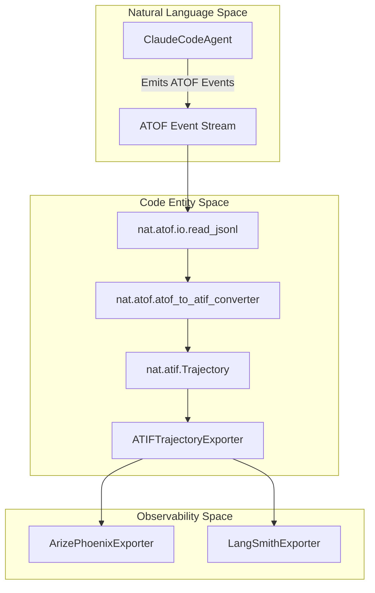
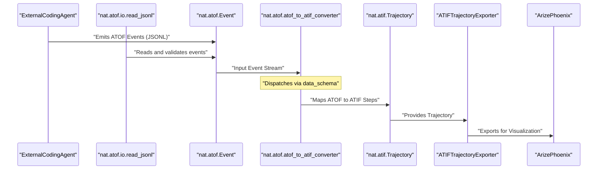

<!-- source: DeepWiki mcp.deepwiki.com · repo NVIDIA/NeMo-Agent-Toolkit · page 4.11 Experimental Agent Adapters · fetched 2026-10-26 -->

# Experimental Agent Adapters

<details>
<summary>Relevant source files</summary>

The following files were used as context for generating this wiki page:

- [README.md](README.md)
- [ci/markdown-link-check-config.json](ci/markdown-link-check-config.json)
- [ci/scripts/path_checks.py](ci/scripts/path_checks.py)
- [ci/vale/styles/config/vocabularies/nat/accept.txt](ci/vale/styles/config/vocabularies/nat/accept.txt)
- [docs/Makefile](docs/Makefile)
- [docs/source/build-workflows/memory.md](docs/source/build-workflows/memory.md)
- [docs/source/components/agents/auto-memory-wrapper/auto-memory-wrapper.md](docs/source/components/agents/auto-memory-wrapper/auto-memory-wrapper.md)
- [docs/source/components/integrations/index.md](docs/source/components/integrations/index.md)
- [docs/source/components/integrations/integrating-oci-generative-ai-models.md](docs/source/components/integrations/integrating-oci-generative-ai-models.md)
- [docs/source/conf.py](docs/source/conf.py)
- [docs/source/index.md](docs/source/index.md)
- [examples/README.md](examples/README.md)
- [examples/agents/auto_memory_wrapper/README.md](examples/agents/auto_memory_wrapper/README.md)
- [examples/memory/memanto/README.md](examples/memory/memanto/README.md)
- [packages/nvidia_nat_langchain/src/nat/plugins/langchain/agent/auto_memory_wrapper/agent.py](packages/nvidia_nat_langchain/src/nat/plugins/langchain/agent/auto_memory_wrapper/agent.py)

</details>


## Purpose and Scope
This page documents the experimental agent workflow adapters within the NVIDIA NeMo Agent Toolkit (NAT) designed for external coding agents and specialized reasoning assistants (Claude Code, Hermes, Codex, Cursor, OpenClaw). These adapters integrate via NeMo Relay and leverage the Agentic Trajectory Observability Format (ATOF) to bridge external agent executions into the NAT telemetry and execution pipeline.

Sources: [pyproject.toml:130-152]()

## Supported Agent Adapters
The toolkit defines optional example packages and configuration entries for various external coding agents and frameworks. These wrap the execution loops of external agents so they can be managed, evaluated, and observed as standard NAT workflows.

| Agent Adapter | Example Package | Description |
| :--- | :--- | :--- |
| **Claude Code** | `nat_claude_code_agent_adapter` | Integration for Anthropic's Claude-based coding assistant [pyproject.toml:137-137]() |
| **Codex** | `nat_codex_agent_adapter` | Support for OpenAI Codex-derived coding workflows [pyproject.toml:138-138]() |
| **Cursor** | `nat_cursor_agent_adapter` | Integration for Cursor-based agentic interactions [pyproject.toml:139-139]() |
| **Hermes** | `nat_hermes_agent_adapter` | Adapter for the Hermes series of fine-tuned reasoning models [pyproject.toml:144-144]() |
| **OpenClaw** | `nat_openclaw_agent_adapter` | Adapter for the OpenClaw open-source agent framework [pyproject.toml:151-151]() |

Sources: [pyproject.toml:130-152]()

## Architecture and Data Flow
The experimental adapters intercept execution events from external agent processes, translating them into unified trace streams via the Relay Telemetry Bridge.

### System Integration Diagram
This diagram bridges the Natural Language Space (external coding agents) to the Code Entity Space by mapping component names to explicit Python symbols and entry points.

Title: External Agent Relay Integration


Sources: [pyproject.toml:130-152]()

## Configuration and Usage
Experimental adapters are configured as workflows within the NAT configuration structure, specifying relay and telemetry options.

### Example Workflow Definition
```yaml
workflow:
  _type: "experimental_claude_code_adapter" 
  llm_name: "nim_llm"
  relay_enabled: true
  telemetry_bridge:
    import_atof: true

llms:
  nim_llm:
    _type: nim
    model_name: nvidia/nemotron-3-nano-30b-a3b
    temperature: 0.0
```

Sources: [pyproject.toml:130-152]()

### Relay Telemetry Sequence
Title: ATOF to ATIF Telemetry Sequence


Sources: [pyproject.toml:130-152]()

## Key Implementation Components
* `nat.atof.io.read_jsonl`: Core utility to ingest ATOF streams and ensure ordering by timestamp.
* `nat.atof.atof_to_atif_converter`: Converter logic mapping raw ATOF scope and mark events into structured ATIF trajectories.
* `ATIFTrajectoryExporter`: Exporter component responsible for shipping trajectories to backends like Arize Phoenix or OpenTelemetry endpoints.

Sources: [pyproject.toml:130-152]()

---

