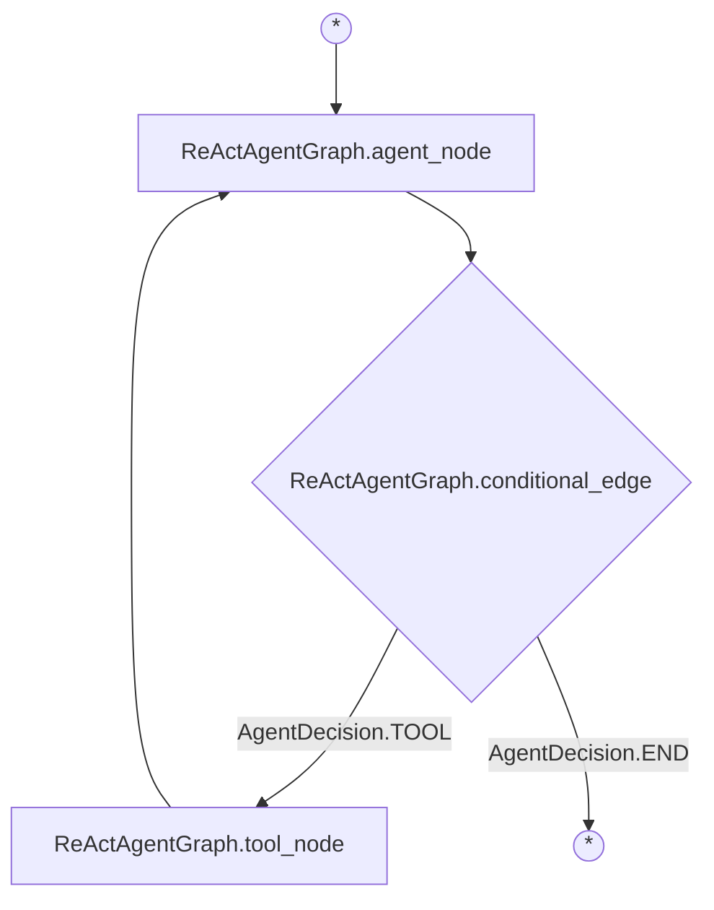
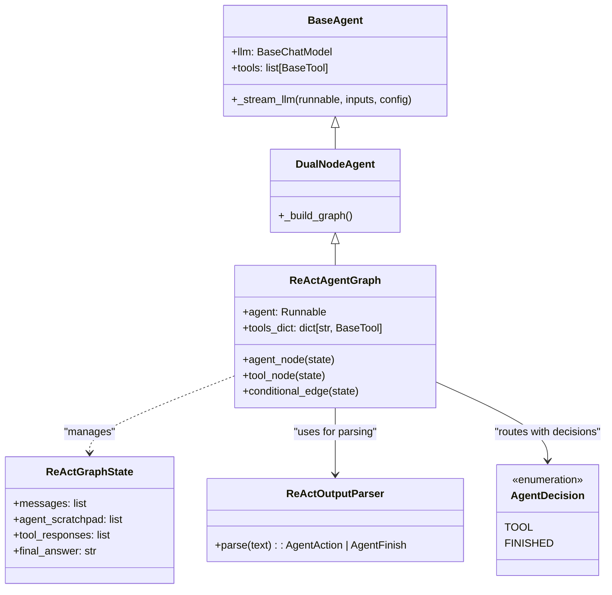
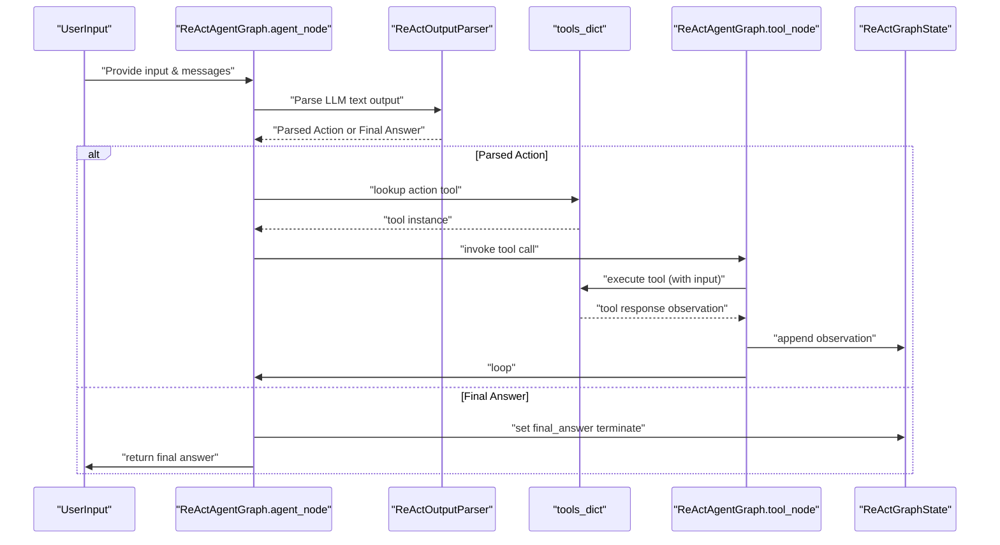

<!-- source: DeepWiki mcp.deepwiki.com · repo NVIDIA/NeMo-Agent-Toolkit · page 4.2 ReAct Agent · fetched 2026-10-26 -->

# ReAct Agent

<details>
<summary>Relevant source files</summary>

The following files were used as context for generating this wiki page:

- [examples/agents/mixture_of_agents/README.md](examples/agents/mixture_of_agents/README.md)
- [examples/agents/mixture_of_agents/configs/config.yml](examples/agents/mixture_of_agents/configs/config.yml)
- [examples/agents/react/README.md](examples/agents/react/README.md)
- [examples/agents/tool_calling/README.md](examples/agents/tool_calling/README.md)
- [examples/front_ends/simple_calculator_custom_routes/configs/config-metadata.yml](examples/front_ends/simple_calculator_custom_routes/configs/config-metadata.yml)
- [examples/front_ends/simple_calculator_custom_routes/tests/test_simple_calculator_custom_routes.py](examples/front_ends/simple_calculator_custom_routes/tests/test_simple_calculator_custom_routes.py)
- [examples/getting_started/simple_calculator/src/nat_simple_calculator/configs/config.yml](examples/getting_started/simple_calculator/src/nat_simple_calculator/configs/config.yml)
- [examples/getting_started/simple_web_query/src/nat_simple_web_query/configs/config.yml](examples/getting_started/simple_web_query/src/nat_simple_web_query/configs/config.yml)
- [packages/nvidia_nat_core/src/nat/data_models/api_server.py](packages/nvidia_nat_core/src/nat/data_models/api_server.py)
- [packages/nvidia_nat_core/src/nat/llm/utils/constants.py](packages/nvidia_nat_core/src/nat/llm/utils/constants.py)
- [packages/nvidia_nat_core/src/nat/utils/io/model_processing.py](packages/nvidia_nat_core/src/nat/utils/io/model_processing.py)
- [packages/nvidia_nat_core/tests/nat/data_models/test_api_server.py](packages/nvidia_nat_core/tests/nat/data_models/test_api_server.py)
- [packages/nvidia_nat_langchain/src/nat/plugins/langchain/agent/base.py](packages/nvidia_nat_langchain/src/nat/plugins/langchain/agent/base.py)
- [packages/nvidia_nat_langchain/src/nat/plugins/langchain/agent/dual_node.py](packages/nvidia_nat_langchain/src/nat/plugins/langchain/agent/dual_node.py)
- [packages/nvidia_nat_langchain/src/nat/plugins/langchain/agent/react_agent/agent.py](packages/nvidia_nat_langchain/src/nat/plugins/langchain/agent/react_agent/agent.py)
- [packages/nvidia_nat_langchain/src/nat/plugins/langchain/agent/react_agent/prompt.py](packages/nvidia_nat_langchain/src/nat/plugins/langchain/agent/react_agent/prompt.py)
- [packages/nvidia_nat_langchain/src/nat/plugins/langchain/agent/react_agent/register.py](packages/nvidia_nat_langchain/src/nat/plugins/langchain/agent/react_agent/register.py)
- [packages/nvidia_nat_langchain/src/nat/plugins/langchain/agent/react_agent/register_per_user_agent.py](packages/nvidia_nat_langchain/src/nat/plugins/langchain/agent/react_agent/register_per_user_agent.py)
- [packages/nvidia_nat_langchain/src/nat/plugins/langchain/agent/tool_calling_agent/agent.py](packages/nvidia_nat_langchain/src/nat/plugins/langchain/agent/tool_calling_agent/agent.py)
- [packages/nvidia_nat_langchain/src/nat/plugins/langchain/agent/tool_calling_agent/register.py](packages/nvidia_nat_langchain/src/nat/plugins/langchain/agent/tool_calling_agent/register.py)
- [packages/nvidia_nat_langchain/tests/agent/test_base.py](packages/nvidia_nat_langchain/tests/agent/test_base.py)
- [packages/nvidia_nat_langchain/tests/agent/test_react.py](packages/nvidia_nat_langchain/tests/agent/test_react.py)
- [packages/nvidia_nat_langchain/tests/agent/test_tool_calling.py](packages/nvidia_nat_langchain/tests/agent/test_tool_calling.py)

</details>


This page documents the ReAct (Reasoning and Acting) agent workflow type in the NVIDIA NeMo Agent Toolkit (`nvidia-nat-langchain` package). It covers the agent's iterative reasoning and tool usage pattern following the Thought-Action-Observation loop, the LangGraph state graph implementation, parsing strategies, configuration options, and prompt variable injection.

It is one of the core built-in agent types; for other agents refer to pages [4.3]() (ReWOO), [4.4]() (Tool Calling), and [4.5]() (Router / Sequential).

---

## Overview

The ReAct agent implements the **ReAct** (Reasoning and Acting) agent pattern where the LLM iteratively performs these steps:
- Emits a natural language **Thought** describing reasoning progress.
- Selects a **Tool** by specifying an **Action** and structured **Action Input**.
- Receives an **Observation** from the tool's response.
- Repeats this cycle until it produces a **Final Answer**.

The agent is realized as a configurable LangGraph managed by `ReActAgentGraph` with primary nodes connected by a conditional edge [packages/nvidia_nat_langchain/src/nat/plugins/langchain/agent/react_agent/agent.py:105-124]().

### Key File Components

| File Path | Description |
| :--- | :--- |
| `packages/nvidia_nat_langchain/src/nat/plugins/langchain/agent/react_agent/agent.py` | `ReActAgentGraph` (agent logic and LangGraph state), `ReActGraphState` (state model) [packages/nvidia_nat_langchain/src/nat/plugins/langchain/agent/react_agent/agent.py:106-134]() |
| `packages/nvidia_nat_langchain/src/nat/plugins/langchain/agent/react_agent/output_parser.py` | `ReActOutputParser` for parsing Thought, Action, and Final Answer [packages/nvidia_nat_langchain/src/nat/plugins/langchain/agent/react_agent/output_parser.py:1-50]() |
| `packages/nvidia_nat_langchain/src/nat/plugins/langchain/agent/react_agent/prompt.py` | Default `SYSTEM_PROMPT` and `USER_PROMPT` templates [packages/nvidia_nat_langchain/src/nat/plugins/langchain/agent/react_agent/prompt.py:1-45]() |
| `packages/nvidia_nat_langchain/src/nat/plugins/langchain/agent/react_agent/register.py` | Workflow config registration (`ReActAgentWorkflowConfig`) [packages/nvidia_nat_langchain/src/nat/plugins/langchain/agent/react_agent/register.py:61-112]() |

Sources: [packages/nvidia_nat_langchain/src/nat/plugins/langchain/agent/react_agent/agent.py:106-134](), [packages/nvidia_nat_langchain/src/nat/plugins/langchain/agent/react_agent/register.py:61-112]()

---

## Think-Act-Observe Loop

Each ReAct iteration involves three logical phases mapped to underlying code methods:

| Phase | Description | Corresponding Code Entity |
| :--- | :--- | :--- |
| **Think** | The LLM processes input, history, and scratchpad, then outputs a `Thought` plus either an `Action` with `Action Input`, or a `Final Answer`. | `ReActAgentGraph.agent_node` [packages/nvidia_nat_langchain/src/nat/plugins/langchain/agent/react_agent/agent.py:114-133]() |
| **Act** | The specified tool is looked up from `tools` and called with the parsed input. | `ReActAgentGraph.tool_node` [packages/nvidia_nat_langchain/src/nat/plugins/langchain/agent/react_agent/agent.py:114-133]() |
| **Observe** | The tool’s response is added to the tool responses; control returns to the agent node for the next reasoning cycle. | `ReActAgentGraph.conditional_edge` [packages/nvidia_nat_langchain/src/nat/plugins/langchain/agent/react_agent/agent.py:114-133]() |

### Graph Flow Diagram (Natural Language to Code Entity Space)


**Title:** Think-Act-Observe Execution Flow
Sources: [packages/nvidia_nat_langchain/src/nat/plugins/langchain/agent/react_agent/agent.py:114-133](), [packages/nvidia_nat_langchain/src/nat/plugins/langchain/agent/base.py:131-136]()

---

## LangGraph State Schema

The LangGraph node state schema is implemented via the Pydantic model `ReActGraphState` [packages/nvidia_nat_langchain/src/nat/plugins/langchain/agent/react_agent/agent.py:106-112]().

| Field | Type | Purpose |
| :--- | :--- | :--- |
| `messages` | `list[BaseMessage]` | Full input messages including user input and agent outputs [packages/nvidia_nat_langchain/src/nat/plugins/langchain/agent/react_agent/agent.py:108](). |
| `agent_scratchpad` | `list[AgentAction]` | Intermediary thoughts and completed tool call actions [packages/nvidia_nat_langchain/src/nat/plugins/langchain/agent/react_agent/agent.py:109](). |
| `tool_responses` | `list[BaseMessage]` | Captured outputs from executed tool calls [packages/nvidia_nat_langchain/src/nat/plugins/langchain/agent/react_agent/agent.py:110](). |
| `final_answer` | `str \| None` | The final output answer from agent; signals termination [packages/nvidia_nat_langchain/src/nat/plugins/langchain/agent/react_agent/agent.py:111](). |

Sources: [packages/nvidia_nat_langchain/src/nat/plugins/langchain/agent/react_agent/agent.py:106-112]()

---

## Class Architecture and Relationships


**Title:** ReAct Agent Class Hierarchy
Sources: [packages/nvidia_nat_langchain/src/nat/plugins/langchain/agent/react_agent/agent.py:106-133](), [packages/nvidia_nat_langchain/src/nat/plugins/langchain/agent/base.py:131-154](), [packages/nvidia_nat_langchain/src/nat/plugins/langchain/agent/dual_node.py:48]()

---

## Output Parsing and Robust Error Handling

The `ReActOutputParser` interprets textual LLM outputs, extracting **Thought**, **Action**, **Action Input**, and **Final Answer**.

- **Reasoning Model Tag Removal**: Reasoning-specialized models have their inner reasoning tags stripped via `remove_r1_think_tags` and `_normalize_react_message_content` [packages/nvidia_nat_langchain/src/nat/plugins/langchain/agent/react_agent/agent.py:76-104]().
- **Retry on Parsing Errors**: When `retry_agent_response_parsing_errors` is enabled, parsing exceptions trigger retries up to `parse_agent_response_max_retries` [packages/nvidia_nat_langchain/src/nat/plugins/langchain/agent/react_agent/agent.py:119-141]().
- **Tool Input Parsing**: Input strings use normalization (`normalize_tool_input_quotes`) and JSON/literal decoding safely [packages/nvidia_nat_langchain/src/nat/plugins/langchain/agent/react_agent/agent.py:119-141]().

Sources: [packages/nvidia_nat_langchain/src/nat/plugins/langchain/agent/react_agent/agent.py:76-141]()

---

## Prompt Injection and LLM Configuration

- **Prompt Variables**: Injects `{tools}` (descriptions and input schemas) and `{tool_names}` into the prompt template [packages/nvidia_nat_langchain/src/nat/plugins/langchain/agent/react_agent/agent.py:119-142]().
- **LLM Binding**: Binds tool schemas natively if `use_native_tool_calling=True` or constructs custom prompt templates with stop sequences [packages/nvidia_nat_langchain/src/nat/plugins/langchain/agent/react_agent/agent.py:119-133]().

Sources: [packages/nvidia_nat_langchain/src/nat/plugins/langchain/agent/react_agent/agent.py:119-142]()

---

## Configuration Reference

The ReAct agent is configured via YAML using `_type: react_agent` [packages/nvidia_nat_langchain/src/nat/plugins/langchain/agent/react_agent/register.py:61-112]().

| Option | Default | Description |
| :--- | :--- | :--- |
| `tool_names` | (required) | List of tool names that the agent can invoke [packages/nvidia_nat_langchain/src/nat/plugins/langchain/agent/react_agent/register.py:67-68](). |
| `llm_name` | (required) | Name of the configured LLM to use [packages/nvidia_nat_langchain/src/nat/plugins/langchain/agent/react_agent/register.py:115](). |
| `parse_agent_response_max_retries` | `1` | Number of retries for parsing LLM output errors [packages/nvidia_nat_langchain/src/nat/plugins/langchain/agent/react_agent/register.py:73-77](). |
| `use_native_tool_calling` | `False` | Whether to enable native LLM tool calling [packages/nvidia_nat_langchain/src/nat/plugins/langchain/agent/react_agent/register.py:95-99](). |
| `max_history` | `15` | Maximum number of messages to keep in history [packages/nvidia_nat_langchain/src/nat/plugins/langchain/agent/react_agent/register.py:103](). |

### Example YAML Snippet
```yaml
workflow:
  _type: react_agent
  tool_names: [wikipedia_search, current_datetime, code_generation]
  llm_name: nim_llm
  verbose: true
  parse_agent_response_max_retries: 2
```

Sources: [packages/nvidia_nat_langchain/src/nat/plugins/langchain/agent/react_agent/register.py:61-112](), [examples/agents/react/configs/config.yml:39-44]()

---

## Dataflow and Execution Sequence


**Title:** ReAct Agent Dataflow Sequence
Sources: [packages/nvidia_nat_langchain/src/nat/plugins/langchain/agent/react_agent/agent.py:106-134]()

---

## Sources
- `packages/nvidia_nat_langchain/src/nat/plugins/langchain/agent/react_agent/agent.py:76-142`
- `packages/nvidia_nat_langchain/src/nat/plugins/langchain/agent/react_agent/register.py:61-112`
- `packages/nvidia_nat_langchain/src/nat/plugins/langchain/agent/react_agent/prompt.py:1-45`
- `packages/nvidia_nat_langchain/src/nat/plugins/langchain/agent/base.py:131-154`
- `packages/nvidia_nat_langchain/src/nat/plugins/langchain/agent/dual_node.py:48`
- `examples/agents/react/configs/config.yml:39-44`

---

