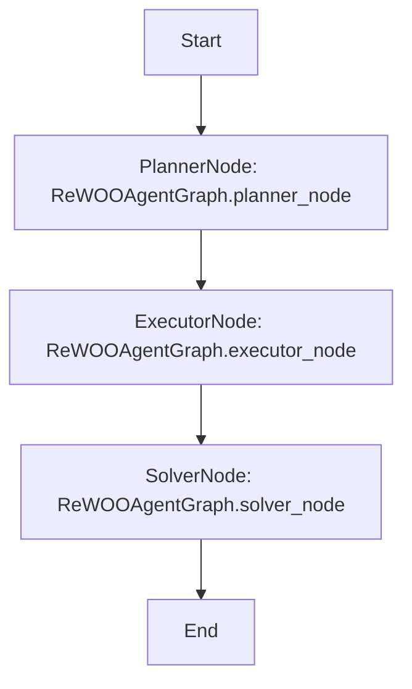
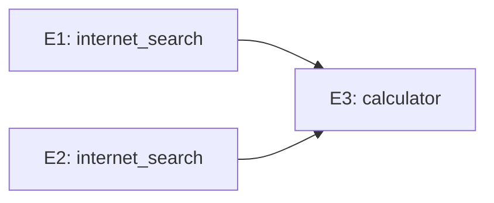
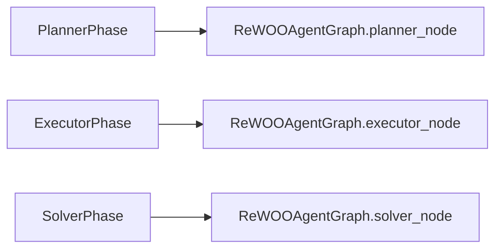
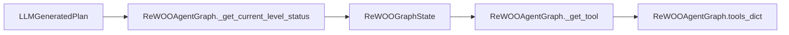

<!-- source: DeepWiki mcp.deepwiki.com · repo NVIDIA/NeMo-Agent-Toolkit · page 4.3 ReWOO Agent · fetched 2026-10-26 -->

# ReWOO Agent

<details>
<summary>Relevant source files</summary>

The following files were used as context for generating this wiki page:

- [examples/HITL/simple_calculator_hitl/README.md](examples/HITL/simple_calculator_hitl/README.md)
- [examples/MCP/simple_auth_mcp/README.md](examples/MCP/simple_auth_mcp/README.md)
- [examples/advanced_agents/alert_triage_agent/README.md](examples/advanced_agents/alert_triage_agent/README.md)
- [examples/agents/data/rewoo.json](examples/agents/data/rewoo.json)
- [examples/agents/rewoo/README.md](examples/agents/rewoo/README.md)
- [examples/evaluation_and_profiling/simple_calculator_eval/README.md](examples/evaluation_and_profiling/simple_calculator_eval/README.md)
- [examples/evaluation_and_profiling/simple_web_query_eval/README.md](examples/evaluation_and_profiling/simple_web_query_eval/README.md)
- [packages/nvidia_nat_langchain/src/nat/plugins/langchain/agent/react_agent/output_parser.py](packages/nvidia_nat_langchain/src/nat/plugins/langchain/agent/react_agent/output_parser.py)
- [packages/nvidia_nat_langchain/src/nat/plugins/langchain/agent/rewoo_agent/agent.py](packages/nvidia_nat_langchain/src/nat/plugins/langchain/agent/rewoo_agent/agent.py)
- [packages/nvidia_nat_langchain/tests/agent/test_rewoo.py](packages/nvidia_nat_langchain/tests/agent/test_rewoo.py)

</details>


## Purpose and Scope

This document describes the ReWOO (Reasoning Without Observation) agent workflow type in the NeMo Agent Toolkit. ReWOO follows a plan-execute-solve pattern that distinctly separates phases of reasoning from execution by implementing upfront planning, systematic tool execution, and final result synthesis in three independent stages.

For comparison, see the iterative reasoning-acting pattern in the [ReAct Agent](4.2) documentation. For general agent architectural concepts, refer to [Agent Architecture Overview](4.1).

Sources: [examples/agents/rewoo/README.md:18-23](), [examples/agents/rewoo/README.md:38-42]()

---

## Overview

The ReWOO agent embodies the "Reasoning Without Observation" paradigm. Unlike the ReAct agent's iterative approach that dynamically reasons and acts based on ongoing observations, ReWOO strictly separates planning from execution:

1. **Complete upfront plan generation:** The `planner` node produces a full execution plan enumerating all needed tool calls before any tool is executed [examples/agents/rewoo/README.md:54-55]().
2. **Plan parsing into a dependency graph:** The planner output is parsed to identify dependencies and create execution levels [packages/nvidia_nat_langchain/src/nat/plugins/langchain/agent/rewoo_agent/agent.py:164-173]().
3. **Systematic, parallelizable execution:** Tools are executed in the `executor` node according to the plan in dependency order, with non-dependent calls executing in parallel [examples/agents/rewoo/README.md:55-56]().
4. **Final synthesis by the solver:** The `solver` node consumes all evidence and generates the final answer without invoking further tools [examples/agents/rewoo/README.md:56-57]().

This methodology enables predictable tool usage and parallel execution of independent steps, optimizing efficiency and control.

### Key Differences from ReAct Agent

| Aspect | ReWOO | ReAct |
| :--- | :--- | :--- |
| **Planning** | Full upfront plan with evidence placeholders [examples/agents/rewoo/README.md:54-55]() | Iterative, observation-driven, partial plans [packages/nvidia_nat_langchain/src/nat/plugins/langchain/agent/react_agent/output_parser.py:93-107]() |
| **Execution** | Parallelized, dependency-driven execution of planned tools [examples/agents/rewoo/README.md:55-56]() | Sequential execution based on immediate observations [packages/nvidia_nat_langchain/src/nat/plugins/langchain/agent/react_agent/output_parser.py:114-136]() |
| **Parallelization** | Yes - independent tools run concurrently [examples/agents/rewoo/README.md:55-56]() | No - strictly sequential |
| **Re-Planning** | Not performed after initial plan [examples/agents/rewoo/README.md:59-59]() | Re-planning after each observation |
| **Predictability** | High - fixed plan execution [examples/agents/rewoo/README.md:40-40]() | Lower - dynamic branching |

Sources: [examples/agents/rewoo/README.md:18-60](), [packages/nvidia_nat_langchain/src/nat/plugins/langchain/agent/rewoo_agent/agent.py:164-173](), [packages/nvidia_nat_langchain/src/nat/plugins/langchain/agent/react_agent/output_parser.py:93-144]()

---

## Architecture

### Three-Node Graph Structure

The architecture of ReWOO divides responsibilities into three distinct nodes, forming a linear workflow that enforces phase separation. The graph is constructed in `ReWOOAgentGraph` [packages/nvidia_nat_langchain/tests/agent/test_rewoo.py:97-101]().

Title: ReWOO Phase Architecture

Sources: [examples/agents/rewoo/README.md:44-59](), [packages/nvidia_nat_langchain/tests/agent/test_rewoo.py:97-101]()

---

### Planner Node

The `planner_node` is responsible for producing a complete plan from the initial user input. The plan consists of natural language steps with interleaved "evidence" placeholders (e.g., `#E1`) representing deferred tool outputs [examples/agents/rewoo/README.md:54-55]().

The planner output is parsed into a list of `ReWOOPlanStep` and `ReWOOEvidence` objects [packages/nvidia_nat_langchain/src/nat/plugins/langchain/agent/rewoo_agent/agent.py:49-58]().

Sources: [examples/agents/rewoo/README.md:54-55](), [packages/nvidia_nat_langchain/src/nat/plugins/langchain/agent/rewoo_agent/agent.py:49-58]()

---

### Executor Node

The `executor_node` processes the plan by:

1. **Parsing dependencies:** Building a dependency map and identifying parallel execution levels [packages/nvidia_nat_langchain/src/nat/plugins/langchain/agent/rewoo_agent/agent.py:164-173]().
2. **Constructing execution levels:** Grouping tools into `execution_levels` where all tools in one level can execute concurrently [packages/nvidia_nat_langchain/src/nat/plugins/langchain/agent/rewoo_agent/agent.py:70]().
3. **Executing tools:** Invoking all tools at the `current_level` in parallel with placeholder substitution [examples/agents/rewoo/README.md:55-56]().
4. **Collecting evidence:** Storing results in `intermediate_results` as a map of placeholders to `ToolMessage` objects [packages/nvidia_nat_langchain/src/nat/plugins/langchain/agent/rewoo_agent/agent.py:72]().

Title: ReWOO Dependency Graph Execution Levels

Sources: [examples/agents/rewoo/README.md:55-56](), [packages/nvidia_nat_langchain/src/nat/plugins/langchain/agent/rewoo_agent/agent.py:69-72]()

---

### Solver Node

The `solver_node` is the final phase. It consumes the original `task` and the `intermediate_results` evidence map [packages/nvidia_nat_langchain/src/nat/plugins/langchain/agent/rewoo_agent/agent.py:72-74](). The solver generates the final answer through an LLM call using `solver_prompt` [examples/agents/rewoo/README.md:103-104]().

Sources: [examples/agents/rewoo/README.md:56-57](), [packages/nvidia_nat_langchain/src/nat/plugins/langchain/agent/rewoo_agent/agent.py:72-74]()

---

## Configuration

### Workflow Configuration YAML

The ReWOO agent is configured using the `_type: rewoo_agent` workflow type [examples/agents/rewoo/configs/config.yml:36-37]().

```yaml
workflow:
  _type: rewoo_agent
  tool_names: [calculator, internet_search__search]
  llm_name: nim_llm
  verbose: true
  tool_call_max_retries: 3
```
Sources: [examples/agents/rewoo/README.md:85-91](), [examples/agents/rewoo/configs/config.yml:36-41]()

### Configuration Options Reference

| Option | Type | Default | Description |
| :--- | :--- | :--- | :--- |
| `tool_names` | List[str] | **Required** | Tools available to the agent [examples/agents/rewoo/README.md:91-91]() |
| `llm_name` | str | **Required** | Name of LLM configuration [examples/agents/rewoo/README.md:93-93]() |
| `verbose` | bool | false | Enable verbose logging [examples/agents/rewoo/README.md:95-95]() |
| `planner_prompt` | str \| null | null | Custom planner prompt override [examples/agents/rewoo/README.md:101-101]() |
| `solver_prompt` | str \| null | null | Custom solver prompt override [examples/agents/rewoo/README.md:103-103]() |
| `tool_call_max_retries` | int | 3 | Retries for failed tool calls [examples/agents/rewoo/README.md:105-105]() |
| `raise_tool_call_error` | bool | true | Raise exception immediately on tool failure [examples/agents/rewoo/README.md:115-115]() |
| `max_history` | int | 15 | Max messages to keep in history [examples/agents/rewoo/README.md:107-107]() |
| `log_response_max_chars` | int | 1000 | Max characters for tool response logs [examples/agents/rewoo/README.md:109-109]() |

Sources: [examples/agents/rewoo/README.md:91-116]()

---

## Implementation Details

### Data Flow Entities

The internal state of the agent is managed by the `ReWOOGraphState` Pydantic model [packages/nvidia_nat_langchain/src/nat/plugins/langchain/agent/rewoo_agent/agent.py:60-75]().

| Field | Type | Description |
| :--- | :--- | :--- |
| `task` | `HumanMessage` | The original user query [packages/nvidia_nat_langchain/src/nat/plugins/langchain/agent/rewoo_agent/agent.py:63]() |
| `plan` | `AIMessage` | The raw plan generated by the planner [packages/nvidia_nat_langchain/src/nat/plugins/langchain/agent/rewoo_agent/agent.py:64]() |
| `evidence_map` | `dict[str, ReWOOPlanStep]` | Mapping from placeholders (e.g., `#E1`) to step info [packages/nvidia_nat_langchain/src/nat/plugins/langchain/agent/rewoo_agent/agent.py:69]() |
| `execution_levels` | `list[list[str]]` | Groups of placeholders for parallel execution [packages/nvidia_nat_langchain/src/nat/plugins/langchain/agent/rewoo_agent/agent.py:70]() |
| `current_level` | `int` | Current execution level being processed [packages/nvidia_nat_langchain/src/nat/plugins/langchain/agent/rewoo_agent/agent.py:71]() |
| `intermediate_results` | `dict[str, ToolMessage]` | Results collected during execution [packages/nvidia_nat_langchain/src/nat/plugins/langchain/agent/rewoo_agent/agent.py:72]() |

Sources: [packages/nvidia_nat_langchain/src/nat/plugins/langchain/agent/rewoo_agent/agent.py:60-75]()

---

## Natural Language Space to Code Entity Space Diagrams

### Mapping ReWOO Agent Workflow Components to Code Entities

Title: Natural Language to Code Mapping for Workflow Components

Sources: [packages/nvidia_nat_langchain/src/nat/plugins/langchain/agent/rewoo_agent/agent.py:77-121]()

### Tool Interaction and State Management

Title: Tool Interaction and State Management Code Entities

Sources: [packages/nvidia_nat_langchain/src/nat/plugins/langchain/agent/rewoo_agent/agent.py:60-143]()

---

