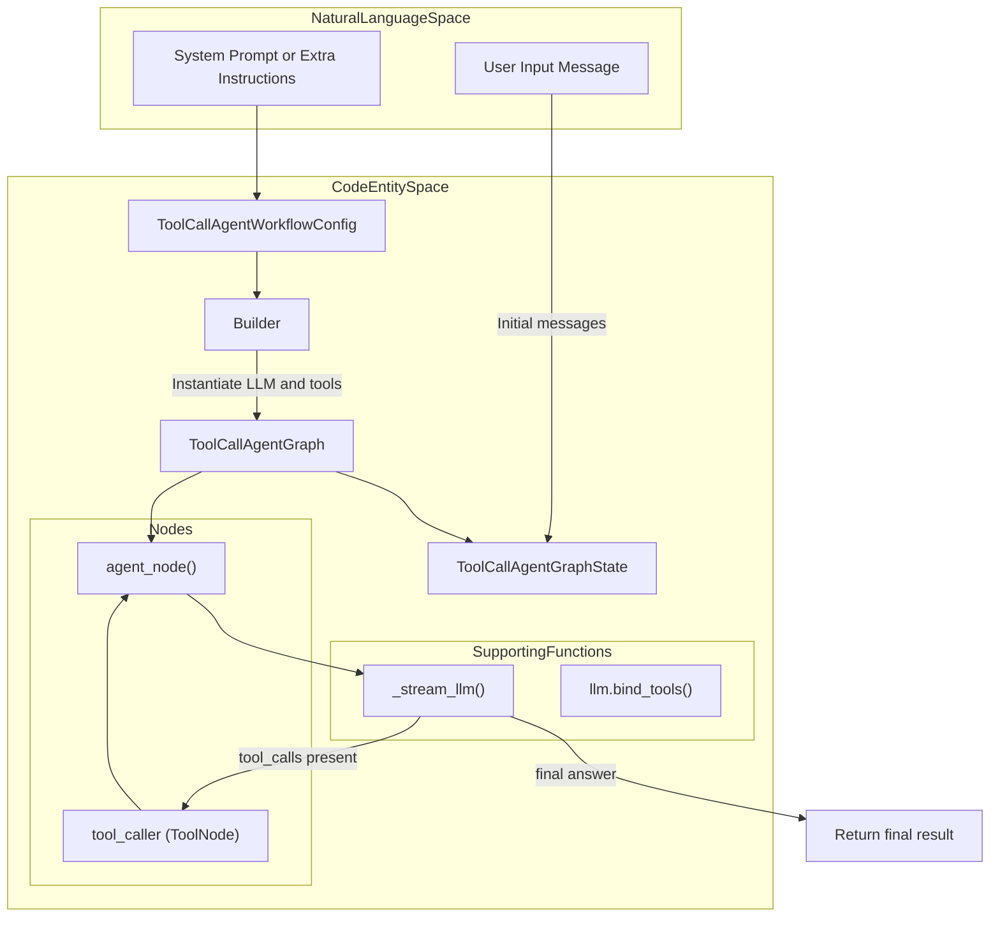
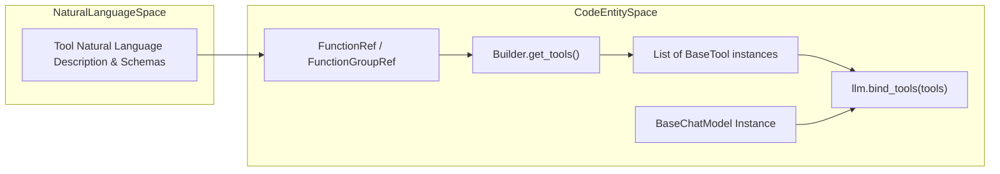

<!-- source: DeepWiki mcp.deepwiki.com · repo NVIDIA/NeMo-Agent-Toolkit · page 4.4 Tool Calling Agent · fetched 2026-10-26 -->

# Tool Calling Agent

<details>
<summary>Relevant source files</summary>

The following files were used as context for generating this wiki page:

- [examples/agents/mixture_of_agents/README.md](examples/agents/mixture_of_agents/README.md)
- [examples/agents/mixture_of_agents/configs/config.yml](examples/agents/mixture_of_agents/configs/config.yml)
- [examples/agents/react/README.md](examples/agents/react/README.md)
- [examples/agents/tool_calling/README.md](examples/agents/tool_calling/README.md)
- [examples/front_ends/simple_calculator_custom_routes/configs/config-metadata.yml](examples/front_ends/simple_calculator_custom_routes/configs/config-metadata.yml)
- [examples/front_ends/simple_calculator_custom_routes/tests/test_simple_calculator_custom_routes.py](examples/front_ends/simple_calculator_custom_routes/tests/test_simple_calculator_custom_routes.py)
- [examples/getting_started/simple_calculator/src/nat_simple_calculator/configs/config.yml](examples/getting_started/simple_calculator/src/nat_simple_calculator/configs/config.yml)
- [examples/getting_started/simple_web_query/src/nat_simple_web_query/configs/config.yml](examples/getting_started/simple_web_query/src/nat_simple_web_query/configs/config.yml)
- [packages/nvidia_nat_core/src/nat/data_models/api_server.py](packages/nvidia_nat_core/src/nat/data_models/api_server.py)
- [packages/nvidia_nat_core/src/nat/llm/utils/constants.py](packages/nvidia_nat_core/src/nat/llm/utils/constants.py)
- [packages/nvidia_nat_core/src/nat/utils/io/model_processing.py](packages/nvidia_nat_core/src/nat/utils/io/model_processing.py)
- [packages/nvidia_nat_core/tests/nat/data_models/test_api_server.py](packages/nvidia_nat_core/tests/nat/data_models/test_api_server.py)
- [packages/nvidia_nat_langchain/src/nat/plugins/langchain/agent/base.py](packages/nvidia_nat_langchain/src/nat/plugins/langchain/agent/base.py)
- [packages/nvidia_nat_langchain/src/nat/plugins/langchain/agent/dual_node.py](packages/nvidia_nat_langchain/src/nat/plugins/langchain/agent/dual_node.py)
- [packages/nvidia_nat_langchain/src/nat/plugins/langchain/agent/react_agent/agent.py](packages/nvidia_nat_langchain/src/nat/plugins/langchain/agent/react_agent/agent.py)
- [packages/nvidia_nat_langchain/src/nat/plugins/langchain/agent/react_agent/prompt.py](packages/nvidia_nat_langchain/src/nat/plugins/langchain/agent/react_agent/prompt.py)
- [packages/nvidia_nat_langchain/src/nat/plugins/langchain/agent/react_agent/register.py](packages/nvidia_nat_langchain/src/nat/plugins/langchain/agent/react_agent/register.py)
- [packages/nvidia_nat_langchain/src/nat/plugins/langchain/agent/react_agent/register_per_user_agent.py](packages/nvidia_nat_langchain/src/nat/plugins/langchain/agent/react_agent/register_per_user_agent.py)
- [packages/nvidia_nat_langchain/src/nat/plugins/langchain/agent/tool_calling_agent/agent.py](packages/nvidia_nat_langchain/src/nat/plugins/langchain/agent/tool_calling_agent/agent.py)
- [packages/nvidia_nat_langchain/src/nat/plugins/langchain/agent/tool_calling_agent/register.py](packages/nvidia_nat_langchain/src/nat/plugins/langchain/agent/tool_calling_agent/register.py)
- [packages/nvidia_nat_langchain/tests/agent/test_base.py](packages/nvidia_nat_langchain/tests/agent/test_base.py)
- [packages/nvidia_nat_langchain/tests/agent/test_react.py](packages/nvidia_nat_langchain/tests/agent/test_react.py)
- [packages/nvidia_nat_langchain/tests/agent/test_tool_calling.py](packages/nvidia_nat_langchain/tests/agent/test_tool_calling.py)

</details>


## Purpose and Scope

The **Tool Calling Agent** is a specialized agent workflow that leverages the native function calling capabilities of modern Large Language Models (LLMs). Instead of relying on parsing textual output to identify tool usage (as in the ReAct pattern), this agent uses structured tool call APIs (like OpenAI's `tool_calls`) to perform direct function invocation `[packages/nvidia_nat_langchain/src/nat/plugins/langchain/agent/tool_calling_agent/register.py:80-84]()`. This approach yields more reliable tool selection, precise invocation using input schemas, and supports advanced features such as parallel tool execution and robust error handling.

This agent is implemented primarily using the `ToolCallAgentGraph` class `[packages/nvidia_nat_langchain/src/nat/plugins/langchain/agent/tool_calling_agent/agent.py:99-103]()`, which extends a dual-node agent architecture (`DualNodeAgent`) `[packages/nvidia_nat_langchain/src/nat/plugins/langchain/agent/dual_node.py:33-46]()` with explicit reasoning and tool execution nodes driven by the LLM’s structured function call outputs.

Sources: `[packages/nvidia_nat_langchain/src/nat/plugins/langchain/agent/tool_calling_agent/register.py:80-84]`, `[packages/nvidia_nat_langchain/src/nat/plugins/langchain/agent/tool_calling_agent/agent.py:99-103]`, `[packages/nvidia_nat_langchain/src/nat/plugins/langchain/agent/dual_node.py:33-46]()`

---

## Overview

The Tool Calling Agent leverages LLMs that support function calling natively. It binds tool input schemas directly to the LLM client, enabling the model to produce valid, type-safe invocation requests `[packages/nvidia_nat_langchain/src/nat/plugins/langchain/agent/tool_calling_agent/agent.py:127-129]()`.

### Key Characteristics

| Feature | Tool Calling Agent Implementation |
|---------|-----------------------------------|
| **State Management** | Uses `ToolCallAgentGraphState` maintaining conversation `messages: list[BaseMessage]` `[packages/nvidia_nat_langchain/src/nat/plugins/langchain/agent/tool_calling_agent/agent.py:50-53]()` |
| **Tool Binding** | Binds tools natively to the LLM using `llm.bind_tools(tools)` for schema-driven calls `[packages/nvidia_nat_langchain/src/nat/plugins/langchain/agent/tool_calling_agent/agent.py:127-129]()` |
| **Execution Loop** | Alternates between an `agent_node` (reasoning) and a `tool_caller` node (tool execution) `[packages/nvidia_nat_langchain/src/nat/plugins/langchain/agent/tool_calling_agent/agent.py:145-146]()` |
| **Error Handling** | Configurable `handle_tool_errors` flag, supports retries on truncation & empty responses `[packages/nvidia_nat_langchain/src/nat/plugins/langchain/agent/tool_calling_agent/register.py:86-97]()` |
| **Streaming Support** | Supports token-level incremental streaming via LangChain’s `astream` API `[packages/nvidia_nat_langchain/src/nat/plugins/langchain/agent/base.py:156-162]()` |
| **Direct Return Tools** | Supports a `return_direct` tool list to short-circuit agent reasoning and return tool responses immediately `[packages/nvidia_nat_langchain/src/nat/plugins/langchain/agent/tool_calling_agent/register.py:101-103]()` |

Sources: `[packages/nvidia_nat_langchain/src/nat/plugins/langchain/agent/tool_calling_agent/agent.py:50-151]`, `[packages/nvidia_nat_langchain/src/nat/plugins/langchain/agent/tool_calling_agent/register.py:80-103]`, `[packages/nvidia_nat_langchain/src/nat/plugins/langchain/agent/base.py:156-162]()`

---

## Architecture

The Tool Calling Agent employs a **Dual-Node Graph** model, iterating between reasoning in the `agent_node` and execution of tools in the `tool_caller` node `[packages/nvidia_nat_langchain/src/nat/plugins/langchain/agent/tool_calling_agent/agent.py:145-146]()`. The agent maintains conversation context, issuing LLM calls that return structured function (tool) invocation requests.

### Data Flow Diagram: Natural Language Interface to Code Components

Title: "Tool Calling Agent Logic Flow"


Sources: `[packages/nvidia_nat_langchain/src/nat/plugins/langchain/agent/tool_calling_agent/agent.py:50-151]`, `[packages/nvidia_nat_langchain/src/nat/plugins/langchain/agent/tool_calling_agent/register.py:105-126]()`

---

### Tool Binding: From Natural Language Descriptions to Bound LLMs

Title: "Tool Registration and Binding Sequence"


Sources: `[packages/nvidia_nat_langchain/src/nat/plugins/langchain/agent/tool_calling_agent/register.py:120-125]`, `[packages/nvidia_nat_langchain/src/nat/plugins/langchain/agent/tool_calling_agent/agent.py:127-129]()`

---

## Configuration

The agent is configured using the `ToolCallAgentWorkflowConfig` Pydantic model `[packages/nvidia_nat_langchain/src/nat/plugins/langchain/agent/tool_calling_agent/register.py:80-104]`, which extends `AgentBaseConfig`.

### Key Config Parameters

| Parameter | Type | Default | Description |
|-----------|------|---------|-------------|
| `tool_names` | `list[FunctionRef \| FunctionGroupRef]` | `[]` | List of tools provided to the agent `[packages/nvidia_nat_langchain/src/nat/plugins/langchain/agent/tool_calling_agent/register.py:86-87]()` |
| `handle_tool_errors` | `bool` | `True` | Specify ability to handle tool calling errors `[packages/nvidia_nat_langchain/src/nat/plugins/langchain/agent/tool_calling_agent/register.py:88-88]()` |
| `max_iterations` | `int` | `15` | Number of tool calls before stopping `[packages/nvidia_nat_langchain/src/nat/plugins/langchain/agent/tool_calling_agent/register.py:89-89]()` |
| `max_history` | `int` | `15` | Maximum messages in conversation history `[packages/nvidia_nat_langchain/src/nat/plugins/langchain/agent/tool_calling_agent/register.py:90-90]()` |
| `truncation_retry` | `TruncationRetryConfig` | default instance | Configuration for retrying truncated LLM responses `[packages/nvidia_nat_langchain/src/nat/plugins/langchain/agent/tool_calling_agent/register.py:92-93]()` |
| `max_empty_response_retries` | `int` | `0` | Retries when LLM returns no content/tool calls `[packages/nvidia_nat_langchain/src/nat/plugins/langchain/agent/tool_calling_agent/register.py:94-97]()` |
| `system_prompt` | `str \| None` | `None` | System prompt for the agent `[packages/nvidia_nat_langchain/src/nat/plugins/langchain/agent/tool_calling_agent/register.py:98-98]()` |
| `additional_instructions` | `str \| None` | `None` | Additional instructions appended to system prompt `[packages/nvidia_nat_langchain/src/nat/plugins/langchain/agent/tool_calling_agent/register.py:99-100]()` |
| `return_direct` | `list[FunctionRef] \| None` | `None` | Tools that return responses directly `[packages/nvidia_nat_langchain/src/nat/plugins/langchain/agent/tool_calling_agent/register.py:101-103]()` |

Sources: `[packages/nvidia_nat_langchain/src/nat/plugins/langchain/agent/tool_calling_agent/register.py:80-104]()`

---

## Implementation Details

### 1. Truncation Retry Logic

To handle the case where the LLM response is truncated due to token limits (`finish_reason='length'`), the agent supports configurable automatic retries with increased token budgets `[packages/nvidia_nat_langchain/src/nat/plugins/langchain/agent/tool_calling_agent/register.py:49-78]()`.

- `TruncationRetryConfig` allows two mutually exclusive strategies:
  - **Fixed token increments**: `token_increment` (defaults to 1024 if `max_retries > 0` and neither is set) `[packages/nvidia_nat_langchain/src/nat/plugins/langchain/agent/tool_calling_agent/register.py:52-69]()`.
  - **Multiplicative scaling**: `token_scaling` (e.g., 1.5) `[packages/nvidia_nat_langchain/src/nat/plugins/langchain/agent/tool_calling_agent/register.py:58-61]()`.

The scaling function is built via `build_scaling_fn()` `[packages/nvidia_nat_langchain/src/nat/plugins/langchain/agent/tool_calling_agent/register.py:71-78]()`.

Sources: `[packages/nvidia_nat_langchain/src/nat/plugins/langchain/agent/tool_calling_agent/register.py:49-78]()`

### 2. Agent Node (`agent_node`)

The agent node is the reasoning driver invoking the LLM:

- It streams the LLM output asynchronously via `_stream_llm`, accumulating chunks into a complete `AIMessage` `[packages/nvidia_nat_langchain/src/nat/plugins/langchain/agent/base.py:156-162]()`.
- It validates the response, checking for empty responses or truncation and applying the configured retry logic `[packages/nvidia_nat_langchain/src/nat/plugins/langchain/agent/tool_calling_agent/agent.py:145-148]()`.
- It appends the valid response to the message history in `state.messages` `[packages/nvidia_nat_langchain/src/nat/plugins/langchain/agent/tool_calling_agent/agent.py:50-53]()`.

Sources: `[packages/nvidia_nat_langchain/src/nat/plugins/langchain/agent/tool_calling_agent/agent.py:99-151]`, `[packages/nvidia_nat_langchain/src/nat/plugins/langchain/agent/base.py:156-162]()`

### 3. Tool Node

The tool node uses the standard LangGraph `ToolNode` `[packages/nvidia_nat_langchain/src/nat/plugins/langchain/agent/tool_calling_agent/agent.py:146-146]()`, which executes tools given the structured parameters from the LLM.

- It supports execution error handling controlled by `handle_tool_errors` `[packages/nvidia_nat_langchain/src/nat/plugins/langchain/agent/tool_calling_agent/agent.py:146-146]()`.
- It identifies tools that should return results directly without further LLM processing via the `return_direct` list `[packages/nvidia_nat_langchain/src/nat/plugins/langchain/agent/tool_calling_agent/agent.py:147-147]()`.

Sources: `[packages/nvidia_nat_langchain/src/nat/plugins/langchain/agent/tool_calling_agent/agent.py:146-147]()`

### 4. Finish Reason Validation

The agent relies on `LLMFinishReason` constants (e.g., `STOP`, `LENGTH`, `TOOL_CALLS`) to determine the next step in the graph `[packages/nvidia_nat_core/src/nat/llm/utils/constants.py:1-32]()`. If the model returns `tool_calls`, the graph routes to the tool execution node; if it returns `stop`, the workflow completes.

Sources: `[packages/nvidia_nat_core/src/nat/llm/utils/constants.py:1-32]()`

---

## Example Usage

### Sample YAML Configuration for Tool Calling Agent Workflow

This configuration defines a tool calling agent that uses built-in or registered tools:

```yaml
functions:
  wikipedia_search:
    _type: wiki_search
  current_datetime:
    _type: current_datetime

llms:
  agent_llm:
    _type: nim
    model_name: nvidia/nemotron-3-nano-30b-a3b

workflow:
  _type: tool_calling_agent
  tool_names: [wikipedia_search, current_datetime]
  llm_name: agent_llm
  verbose: true
  handle_tool_errors: true
```

### CLI Command to Run Agent

```bash
nat run --config_file=config.yml --input "who was Dijkstra?"
```

Sources: `[packages/nvidia_nat_langchain/src/nat/plugins/langchain/agent/tool_calling_agent/register.py:80-126]()`

---

