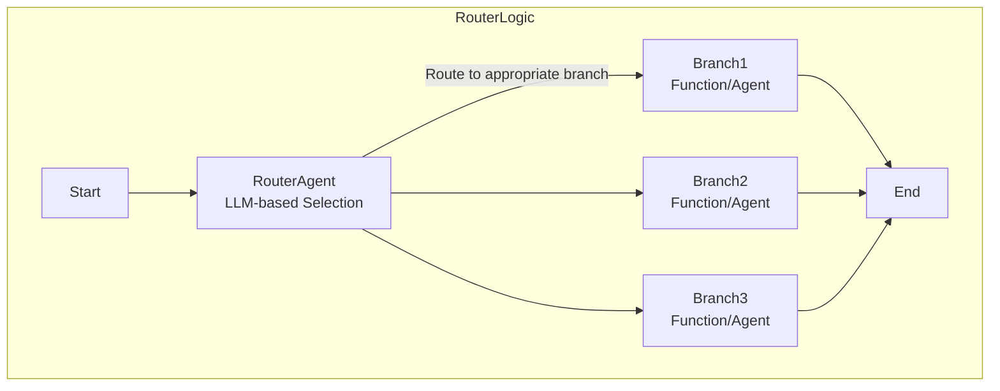
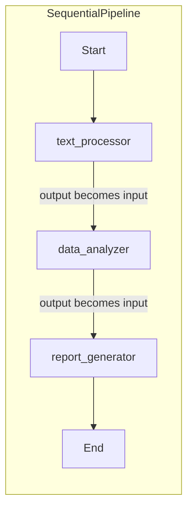
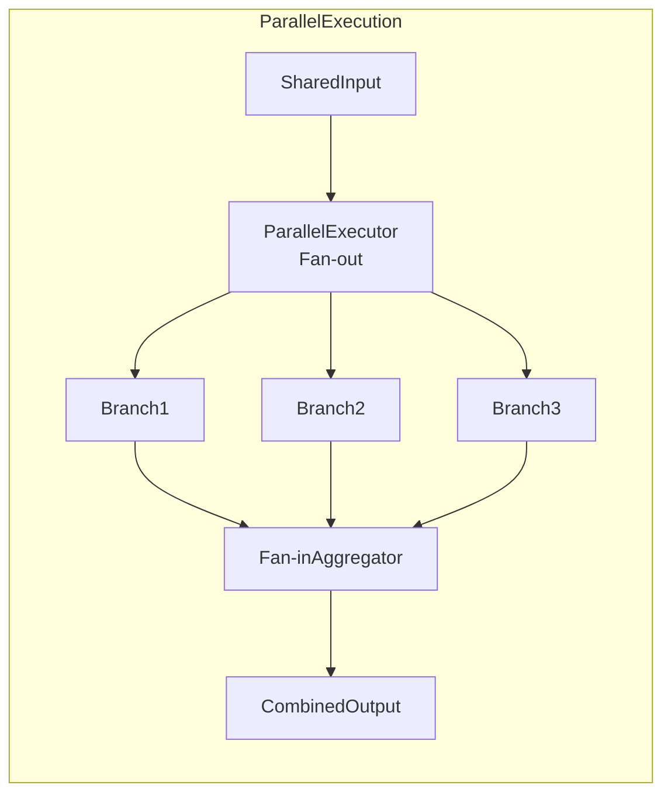
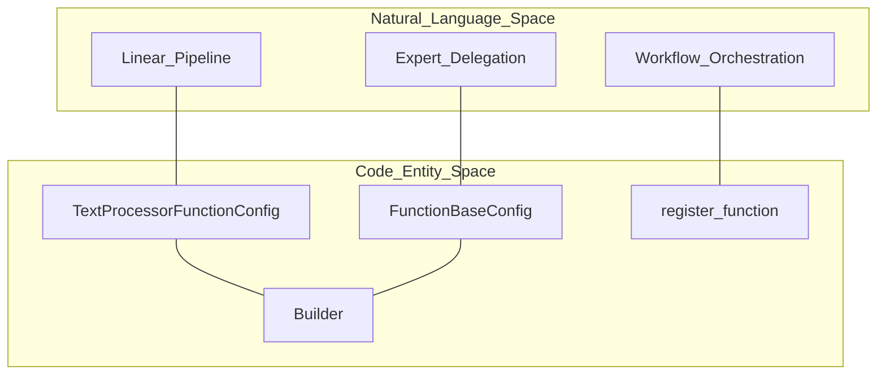

<!-- source: DeepWiki mcp.deepwiki.com · repo NVIDIA/NeMo-Agent-Toolkit · page 4.5 Router and Sequential Agents · fetched 2026-10-26 -->

# Router and Sequential Agents

Relevant source files

The following files were used as context for generating this wiki page:

- [docs/source/_static/sequential_executor.png](docs/source/_static/sequential_executor.png)
- [docs/source/components/agents/sequential-executor/sequential-executor.md](docs/source/components/agents/sequential-executor/sequential-executor.md)
- [examples/advanced_agents/alert_triage_agent/src/nat_alert_triage_agent/register.py](examples/advanced_agents/alert_triage_agent/src/nat_alert_triage_agent/register.py)
- [examples/advanced_agents/alert_triage_agent/tests/test_alert_triage_agent_workflow.py](examples/advanced_agents/alert_triage_agent/tests/test_alert_triage_agent_workflow.py)
- [examples/control_flow/router_agent/src/nat_router_agent/configs/config.yml](examples/control_flow/router_agent/src/nat_router_agent/configs/config.yml)
- [examples/control_flow/router_agent/tests/test_control_flow_example_router_agent.py](examples/control_flow/router_agent/tests/test_control_flow_example_router_agent.py)
- [examples/control_flow/sequential_executor/README.md](examples/control_flow/sequential_executor/README.md)
- [examples/control_flow/sequential_executor/src/nat_sequential_executor/__init__.py](examples/control_flow/sequential_executor/src/nat_sequential_executor/__init__.py)
- [examples/control_flow/sequential_executor/src/nat_sequential_executor/configs/config.yml](examples/control_flow/sequential_executor/src/nat_sequential_executor/configs/config.yml)
- [examples/control_flow/sequential_executor/src/nat_sequential_executor/register.py](examples/control_flow/sequential_executor/src/nat_sequential_executor/register.py)
- [examples/control_flow/sequential_executor/tests/test_example_sequential_executor.py](examples/control_flow/sequential_executor/tests/test_example_sequential_executor.py)
- [examples/custom_functions/plot_charts/tests/test_plot_charts_workflow.py](examples/custom_functions/plot_charts/tests/test_plot_charts_workflow.py)
- [examples/frameworks/agno_personal_finance/tests/test_agno_personal_finance_workflow.py](examples/frameworks/agno_personal_finance/tests/test_agno_personal_finance_workflow.py)
- [examples/frameworks/semantic_kernel_demo/tests/test_semantic_kernel_workflow.py](examples/frameworks/semantic_kernel_demo/tests/test_semantic_kernel_workflow.py)
- [examples/getting_started/simple_calculator/tests/test_simple_calculator_workflow.py](examples/getting_started/simple_calculator/tests/test_simple_calculator_workflow.py)
- [examples/getting_started/simple_web_query/tests/test_simple_web_query_workflow.py](examples/getting_started/simple_web_query/tests/test_simple_web_query_workflow.py)

## Purpose and Scope

This document details the Router agent for multi-agent orchestration, the Sequential executor for linear workflows, the Parallel executor, and hybrid control flow patterns in the NVIDIA NeMo Agent Toolkit. These patterns support **deterministic control flow** in AI workflows where explicit branching or linear/parallel function execution is required without iterative LLM reasoning loops.

- **Router Agent:** Routes user requests to appropriate specialized functions or agents using a single LLM inference.
- **Sequential Executor:** Chains multiple functions linearly where each step's output is input to the next [examples/control_flow/sequential_executor/src/nat_sequential_executor/register.py:52-78]().
- **Parallel Executor:** Fans out an identical input to multiple branches concurrently and aggregates their results.
- **Hybrids:** Compose these building blocks to create sophisticated workflows combining conditional routing, linear, and parallel execution [docs/source/components/agents/sequential-executor/sequential-executor.md:18-60]().

This contrasts with iterative reasoning agents (e.g., ReAct, ReWOO) which perform multi-turn reasoning and tool use cycles.

Sources: [examples/control_flow/sequential_executor/src/nat_sequential_executor/register.py:52-78](), [docs/source/components/agents/sequential-executor/sequential-executor.md:18-60]()

## Router Agent

### Overview

The Router agent performs conditional **single-step routing** by invoking an LLM to select the most suitable branch for processing the input. After a single routing decision, the chosen branch (function, agent, or another router) executes deterministically without further reasoning cycles.

This pattern is useful for dynamic **delegation and workload partitioning** among specialized agents or functions, enhancing modularity and scalability.

Title: Router Agent Logic Flow

Sources: [examples/control_flow/sequential_executor/src/nat_sequential_executor/register.py:35-80]()

### Key Characteristics

- Inference happens once per user input for the routing decision.
- Routes to any registered function or agent (can be layered routers).
- No repeated cycles of reasoning or tool calls within the router itself.
- Deterministic, lightweight delegation.

Sources: [examples/control_flow/sequential_executor/src/nat_sequential_executor/register.py:35-80]()

## Sequential Executor

### Overview

The Sequential executor enables a **deterministic linear pipeline** where multiple functions execute one after another [docs/source/components/agents/sequential-executor/sequential-executor.md:18-20](). Each function receives as input the output of its predecessor, forming a chain of transformations or computations.

This is ideal for deterministic workflows requiring well-defined data flows without conditional branches or iteration.

Title: Sequential Executor Pipeline

Sources: [docs/source/components/agents/sequential-executor/sequential-executor.md:27-60]()

### Key Characteristics & Configuration Options

- **No LLM involved** for control flow decisions.
- **Fixed execution order** defined explicitly in configuration via `tool_list` [docs/source/components/agents/sequential-executor/sequential-executor.md:91]().
- **Type compatibility checking**: Optionally validates that the output type of one function is compatible with the input type of the next using `raise_type_incompatibility` [docs/source/components/agents/sequential-executor/sequential-executor.md:93]().
- **Exception handling**: Configurable via `return_error_on_exception` to gracefully capture errors and return messages [docs/source/components/agents/sequential-executor/sequential-executor.md:95]().
- **Early Exit**: Supports a specialized exit mechanism (`SequentialExecutorExit`) to terminate the chain early and return a custom message [docs/source/components/agents/sequential-executor/sequential-executor.md:102]().

Sources: [docs/source/components/agents/sequential-executor/sequential-executor.md:87-103]()

### Implementation and Registration

Sequential workflows use custom configuration classes inheriting from `FunctionBaseConfig` and are registered with `@register_function` [examples/control_flow/sequential_executor/src/nat_sequential_executor/register.py:29-34](). For instance, `TextProcessorFunctionConfig`, `DataAnalyzerFunctionConfig`, and `ReportGeneratorFunctionConfig` define discrete steps in the pipeline [examples/control_flow/sequential_executor/src/nat_sequential_executor/register.py:29-185]().

Sources: [examples/control_flow/sequential_executor/src/nat_sequential_executor/register.py:29-185]()

## Parallel Executor

### Overview

The Parallel executor fans out a single input to multiple branch functions concurrently. Once all branches finish, their outputs are aggregated, typically as appended text blocks.

This increases efficiency when multiple independent analyses or transformations can be performed in parallel.

Title: Parallel Executor Fan-Out/Fan-In

Sources: [docs/source/components/agents/sequential-executor/sequential-executor.md:133-141]()

## Composition and Hybrid Control Flow

These building blocks (router, sequential, parallel) can be composed and nested to create hybrid, sophisticated workflows meeting complex orchestration needs.

### Natural Language Space to Code Entity Space Mapping: Control Flows

This diagram bridges conceptual control flow components with their implementation classes and decorators in the toolkit.

Title: Control Flow Component Mapping

Sources: [examples/control_flow/sequential_executor/src/nat_sequential_executor/register.py:29-34](), [examples/control_flow/sequential_executor/src/nat_sequential_executor/register.py:20-23]()

## Summary of Patterns

| Pattern | Description | Best For |
|---|---|---|
| **Linear** | `sequential_executor` | Fixed, deterministic pipelines (A → B → C) [docs/source/components/agents/sequential-executor/sequential-executor.md:38-42](). |
| **Conditional** | `router_agent` | Dynamic delegation to specialized handlers [examples/control_flow/sequential_executor/src/nat_sequential_executor/register.py:35-80](). |
| **Concurrent** | `parallel_executor` | Latency reduction by running independent analyses concurrently. |
| **Hybrid** | Nested Control Flows | Complex workflows combining state graphs, routers, and sequential pipelines. |

Sources: [docs/source/components/agents/sequential-executor/sequential-executor.md:38-42](), [examples/control_flow/sequential_executor/src/nat_sequential_executor/register.py:35-80]()

---

