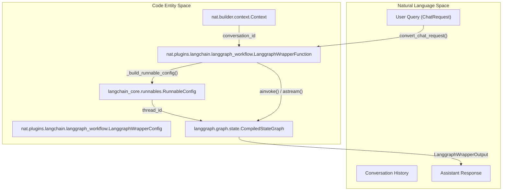
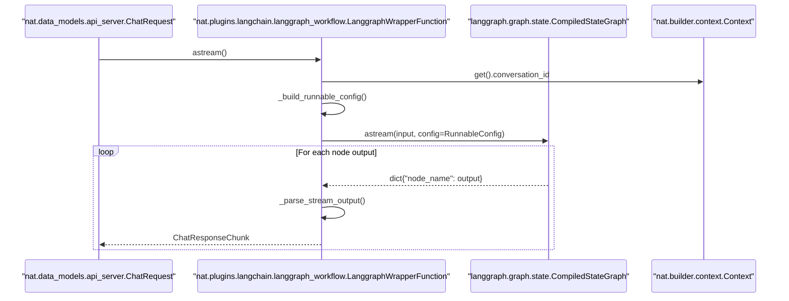
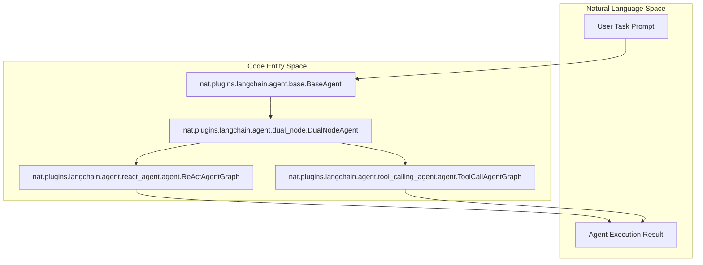

<!-- source: DeepWiki mcp.deepwiki.com · repo NVIDIA/NeMo-Agent-Toolkit · page 4.6 LangGraph Wrapper and Existing Agents · fetched 2026-10-26 -->

# LangGraph Wrapper and Existing Agents

Relevant source files

The following files were used as context for generating this wiki page:

- [packages/nvidia_nat_langchain/src/nat/plugins/langchain/langgraph_workflow.py](packages/nvidia_nat_langchain/src/nat/plugins/langchain/langgraph_workflow.py)
- [packages/nvidia_nat_langchain/tests/test_langgraph_workflow.py](packages/nvidia_nat_langchain/tests/test_langgraph_workflow.py)

The NVIDIA NeMo Agent Toolkit (NAT) provides the `langgraph_wrapper` workflow type to integrate existing LangGraph-based agents without requiring a complete rewrite. This pattern allows developers to take a pre-existing `CompiledStateGraph` and expose it as a NAT-native workflow, enabling features like unified configuration, OpenTelemetry-based observability (e.g., Arize Phoenix), and high-performance API serving through the toolkit's infrastructure [packages/nvidia_nat_langchain/src/nat/plugins/langchain/langgraph_workflow.py:72-83]().

Beyond wrapping external graphs, NAT provides several built-in LangGraph-based agents, such as the `ReActAgentGraph` and `ToolCallAgentGraph`, which implement standardized state management and execution patterns using the `DualNodeAgent` base class [packages/nvidia_nat_langchain/src/nat/plugins/langchain/agent/react_agent/agent.py:70-73]().

---

## Purpose and Scope

The LangGraph wrapper bridges the gap between LangGraph’s state-based execution and NAT’s standardized `Function` and `Workflow` interfaces. Key benefits include:

- **Zero-Rewrite Integration:** Wrap existing LangGraph graphs by providing a path to the graph definition in a configuration file [packages/nvidia_nat_langchain/src/nat/plugins/langchain/langgraph_workflow.py:79]().
- **Conversation Continuity:** Automatically maps the NAT `conversation_id` from the request context to LangGraph's `thread_id`, ensuring state persistence for checkpointer-backed graphs [packages/nvidia_nat_langchain/src/nat/plugins/langchain/langgraph_workflow.py:108-121]().
- **Unified API:** Exposes LangGraph agents through the NAT `ChatRequest` and `ChatResponse` models, making them compatible with the toolkit's API server and UI [packages/nvidia_nat_langchain/src/nat/plugins/langchain/langgraph_workflow.py:165-200]().
- **Environment Management:** Supports loading specific `.env` files or dictionary-based environment variables for the wrapped graph [packages/nvidia_nat_langchain/src/nat/plugins/langchain/langgraph_workflow.py:80]().

Detailed walkthroughs for bringing existing agents into the toolkit are available in notebook tutorials such as `langgraph_deep_research.ipynb` [examples/frameworks/auto_wrapper/langchain_deep_research/langgraph_deep_research.ipynb:7-13]().

Sources: [packages/nvidia_nat_langchain/src/nat/plugins/langchain/langgraph_workflow.py:72-83](), [examples/frameworks/auto_wrapper/langchain_deep_research/langgraph_deep_research.ipynb:7-13]()

---

## Architecture and Data Flow

### Mapping Concepts to Code Entities

The following diagram bridges the natural language space (user inputs and conversation state) to the underlying code entities in NAT and LangGraph.

**NAT LangGraph Entity Mapping**

Sources: [packages/nvidia_nat_langchain/src/nat/plugins/langchain/langgraph_workflow.py:83-105](), [packages/nvidia_nat_langchain/src/nat/plugins/langchain/langgraph_workflow.py:108-121](), [packages/nvidia_nat_langchain/src/nat/plugins/langchain/langgraph_workflow.py:165-175]()

### Execution and Streaming Flow

The wrapper handles both synchronous invocation via `_ainvoke()` and asynchronous streaming via `_astream()`. It includes logic to unwrap node-keyed dictionaries typically yielded by LangGraph's `astream()` method [packages/nvidia_nat_langchain/src/nat/plugins/langchain/langgraph_workflow.py:123-152]().

**Data Execution Flow**

Sources: [packages/nvidia_nat_langchain/src/nat/plugins/langchain/langgraph_workflow.py:138-152](), [packages/nvidia_nat_langchain/src/nat/plugins/langchain/langgraph_workflow.py:108-121](), [packages/nvidia_nat_langchain/src/nat/plugins/langchain/langgraph_workflow.py:153-162]()

---

## Built-in LangGraph Agents

NAT includes optimized LangGraph implementations for common agentic patterns. These agents inherit from `BaseAgent` and `DualNodeAgent` to provide consistent logging and streaming behavior [packages/nvidia_nat_langchain/src/nat/plugins/langchain/agent/base.py:138-154]().

### ReAct Agent (`react_agent`)
The `ReActAgentGraph` implements the Reasoning and Acting pattern. It performs reasoning between tool calls and uses tool names/descriptions to select the optimal tool [packages/nvidia_nat_langchain/src/nat/plugins/langchain/agent/react_agent/agent.py:70-73]().

- **State Management**: Uses `ReActGraphState` to track `messages`, `agent_scratchpad`, and `tool_responses` [packages/nvidia_nat_langchain/src/nat/plugins/langchain/agent/react_agent/agent.py:62-68]().
- **Native Tool Calling**: Can be configured to use the LLM's native tool API (`use_native_tool_calling=True`) or text-based parsing [packages/nvidia_nat_langchain/src/nat/plugins/langchain/agent/react_agent/register.py:95-99]().
- **Error Recovery**: Supports retrying on output parsing errors and passing tool errors back to the agent for self-correction [packages/nvidia_nat_langchain/src/nat/plugins/langchain/agent/react_agent/register.py:69-84]().

### Tool Calling Agent (`tool_calling_agent`)
The `ToolCallAgentGraph` is a streamlined agent designed specifically for LLMs with native tool-calling support [packages/nvidia_nat_langchain/src/nat/plugins/langchain/agent/tool_calling_agent/agent.py:55-58]().

- **Truncation Recovery**: Includes a `TruncationRetryConfig` to automatically retry LLM calls that hit token limits (`finish_reason='length'`) by scaling `max_tokens` [packages/nvidia_nat_langchain/src/nat/plugins/langchain/agent/tool_calling_agent/register.py:47-60]().
- **Empty Response Handling**: Can retry if the LLM returns no content or tool calls [packages/nvidia_nat_langchain/src/nat/plugins/langchain/agent/tool_calling_agent/register.py:92-95]().

**Agent Implementation Mapping**

Sources: [packages/nvidia_nat_langchain/src/nat/plugins/langchain/agent/base.py:138-154](), [packages/nvidia_nat_langchain/src/nat/plugins/langchain/agent/react_agent/agent.py:70-73](), [packages/nvidia_nat_langchain/src/nat/plugins/langchain/agent/tool_calling_agent/agent.py:55-58]()

---

## Implementation Details

### Configuration Model
The `LanggraphWrapperConfig` class defines how to load an external graph into the toolkit [packages/nvidia_nat_langchain/src/nat/plugins/langchain/langgraph_workflow.py:72-81]():

| Field | Type | Description |
| :--- | :--- | :--- |
| `graph` | `str` | Path to the graph object (e.g., `path.to.module:graph_variable`) [packages/nvidia_nat_langchain/src/nat/plugins/langchain/langgraph_workflow.py:79](). |
| `dependencies` | `list[DirectoryPath]` | Local directories to add to `sys.path` for loading the graph [packages/nvidia_nat_langchain/src/nat/plugins/langchain/langgraph_workflow.py:78](). |
| `env` | `FilePath \| dict \| None` | Environment variables or a path to a `.env` file [packages/nvidia_nat_langchain/src/nat/plugins/langchain/langgraph_workflow.py:80](). |

Sources: [packages/nvidia_nat_langchain/src/nat/plugins/langchain/langgraph_workflow.py:72-81]()

### Data Conversion
The `LanggraphWrapperFunction` implements several static methods to bridge NAT's data models with LangChain/LangGraph primitives [packages/nvidia_nat_langchain/src/nat/plugins/langchain/langgraph_workflow.py:83-166]():

- **`convert_chat_request`**: Transforms a NAT `ChatRequest` into `LanggraphWrapperInput` by converting message dictionaries into `HumanMessage`, `AIMessage`, or `SystemMessage` objects [packages/nvidia_nat_langchain/src/nat/plugins/langchain/langgraph_workflow.py:33-75]().
- **`convert_to_chat_response`**: Takes the final `LanggraphWrapperOutput` (containing a list of `BaseMessage`) and extracts the last message content for the NAT API response [packages/nvidia_nat_langchain/src/nat/plugins/langchain/langgraph_workflow.py:97-124]().
- **`_parse_stream_output`**: Specifically handles LangGraph's streaming format where outputs are keyed by the node name. It automatically extracts the inner value if the dictionary has exactly one key [packages/nvidia_nat_langchain/src/nat/plugins/langchain/langgraph_workflow.py:153-162]().

Sources: [packages/nvidia_nat_langchain/src/nat/plugins/langchain/langgraph_workflow.py:83-166]()

### Context Management
A critical feature of the wrapper is the `_build_runnable_config` method. It retrieves the `conversation_id` from the global NAT context and injects it into the LangChain `RunnableConfig` as a `thread_id` [packages/nvidia_nat_langchain/src/nat/plugins/langchain/langgraph_workflow.py:108-121](). This is mandatory for LangGraph instances compiled with a checkpointer to maintain state across turns.

Sources: [packages/nvidia_nat_langchain/src/nat/plugins/langchain/langgraph_workflow.py:108-121]()

### Per-User Isolation
For multi-tenant environments, NAT provides per-user workflow variants. These use registration decorators to ensure each user gets their own isolated agent instance and state [packages/nvidia_nat_langchain/src/nat/plugins/langchain/agent/react_agent/register_per_user_agent.py:39-43]().

Sources: [packages/nvidia_nat_langchain/src/nat/plugins/langchain/agent/react_agent/register_per_user_agent.py:39-43]()

---

## Testing and Validation

The toolkit includes comprehensive tests for the wrapper's conversion logic and built-in agents:
- **Wrapper Logic**: `packages/nvidia_nat_langchain/tests/test_langgraph_workflow.py` verifies multi-turn conversion, string inputs, and system message handling [packages/nvidia_nat_langchain/tests/test_langgraph_workflow.py:33-116]().
- **ReAct Agent**: Tests validate the graph topology and parsing failure behaviors [packages/nvidia_nat_langchain/tests/agent/test_react.py:123-131]().
- **Tool Calling Agent**: Tests cover truncation retry scaling and conversation history persistence [packages/nvidia_nat_langchain/tests/agent/test_tool_calling.py:43-68]().

Sources: [packages/nvidia_nat_langchain/tests/test_langgraph_workflow.py:33-116](), [packages/nvidia_nat_langchain/tests/agent/test_react.py:123-131](), [packages/nvidia_nat_langchain/tests/agent/test_tool_calling.py:43-68]()

---

## Sources
- [packages/nvidia_nat_langchain/src/nat/plugins/langchain/langgraph_workflow.py:56-242]()
- [packages/nvidia_nat_langchain/src/nat/plugins/langchain/agent/base.py:138-175]()
- [packages/nvidia_nat_langchain/src/nat/plugins/langchain/agent/react_agent/agent.py:62-121]()
- [packages/nvidia_nat_langchain/src/nat/plugins/langchain/agent/tool_calling_agent/agent.py:50-111]()
- [packages/nvidia_nat_langchain/src/nat/plugins/langchain/agent/tool_calling_agent/register.py:47-102]()
- [packages/nvidia_nat_langchain/src/nat/plugins/langchain/agent/react_agent/register_per_user_agent.py:31-43]()
- [packages/nvidia_nat_langchain/tests/test_langgraph_workflow.py:33-168]()
- [packages/nvidia_nat_langchain/tests/agent/test_react.py:69-137]()
- [packages/nvidia_nat_langchain/tests/agent/test_tool_calling.py:43-156]()
- [examples/frameworks/auto_wrapper/langchain_deep_research/langgraph_deep_research.ipynb:7-13]()

---

