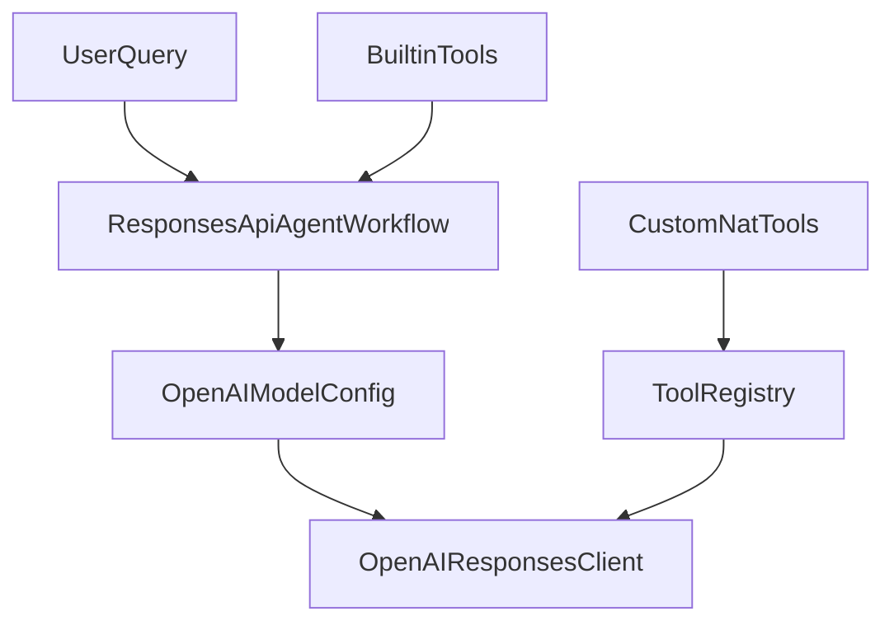
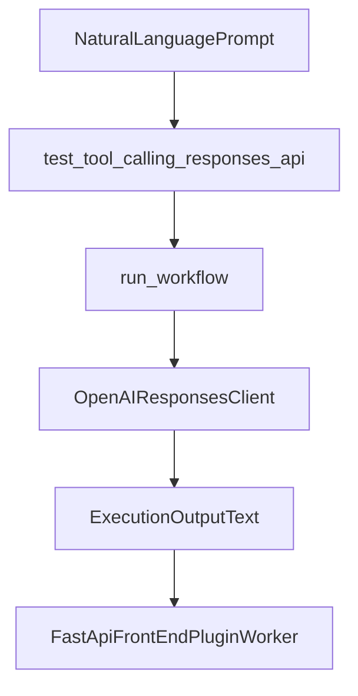

<!-- source: DeepWiki mcp.deepwiki.com · repo NVIDIA/NeMo-Agent-Toolkit · page 4.7 Responses API Agent · fetched 2026-10-26 -->

# Responses API Agent

<details>
<summary>Relevant source files</summary>

The following files were used as context for generating this wiki page:

- [examples/advanced_agents/alert_triage_agent/src/nat_alert_triage_agent/configs/config_live_mode.yml](examples/advanced_agents/alert_triage_agent/src/nat_alert_triage_agent/configs/config_live_mode.yml)
- [examples/agents/react/configs/config-reasoning.yml](examples/agents/react/configs/config-reasoning.yml)
- [examples/agents/react/configs/config.yml](examples/agents/react/configs/config.yml)
- [examples/agents/rewoo/configs/config.yml](examples/agents/rewoo/configs/config.yml)
- [examples/agents/tests/conftest.py](examples/agents/tests/conftest.py)
- [examples/agents/tests/test_agents.py](examples/agents/tests/test_agents.py)
- [examples/agents/tool_calling/configs/config-reasoning.yml](examples/agents/tool_calling/configs/config-reasoning.yml)
- [examples/agents/tool_calling/configs/config-responses-api.yml](examples/agents/tool_calling/configs/config-responses-api.yml)
- [examples/agents/tool_calling/configs/config.yml](examples/agents/tool_calling/configs/config.yml)
- [packages/nvidia_nat_test/src/nat/test/utils.py](packages/nvidia_nat_test/src/nat/test/utils.py)
- [test_data/nginx/nginx.conf](test_data/nginx/nginx.conf)

</details>


The Responses API agent is a specialized agent workflow type that binds tools directly to the LLM using OpenAI's Responses API or equivalent protocol configurations [examples/agents/tool_calling/configs/config-responses-api.yml:17-21](). This agent type is designed for high-performance tool selection where the LLM provider natively supports structured function calling schemas and manages the execution loop.

Sources: [examples/agents/tool_calling/configs/config-responses-api.yml:1-36]()

## Overview

The Responses API agent operates via the `responses_api_agent` workflow type, configuring the underlying LLM client to use specific API types that support native tool binding (such as `openai` or `nim` with `api_type: responses`) [examples/agents/tool_calling/configs/config-responses-api.yml:17-21](). Unlike manual text-parsing ReAct loops, this agent relies on the provider's native capability to handle structured tool definitions and return tool calls.

### Key Capabilities
* **Native Tool Binding**: Tools are bound directly to the LLM client, passing input schemas at runtime.
* **Structured Selection**: Uses JSON schemas to describe parameters, ensuring arguments match function signatures.
* **Built-in Error Handling**: Supports `handle_tool_errors` configuration parameters to gracefully recover from tool exceptions [examples/agents/tool_calling/configs/config-responses-api.yml:36]().
* **OpenAI & Builtin Tool Support**: Supports both custom `nat_tools` and native `builtin_tools` (such as code interpreters) [examples/agents/tool_calling/configs/config-responses-api.yml:29-33]().

Sources: [examples/agents/tool_calling/configs/config-responses-api.yml:17-36]()

## Architecture and Data Flow

The Responses API agent architecture configures an LLM client with `api_type: responses` [examples/agents/tool_calling/configs/config-responses-api.yml:21](). It interfaces between user queries, NAT-registered functions, and builtin platform tools.

### System Component Mapping
The following diagram bridges natural language concepts to specific code entities in the codebase.

**Natural Language Space to Code Entity Space (Components)**

Sources: [examples/agents/tool_calling/configs/config-responses-api.yml:17-36]()

## Configuration

The Responses API agent is configured via YAML files. It specifies the model configuration with `api_type: responses`, lists custom NAT functions under `nat_tools`, and defines platform tools under `builtin_tools`.

### Configuration Parameters
| Parameter | Type | Description |
| :--- | :--- | :--- |
| `_type` | `str` | Must be set to `responses_api_agent` for the workflow [examples/agents/tool_calling/configs/config-responses-api.yml:28](). |
| `api_type` | `str` | Set to `responses` in the LLM configuration to trigger responses API handling [examples/agents/tool_calling/configs/config-responses-api.yml:21](). |
| `nat_tools` | `list[str]` | List of registered NAT function identifiers available to the agent [examples/agents/tool_calling/configs/config-responses-api.yml:29](). |
| `builtin_tools` | `list[dict]` | Native platform tools (e.g., code interpreter) [examples/agents/tool_calling/configs/config-responses-api.yml:30-33](). |
| `handle_tool_errors` | `bool` | Whether to handle tool execution errors gracefully [examples/agents/tool_calling/configs/config-responses-api.yml:36](). |

### Example YAML Configuration
```yaml
llms:
  openai_llm:
    _type: openai
    model_name: gpt-5-mini-2025-08-07
    api_type: responses

functions:
  current_datetime:
    _type: current_datetime

workflow:
  _type: responses_api_agent
  nat_tools: [current_datetime]
  builtin_tools:
    - type: code_interpreter
      container:
        type: "auto"
  llm_name: openai_llm
  verbose: true
  handle_tool_errors: true
```
Sources: [examples/agents/tool_calling/configs/config-responses-api.yml:1-36]()

## Implementation Details and Testing

### Integration and Serving
The Responses API agent is validated through integration tests that run workflows directly or via ASGI clients testing the FastAPI `/generate` endpoint [examples/agents/tests/test_agents.py:87-104](). These tests use `run_workflow` with configuration files like `config-responses-api.yml` [examples/agents/tests/test_agents.py:89-92]().

### Execution Flow and Entity Mapping
The sequence and data transformation bridging natural language execution to code entities is illustrated below.

**Natural Language Space to Code Entity Space (Execution)**

Sources: [examples/agents/tests/test_agents.py:87-104](), [packages/nvidia_nat_test/src/nat/test/utils.py:100-116]()

---

