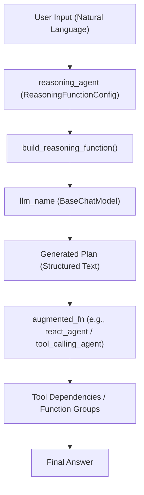
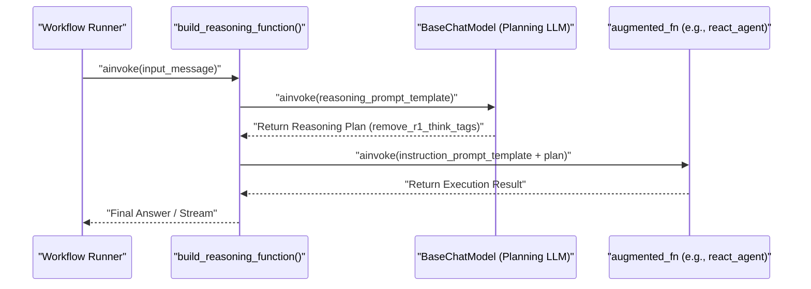

<!-- source: DeepWiki mcp.deepwiki.com · repo NVIDIA/NeMo-Agent-Toolkit · page 4.8 Reasoning Agent · fetched 2026-10-26 -->

# Reasoning Agent

<details>
<summary>Relevant source files</summary>

The following files were used as context for generating this wiki page:

- [examples/HITL/por_to_jiratickets/src/nat_por_to_jiratickets/configs/config.yml](examples/HITL/por_to_jiratickets/src/nat_por_to_jiratickets/configs/config.yml)
- [examples/HITL/por_to_jiratickets/src/nat_por_to_jiratickets/extract_por_tool.py](examples/HITL/por_to_jiratickets/src/nat_por_to_jiratickets/extract_por_tool.py)
- [examples/HITL/por_to_jiratickets/src/nat_por_to_jiratickets/hitl_approval_tool.py](examples/HITL/por_to_jiratickets/src/nat_por_to_jiratickets/hitl_approval_tool.py)
- [examples/HITL/por_to_jiratickets/src/nat_por_to_jiratickets/jira_tickets_tool.py](examples/HITL/por_to_jiratickets/src/nat_por_to_jiratickets/jira_tickets_tool.py)
- [examples/getting_started/simple_calculator/src/nat_simple_calculator/configs/config-reasoning.yml](examples/getting_started/simple_calculator/src/nat_simple_calculator/configs/config-reasoning.yml)
- [examples/observability/simple_calculator_observability/configs/config-otel-file.yml](examples/observability/simple_calculator_observability/configs/config-otel-file.yml)
- [packages/nvidia_nat_langchain/src/nat/plugins/langchain/agent/reasoning_agent/reasoning_agent.py](packages/nvidia_nat_langchain/src/nat/plugins/langchain/agent/reasoning_agent/reasoning_agent.py)

</details>


The Reasoning Agent wrapper is a meta-workflow type (`reasoning_agent`) that injects a task-specific planning and reasoning phase before delegating execution to an underlying "augmented" agent (specified via `augmented_fn`). Implemented in `packages/nvidia_nat_langchain/src/nat/plugins/langchain/agent/reasoning_agent/reasoning_agent.py` [packages/nvidia_nat_langchain/src/nat/plugins/langchain/agent/reasoning_agent/reasoning_agent.py:33-81](), it leverages a reasoning-enabled or high-capacity model to generate a step-by-step execution plan that guides downstream agents (such as tool-calling or ReAct agents) through complex multi-step workflows.

Sources: [packages/nvidia_nat_langchain/src/nat/plugins/langchain/agent/reasoning_agent/reasoning_agent.py:33-81](), [examples/getting_started/simple_calculator/src/nat_simple_calculator/configs/config-reasoning.yml:56-60]()

## Overview

The Reasoning Agent intercepts the user query, invokes a planning LLM using a structured prompt template, resolves tool dependencies from the builder context, and passes both the original query and the generated plan to the target execution function (`augmented_fn`).

### Key Benefits
* **Task Decomposition**: Breaks complex user queries into sequential, manageable sub-steps.
* **Model Specialization**: Combines advanced "thinking" or high-parameter models for planning with faster, specialized models for tool execution and response generation.
* **Reduced Tool Hallucination**: Provides downstream tool-calling agents with an explicit plan, reducing invalid or out-of-order tool invocations.

Sources: [packages/nvidia_nat_langchain/src/nat/plugins/langchain/agent/reasoning_agent/reasoning_agent.py:33-68](), [examples/getting_started/simple_calculator/src/nat_simple_calculator/configs/config-reasoning.yml:41-60]()

---

## Architecture and Data Flow

The following diagrams bridge the natural language user intent and planning phase to the concrete code entities (`ReasoningFunctionConfig`, `build_reasoning_function`, `reasoning_agent`, and `augmented_fn`) used across the toolkit.

### Natural Language to Code Entity Flow
This diagram maps abstract planning concepts to specific configuration and runtime components in the codebase.


Sources: [packages/nvidia_nat_langchain/src/nat/plugins/langchain/agent/reasoning_agent/reasoning_agent.py:33-128](), [examples/getting_started/simple_calculator/src/nat_simple_calculator/configs/config-reasoning.yml:56-60]()

### Sequence Interaction Diagram
This sequence diagram illustrates the call lifecycle when executing a reasoning-wrapped workflow via the LangChain wrapper plugin.


Sources: [packages/nvidia_nat_langchain/src/nat/plugins/langchain/agent/reasoning_agent/reasoning_agent.py:71-151]()

---

## Configuration

The reasoning agent is configured within a YAML workflow file by specifying `_type: reasoning_agent`, supplying an LLM via `llm_name`, and defining the target delegated agent via `augmented_fn`.

### Configuration Example
The following configuration demonstrates how a reasoning model wraps a `tool_calling_agent` workflow with calculator and datetime tools.

```yaml
llms:
  nim_llm:
    _type: nim
    model_name: nvidia/nemotron-3.5-lightning-30b-a3b
    temperature: 0.0
    max_tokens: 1024
    chat_template_kwargs:
      enable_thinking: false
  nemotron_model:
    _type: nim
    model_name: nvidia/nemotron-3-super-120b-a12b
    thinking: true
    temperature: 0.0
    max_tokens: 2000

workflow:
  _type: reasoning_agent
  llm_name: nemotron_model
  augmented_fn: react_agent
  verbose: true
```
Sources: [examples/getting_started/simple_calculator/src/nat_simple_calculator/configs/config-reasoning.yml:41-60]()

### Parameters

| Parameter | Type | Description |
| :--- | :--- | :--- |
| `_type` | `str` | Must be set to `reasoning_agent`. |
| `description` | `str` | Description of the function's use (defaults to `"Reasoning Agent"`). |
| `augmented_fn` | `FunctionRef` | References the downstream agent function (e.g., `react_agent` or `tool_calling_agent`) to execute the plan. |
| `reasoning_prompt_template` | `str` | Prompt template used to instruct the planning model to generate step-by-step actions. |
| `instruction_prompt_template` | `str` | Prompt template combining the original input with the generated execution plan for downstream consumption. |

Sources: [packages/nvidia_nat_langchain/src/nat/plugins/langchain/agent/reasoning_agent/reasoning_agent.py:33-69]()

---

## Implementation Details

### Core Classes and Functions
The reasoning agent is registered using `ReasoningFunctionConfig` and built via `build_reasoning_function` [packages/nvidia_nat_langchain/src/nat/plugins/langchain/agent/reasoning_agent/reasoning_agent.py:33-81]():
* **`ReasoningFunctionConfig`**: Extends `AgentBaseConfig` with configuration options including `augmented_fn`, `reasoning_prompt_template`, and `instruction_prompt_template` [packages/nvidia_nat_langchain/src/nat/plugins/langchain/agent/reasoning_agent/reasoning_agent.py:33-69]().
* **`build_reasoning_function`**: An async builder function registered with `@register_function` under `LLMFrameworkEnum.LANGCHAIN` [packages/nvidia_nat_langchain/src/nat/plugins/langchain/agent/reasoning_agent/reasoning_agent.py:70-71](). It retrieves the planning LLM, extracts the description and tool dependencies of the `augmented_fn` (including function group members), and formats prompts accordingly [packages/nvidia_nat_langchain/src/nat/plugins/langchain/agent/reasoning_agent/reasoning_agent.py:98-128]().
* **`remove_r1_think_tags`**: Utility helper that strips reasoning tags (such as `<think>` tags generated by reasoning models) before passing the plan downstream [packages/nvidia_nat_langchain/src/nat/plugins/langchain/agent/reasoning_agent/reasoning_agent.py:87-96]().

Sources: [packages/nvidia_nat_langchain/src/nat/plugins/langchain/agent/reasoning_agent/reasoning_agent.py:33-128]()

---

## Use Cases

1. **Complex Information Retrieval**: Multi-hop question answering where initial search results dictate subsequent queries, organized cleanly by the reasoning plan.
2. **Code Generation and Verification**: Directing code generation sub-agents with architectural plans to ensure correct syntax and tool selection.
3. **Model Hybridization**: Utilizing large frontier reasoning models (`nvidia/nemotron-3-super-120b-a12b`) exclusively for high-level planning while routing execution to faster, lower-parameter models.

Sources: [examples/getting_started/simple_calculator/src/nat_simple_calculator/configs/config-reasoning.yml:31-60]()

---

