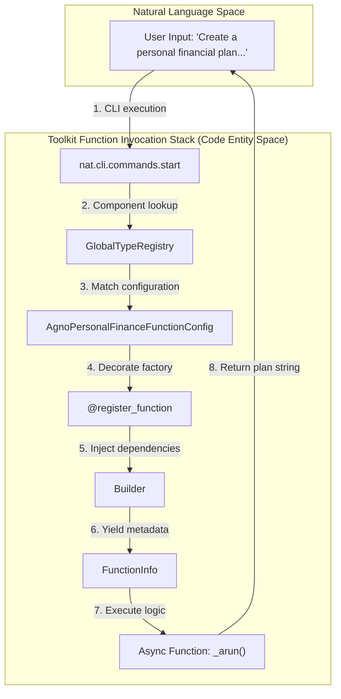
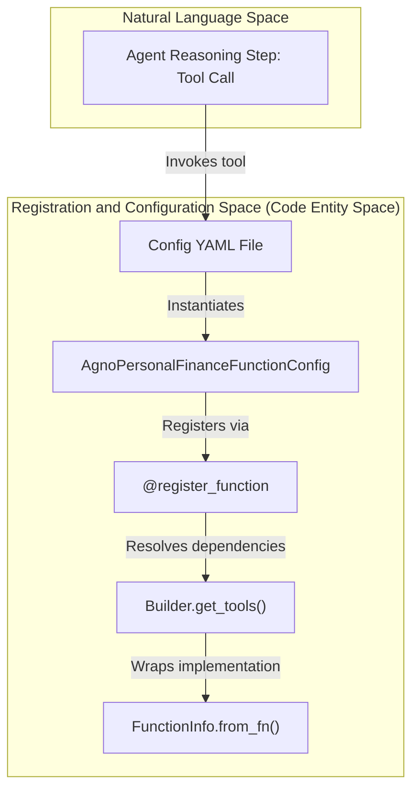

<!-- source: DeepWiki mcp.deepwiki.com · repo NVIDIA/NeMo-Agent-Toolkit · page 5.1 Function Registration and Development · fetched 2026-10-26 -->

# Function Registration and Development

Relevant source files

The following files were used as context for generating this wiki page:

- [packages/nvidia_nat_core/src/nat/builder/function.py](packages/nvidia_nat_core/src/nat/builder/function.py)
- [packages/nvidia_nat_core/src/nat/builder/function_base.py](packages/nvidia_nat_core/src/nat/builder/function_base.py)
- [packages/nvidia_nat_core/src/nat/builder/function_info.py](packages/nvidia_nat_core/src/nat/builder/function_info.py)
- [packages/nvidia_nat_core/src/nat/middleware/dynamic/dynamic_function_middleware.py](packages/nvidia_nat_core/src/nat/middleware/dynamic/dynamic_function_middleware.py)
- [packages/nvidia_nat_core/src/nat/observability/mixin/type_introspection_mixin.py](packages/nvidia_nat_core/src/nat/observability/mixin/type_introspection_mixin.py)
- [packages/nvidia_nat_core/src/nat/utils/type_converter.py](packages/nvidia_nat_core/src/nat/utils/type_converter.py)
- [packages/nvidia_nat_core/src/nat/utils/type_utils.py](packages/nvidia_nat_core/src/nat/utils/type_utils.py)
- [packages/nvidia_nat_core/tests/nat/builder/test_function.py](packages/nvidia_nat_core/tests/nat/builder/test_function.py)
- [packages/nvidia_nat_core/tests/nat/builder/test_function_info.py](packages/nvidia_nat_core/tests/nat/builder/test_function_info.py)
- [packages/nvidia_nat_core/tests/nat/builder/test_function_info_future_annotations.py](packages/nvidia_nat_core/tests/nat/builder/test_function_info_future_annotations.py)
- [packages/nvidia_nat_core/tests/nat/observability/mixin/test_type_introspection_mixin.py](packages/nvidia_nat_core/tests/nat/observability/mixin/test_type_introspection_mixin.py)
- [packages/nvidia_nat_core/tests/nat/utils/test_converter.py](packages/nvidia_nat_core/tests/nat/utils/test_converter.py)
- [packages/nvidia_nat_core/tests/nat/utils/test_type_utils.py](packages/nvidia_nat_core/tests/nat/utils/test_type_utils.py)

This page explains how to create, register, and configure custom functions and tools within the NVIDIA NeMo Agent Toolkit (NAT). Functions serve as the fundamental execution units that agents invoke to perform actions, retrieve data, or integrate with external systems. This guide details the `@register_function` decorator, Pydantic-based function schemas, type introspection via `FunctionBase` and `FunctionDescriptor`, type conversion mechanisms, middleware bindings, and advanced patterns like per-user functions and function groups.

---

## Function Registration Architecture

Functions in NAT are registered via Python decorators that bind configuration data models inheriting from `FunctionBaseConfig` to asynchronous component factories [examples/frameworks/agno_personal_finance/src/nat_agno_personal_finance/agno_personal_finance_function.py:32-38](). The toolkit uses abstract bases and descriptors (`FunctionBase`, `FunctionInfo`, and `FunctionDescriptor`) to introspect function signatures, construct Pydantic input/output schemas, and manage execution lifecycles.

### Natural Language Space to Code Entity Mapping: Registration Lifecycle

The diagram below bridges user-facing natural language execution requests to the internal code entities that discover, load, and execute registered functions.

- The `GlobalTypeRegistry` resolves component references from configuration files [packages/nvidia_nat_core/tests/nat/middleware/test_middleware_components.py:27-27]().
- The `@register_function` decorator registers factories accepting `FunctionBaseConfig` and a `Builder` instance [examples/frameworks/agno_personal_finance/src/nat_agno_personal_finance/agno_personal_finance_function.py:38-39]().
- The `Builder` provisions runtime dependencies such as LLMs and tools before returning a `FunctionInfo` descriptor [examples/frameworks/agno_personal_finance/src/nat_agno_personal_finance/agno_personal_finance_function.py:39-47]().

Sources: [examples/frameworks/agno_personal_finance/src/nat_agno_personal_finance/agno_personal_finance_function.py:32-47](), [packages/nvidia_nat_core/tests/nat/middleware/test_middleware_components.py:27-27]()

---

## Creating Custom Functions with `@register_function`

Custom tools and functions are defined by creating a Pydantic configuration class inheriting from `FunctionBaseConfig` and a registration function decorated with `@register_function` [examples/frameworks/agno_personal_finance/src/nat_agno_personal_finance/agno_personal_finance_function.py:32-38]().

### Natural Language Space to Code Entity Mapping: Tool Execution Flow

When an agent triggers a tool call during reasoning, the system resolves the underlying Python implementation through the configuration and builder abstractions.

- **Configuration Definition**: Inherit from `FunctionBaseConfig` with a unique `name` string identifier used in YAML configurations [examples/frameworks/agno_personal_finance/src/nat_agno_personal_finance/agno_personal_finance_function.py:32]().
- **Dependency Injection**: The factory coroutine receives the configuration object and a `Builder` instance to fetch dependent LLMs, embedders, or other tools [examples/frameworks/agno_personal_finance/src/nat_agno_personal_finance/agno_personal_finance_function.py:39-62]().
- **Function Wrapping**: Use `FunctionInfo.from_fn()` to package raw coroutines or functions into standardized execution descriptors [packages/nvidia_nat_core/src/nat/builder/function_info.py:118-193]() and [examples/frameworks/agno_personal_finance/src/nat_agno_personal_finance/agno_personal_finance_function.py:146-146]().

Sources: [packages/nvidia_nat_core/src/nat/builder/function_info.py:118-193](), [examples/frameworks/agno_personal_finance/src/nat_agno_personal_finance/agno_personal_finance_function.py:32-146]()

---

## Function Schemas and Type Introspection

The toolkit performs rigorous static and runtime introspection on registered functions via `FunctionDescriptor`, `FunctionInfo`, `FunctionBase`, and `DecomposedType` [packages/nvidia_nat_core/src/nat/builder/function_info.py:118-193](), [packages/nvidia_nat_core/src/nat/builder/function_base.py:41-95](), [packages/nvidia_nat_core/src/nat/utils/type_utils.py:90-215]().

### Introspection Mechanics and Validation

- **Input/Output Analysis**: `FunctionDescriptor` inspects function parameters and return annotations to construct Pydantic `input_schema` and `output_schema` models automatically [packages/nvidia_nat_core/src/nat/builder/function_info.py:140-161]().
- **Single vs. Streaming Validation**: 
  - `_validate_single_fn` validates that standard single-invocation functions are coroutines taking a single annotated argument and returning an annotated result [packages/nvidia_nat_core/src/nat/builder/function_info.py:53-81]().
  - `_validate_stream_fn` validates that streaming functions are async generators yielding defined types [packages/nvidia_nat_core/src/nat/builder/function_info.py:83-114]().
- **Future Annotations Support**: Handles modules using `from __future__ import annotations` by resolving string-based forward references against the defining module's namespace prior to Pydantic model generation [packages/nvidia_nat_core/tests/nat/builder/test_function_info_future_annotations.py:15-22]() and [packages/nvidia_nat_core/tests/nat/builder/test_function_info_future_annotations.py:54-103]().

Sources: [packages/nvidia_nat_core/src/nat/builder/function_info.py:53-193](), [packages/nvidia_nat_core/src/nat/builder/function_base.py:41-95](), [packages/nvidia_nat_core/src/nat/utils/type_utils.py:90-215](), [packages/nvidia_nat_core/tests/nat/builder/test_function_info_future_annotations.py:15-103]()

---

## Type Conversion System

NAT features a robust type conversion subsystem via `TypeConverter` and `GlobalTypeConverter` to coerce inputs and outputs between incompatible formats during function execution [packages/nvidia_nat_core/src/nat/utils/type_converter.py:59-178]().

- **Converter Registration**: Converters are callables annotated with a single input parameter and a strict return type. `TypeConverter.add_converter()` inspects signatures using `typing.get_type_hints()` to build a mapping table (`[to_type][from_type]`) [packages/nvidia_nat_core/src/nat/utils/type_converter.py:82-110]().
- **Chained and Fallback Conversion**: The `_convert()` method attempts direct conversion, union-type decomposition, multi-hop indirect conversion paths, and parent-converter fallbacks before raising `ValueError` [packages/nvidia_nat_core/src/nat/utils/type_converter.py:112-178]().
- **Graceful Handling**: `try_convert()` provides error suppression, returning the original data if no valid conversion path exists [packages/nvidia_nat_core/src/nat/utils/type_converter.py:179-197]().

Sources: [packages/nvidia_nat_core/src/nat/utils/type_converter.py:59-197]()

---

## Middleware Integration at Function Boundaries

Functions in NAT can be wrapped with custom middleware using `Function` base capabilities, `FunctionMiddleware`, and `FunctionMiddlewareChain` [packages/nvidia_nat_core/src/nat/builder/function.py:133-157](), [packages/nvidia_nat_core/src/nat/middleware/function_middleware.py:48-91](). 

- **Execution Hooks**: Middleware hooks into function boundaries via `pre_invoke` (for input transformations or guards) and `post_invoke` (for output transformations or auditing) [packages/nvidia_nat_core/src/nat/middleware/function_middleware.py:103-128]().
- **Configuration**: Middleware is bound to function instances using configuration objects processed during component building [packages/nvidia_nat_core/src/nat/builder/function.py:133-157]().

Sources: [packages/nvidia_nat_core/src/nat/builder/function.py:133-157](), [packages/nvidia_nat_core/src/nat/middleware/function_middleware.py:48-128]()

---

## Per-User Functions and Function Groups

To support multi-tenant deployments and state isolation, NAT supports per-user functions and function grouping.

- **Lazy Initialization and Per-User Context**: Per-user functions are dynamically provisioned per user session based on request context using specialized builders such as `PerUserWorkflowBuilder` [packages/nvidia_nat_core/src/nat/builder/per_user_workflow_builder.py:1-30]().
- **Function Groups**: Workflows can reference collections of functions via list configurations (`tools: [tool_a, tool_b]`), allowing agents to selectively route tasks across modular functional domains [examples/frameworks/agno_personal_finance/src/nat_agno_personal_finance/configs/config.yml:17-21]() and [examples/frameworks/agno_personal_finance/src/nat_agno_personal_finance/configs/config.yml:32-32]().

Sources: [packages/nvidia_nat_core/src/nat/builder/per_user_workflow_builder.py:1-30](), [examples/frameworks/agno_personal_finance/src/nat_agno_personal_finance/configs/config.yml:17-32]()

---

