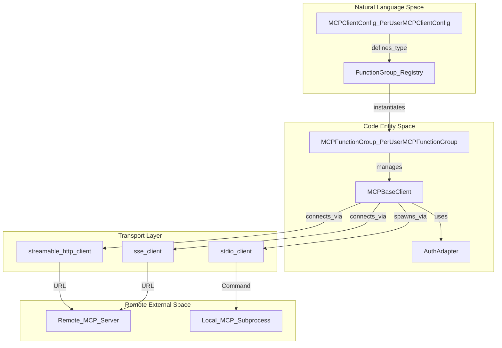
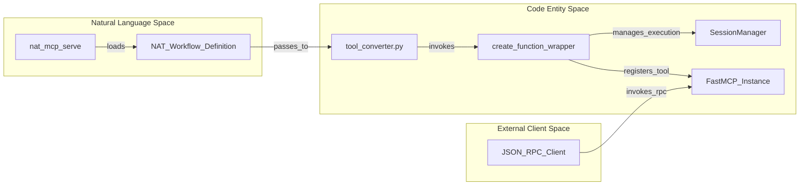
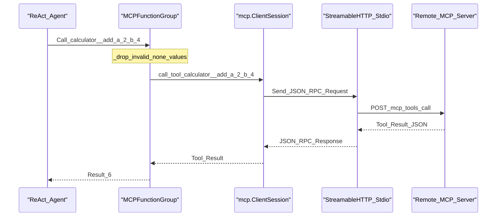

<!-- source: DeepWiki mcp.deepwiki.com · repo NVIDIA/NeMo-Agent-Toolkit · page 5.2 Model Context Protocol (MCP) Integration · fetched 2026-10-26 -->

# Model Context Protocol (MCP) Integration

<details>
<summary>Relevant source files</summary>

The following files were used as context for generating this wiki page:

- [docs/source/build-workflows/mcp-client.md](docs/source/build-workflows/mcp-client.md)
- [examples/HITL/simple_calculator_hitl/tests/test_simple_calculator_hitl.py](examples/HITL/simple_calculator_hitl/tests/test_simple_calculator_hitl.py)
- [examples/MCP/simple_calculator_mcp/README.md](examples/MCP/simple_calculator_mcp/README.md)
- [examples/MCP/simple_calculator_mcp/configs/config-mcp-client.yml](examples/MCP/simple_calculator_mcp/configs/config-mcp-client.yml)
- [examples/MCP/simple_calculator_mcp/configs/config-per-user-mcp-client.yml](examples/MCP/simple_calculator_mcp/configs/config-per-user-mcp-client.yml)
- [examples/MCP/simple_calculator_mcp/tests/test_simple_calculator_mcp.py](examples/MCP/simple_calculator_mcp/tests/test_simple_calculator_mcp.py)
- [packages/nvidia_nat_fastmcp/src/nat/plugins/fastmcp/server/tool_converter.py](packages/nvidia_nat_fastmcp/src/nat/plugins/fastmcp/server/tool_converter.py)
- [packages/nvidia_nat_fastmcp/tests/server/test_tool_converter.py](packages/nvidia_nat_fastmcp/tests/server/test_tool_converter.py)
- [packages/nvidia_nat_mcp/src/nat/plugins/mcp/client/fastapi_routes.py](packages/nvidia_nat_mcp/src/nat/plugins/mcp/client/fastapi_routes.py)
- [packages/nvidia_nat_mcp/src/nat/plugins/mcp/server/tool_converter.py](packages/nvidia_nat_mcp/src/nat/plugins/mcp/server/tool_converter.py)
- [packages/nvidia_nat_mcp/src/nat/plugins/mcp/utils.py](packages/nvidia_nat_mcp/src/nat/plugins/mcp/utils.py)
- [packages/nvidia_nat_mcp/tests/client/test_mcp_schema.py](packages/nvidia_nat_mcp/tests/client/test_mcp_schema.py)
- [packages/nvidia_nat_mcp/tests/server/test_mcp_client_endpoint.py](packages/nvidia_nat_mcp/tests/server/test_mcp_client_endpoint.py)
- [packages/nvidia_nat_mcp/tests/server/test_tool_converter.py](packages/nvidia_nat_mcp/tests/server/test_tool_converter.py)

</details>


This document details the Model Context Protocol (MCP) integration within the NVIDIA NeMo Agent Toolkit (NAT), providing comprehensive specifications for MCP client and server integration, tool discovery, session management, dynamic schema translation, and secure authentication flows.

Sources:
[examples/MCP/simple_calculator_mcp/README.md:18-27]()
[docs/source/build-workflows/mcp-client.md:18-25]()

---

## Overview

Model Context Protocol (MCP) is an open standard designed to standardize how applications expose context and tools to large language models (LLMs). The NVIDIA NeMo Agent Toolkit integrates MCP bidirectionally:

- **MCP Client Mode**: NAT workflows act as MCP clients, connecting to external MCP servers, dynamically discovering remote tools, and registering them as native functions usable by agent workflows [examples/MCP/simple_calculator_mcp/README.md:49-50](), [docs/source/build-workflows/mcp-client.md:22-23]().
- **MCP Server Mode**: NAT workflows and underlying functions are published as MCP servers using the `nat mcp serve` command or FastMCP backends, allowing external MCP-compliant clients to invoke NAT capabilities remotely [examples/MCP/simple_calculator_mcp/README.md:52-53](), [docs/source/build-workflows/mcp-client.md:24]().

Sources:
[examples/MCP/simple_calculator_mcp/README.md:49-53]()
[docs/source/build-workflows/mcp-client.md:18-25]()

---

## Architecture Overview

The MCP integration spans multiple layers covering configuration definitions, client session wrappers, and specialized transport protocols.

### System Component Mapping

The following diagram bridges the Natural Language Space to the Code Entity Space by mapping architectural configuration concepts to specific internal classes and helper modules.

Title: MCP Integration Component Architecture


Sources:
[packages/nvidia_nat_mcp/src/nat/plugins/mcp/client/client_config.py:42-151]()
[packages/nvidia_nat_mcp/src/nat/plugins/mcp/client/client_base.py:139-155]()

---

## MCP Client Mode

MCP client mode enables NAT workflows to consume tools served by external MCP servers.

### Supported Transport Protocols

NAT supports multiple transport protocols configured via the `server.transport` field:

| Transport | Description | Implementation Usage |
| :--- | :--- | :--- |
| `streamable-http` | Recommended for HTTP-based connections | `streamable_http_client` [packages/nvidia_nat_mcp/src/nat/plugins/mcp/client/client_base.py:35-35]() |
| `stdio` | Uses subprocess pipes to communicate with a local process | `stdio_client` [packages/nvidia_nat_mcp/src/nat/plugins/mcp/client/client_base.py:34-34]() |
| `sse` | Server-Sent Events (backwards compatibility) | `sse_client` [packages/nvidia_nat_mcp/src/nat/plugins/mcp/client/client_base.py:32-32]() |

Sources:
[packages/nvidia_nat_mcp/src/nat/plugins/mcp/client/client_base.py:30-40]()
[docs/source/build-workflows/mcp-client.md:104-110]()

### Tool Discovery and Concurrency Management

When a workflow starts, NAT connects to the configured MCP server, discovers available tools, and registers them.

- **Shared Workflow Mode (`mcp_client`)**: A single MCP connection is shared across all users [examples/MCP/simple_calculator_mcp/README.md:24-25](). The `MCPFunctionGroup` manages these shared sessions, using `aiorwlock.RWLock` for concurrent read/write isolation [packages/nvidia_nat_mcp/src/nat/plugins/mcp/client/client_impl.py:150-180]().
- **Per-User Workflow Mode (`per_user_mcp_client`)**: Isolated MCP sessions are lazily instantiated for each user based on session context [examples/MCP/simple_calculator_mcp/README.md:126-130](). This uses `PerUserMCPFunctionGroup` [packages/nvidia_nat_mcp/src/nat/plugins/mcp/client/client_impl.py:78-81]().

Sources:
[examples/MCP/simple_calculator_mcp/README.md:24-130]()
[packages/nvidia_nat_mcp/src/nat/plugins/mcp/client/client_impl.py:64-180]()

### Tool Overrides and Aliasing

NAT allows overriding tool metadata discovered from the MCP server using the `tool_overrides` block [docs/source/build-workflows/mcp-client.md:130-133]().

```yaml
function_groups:
  mcp_time:
    _type: mcp_client
    server:
      transport: stdio
      command: "python"
      args: ["-m", "mcp_server_time"]
    tool_overrides:
      get_current_time:
        alias: get_current_time_mcp_tool
        description: "Returns the current date and time."
```

Sources:
[examples/MCP/simple_calculator_mcp/configs/config-mcp-client.yml:34-44]()
[docs/source/build-workflows/mcp-client.md:128-133]()

---

## MCP Server Mode & FastMCP Integration

NAT can expose its internal functions and workflows as MCP tools using the `nat mcp serve` command with a `FastMCP` backend [packages/nvidia_nat_mcp/src/nat/plugins/mcp/server/tool_converter.py:31-35](), [packages/nvidia_nat_fastmcp/src/nat/plugins/fastmcp/server/tool_converter.py:29-33](). The frontend worker orchestrates route registration, health checks, and tool conversion [packages/nvidia_nat_mcp/src/nat/plugins/mcp/server/front_end_plugin_worker.py:43-145]().

### Tool Conversion and Sanitization
NAT functions are converted to MCP tools by generating valid Python signatures from NAT's Pydantic schemas [packages/nvidia_nat_mcp/src/nat/plugins/mcp/server/tool_converter.py:167-186](), [packages/nvidia_nat_fastmcp/src/nat/plugins/fastmcp/server/tool_converter.py:123-150]().

- **Sanitization**: Field names are sanitized using `_sanitize_parameter_name` [packages/nvidia_nat_mcp/src/nat/plugins/mcp/server/tool_converter.py:66-87](), [packages/nvidia_nat_fastmcp/src/nat/plugins/fastmcp/server/tool_converter.py:40-61](). Collisions are resolved via `_build_name_mapping` [packages/nvidia_nat_mcp/src/nat/plugins/mcp/server/tool_converter.py:90-104](), [packages/nvidia_nat_fastmcp/src/nat/plugins/fastmcp/server/tool_converter.py:64-102]().
- **Signature Building**: `create_function_wrapper` wraps function execution to integrate with NAT's observability and `SessionManager.run()` [packages/nvidia_nat_mcp/src/nat/plugins/mcp/server/tool_converter.py:167-186]().
- **Optional Fields**: `is_field_optional` distinguishes required parameters from optional defaults or factories [packages/nvidia_nat_mcp/src/nat/plugins/mcp/server/tool_converter.py:131-165]().

### Server Architecture Component Mapping

The following diagram bridges the Natural Language Space to the Code Entity Space for server-side tool conversion and execution.

Title: NAT MCP Server Component Mapping


Sources:
[packages/nvidia_nat_mcp/src/nat/plugins/mcp/server/tool_converter.py:31-186]()
[packages/nvidia_nat_fastmcp/src/nat/plugins/fastmcp/server/tool_converter.py:1-195]()
[packages/nvidia_nat_mcp/src/nat/plugins/mcp/server/front_end_plugin_worker.py:43-145]()

---

## Authentication and Security

NAT supports authenticated MCP servers using `AuthAdapter`, bridging authentication providers with `httpx.Auth` [packages/nvidia_nat_mcp/src/nat/plugins/mcp/client/client_base.py:54-60]().

- **Header Injection**: Supplies `BearerTokenCred` or `HeaderCred` during request signing [packages/nvidia_nat_mcp/src/nat/plugins/mcp/client/client_base.py:119-133]().
- **Error Recovery**: Intercepts `401 Unauthorized` responses to trigger re-authentication flows [packages/nvidia_nat_mcp/src/nat/plugins/mcp/client/client_base.py:84-107]().

Sources:
[packages/nvidia_nat_mcp/src/nat/plugins/mcp/client/client_base.py:54-137]()

---

## Dynamic Schema Generation and Validation

The toolkit dynamically generates Pydantic models from MCP tool schemas via `model_from_mcp_schema` [packages/nvidia_nat_mcp/src/nat/plugins/mcp/utils.py:98-105]().

- **Type Mapping**: Translates schema types to Python types [packages/nvidia_nat_mcp/src/nat/plugins/mcp/utils.py:113-121]().
- **Unions and Enums**: Resolves `anyOf`/`oneOf` unions and caches `Enum` classes via `_get_or_create_enum` [packages/nvidia_nat_mcp/src/nat/plugins/mcp/utils.py:31-62]().
- **Constraints**: Maps JSON schema constraints to Pydantic `Field` arguments via `_constraint_kwargs` and `_apply_constraints` [packages/nvidia_nat_mcp/src/nat/plugins/mcp/utils.py:130-157]().

Sources:
[packages/nvidia_nat_mcp/src/nat/plugins/mcp/utils.py:31-172]()
[packages/nvidia_nat_mcp/tests/client/test_mcp_schema.py:112-160]()

---

## Data Flow: Tool Invocation

The following sequence diagram illustrates the flow from an Agent reasoning step to a remote MCP tool execution.

Title: Tool Invocation Sequence


NAT includes `_drop_invalid_none_values` to strip null fields from tool calls unless explicitly permitted by the schema [packages/nvidia_nat_mcp/src/nat/plugins/mcp/client/client_impl.py:64-75]().

Sources:
[packages/nvidia_nat_mcp/src/nat/plugins/mcp/client/client_impl.py:64-75]()

---

## Summary of Configuration Options

| YAML Key | Type | Description |
| :--- | :--- | :--- |
| `_type` | `str` | Either `mcp_client` or `per_user_mcp_client` [packages/nvidia_nat_mcp/src/nat/plugins/mcp/client/client_config.py:140-151]() |
| `server.transport` | `str` | `stdio`, `streamable-http`, or `sse` [packages/nvidia_nat_mcp/src/nat/plugins/mcp/client/client_config.py:42-43]() |
| `server.url` | `str` | The endpoint URL (for HTTP/SSE) [packages/nvidia_nat_mcp/src/nat/plugins/mcp/client/client_config.py:44-45]() |
| `include` | `list[str]` | Optional list of specific MCP tools to register [packages/nvidia_nat_mcp/src/nat/plugins/mcp/client/client_config.py:145]() |
| `tool_overrides` | `dict` | Mapping of tool names to `alias` and `description` [packages/nvidia_nat_mcp/src/nat/plugins/mcp/client/client_config.py:120-130]() |
| `auth_provider` | `str` | Reference to an authentication provider defined in the configuration block [docs/source/build-workflows/mcp-client.md:109-109]() |

Sources:
[packages/nvidia_nat_mcp/src/nat/plugins/mcp/client/client_config.py:42-151]()
[docs/source/build-workflows/mcp-client.md:104-110]()

---

