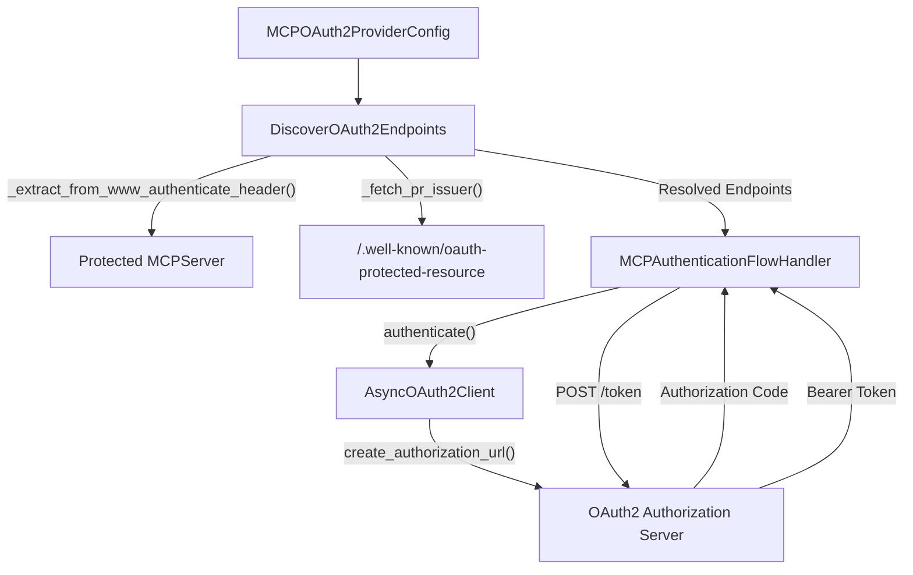
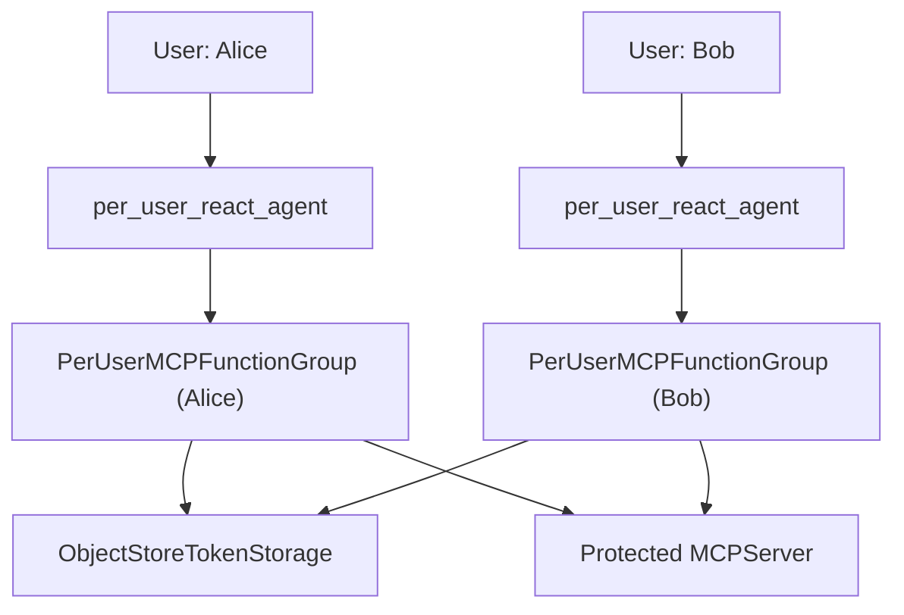

<!-- source: DeepWiki mcp.deepwiki.com · repo NVIDIA/NeMo-Agent-Toolkit · page 5.3 MCP Authentication · fetched 2026-10-26 -->

# MCP Authentication

<details>
<summary>Relevant source files</summary>

The following files were used as context for generating this wiki page:

- [docs/source/components/auth/mcp-auth/index.md](docs/source/components/auth/mcp-auth/index.md)
- [docs/source/components/auth/mcp-auth/mcp-auth-token-storage.md](docs/source/components/auth/mcp-auth/mcp-auth-token-storage.md)
- [examples/MCP/service_account_auth_mcp/uv.lock](examples/MCP/service_account_auth_mcp/uv.lock)
- [examples/MCP/simple_auth_mcp/configs/config-mcp-auth-jira-per-user.yml](examples/MCP/simple_auth_mcp/configs/config-mcp-auth-jira-per-user.yml)
- [examples/MCP/simple_auth_mcp/configs/config-mcp-auth-jira.yml](examples/MCP/simple_auth_mcp/configs/config-mcp-auth-jira.yml)
- [examples/MCP/simple_auth_mcp/configs/config-mcp-auth-outlook.yml](examples/MCP/simple_auth_mcp/configs/config-mcp-auth-outlook.yml)
- [examples/MCP/simple_auth_mcp/uv.lock](examples/MCP/simple_auth_mcp/uv.lock)
- [packages/nvidia_nat_core/src/nat/front_ends/fastapi/routes/chat.py](packages/nvidia_nat_core/src/nat/front_ends/fastapi/routes/chat.py)
- [packages/nvidia_nat_mcp/scripts/check_mcp_auth_cookie.py](packages/nvidia_nat_mcp/scripts/check_mcp_auth_cookie.py)
- [packages/nvidia_nat_mcp/scripts/check_mcp_auth_jwt.py](packages/nvidia_nat_mcp/scripts/check_mcp_auth_jwt.py)
- [packages/nvidia_nat_mcp/src/nat/plugins/mcp/auth/auth_flow_handler.py](packages/nvidia_nat_mcp/src/nat/plugins/mcp/auth/auth_flow_handler.py)
- [packages/nvidia_nat_mcp/src/nat/plugins/mcp/auth/auth_provider.py](packages/nvidia_nat_mcp/src/nat/plugins/mcp/auth/auth_provider.py)
- [packages/nvidia_nat_mcp/src/nat/plugins/mcp/auth/auth_provider_config.py](packages/nvidia_nat_mcp/src/nat/plugins/mcp/auth/auth_provider_config.py)
- [packages/nvidia_nat_mcp/src/nat/plugins/mcp/client/client_base.py](packages/nvidia_nat_mcp/src/nat/plugins/mcp/client/client_base.py)
- [packages/nvidia_nat_mcp/src/nat/plugins/mcp/client/client_config.py](packages/nvidia_nat_mcp/src/nat/plugins/mcp/client/client_config.py)
- [packages/nvidia_nat_mcp/src/nat/plugins/mcp/client/client_impl.py](packages/nvidia_nat_mcp/src/nat/plugins/mcp/client/client_impl.py)
- [packages/nvidia_nat_mcp/tests/cli/test_mcp_cli.py](packages/nvidia_nat_mcp/tests/cli/test_mcp_cli.py)
- [packages/nvidia_nat_mcp/tests/client/test_mcp_auth_provider.py](packages/nvidia_nat_mcp/tests/client/test_mcp_auth_provider.py)
- [packages/nvidia_nat_mcp/tests/client/test_mcp_client_base.py](packages/nvidia_nat_mcp/tests/client/test_mcp_client_base.py)
- [packages/nvidia_nat_mcp/tests/client/test_mcp_client_impl.py](packages/nvidia_nat_mcp/tests/client/test_mcp_client_impl.py)
- [packages/nvidia_nat_mcp/tests/client/test_mcp_token_storage.py](packages/nvidia_nat_mcp/tests/client/test_mcp_token_storage.py)

</details>


## Purpose and Scope

This page details the authentication mechanisms used to connect the NVIDIA NeMo Agent Toolkit to protected Model Context Protocol (MCP) servers. MCP Authentication enables workflows to securely interact with enterprise MCP servers that require OAuth2 authorization, dynamic client registration (DCR), service account patterns, token caching, and object store persistence.

For foundational MCP client configuration and tool discovery, see [Model Context Protocol (MCP) Integration]().

Sources: [packages/nvidia_nat_mcp/src/nat/plugins/mcp/auth/auth_provider.py:34-41](), [packages/nvidia_nat_mcp/src/nat/plugins/mcp/auth/auth_provider_config.py:26-32]()

---

## Authentication Providers Overview

NeMo Agent Toolkit supports authentication providers for MCP servers registered via its plugin system. These providers implement the MCP OAuth2 specification.

| Provider Type | Implementation Class / Config | Use Case |
| :--- | :--- | :--- |
| `mcp_oauth2` | `MCPOAuth2ProviderConfig` [packages/nvidia_nat_mcp/src/nat/plugins/mcp/auth/auth_provider_config.py:26-38]() | Interactive OAuth2 authorization code flow and dynamic registration for user-facing workflows. |

### Provider Registration and Configuration

The `mcp_oauth2` provider configuration is validated in `MCPOAuth2ProviderConfig.validate_auth_config` [packages/nvidia_nat_mcp/src/nat/plugins/mcp/auth/auth_provider_config.py:80-103]() and supports dynamic endpoint discovery, Dynamic Client Registration (DCR) via RFC 7591, and manual registration.

Key configuration fields for `MCPOAuth2ProviderConfig`:
- `server_url`: The URL of the protected MCP server [packages/nvidia_nat_mcp/src/nat/plugins/mcp/auth/auth_provider_config.py:39-42]().
- `redirect_uri`: The callback URI for the OAuth2 flow [packages/nvidia_nat_mcp/src/nat/plugins/mcp/auth/auth_provider_config.py:54-54]().
- `oauth_client_ttl`: Cache duration for DCR credentials, defaulting to `270.0` seconds [packages/nvidia_nat_mcp/src/nat/plugins/mcp/auth/auth_provider_config.py:67-70]().
- `token_storage_object_store`: Reference to an object store for secure persistent token storage [packages/nvidia_nat_mcp/src/nat/plugins/mcp/auth/auth_provider_config.py:73-75]().

Sources: [packages/nvidia_nat_mcp/src/nat/plugins/mcp/auth/auth_provider_config.py:26-103]()

---

## OAuth2 Interactive Authentication

### Implementation and Discovery Flow

The toolkit implements a comprehensive discovery flow inside `DiscoverOAuth2Endpoints` [packages/nvidia_nat_mcp/src/nat/plugins/mcp/auth/auth_provider.py:60-67]() aligned with RFC 9728 and RFC 8414.

1. **401 Hint**: If a request returns `401`, `DiscoverOAuth2Endpoints.discover` parses the `WWW-Authenticate` header for a `resource_metadata` hint using `_extract_from_www_authenticate_header` [packages/nvidia_nat_mcp/src/nat/plugins/mcp/auth/auth_provider.py:76-107](), [packages/nvidia_nat_mcp/src/nat/plugins/mcp/auth/auth_provider.py:137-151]().
2. **Well-known Fallback**: If no header hint exists, it attempts to fetch `/.well-known/oauth-protected-resource` via `_fetch_pr_issuer` [packages/nvidia_nat_mcp/src/nat/plugins/mcp/auth/auth_provider.py:109-118]().
3. **Issuer Discovery**: Once an issuer is identified, `_discover_via_issuer_or_base` resolves the `authorization_endpoint` and `token_endpoint` [packages/nvidia_nat_mcp/src/nat/plugins/mcp/auth/auth_provider.py:119-122]().

Title: MCP Discovery and OAuth2 Flow Code Architecture


Sources: [packages/nvidia_nat_mcp/src/nat/plugins/mcp/auth/auth_provider.py:60-159](), [packages/nvidia_nat_mcp/src/nat/plugins/mcp/auth/auth_flow_handler.py:38-92](), [packages/nvidia_nat_mcp/src/nat/plugins/mcp/auth/auth_provider_config.py:26-103]()

The `MCPAuthenticationFlowHandler` class manages the interactive authentication process, implementing PKCE support through `pkce.generate_pkce_pair()` and binding a temporary local callback server [packages/nvidia_nat_mcp/src/nat/plugins/mcp/auth/auth_flow_handler.py:38-136]().

Sources: [packages/nvidia_nat_mcp/src/nat/plugins/mcp/auth/auth_flow_handler.py:38-163]()

---

## Transport and Token Management

### Dynamic Token Injection with `AuthAdapter`

To integrate authentication providers with `httpx`-based transports (such as `streamable-http`), the toolkit defines `AuthAdapter` inheriting from `httpx.Auth` [packages/nvidia_nat_mcp/src/nat/plugins/mcp/client/client_base.py:54-58](). 

`AuthAdapter.async_auth_flow` manages session isolation via `user_id`, acquires a lock via `anyio.Lock()`, and injects credentials (`BearerTokenCred` or `HeaderCred`) into request headers [packages/nvidia_nat_mcp/src/nat/plugins/mcp/client/client_base.py:60-137](). If a `401 Unauthorized` response is received, `AuthAdapter` triggers a re-authentication and discovery cycle before retrying the request [packages/nvidia_nat_mcp/src/nat/plugins/mcp/client/client_base.py:84-106]().

### Token Caching and Expiration

Client credentials obtained via Dynamic Client Registration (DCR) are cached in memory for the duration specified by `oauth_client_ttl` in `MCPOAuth2ProviderConfig` [packages/nvidia_nat_mcp/src/nat/plugins/mcp/auth/auth_provider_config.py:67-70](). Setting this value to `0` disables client credential caching, forcing a new registration step on each authentication attempt.

### Secure Token Persistence

When `token_storage_object_store` is defined, authentication results are serialized and persisted through the object store layer using hashed `user_id` keys to ensure strict namespace isolation [packages/nvidia_nat_mcp/src/nat/plugins/mcp/auth/auth_provider_config.py:73-75]().

Sources: [packages/nvidia_nat_mcp/src/nat/plugins/mcp/client/client_base.py:54-137](), [packages/nvidia_nat_mcp/src/nat/plugins/mcp/auth/auth_provider_config.py:66-75]()

---

## Authentication Patterns

### Per-User Isolation

For multi-user deployments, the toolkit utilizes the `per_user_mcp_client` function group and `per_user_react_agent` workflows [examples/MCP/simple_auth_mcp/configs/config-mcp-auth-jira-per-user.yml:16-44](). This guarantees state isolation and lazy authentication per user session.

Title: Per-User MCP Client Isolation Architecture


Sources: [examples/MCP/simple_auth_mcp/configs/config-mcp-auth-jira-per-user.yml:16-44](), [packages/nvidia_nat_mcp/src/nat/plugins/mcp/auth/auth_provider_config.py:73-75]()

### Dual Authentication and Service Accounts

For automated or hybrid execution scenarios, the toolkit supports configurations combining user-context tokens with backend service accounts. Service account flows leverage client credentials grants where secrets are retrieved securely via `OptionalSecretStr` fields in `MCPOAuth2ProviderConfig` [packages/nvidia_nat_mcp/src/nat/plugins/mcp/auth/auth_provider_config.py:45-47]().

Sources: [packages/nvidia_nat_mcp/src/nat/plugins/mcp/auth/auth_provider_config.py:45-52]()

---

## Configuration Reference

### YAML Configuration Example

The following configuration demonstrates a ReAct agent utilizing a protected Jira MCP server via `per_user_mcp_client` and `mcp_oauth2` authentication [examples/MCP/simple_auth_mcp/configs/config-mcp-auth-jira-per-user.yml:16-44]().

```yaml
function_groups:
  mcp_jira:
    _type: per_user_mcp_client
    server:
      transport: streamable-http
      url: ${CORPORATE_MCP_JIRA_URL}
      auth_provider: mcp_oauth2_jira

authentication:
  mcp_oauth2_jira:
    _type: mcp_oauth2
    server_url: ${CORPORATE_MCP_JIRA_URL}
    redirect_uri: ${NAT_REDIRECT_URI:-http://localhost:8000/auth/redirect}

workflow:
  _type: per_user_react_agent
  tool_names:
    - mcp_jira
  llm_name: nim_llm
```

Sources: [examples/MCP/simple_auth_mcp/configs/config-mcp-auth-jira-per-user.yml:16-44]()

---

