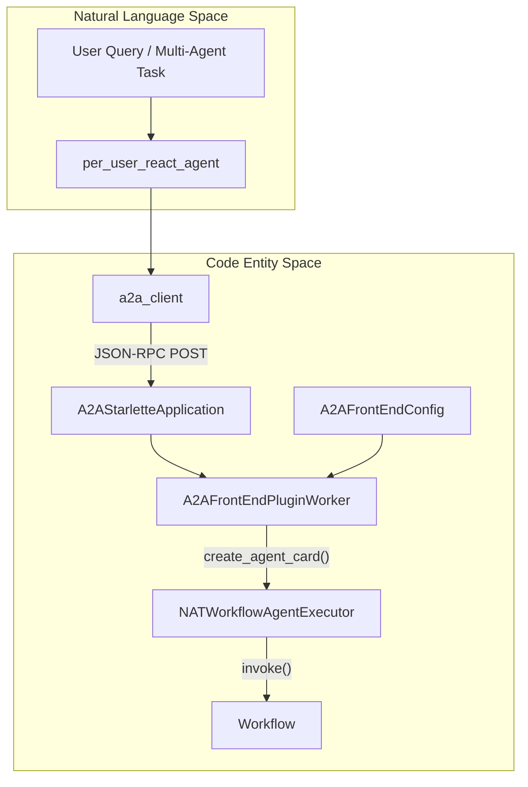
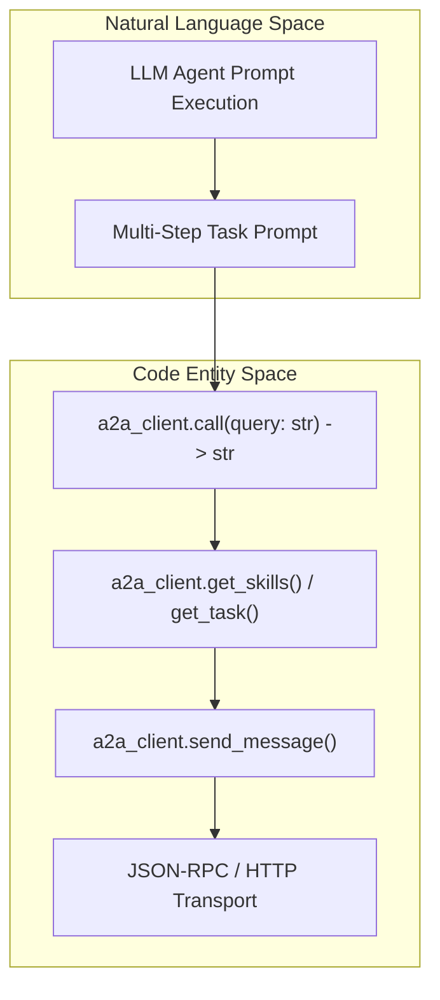
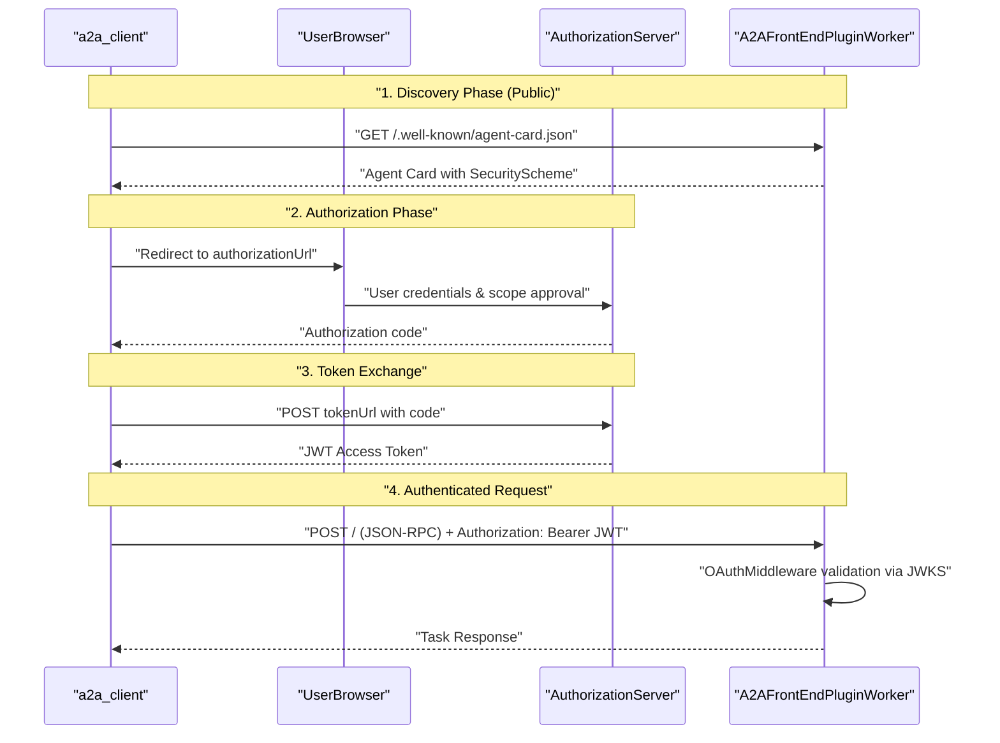

<!-- source: DeepWiki mcp.deepwiki.com · repo NVIDIA/NeMo-Agent-Toolkit · page 5.4 Agent-to-Agent Protocol · fetched 2026-10-26 -->

# Agent-to-Agent Protocol

<details>
<summary>Relevant source files</summary>

The following files were used as context for generating this wiki page:

- [docs/source/build-workflows/a2a-client.md](docs/source/build-workflows/a2a-client.md)
- [docs/source/components/auth/a2a-auth.md](docs/source/components/auth/a2a-auth.md)
- [docs/source/components/integrations/a2a.md](docs/source/components/integrations/a2a.md)
- [docs/source/run-workflows/a2a-server.md](docs/source/run-workflows/a2a-server.md)
- [examples/A2A/math_assistant_a2a/README.md](examples/A2A/math_assistant_a2a/README.md)
- [examples/A2A/math_assistant_a2a/src/nat_math_assistant_a2a/configs/config.yml](examples/A2A/math_assistant_a2a/src/nat_math_assistant_a2a/configs/config.yml)
- [examples/A2A/math_assistant_a2a_protected/README.md](examples/A2A/math_assistant_a2a_protected/README.md)
- [examples/A2A/math_assistant_a2a_protected/configs/config-client.yml](examples/A2A/math_assistant_a2a_protected/configs/config-client.yml)
- [examples/A2A/math_assistant_a2a_protected/configs/config-server.yml](examples/A2A/math_assistant_a2a_protected/configs/config-server.yml)
- [examples/A2A/math_assistant_a2a_protected/pyproject.toml](examples/A2A/math_assistant_a2a_protected/pyproject.toml)
- [packages/nvidia_nat_a2a/src/nat/plugins/a2a/server/front_end_config.py](packages/nvidia_nat_a2a/src/nat/plugins/a2a/server/front_end_config.py)
- [packages/nvidia_nat_a2a/src/nat/plugins/a2a/server/front_end_plugin.py](packages/nvidia_nat_a2a/src/nat/plugins/a2a/server/front_end_plugin.py)
- [packages/nvidia_nat_a2a/src/nat/plugins/a2a/server/front_end_plugin_worker.py](packages/nvidia_nat_a2a/src/nat/plugins/a2a/server/front_end_plugin_worker.py)
- [packages/nvidia_nat_a2a/tests/server/test_agent_card_generation.py](packages/nvidia_nat_a2a/tests/server/test_agent_card_generation.py)

</details>


This page explains the Agent-to-Agent (A2A) Protocol integration within the NVIDIA NeMo Agent Toolkit. The purpose and scope of this page are to provide full technical details on distributed agent teams, inter-agent communication, the implementation of A2A clients (`a2a_client`), A2A server runtimes (`A2AFrontEndPluginWorker`), capability discovery via Agent Cards, and OAuth 2.1 authentication workflows.

Sources: [docs/source/components/integrations/a2a.md:18-32](), [docs/source/components/auth/a2a-auth.md:20-24]()

## Overview and Protocol Fundamentals

The Agent-to-Agent (A2A) Protocol is an open standard from the Linux Foundation that formalizes multi-agent discovery, task delegation, information exchange, and secure communication across distributed agent teams [docs/source/components/integrations/a2a.md:18-32](). 

NVIDIA NeMo Agent Toolkit implements both sides of the protocol via the `nvidia-nat-a2a` package [docs/source/components/integrations/a2a.md:20-24]():
- **A2A Clients**: Implemented as per-user function groups (`a2a_client`) that connect to remote agents, discover skills, and execute tasks [docs/source/build-workflows/a2a-client.md:22-24](), [docs/source/build-workflows/a2a-client.md:58-58]().
- **A2A Servers**: Implemented via the frontend plugin worker (`A2AFrontEndPluginWorker`) which publishes NeMo workflows as discoverable endpoints [docs/source/run-workflows/a2a-server.md:18-22](), [packages/nvidia_nat_a2a/src/nat/plugins/a2a/server/front_end_plugin_worker.py:40-41]().

Sources: [docs/source/components/integrations/a2a.md:18-25](), [docs/source/build-workflows/a2a-client.md:22-24](), [packages/nvidia_nat_a2a/src/nat/plugins/a2a/server/front_end_plugin_worker.py:40-41]()

---

## Architecture and Code Entities

The A2A integration bridges local workflow builders and remote JSON-RPC HTTP servers. Below is the mapping between architectural concepts and concrete codebase entities.

| Component Role | Code Entity / Class | Description |
| :--- | :--- | :--- |
| A2A Client Function Group | `a2a_client` | Function group type managing remote agent connections [docs/source/build-workflows/a2a-client.md:58-58](). |
| Server Configuration | `A2AFrontEndConfig` | Pydantic configuration model defining host, port, authentication, and concurrency [packages/nvidia_nat_a2a/src/nat/plugins/a2a/server/front_end_config.py:42-46](). |
| Server Plugin Worker | `A2AFrontEndPluginWorker` | Handles server lifecycle, Agent Card generation, and OAuth endpoint resolution [packages/nvidia_nat_a2a/src/nat/plugins/a2a/server/front_end_plugin_worker.py:40-41](). |
| Workflow Adapter | `NATWorkflowAgentExecutor` | Adapts NAT workflows for execution within the A2A Starlette application framework [packages/nvidia_nat_a2a/src/nat/plugins/a2a/server/front_end_plugin_worker.py:33-33](). |

Sources: [docs/source/build-workflows/a2a-client.md:58-58](), [packages/nvidia_nat_a2a/src/nat/plugins/a2a/server/front_end_config.py:42-46](), [packages/nvidia_nat_a2a/src/nat/plugins/a2a/server/front_end_plugin_worker.py:33-41]()

### Diagram: Natural Language Space to Code Entity Space (Client/Server Bridge)

Title: "A2A Implementation and Data Flow Mapping"


Sources: [packages/nvidia_nat_a2a/src/nat/plugins/a2a/server/front_end_plugin_worker.py:20-41](), [packages/nvidia_nat_a2a/src/nat/plugins/a2a/server/front_end_config.py:42-46](), [docs/source/components/auth/a2a-auth.md:40-69]()

---

## A2A Client Configuration and Per-User Isolation

NeMo implements A2A clients as **per-user function groups** (`a2a_client`) to guarantee session isolation and authentication separation [docs/source/build-workflows/a2a-client.md:27-35]().

### Per-User Workflow Requirement

- Because A2A clients retain connection states and user-specific OAuth2 tokens, workflows embedding `a2a_client` **must** be declared per-user (e.g., using `per_user_react_agent`) [docs/source/build-workflows/a2a-client.md:29-35]().
- In server deployments (`nat serve`), user separation is driven by the `nat-session` HTTP cookie [examples/A2A/math_assistant_a2a/README.md:140-141]().

Sources: [docs/source/build-workflows/a2a-client.md:27-35](), [examples/A2A/math_assistant_a2a/README.md:140-141]()

### Three-Level API Architecture

The A2A client provides three abstraction tiers for interacting with remote capabilities:
1. **Level 1: High-Level (`call`)**: Natural language interface optimized for LLM agents [docs/source/build-workflows/a2a-client.md:140-155]().
2. **Level 2: Helper Functions**: Programmatic utilities like `get_skills()`, `get_info()`, and `get_task(task_id)` [docs/source/build-workflows/a2a-client.md:173-180]().
3. **Level 3: Low-Level**: Direct protocol access via `send_message()` and `send_message_streaming()` [docs/source/build-workflows/a2a-client.md:128-128]().

Sources: [docs/source/build-workflows/a2a-client.md:113-138]()

### Diagram: Natural Language Space to Code Entity Space (Client Abstraction Layers)

Title: "A2A Client Three-Level API Mapping"


Sources: [docs/source/build-workflows/a2a-client.md:113-138]()

---

## A2A Server Setup and Concurrency Control

Publishing workflows as A2A servers is handled via `nat a2a serve` [docs/source/run-workflows/a2a-server.md:38-44](). 

### Mapping Workflows to Agent Skills
- The complete workflow is exposed as an A2A agent [docs/source/run-workflows/a2a-server.md:126-126]().
- Individual workflow functions are automatically introspected into `AgentSkill` items by `A2AFrontEndPluginWorker.create_agent_card()` [packages/nvidia_nat_a2a/src/nat/plugins/a2a/server/front_end_plugin_worker.py:152-175]().
- Metadata is exposed publicly at `/.well-known/agent-card.json` [docs/source/run-workflows/a2a-server.md:50-50]().

### Concurrency Control
The A2A server limits simultaneous execution using `max_concurrency` (default: `8`) defined in `A2AFrontEndConfig` [packages/nvidia_nat_a2a/src/nat/plugins/a2a/server/front_end_config.py:91-97](). Excess requests are queued until running workflow tasks complete [docs/source/run-workflows/a2a-server.md:98-98]().

Sources: [docs/source/run-workflows/a2a-server.md:38-98](), [packages/nvidia_nat_a2a/src/nat/plugins/a2a/server/front_end_config.py:42-97](), [packages/nvidia_nat_a2a/src/nat/plugins/a2a/server/front_end_plugin_worker.py:152-175]()

---

## Authentication and Security Flow

A2A protocol supports OAuth 2.1 Authorization Code Flow with JWT validation on resource servers [docs/source/components/auth/a2a-auth.md:20-24]().

Title: "OAuth2 Protected A2A Protocol Sequence"


Sources: [docs/source/components/auth/a2a-auth.md:83-115](), [examples/A2A/math_assistant_a2a_protected/README.md:103-134]()

---

## Illustrative Usage Example: Math Assistant A2A

Title: "Math Assistant Hybrid Architecture"
```mermaid
flowgraph LR
    subgraph ClientWorkflow["ClientWorkflow"]
        MA["per_user_react_agent"] --> CA["calculator_a2a"]
        MA --> TM["mcp_time"]
        MA --> LE["logic_evaluator"]
    end

    subgraph RemoteA2AServer["RemoteA2AServer"]
        CA -->|"A2A JSON-RPC"| CS["A2AFrontEndPluginWorker"]
        CS --> Add["calculator__add"]
        CS --> Sub["calculator__subtract"]
    end
```

Sources: [examples/A2A/math_assistant_a2a/README.md:31-57](), [examples/A2A/math_assistant_a2a/src/nat_math_assistant_a2a/configs/config.yml:16-40]()

---

## A2A vs MCP Comparison

| Aspect | Agent-to-Agent (A2A) | Model Context Protocol (MCP) |
| :--- | :--- | :--- |
| **Purpose** | Agent-to-agent task delegation | Tool and context integration |
| **Granularity** | Agent level (high-level multi-step skills) | Tool level (specific functions and schemas) |
| **Discovery** | Agent Card JSON metadata | Tool list endpoint schemas |
| **Best For** | Distributed multi-agent collaboration | Direct tool and data context injection |

Sources: [docs/source/components/integrations/a2a.md:85-96]()

---

