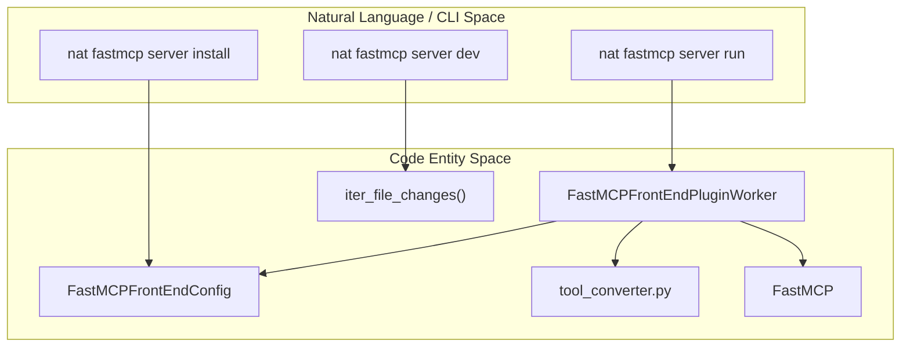
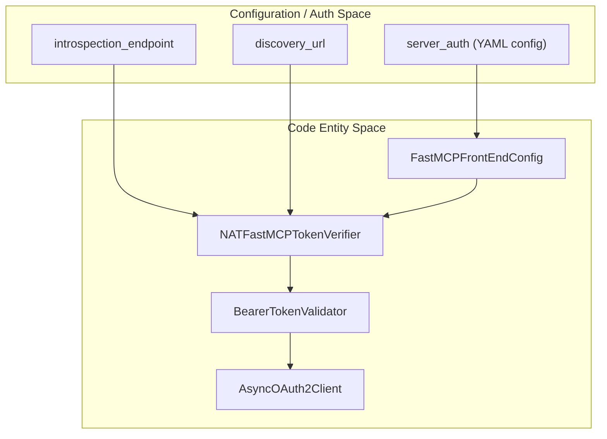
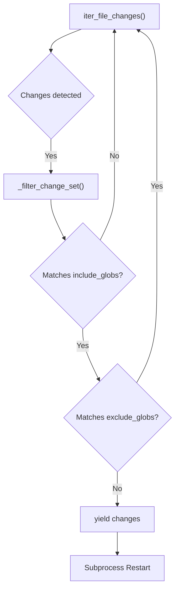

<!-- source: DeepWiki mcp.deepwiki.com · repo NVIDIA/NeMo-Agent-Toolkit · page 5.6 FastMCP Server · fetched 2026-10-26 -->

# FastMCP Server

Relevant source files

The following files were used as context for generating this wiki page:

- [docs/source/run-workflows/fastmcp-server.md](docs/source/run-workflows/fastmcp-server.md)
- [examples/A2A/math_assistant_a2a/uv.lock](examples/A2A/math_assistant_a2a/uv.lock)
- [examples/A2A/math_assistant_a2a_protected/uv.lock](examples/A2A/math_assistant_a2a_protected/uv.lock)
- [examples/HITL/por_to_jiratickets/uv.lock](examples/HITL/por_to_jiratickets/uv.lock)
- [examples/HITL/simple_calculator_hitl/uv.lock](examples/HITL/simple_calculator_hitl/uv.lock)
- [examples/MCP/simple_calculator_fastmcp/uv.lock](examples/MCP/simple_calculator_fastmcp/uv.lock)
- [examples/MCP/simple_calculator_fastmcp_protected/README.md](examples/MCP/simple_calculator_fastmcp_protected/README.md)
- [examples/MCP/simple_calculator_fastmcp_protected/configs/config-server.yml](examples/MCP/simple_calculator_fastmcp_protected/configs/config-server.yml)
- [examples/MCP/simple_calculator_fastmcp_protected/pyproject.toml](examples/MCP/simple_calculator_fastmcp_protected/pyproject.toml)
- [examples/MCP/simple_calculator_fastmcp_protected/uv.lock](examples/MCP/simple_calculator_fastmcp_protected/uv.lock)
- [examples/MCP/simple_calculator_mcp/uv.lock](examples/MCP/simple_calculator_mcp/uv.lock)
- [examples/MCP/simple_calculator_mcp_protected/uv.lock](examples/MCP/simple_calculator_mcp_protected/uv.lock)
- [examples/RAG/simple_rag/uv.lock](examples/RAG/simple_rag/uv.lock)
- [examples/advanced_agents/alert_triage_agent/uv.lock](examples/advanced_agents/alert_triage_agent/uv.lock)
- [packages/nvidia_nat_core/src/nat/authentication/credential_validator/bearer_token_validator.py](packages/nvidia_nat_core/src/nat/authentication/credential_validator/bearer_token_validator.py)
- [packages/nvidia_nat_core/tests/nat/authentication/test_bearer_token_validator.py](packages/nvidia_nat_core/tests/nat/authentication/test_bearer_token_validator.py)
- [packages/nvidia_nat_fastmcp/src/nat/plugins/fastmcp/server/front_end_plugin_worker.py](packages/nvidia_nat_fastmcp/src/nat/plugins/fastmcp/server/front_end_plugin_worker.py)
- [packages/nvidia_nat_fastmcp/tests/test_fastmcp.py](packages/nvidia_nat_fastmcp/tests/test_fastmcp.py)

The FastMCP Server integration in the NVIDIA NeMo Agent Toolkit (NAT) enables publishing NeMo agent workflows and tools as Model Context Protocol (MCP) native services using the high-performance FastMCP server runtime [docs/source/run-workflows/fastmcp-server.md:18-20](). This architecture exposes workflow tools via the `streamable-http` transport protocol, making them fully compatible with MCP clients such as Cursor or Claude Desktop [docs/source/run-workflows/fastmcp-server.md:18-20](), [docs/source/run-workflows/fastmcp-server.md:58-58]().

---

## Overview and Implementation

NAT supports two distinct MCP server runtimes:
- **MCP SDK Server Runtime** (`nat mcp serve`): Utilizes the official MCP Python SDK [docs/source/run-workflows/fastmcp-server.md:26-26]().
- **FastMCP Server Runtime** (`nat fastmcp server run`): Utilizes the FastMCP server package, integrated via `nvidia-nat-fastmcp` [docs/source/run-workflows/fastmcp-server.md:27-27](), [docs/source/run-workflows/fastmcp-server.md:38-41]().

The FastMCP server worker initializes a `FastMCP` instance and registers functions decorated with `@register_function` [packages/nvidia_nat_fastmcp/src/nat/plugins/fastmcp/server/front_end_plugin_worker.py:28-28](), [packages/nvidia_nat_fastmcp/src/nat/plugins/fastmcp/server/front_end_plugin_worker.py:108-150](). The `tool_converter` translates NAT `Function` interfaces into MCP-compatible tools while managing schema conversions and parameter sanitization [packages/nvidia_nat_fastmcp/src/nat/plugins/fastmcp/server/tool_converter.py:40-61]().

Sources: [docs/source/run-workflows/fastmcp-server.md:18-58](), [packages/nvidia_nat_fastmcp/src/nat/plugins/fastmcp/server/front_end_plugin_worker.py:108-150](), [packages/nvidia_nat_fastmcp/src/nat/plugins/fastmcp/server/tool_converter.py:40-61]()

---

## Data Flow and Architecture

When starting a FastMCP server:
1. `FastMCPFrontEndPluginWorker` parses the runtime configuration via the NAT `Config` system [packages/nvidia_nat_fastmcp/src/nat/plugins/fastmcp/server/front_end_plugin_worker.py:47-54]().
2. A `FastMCP` server instance is created, attaching `NATFastMCPTokenVerifier` if `server_auth` is configured [packages/nvidia_nat_fastmcp/tests/test_fastmcp.py:173-180]().
3. Registered functions and workflows are extracted and converted into MCP tools via `register_function_with_mcp` [packages/nvidia_nat_fastmcp/src/nat/plugins/fastmcp/server/front_end_plugin_worker.py:119-150]().
4. Health and debug endpoints are mounted to handle inspection and liveness probes [packages/nvidia_nat_fastmcp/src/nat/plugins/fastmcp/server/front_end_plugin_worker.py:56-87](), [packages/nvidia_nat_fastmcp/src/nat/plugins/fastmcp/server/front_end_plugin_worker.py:155-157]().

| Component | Description |
| :--- | :--- |
| `FastMCPFrontEndPluginWorker` | MCP server worker class implementing server lifecycle and tool registration [packages/nvidia_nat_fastmcp/src/nat/plugins/fastmcp/server/front_end_plugin_worker.py:44-44]() |
| `FastMCPFrontEndConfig` | Pydantic configuration model for FastMCP parameters [packages/nvidia_nat_fastmcp/src/nat/plugins/fastmcp/server/front_end_config.py:18-18]() |
| `FastMCP` | Underlying server instance from the `fastmcp` package [packages/nvidia_nat_fastmcp/src/nat/plugins/fastmcp/server/front_end_plugin_worker.py:28-28]() |
| `NATFastMCPTokenVerifier` | Bridges NAT's `BearerTokenValidator` to FastMCP token verification [packages/nvidia_nat_fastmcp/src/nat/plugins/fastmcp/server/token_verifier.py:23-23]() |

Sources: [packages/nvidia_nat_fastmcp/src/nat/plugins/fastmcp/server/front_end_plugin_worker.py:44-150](), [packages/nvidia_nat_fastmcp/src/nat/plugins/fastmcp/server/token_verifier.py:23-40](), [packages/nvidia_nat_fastmcp/tests/test_fastmcp.py:131-180]()

---

## CLI to Code Entity Mapping

Diagram illustrating how natural language user commands bridge into execution classes and configuration objects within the codebase.

Title: CLI Space to Code Entity Mapping

Sources: [packages/nvidia_nat_fastmcp/src/nat/plugins/fastmcp/server/front_end_plugin_worker.py:44-54](), [packages/nvidia_nat_fastmcp/src/nat/plugins/fastmcp/server/token_verifier.py:23-38](), [packages/nvidia_nat_fastmcp/tests/test_fastmcp.py:91-105](), [packages/nvidia_nat_fastmcp/src/nat/plugins/fastmcp/server/tool_converter.py:15-35]()

---

## Protected Server Patterns and Authentication

Diagram mapping authentication configuration options to credential validation and token verification classes.

Title: Configuration Space to Auth Code Entities

Sources: [examples/MCP/simple_calculator_fastmcp_protected/configs/config-server.yml:32-52](), [packages/nvidia_nat_fastmcp/src/nat/plugins/fastmcp/server/token_verifier.py:23-64](), [packages/nvidia_nat_core/src/nat/authentication/credential_validator/bearer_token_validator.py:36-82]()

---

## CLI Usage and Developer Mode

The FastMCP CLI exposes subcommands under `nat fastmcp` [packages/nvidia_nat_fastmcp/tests/test_fastmcp.py:91-105]():
- `server run`: Starts a production FastMCP server [docs/source/run-workflows/fastmcp-server.md:52-56]()
- `server dev`: Starts auto-reloading development server [docs/source/run-workflows/fastmcp-server.md:71-76]()
- `server install`: Generates MCP client config snippets [docs/source/run-workflows/fastmcp-server.md:95-99]()

Developer mode filters out noisy files using `_filter_change_set()` and `iter_file_changes()` [packages/nvidia_nat_fastmcp/tests/test_fastmcp.py:108-118](), [packages/nvidia_nat_fastmcp/tests/test_fastmcp.py:131-135]().

Title: Dev Mode Reload Logic

Sources: [packages/nvidia_nat_fastmcp/tests/test_fastmcp.py:107-138](), [docs/source/run-workflows/fastmcp-server.md:71-91]()

---

## Tool Parameter Sanitization

To ensure compatibility with Python identifiers, the `tool_converter` applies strict sanitization rules [packages/nvidia_nat_fastmcp/src/nat/plugins/fastmcp/server/tool_converter.py:40-61]():
1. Non-alphanumeric characters are replaced with `_`.
2. Python reserved keywords have a trailing `_` appended.
3. Collisions are resolved using numeric suffixes [packages/nvidia_nat_fastmcp/src/nat/plugins/fastmcp/server/tool_converter.py:79-102]().

`create_function_wrapper` reverse-maps sanitized arguments back to original schema keys before downstream workflow execution [packages/nvidia_nat_fastmcp/tests/server/test_tool_converter.py:138-154]().

Sources: [packages/nvidia_nat_fastmcp/src/nat/plugins/fastmcp/server/tool_converter.py:40-102](), [packages/nvidia_nat_fastmcp/tests/server/test_tool_converter.py:39-102]()

---

## Debugging and Tool Inspection

FastMCP servers expose built-in HTTP endpoints for monitoring:
- `/debug/tools/list`: JSON listing of registered tools and metadata [docs/source/run-workflows/fastmcp-server.md:205-209]()
- `/health`: Exercises internal MCP ping handlers for readiness checking [packages/nvidia_nat_fastmcp/src/nat/plugins/fastmcp/server/front_end_plugin_worker.py:56-87]()

Sources: [docs/source/run-workflows/fastmcp-server.md:153-209](), [packages/nvidia_nat_fastmcp/src/nat/plugins/fastmcp/server/front_end_plugin_worker.py:56-87]()

---

