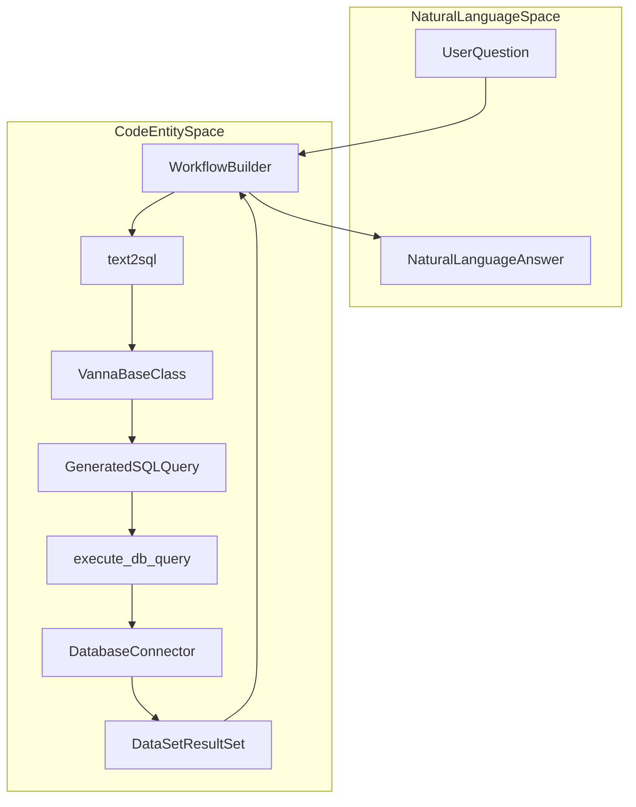
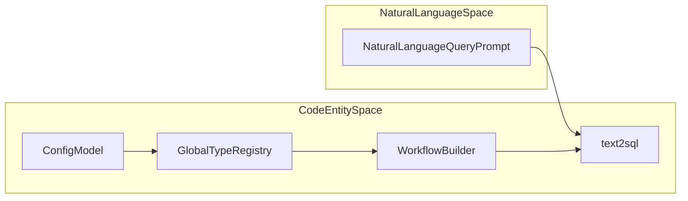

<!-- source: DeepWiki mcp.deepwiki.com · repo NVIDIA/NeMo-Agent-Toolkit · page 5.7 Text-to-SQL with Vanna · fetched 2026-10-26 -->

# Text-to-SQL with Vanna

<details>
<summary>Relevant source files</summary>

The following files were used as context for generating this wiki page:

- [.github/release.yml](.github/release.yml)
- [CHANGELOG.md](CHANGELOG.md)
- [SECURITY.md](SECURITY.md)
- [docs/source/build-workflows/about-building-workflows.md](docs/source/build-workflows/about-building-workflows.md)
- [docs/source/components/auth/api-authentication.md](docs/source/components/auth/api-authentication.md)
- [docs/source/extend/custom-components/memory.md](docs/source/extend/custom-components/memory.md)
- [docs/source/improve-workflows/profiler.md](docs/source/improve-workflows/profiler.md)
- [docs/source/release-notes.md](docs/source/release-notes.md)
- [docs/source/resources/security-considerations.md](docs/source/resources/security-considerations.md)
- [docs/source/run-workflows/observe/observe-workflow-with-mlflow.md](docs/source/run-workflows/observe/observe-workflow-with-mlflow.md)

</details>


## Purpose and Scope

This document details the Text-to-SQL capabilities powered by the Vanna framework within the NVIDIA NeMo Agent Toolkit. It covers the `text2sql` and `execute_db_query` functions, underlying data flow, component configurations, code entity mappings, and the removal of the standalone `nvidia-nat-vanna` package as of version `v1.7.0`.

Sources: [CHANGELOG.md:1-75](), [docs/source/release-notes.md:1-39]()

## Overview and Implementation

The Text-to-SQL functionality translates natural language prompts into executable SQL queries, interacts with relational databases via `execute_db_query`, and returns resulting datasets to agent workflows such as `react_agent` or `tool_calling_agent`.

### Key Functions and Classes
1. **`text2sql`**: Transforms a natural language query string into a valid SQL statement using database schema definitions, DDL statements, documentation, and few-shot examples.
2. **`execute_db_query`**: Executes the generated SQL string against the configured database connector and returns results to the agent workflow.

Sources: [docs/source/build-workflows/about-building-workflows.md:1-117]()

## Data Flow: Natural Language to Result

The following diagram illustrates the transformation from a user request to a database query result, bridging Natural Language Space and Code Entity Space.

### Text-to-SQL Execution Pipeline

Sources: [docs/source/build-workflows/about-building-workflows.md:1-117]()

## Component Configuration

Text-to-SQL entities are configured within the `function_groups` or `functions` section of the YAML configuration files.

### Integration Overview
The toolkit supports database backends alongside vector stores for few-shot learning metadata storage (DDL statements, documentation, and query pairs).

| Component | Role | Configuration Key Example |
| :--- | :--- | :--- |
| **Vanna** | Core Logic | `_type: vanna_text2sql` |
| **Milvus** | Vector Store | `_type: milvus_retriever` |
| **Databricks** | Database | `_type: databricks` |

### Example Workflow Configuration
```yaml
retrievers:
  vanna_milvus:
    _type: milvus_retriever
    uri: http://localhost:19530
    collection_name: "sql_knowledge_base"
    embedding_model: nim_embedder

function_groups:
  sql_tools:
    _type: vanna_text2sql
    db_type: databricks
    retriever: vanna_milvus
    include: [text2sql, execute_db_query]

workflow:
  _type: react_agent
  tool_names: [sql_tools]
```
Sources: [docs/source/build-workflows/about-building-workflows.md:24-60]()

## Mapping Code Entities to Space

This diagram bridges the Natural Language Space to the Code Entity Space, connecting configuration parsers, registry components, and execution functions.

### Code Entity Mapping

Sources: [docs/source/build-workflows/about-building-workflows.md:24-60]()

## Installation and Dependency Management

As of release **v1.7.0**, the standalone `nvidia-nat-vanna` integration package has been removed from the toolkit to streamline core dependencies. Users requiring Text-to-SQL capabilities must manage database drivers and Vanna framework dependencies manually or via custom package extensions.

```bash
# Example for installing optional database support extras
uv pip install "nvidia-nat[mysql]"
```

Sources: [CHANGELOG.md:1-75](), [docs/source/release-notes.md:1-39]()

---

