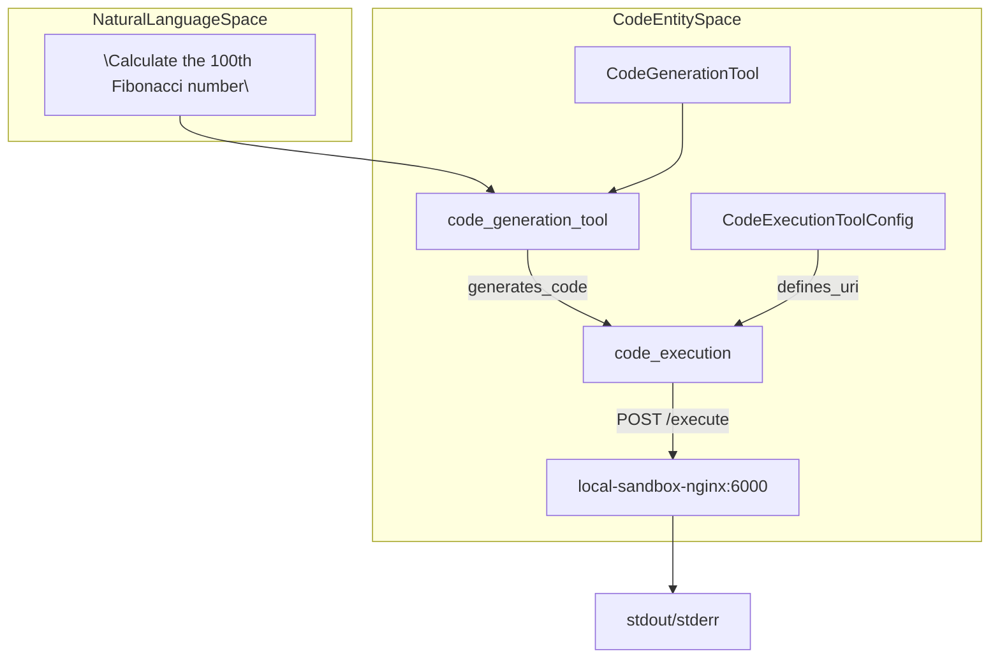
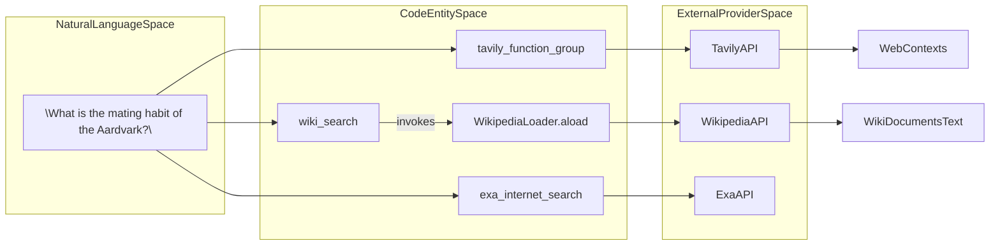
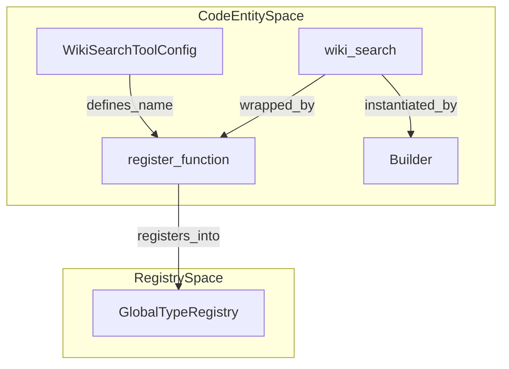

<!-- source: DeepWiki mcp.deepwiki.com · repo NVIDIA/NeMo-Agent-Toolkit · page 5.8 Code Execution and Built-in Functions · fetched 2026-10-26 -->

# Code Execution and Built-in Functions

Relevant source files

The following files were used as context for generating this wiki page:

- [docs/source/extend/custom-components/mcp-server.md](docs/source/extend/custom-components/mcp-server.md)
- [docs/source/extend/third-party-plugins.md](docs/source/extend/third-party-plugins.md)
- [examples/advanced_agents/alert_triage_agent/src/nat_alert_triage_agent/categorizer.py](examples/advanced_agents/alert_triage_agent/src/nat_alert_triage_agent/categorizer.py)
- [examples/advanced_agents/alert_triage_agent/src/nat_alert_triage_agent/configs/config_offline_mode.yml](examples/advanced_agents/alert_triage_agent/src/nat_alert_triage_agent/configs/config_offline_mode.yml)
- [examples/advanced_agents/alert_triage_agent/src/nat_alert_triage_agent/host_performance_check_tool.py](examples/advanced_agents/alert_triage_agent/src/nat_alert_triage_agent/host_performance_check_tool.py)
- [examples/advanced_agents/alert_triage_agent/src/nat_alert_triage_agent/network_connectivity_check_tool.py](examples/advanced_agents/alert_triage_agent/src/nat_alert_triage_agent/network_connectivity_check_tool.py)
- [examples/advanced_agents/alert_triage_agent/src/nat_alert_triage_agent/prompts.py](examples/advanced_agents/alert_triage_agent/src/nat_alert_triage_agent/prompts.py)
- [examples/advanced_agents/alert_triage_agent/src/nat_alert_triage_agent/utils.py](examples/advanced_agents/alert_triage_agent/src/nat_alert_triage_agent/utils.py)
- [examples/custom_functions/automated_description_generation/src/nat_automated_description_generation/utils/workflow_utils.py](examples/custom_functions/automated_description_generation/src/nat_automated_description_generation/utils/workflow_utils.py)
- [examples/custom_functions/automated_description_generation/tests/test_auto_desc_generation.py](examples/custom_functions/automated_description_generation/tests/test_auto_desc_generation.py)
- [packages/nvidia_nat_core/src/nat/tool/github_tools.py](packages/nvidia_nat_core/src/nat/tool/github_tools.py)
- [packages/nvidia_nat_core/tests/nat/tools/test_github_tools.py](packages/nvidia_nat_core/tests/nat/tools/test_github_tools.py)
- [packages/nvidia_nat_fastmcp/tests/server/__init__.py](packages/nvidia_nat_fastmcp/tests/server/__init__.py)
- [packages/nvidia_nat_langchain/src/nat/plugins/langchain/tools/code_generation_tool.py](packages/nvidia_nat_langchain/src/nat/plugins/langchain/tools/code_generation_tool.py)
- [packages/nvidia_nat_langchain/src/nat/plugins/langchain/tools/tavily_internet_search.py](packages/nvidia_nat_langchain/src/nat/plugins/langchain/tools/tavily_internet_search.py)
- [packages/nvidia_nat_langchain/src/nat/plugins/langchain/tools/wikipedia_search.py](packages/nvidia_nat_langchain/src/nat/plugins/langchain/tools/wikipedia_search.py)
- [packages/nvidia_nat_langchain/tests/test_wikipedia_search.py](packages/nvidia_nat_langchain/tests/test_wikipedia_search.py)

## Purpose and Scope

This page documents the pre-built functions and tools provided by the NVIDIA NeMo Agent Toolkit to extend agent capabilities beyond basic text generation. This includes code generation and sandboxed execution environments, internet search integrations (such as Wikipedia and Tavily migration patterns), and the underlying configuration and registration mechanisms that make these functions discoverable by workflows and the `Builder` pattern.

Sources: [packages/nvidia_nat_langchain/src/nat/plugins/langchain/tools/code_generation_tool.py:28-66](), [packages/nvidia_nat_langchain/src/nat/plugins/langchain/tools/wikipedia_search.py:26-62]()

---

## Code Generation and Execution

The toolkit supports both the generation of code and its secure execution. While code generation relies on LLMs to produce logic, code execution leverages isolated environments to safely run generated snippets.

### Code Generation Tool
The `code_generation` tool is a built-in function that uses a configured LLM to generate code blocks for a specific programming language (defaulting to Python). It is implemented as a LangChain-compatible tool wrapping a prompt template and an LLM client.

*   **Implementation**: Defined as `CodeGenerationTool` [packages/nvidia_nat_langchain/src/nat/plugins/langchain/tools/code_generation_tool.py:28-37]().
*   **Logic**: Uses a `ChatPromptTemplate` to instruct the LLM to act as a code assistant and return clean code blocks [packages/nvidia_nat_langchain/src/nat/plugins/langchain/tools/code_generation_tool.py:46-56]().
*   **Initialization**: Initialized by fetching the LLM from the `Builder` using the provided `llm_name` [packages/nvidia_nat_langchain/src/nat/plugins/langchain/tools/code_generation_tool.py:44-44]().

Sources: [packages/nvidia_nat_langchain/src/nat/plugins/langchain/tools/code_generation_tool.py:28-66]()

### Code Execution Sandbox
NeMo Agent Toolkit supports Python code execution in remote or local environments via the `code_execution` function. This function sends code to an execution backend and returns the `process_status`, `stdout`, and `stderr`.

#### Local Sandbox (Docker)
The toolkit includes a `local_sandbox` that runs as a containerized environment using Docker Compose.
*   **Isolation**: Uses a reverse proxy to isolate the sandbox backend.
*   **Security**: Containers are configured with network isolation and limited privileges (`no-new-privileges:true`).
*   **Resource Limits**: Supports configurable memory limits and execution timeouts.

#### Piston Server Support
For high-performance or distributed environments, the toolkit can connect to a remote Piston Server by configuring the `uri` and `sandbox_type` in the tool configuration.

Sources: [packages/nvidia_nat_langchain/src/nat/plugins/langchain/tools/code_generation_tool.py:28-66]()

### Mapping Natural Language to Code Execution
The following diagram illustrates how a natural language request maps to code generation and execution entities within the system.

**Code Execution Entity Mapping**

Sources: [packages/nvidia_nat_langchain/src/nat/plugins/langchain/tools/code_generation_tool.py:28-66]()

---

## Built-in Internet Search Tools

The toolkit provides multiple tools for real-time information retrieval, including Tavily, Exa, and Wikipedia.

### Tavily Internet Search (Migration)
In NeMo Agent Toolkit 1.8.0, the legacy `tavily_internet_search` tool was removed from the core `nvidia-nat[langchain]` package. Workflows must now use the provider-managed `nemo-agent-toolkit-tavily` plugin [packages/nvidia_nat_langchain/src/nat/plugins/langchain/tools/tavily_internet_search.py:21-29]().

*   **Configuration**: `TavilyInternetSearchToolConfig` serves as a migration stub that raises a `RuntimeError` if invoked [packages/nvidia_nat_langchain/src/nat/plugins/langchain/tools/tavily_internet_search.py:32-38]().
*   **Usage Pattern**: Users migrate by installing the plugin and defining a `function_groups` entry of type `tavily`.

Sources: [packages/nvidia_nat_langchain/src/nat/plugins/langchain/tools/tavily_internet_search.py:16-39]()

### Wikipedia Search
The `wiki_search` tool provides access to Wikipedia articles using the `WikipediaLoader`.

*   **Configuration**: `WikiSearchToolConfig` allows setting parameters such as `max_results` (defaults to 2) [packages/nvidia_nat_langchain/src/nat/plugins/langchain/tools/wikipedia_search.py:26-31]().
*   **Implementation**: Uses `langchain_community.document_loaders.WikipediaLoader` to fetch and format page content into structured XML-like strings [packages/nvidia_nat_langchain/src/nat/plugins/langchain/tools/wikipedia_search.py:45-52]().
*   **User-Agent Compliance**: Explicitly sets a `User-Agent` header to comply with Wikimedia policies, preventing 403 Forbidden errors [packages/nvidia_nat_langchain/src/nat/plugins/langchain/tools/wikipedia_search.py:42-43](), which is verified in unit tests [packages/nvidia_nat_langchain/tests/test_wikipedia_search.py:30-44]().

Sources: [packages/nvidia_nat_langchain/src/nat/plugins/langchain/tools/wikipedia_search.py:16-62](), [packages/nvidia_nat_langchain/tests/test_wikipedia_search.py:1-64]()

### Exa Search
The toolkit provides the LangChain-backed `exa_internet_search` tool, which utilizes the Exa Search API for neural internet search.

Sources: [packages/nvidia_nat_langchain/src/nat/plugins/langchain/tools/wikipedia_search.py:16-62]()

**Search Tool Data Flow and Entity Mapping**

Sources: [packages/nvidia_nat_langchain/src/nat/plugins/langchain/tools/tavily_internet_search.py:16-39](), [packages/nvidia_nat_langchain/src/nat/plugins/langchain/tools/wikipedia_search.py:16-62]()

---

## Configuration and Registration

All built-in functions follow the toolkit's registration pattern using the `@register_function` decorator. This ensures they are discoverable by the `Builder` and can be composed into any workflow type.

1.  **Define Config**: Create a configuration class inheriting from `FunctionBaseConfig` with a unique name [packages/nvidia_nat_langchain/src/nat/plugins/langchain/tools/code_generation_tool.py:28-34]().
2.  **Register**: Apply `@register_function(config_type=..., framework_wrappers=[...])`. This allows the `Builder` to discover the tool and map it to specific execution frameworks like LangChain [packages/nvidia_nat_langchain/src/nat/plugins/langchain/tools/code_generation_tool.py:39-39]().
3.  **Implement**: Use an `async` function that yields a `FunctionInfo` object [packages/nvidia_nat_langchain/src/nat/plugins/langchain/tools/code_generation_tool.py:40-66]().

Sources: [packages/nvidia_nat_langchain/src/nat/plugins/langchain/tools/code_generation_tool.py:16-66](), [packages/nvidia_nat_langchain/src/nat/plugins/langchain/tools/wikipedia_search.py:16-62]()

**Function Registration Mapping**

Sources: [packages/nvidia_nat_langchain/src/nat/plugins/langchain/tools/wikipedia_search.py:26-35](), [packages/nvidia_nat_langchain/src/nat/plugins/langchain/tools/code_generation_tool.py:28-66]()

---

