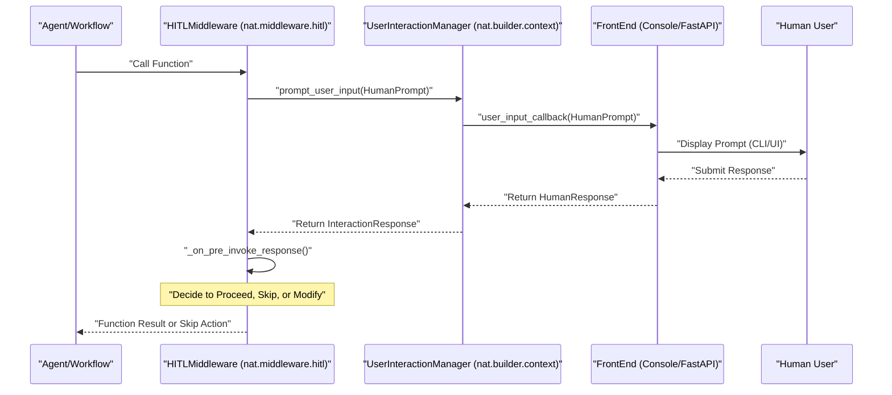
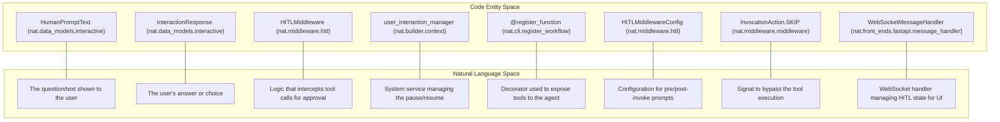

<!-- source: DeepWiki mcp.deepwiki.com · repo NVIDIA/NeMo-Agent-Toolkit · page 5.9 Human-in-the-Loop (HITL) · fetched 2026-10-26 -->

# Human-in-the-Loop (HITL)

Relevant source files

The following files were used as context for generating this wiki page:

- [examples/HITL/por_to_jiratickets/pyproject.toml](examples/HITL/por_to_jiratickets/pyproject.toml)
- [examples/HITL/simple_calculator_hitl/pyproject.toml](examples/HITL/simple_calculator_hitl/pyproject.toml)
- [examples/MCP/simple_calculator_mcp/pyproject.toml](examples/MCP/simple_calculator_mcp/pyproject.toml)
- [examples/RAG/simple_rag/pyproject.toml](examples/RAG/simple_rag/pyproject.toml)
- [examples/advanced_agents/alert_triage_agent/pyproject.toml](examples/advanced_agents/alert_triage_agent/pyproject.toml)
- [examples/custom_functions/plot_charts/pyproject.toml](examples/custom_functions/plot_charts/pyproject.toml)
- [examples/evaluation_and_profiling/simple_calculator_eval/pyproject.toml](examples/evaluation_and_profiling/simple_calculator_eval/pyproject.toml)
- [packages/nvidia_nat_core/src/nat/builder/context.py](packages/nvidia_nat_core/src/nat/builder/context.py)
- [packages/nvidia_nat_core/src/nat/builder/intermediate_step_manager.py](packages/nvidia_nat_core/src/nat/builder/intermediate_step_manager.py)
- [packages/nvidia_nat_core/src/nat/builder/user_interaction_manager.py](packages/nvidia_nat_core/src/nat/builder/user_interaction_manager.py)
- [packages/nvidia_nat_core/src/nat/runtime/runner.py](packages/nvidia_nat_core/src/nat/runtime/runner.py)
- [packages/nvidia_nat_core/src/nat/utils/providers.py](packages/nvidia_nat_core/src/nat/utils/providers.py)
- [packages/nvidia_nat_core/tests/nat/builder/test_interactive.py](packages/nvidia_nat_core/tests/nat/builder/test_interactive.py)
- [packages/nvidia_nat_core/tests/nat/builder/test_intermediate_step_manager.py](packages/nvidia_nat_core/tests/nat/builder/test_intermediate_step_manager.py)
- [packages/nvidia_nat_core/tests/nat/runtime/test_runner.py](packages/nvidia_nat_core/tests/nat/runtime/test_runner.py)
- [packages/nvidia_nat_core/tests/nat/runtime/test_runner_trace_ids.py](packages/nvidia_nat_core/tests/nat/runtime/test_runner_trace_ids.py)
- [packages/nvidia_nat_core/tests/nat/utils/test_providers.py](packages/nvidia_nat_core/tests/nat/utils/test_providers.py)

## Purpose and Scope
This page documents the Human-in-the-Loop (HITL) capabilities in the NVIDIA NeMo Agent Toolkit. It covers architectural components such as `HITLMiddleware`, interactive data models, `hitl_approval_function` implementations, WebSocket-based runtime interaction mechanisms, and configuration patterns used to gate agentic workflows and tool executions with manual user approvals.

Sources: [packages/nvidia_nat_core/src/nat/middleware/hitl/hitl_middleware.py:29-35](), [packages/nvidia_nat_core/src/nat/builder/context.py:93-96]()

---

## HITL Architecture and Interaction

Human-in-the-Loop is implemented through a combination of specialized functions, middleware, and communication protocols that pause agent execution until external feedback is received.

### HITL Middleware
The `HITLMiddleware` class is a specialized `DynamicFunctionMiddleware` that intercepts function calls to present human prompts before (`pre_invoke`) or after (`post_invoke`) execution [packages/nvidia_nat_core/src/nat/middleware/hitl/hitl_middleware.py:29-35](). It inherits from `DynamicFunctionMiddleware`, allowing it to target specific functions or components via configuration [packages/nvidia_nat_core/src/nat/middleware/hitl/hitl_middleware_config.py:25-29]().

*   **`pre_invoke`**: Triggers a prompt before the function runs. The response is handled by `_on_pre_invoke_response`, which can be used to modify arguments or skip the call entirely by returning an `InvocationContext` with `action` set to `InvocationAction.SKIP` [packages/nvidia_nat_core/src/nat/middleware/hitl/hitl_middleware.py:48-64]().
*   **`post_invoke`**: Triggers a prompt after the function returns. The response is handled by `_on_post_invoke_response`, allowing a user to review, replace, or suppress the output (especially in streaming scenarios) [packages/nvidia_nat_core/src/nat/middleware/hitl/hitl_middleware.py:66-82]().

Sources: [packages/nvidia_nat_core/src/nat/middleware/hitl/hitl_middleware.py:29-82](), [packages/nvidia_nat_core/src/nat/middleware/hitl/hitl_middleware_config.py:25-29]()

### Communication Flow
The interaction lifecycle is managed by the `user_interaction_manager` within the `Context` [packages/nvidia_nat_core/src/nat/middleware/hitl/hitl_middleware.py:98-99]().

1.  **Server-based (FastAPI/WebSocket)**: The interaction manager prompts the user via a callback. The `WebSocketMessageHandler` manages the state of the interaction using the `UserInteraction` class, which holds an `asyncio.Future` for the human response [packages/nvidia_nat_core/src/nat/front_ends/fastapi/message_handler.py:74-82](). The workflow execution is paused until the front-end provides the response via a `WebSocketUserInteractionResponseMessage` [packages/nvidia_nat_core/src/nat/front_ends/fastapi/message_handler.py:53-53]().
2.  **CLI Environment**: For local execution, the `ConsoleFrontEndPlugin` utilizes `prompt_for_input_cli` to capture user input directly from `stdin` [packages/nvidia_nat_core/src/nat/front_ends/console/console_front_end_plugin.py:62-66](). It supports timeouts with a visual countdown and placeholder text [packages/nvidia_nat_core/src/nat/front_ends/console/console_front_end_plugin.py:69-90]().

**HITL Execution Flow**

Sources: [packages/nvidia_nat_core/src/nat/middleware/hitl/hitl_middleware.py:84-118](), [examples/HITL/por_to_jiratickets/src/nat_por_to_jiratickets/hitl_approval_tool.py:63-63](), [packages/nvidia_nat_core/src/nat/middleware/middleware.py:87-115](), [packages/nvidia_nat_core/src/nat/front_ends/fastapi/message_handler.py:74-82]()

---

## Implementation Components

The toolkit uses specific data models and registration decorators to define HITL behavior, which are exposed via the stable `nat.plugin_api` [packages/nvidia_nat_core/src/nat/plugin_api/__init__.py:84-93]().

### Key Data Models
*   **`HumanPrompt`**: The base class for requesting user action [packages/nvidia_nat_core/src/nat/plugin_api/__init__.py:85-85](). Subtypes include:
    *   `HumanPromptText`: Simple text input [packages/nvidia_nat_core/src/nat/data_models/interactive.py:26-26]().
    *   `HumanPromptNotification`: One-way message to the user [packages/nvidia_nat_core/src/nat/data_models/interactive.py:57-57]().
*   **`HumanResponse`**: The base class for user feedback.
    *   `HumanResponseText`: Contains the typed string from the user [packages/nvidia_nat_core/src/nat/data_models/interactive.py:28-28]().
    *   `HumanResponseBinary`, `HumanResponseCheckbox`, `HumanResponseDropdown`, `HumanResponseRadio`: Specialized response types for UI interactions [packages/nvidia_nat_core/src/nat/plugin_api/__init__.py:93-97]().
*   **`InteractionResponse`**: An envelope containing the user's decision and metadata [packages/nvidia_nat_core/src/nat/plugin_api/__init__.py:100-100]().
*   **`HITLMiddlewareConfig`**: Configuration defining `pre_invoke_prompt` and `post_invoke_prompt` [packages/nvidia_nat_core/src/nat/middleware/hitl/hitl_middleware_config.py:31-39]().

### HITL Approval Functions
Developers can implement HITL by creating functions that explicitly call the `user_interaction_manager`. In the `por_to_jiratickets` example, the `hitl_approval_function` uses `Context.get().user_interaction_manager.prompt_user_input()` to block execution until a "yes" or "no" is received [examples/HITL/por_to_jiratickets/src/nat_por_to_jiratickets/hitl_approval_tool.py:55-63]().

**Code Entity to Natural Language Mapping**

Sources: [packages/nvidia_nat_core/src/nat/plugin_api/__init__.py:84-115](), [examples/HITL/por_to_jiratickets/src/nat_por_to_jiratickets/hitl_approval_tool.py:32-47](), [packages/nvidia_nat_core/src/nat/middleware/hitl/hitl_middleware.py:29-45](), [packages/nvidia_nat_core/src/nat/front_ends/fastapi/message_handler.py:84-103]()

---

## Configuration Patterns

HITL is typically configured in the workflow YAML by referencing approval functions or attaching middleware to specific tools.

### Example: Tool-Specific Approval
In the Jira tickets example, the `create_jira_tickets_tool` is configured with a reference to an `hitl_approval_fn` [examples/HITL/por_to_jiratickets/src/nat_por_to_jiratickets/configs/config.yml:33-40](). The `hitl_approval_tool` itself is defined with a specific prompt that will be sent to the user [examples/HITL/por_to_jiratickets/src/nat_por_to_jiratickets/configs/config.yml:46-48]().

### Interaction Variety
The toolkit supports multiple response types to handle different HITL scenarios:

| Response Model | Data Content | Purpose |
| :--- | :--- | :--- |
| `HumanResponseText` | `text: str` | Free-form user input [packages/nvidia_nat_core/src/nat/data_models/interactive.py:28-28](). |
| `HumanPromptText` | String Input | Standard text-based human input [packages/nvidia_nat_core/src/nat/plugin_api/__init__.py:91-91](). |
| `HumanPromptNotification` | No Input | Informational message to the user [packages/nvidia_nat_core/src/nat/data_models/interactive.py:57-57](). |
| `HumanResponseBinary` | `data: bytes` | Binary data upload or confirmation [packages/nvidia_nat_core/src/nat/plugin_api/__init__.py:93-93](). |

Sources: [examples/HITL/por_to_jiratickets/src/nat_por_to_jiratickets/configs/config.yml:33-48](), [packages/nvidia_nat_core/src/nat/plugin_api/__init__.py:84-100]()

---

## WebSocket and Server Support
The `WebSocketMessageHandler` in the FastAPI front-end provides robust support for HITL in networked environments:
*   **Reconnection Support**: The handler can restore execution state and re-send pending HITL prompts if a user disconnects and reconnects [packages/nvidia_nat_core/src/nat/front_ends/fastapi/message_handler.py:133-156]().
*   **Interaction State**: It uses a `UserInteraction` object to track the `asyncio.Future` and the time the prompt was started [packages/nvidia_nat_core/src/nat/front_ends/fastapi/message_handler.py:74-82]().
*   **Message Types**: HITL events are transmitted using `WebSocketSystemInteractionMessage` and `WebSocketUserInteractionResponseMessage` [packages/nvidia_nat_core/src/nat/front_ends/fastapi/message_handler.py:50-53]().

Sources: [packages/nvidia_nat_core/src/nat/front_ends/fastapi/message_handler.py:50-82](), [packages/nvidia_nat_core/src/nat/front_ends/fastapi/message_handler.py:133-156]()

---

## Summary of HITL Features

| Feature | Description |
| :--- | :--- |
| **`pre_invoke` Gating** | Intercepts calls before execution to allow parameter modification or skipping via `InvocationAction.SKIP` [packages/nvidia_nat_core/src/nat/middleware/hitl/hitl_middleware.py:84-100](). |
| **`post_invoke` Review** | Intercepts results after execution to allow the user to modify the agent's observation [packages/nvidia_nat_core/src/nat/middleware/hitl/hitl_middleware.py:102-118](). |
| **Dynamic Targeting** | `HITLMiddleware` can be targeted to specific functions or components using `DynamicMiddlewareConfig` patterns [packages/nvidia_nat_core/src/nat/middleware/hitl/hitl_middleware_config.py:25-29](). |
| **Interactive Prompts** | Native support for interactive prompts via `user_interaction_manager` with configurable timeouts [examples/HITL/por_to_jiratickets/src/nat_por_to_jiratickets/hitl_approval_tool.py:58-63](). |
| **WebSocket Persistence** | Support for resuming HITL interactions across WebSocket reconnections [packages/nvidia_nat_core/src/nat/front_ends/fastapi/message_handler.py:153-156](). |

Sources: [packages/nvidia_nat_core/src/nat/middleware/hitl/hitl_middleware.py:29-118](), [packages/nvidia_nat_core/src/nat/middleware/hitl/hitl_middleware_config.py:31-39](), [packages/nvidia_nat_core/src/nat/front_ends/fastapi/message_handler.py:74-156](), [packages/nvidia_nat_core/src/nat/front_ends/console/console_front_end_plugin.py:62-97](), [packages/nvidia_nat_core/src/nat/plugin_api/__init__.py:84-100]()

---

