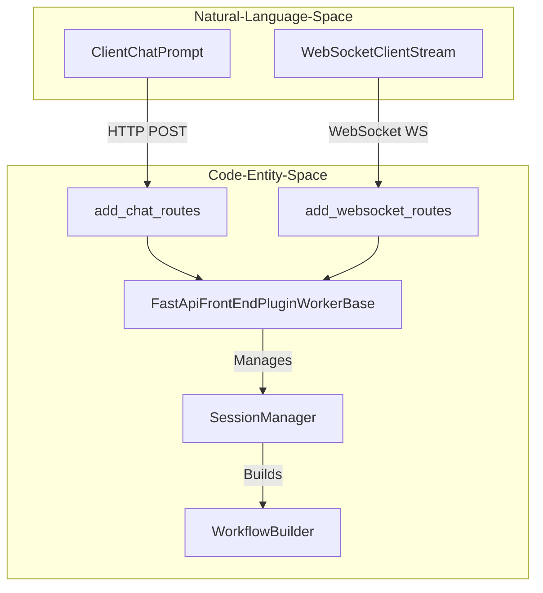
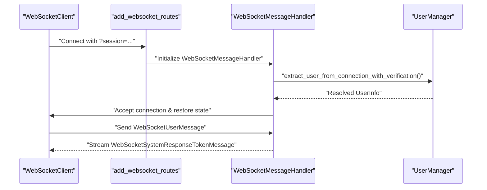
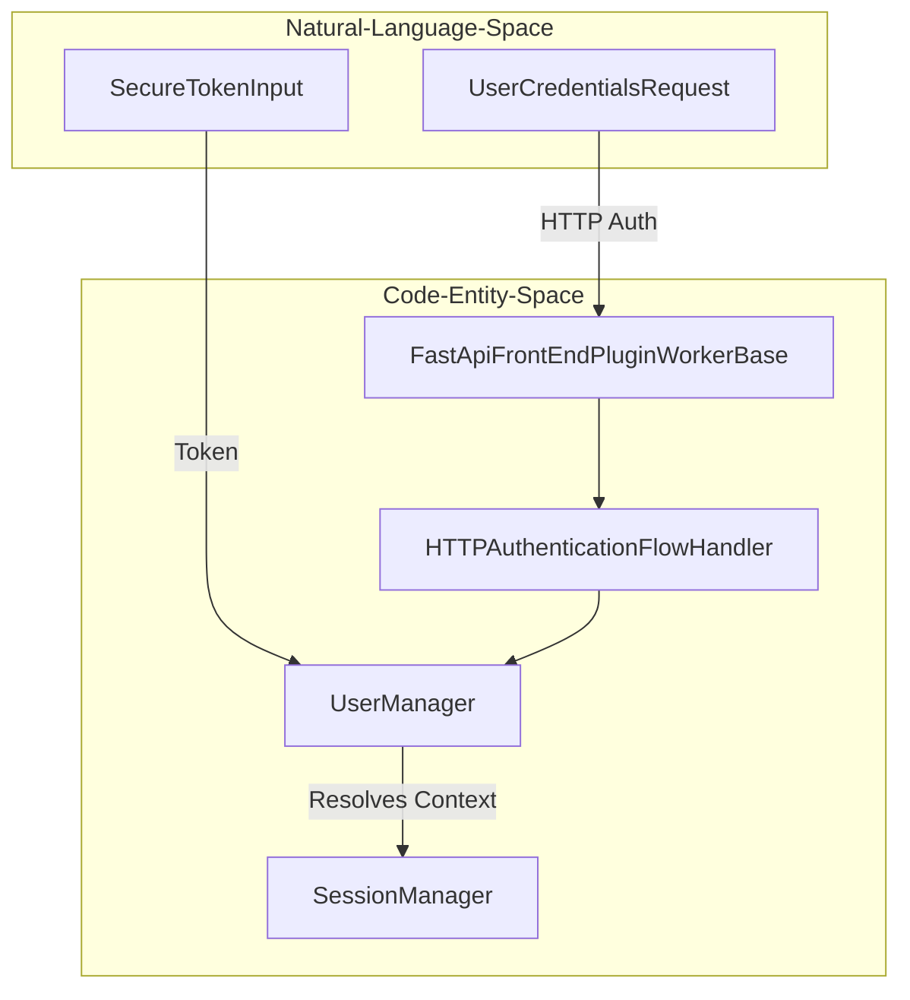
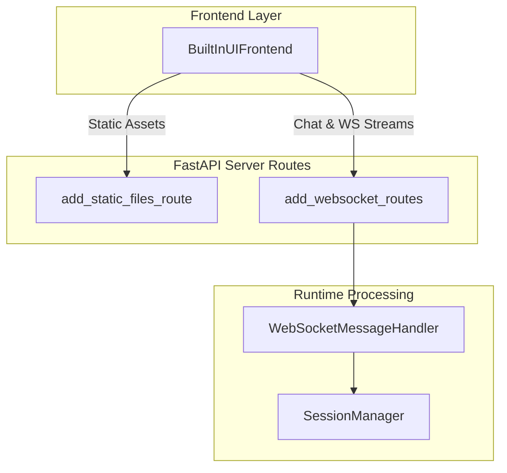

<!-- source: DeepWiki mcp.deepwiki.com · repo NVIDIA/NeMo-Agent-Toolkit · page 6 API Server and Frontend · fetched 2026-10-26 -->

# API Server and Frontend

Relevant source files

The following files were used as context for generating this wiki page:

- [docs/source/reference/rest-api/api-server-endpoints.md](docs/source/reference/rest-api/api-server-endpoints.md)
- [packages/nvidia_nat_core/src/nat/front_ends/fastapi/async_jobs/job_store.py](packages/nvidia_nat_core/src/nat/front_ends/fastapi/async_jobs/job_store.py)
- [packages/nvidia_nat_core/tests/nat/front_ends/fastapi/test_job_store.py](packages/nvidia_nat_core/tests/nat/front_ends/fastapi/test_job_store.py)

## Purpose and Scope

This document provides a high-level overview of how the NVIDIA NeMo Agent Toolkit (NAT) exposes agent workflows as HTTP and WebSocket services via a FastAPI-based API server, alongside a built-in web UI for interactive usage. It explains the main components enabling external clients to invoke, stream, and interact with workflows, bridging natural language inputs to structured workflow executions.

The API server and frontend system components include:
- A **FastAPI Server** (`FastApiFrontEndPluginWorkerBase`) that manages HTTP endpoints, session lifecycle, request validation, route wiring, and CORS configuration [packages/nvidia_nat_core/src/nat/front_ends/fastapi/fastapi_front_end_plugin_worker.py:59-142]().
- A **WebSocket Message Handler** (`WebSocketMessageHandler`) enabling real-time bidirectional communication, streaming intermediate tokens, step responses, and Human-in-the-Loop (HITL) inputs.
- A **Session Manager** (`SessionManager`) that delegates execution to proper workflow instances, maintaining per-user or shared session contexts [packages/nvidia_nat_core/src/nat/runtime/session.py:94-110]().
- A **User Manager** (`UserManager`) resolving incoming HTTP requests or WebSocket connections into `UserInfo` models supporting session cookies, JWTs, API keys, basic auth, and identity headers.
- A **Built-In UI** implemented as a reference web frontend that interacts with the server’s WebSocket endpoint to provide a rich chat interface supporting streaming output, intermediate step inspection, and interactive prompts.

This page acts as a parent overview document linking to child pages for detailed architectural, communication protocol, security, and UI specifics:
- For details on endpoint structure, request handling, and async job stores, see [FastAPI Server Architecture](#6.1) (Child 6.1).
- For details on interactive streaming, reconnection flows, and OAuth authentication flows, see [WebSocket Communication](#6.2) (Child 6.2).
- For details on API authentication (JWT, API key, basic, session cookie), per-user context, and security best practices, see [Authentication and Security](#6.3) (Child 6.3).
- For details on the included web UI for interacting with workflows, HITL support, streaming, and Docker deployment, see [Built-In UI](#6.4) (Child 6.4).

Sources:
- [packages/nvidia_nat_core/src/nat/front_ends/fastapi/fastapi_front_end_plugin_worker.py:59-142]()
- [packages/nvidia_nat_core/src/nat/runtime/session.py:94-110]()

---

## FastAPI Server Architecture

The API server wraps agent workflows as FastAPI route handlers serving HTTP requests and WebSocket connections. Incoming requests are modeled using Pydantic schemas like `ChatRequest` and configured via `FastApiFrontEndConfig`. The application lifecycle is managed asynchronously within `FastApiFrontEndPluginWorkerBase.build_app`, which initializes workflow builders and registers routes for chat, generation, health, execution, and monitoring [packages/nvidia_nat_core/src/nat/front_ends/fastapi/fastapi_front_end_plugin_worker.py:103-142](). It also supports asynchronous job execution backed by database-backed storage (`JobStore`) for long-running operations [packages/nvidia_nat_core/src/nat/front_ends/fastapi/async_jobs/job_store.py:161-186]().

For detailed coverage of endpoint structures, request routing, validation, and async job execution stores, see [FastAPI Server Architecture](#6.1).

Title: "Natural Language to Code Entity Space: FastAPI Request Lifecycle"

Sources:
- [packages/nvidia_nat_core/src/nat/front_ends/fastapi/fastapi_front_end_plugin_worker.py:59-142]()
- [packages/nvidia_nat_core/src/nat/front_ends/fastapi/async_jobs/job_store.py:161-186]()

---

## WebSocket Communication

WebSocket communication is handled via `WebSocketMessageHandler` and registered through route helper functions. This architecture supports bidirectional messaging, token streaming, state restoration across reconnections using `conversation_id` query parameters, and OAuth authentication flows.

For deep dives into the WebSocket message schema, streaming tokens, connection restoration, and OAuth flows, see [WebSocket Communication](#6.2).

Title: "WebSocket Message Processing and State Restoration"

Sources:
- [packages/nvidia_nat_core/src/nat/front_ends/fastapi/fastapi_front_end_plugin_worker.py:44-52]()

---

## Authentication and Security

Authentication and access control are centrally managed by `UserManager` and supported by credential validation configurations. The server supports multiple identity credential types (`session_cookie`, `jwt`, `api_key`, `basic`) controlled by configuration flags and verified via provider validators. Additionally, CORS settings and security headers are enforced across the FastAPI layer [packages/nvidia_nat_core/src/nat/front_ends/fastapi/fastapi_front_end_plugin_worker.py:135-142]().

For detailed information on configuring JWT validation, session cookies, API keys, per-user context, and security best practices, see [Authentication and Security](#6.3).

Title: "Natural Language to Code Entity Space: Authentication and Security Flow"

Sources:
- [packages/nvidia_nat_core/src/nat/front_ends/fastapi/fastapi_front_end_plugin_worker.py:40-76]()

---

## Built-In UI

NAT includes a built-in static web UI served directly by the FastAPI backend. The UI interacts with the WebSocket and HTTP endpoints to deliver real-time streaming, chat histories, intermediate reasoning inspection, and Human-in-the-Loop (HITL) prompt forms.

For comprehensive instructions on using the built-in UI, handling HITL interactions, streaming display, and containerized deployment, see [Built-In UI](#6.4).

Title: "Built-In UI Integration with API Server"

Sources:
- [packages/nvidia_nat_core/src/nat/front_ends/fastapi/fastapi_front_end_plugin_worker.py:44-52]()

---

