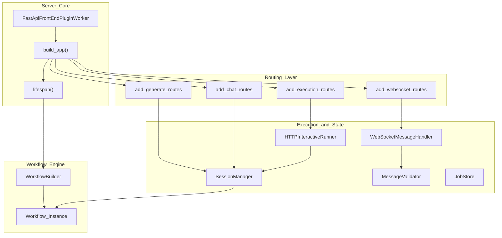
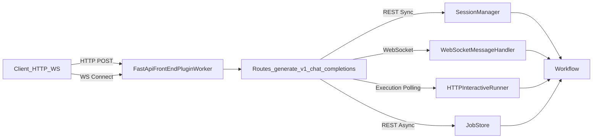

<!-- source: DeepWiki mcp.deepwiki.com · repo NVIDIA/NeMo-Agent-Toolkit · page 6.1 FastAPI Server Architecture · fetched 2026-10-26 -->

# FastAPI Server Architecture

Relevant source files

The following files were used as context for generating this wiki page:

- [docs/source/reference/rest-api/api-server-endpoints.md](docs/source/reference/rest-api/api-server-endpoints.md)
- [packages/nvidia_nat_core/src/nat/data_models/step_adaptor.py](packages/nvidia_nat_core/src/nat/data_models/step_adaptor.py)
- [packages/nvidia_nat_core/src/nat/front_ends/fastapi/async_jobs/async_job.py](packages/nvidia_nat_core/src/nat/front_ends/fastapi/async_jobs/async_job.py)
- [packages/nvidia_nat_core/src/nat/front_ends/fastapi/async_jobs/job_store.py](packages/nvidia_nat_core/src/nat/front_ends/fastapi/async_jobs/job_store.py)
- [packages/nvidia_nat_core/src/nat/front_ends/fastapi/http_interactive_runner.py](packages/nvidia_nat_core/src/nat/front_ends/fastapi/http_interactive_runner.py)
- [packages/nvidia_nat_core/src/nat/front_ends/fastapi/routes/async_generation.py](packages/nvidia_nat_core/src/nat/front_ends/fastapi/routes/async_generation.py)
- [packages/nvidia_nat_core/src/nat/front_ends/fastapi/routes/common_utils.py](packages/nvidia_nat_core/src/nat/front_ends/fastapi/routes/common_utils.py)
- [packages/nvidia_nat_core/src/nat/front_ends/fastapi/routes/generate.py](packages/nvidia_nat_core/src/nat/front_ends/fastapi/routes/generate.py)
- [packages/nvidia_nat_core/src/nat/front_ends/fastapi/routes/v1_chat_completions.py](packages/nvidia_nat_core/src/nat/front_ends/fastapi/routes/v1_chat_completions.py)
- [packages/nvidia_nat_core/src/nat/front_ends/fastapi/step_adaptor.py](packages/nvidia_nat_core/src/nat/front_ends/fastapi/step_adaptor.py)
- [packages/nvidia_nat_core/tests/nat/front_ends/fastapi/test_fastapi_front_end_plugin.py](packages/nvidia_nat_core/tests/nat/front_ends/fastapi/test_fastapi_front_end_plugin.py)
- [packages/nvidia_nat_core/tests/nat/front_ends/fastapi/test_job_store.py](packages/nvidia_nat_core/tests/nat/front_ends/fastapi/test_job_store.py)
- [packages/nvidia_nat_core/tests/nat/front_ends/fastapi/test_step_adaptor.py](packages/nvidia_nat_core/tests/nat/front_ends/fastapi/test_step_adaptor.py)
- [packages/nvidia_nat_core/tests/nat/front_ends/test_http_interactive_runner_cancellation.py](packages/nvidia_nat_core/tests/nat/front_ends/test_http_interactive_runner_cancellation.py)

## Purpose and Scope

This document explains the architecture and implementation details of the FastAPI server in the NVIDIA NeMo Agent Toolkit (NAT). The server exposes agent workflows as HTTP REST APIs and WebSocket endpoints, supporting both synchronous and asynchronous request handling, including interactive workflows with human-in-the-loop (HITL) capabilities.

The scope covers:
- Server lifecycle and app creation via `FastApiFrontEndPluginWorker` [packages/nvidia_nat_core/src/nat/front_ends/fastapi/fastapi_front_end_plugin_worker.py:59-142]().
- Route management, including REST generate/chat endpoints and WebSocket handlers [packages/nvidia_nat_core/src/nat/front_ends/fastapi/fastapi_front_end_plugin_worker.py:45-52]().
- Request processing flow from incoming HTTP/WebSocket messages through workflow execution via `WebSocketMessageHandler` [packages/nvidia_nat_core/src/nat/front_ends/fastapi/message_handler.py:83-113]().
- User session and concurrency management with `SessionManager` [packages/nvidia_nat_core/src/nat/runtime/session.py:94-121]().
- Message validation and schema mapping using `MessageValidator` [packages/nvidia_nat_core/src/nat/front_ends/fastapi/message_validator.py:66-79]().
- HTTP-based interactive execution via `HTTPInteractiveRunner` for polling-based HITL and OAuth [packages/nvidia_nat_core/src/nat/front_ends/fastapi/http_interactive_runner.py:55-77]().
- Asynchronous job management using Dask and SQLAlchemy via `JobStore` [packages/nvidia_nat_core/src/nat/front_ends/fastapi/async_jobs/job_store.py:161-190]().

Sources:
- [packages/nvidia_nat_core/src/nat/front_ends/fastapi/fastapi_front_end_plugin_worker.py:59-142]()
- [packages/nvidia_nat_core/src/nat/front_ends/fastapi/message_handler.py:83-113]()
- [packages/nvidia_nat_core/src/nat/runtime/session.py:94-121]()
- [packages/nvidia_nat_core/src/nat/front_ends/fastapi/message_validator.py:66-79]()
- [packages/nvidia_nat_core/src/nat/front_ends/fastapi/http_interactive_runner.py:55-77]()
- [packages/nvidia_nat_core/src/nat/front_ends/fastapi/async_jobs/job_store.py:161-190]()

---

## High-Level Architecture

The FastAPI server is implemented primarily in the `FastApiFrontEndPluginWorker` class [packages/nvidia_nat_core/src/nat/front_ends/fastapi/fastapi_front_end_plugin_worker.py:59](). It uses a `WorkflowBuilder` to instantiate workflows during the application `lifespan` [packages/nvidia_nat_core/src/nat/front_ends/fastapi/fastapi_front_end_plugin_worker.py:106-116](). The worker configures the FastAPI app, sets up CORS middleware [packages/nvidia_nat_core/src/nat/front_ends/fastapi/fastapi_front_end_plugin_worker.py:144-161](), and registers routes from modular components.

A core component is the `SessionManager`, which maintains user session isolation and concurrency controls, supporting both shared and per-user workflow configurations [packages/nvidia_nat_core/src/nat/runtime/session.py:94-121](). For long-running tasks, the `JobStore` provides a persistence layer for job metadata and status tracking [packages/nvidia_nat_core/src/nat/front_ends/fastapi/async_jobs/job_store.py:85-134]().

### Component Architecture — Code Entity Map

Sources:
- [packages/nvidia_nat_core/src/nat/front_ends/fastapi/fastapi_front_end_plugin_worker.py:59-161]()
- [packages/nvidia_nat_core/src/nat/front_ends/fastapi/routes/generate.py:32-128]()
- [packages/nvidia_nat_core/src/nat/runtime/session.py:94-121]()
- [packages/nvidia_nat_core/src/nat/front_ends/fastapi/async_jobs/job_store.py:85-134]()

---

## Endpoint Structure and Routing

The server exposes endpoints through specialized route registration functions. NAT supports standard paths for generation and chat, compatible with OpenAI's specification where applicable [docs/source/reference/rest-api/api-server-endpoints.md:20-45]().

| Interface | Registration Function | Description |
| :--- | :--- | :--- |
| Generate | `add_generate_routes` | Non-streaming, streaming (`/stream`), and trajectory endpoints [packages/nvidia_nat_core/src/nat/front_ends/fastapi/routes/generate.py:32-128](). |
| Async Generate | `add_async_generation_routes` | Background execution using Dask; returns a job ID for polling [packages/nvidia_nat_core/src/nat/front_ends/fastapi/routes/async_generation.py:1-40](). |
| Chat | `add_chat_routes` | Chat completions endpoints [packages/nvidia_nat_core/src/nat/front_ends/fastapi/fastapi_front_end_plugin_worker.py:46](). |
| WebSocket | `add_websocket_routes` | Real-time bidirectional streaming and interactions [packages/nvidia_nat_core/src/nat/front_ends/fastapi/fastapi_front_end_plugin_worker.py:52](). |
| Execution | `add_execution_routes` | Management of ongoing workflow executions (`/executions/{id}`) and interaction responses [packages/nvidia_nat_core/src/nat/front_ends/fastapi/fastapi_front_end_plugin_worker.py:47](). |

### Default and Legacy Paths
NAT supports both versioned experimental paths and legacy paths for backward compatibility [docs/source/reference/rest-api/api-server-endpoints.md:30-45]().

| Endpoint | Versioned Path | Legacy Path |
|----------|-------------|-------------|
| Generate (non-streaming) | `/v1/workflow` | `/generate` |
| Generate (streaming) | `/v1/workflow/stream` | `/generate/stream` |
| Chat (non-streaming) | `/v1/chat` | `/chat` |
| OpenAI v1 Completions | `/v1/chat/completions` | (none) |

Sources:
- [packages/nvidia_nat_core/src/nat/front_ends/fastapi/fastapi_front_end_plugin_worker.py:45-52]()
- [packages/nvidia_nat_core/src/nat/front_ends/fastapi/routes/generate.py:32-128]()
- [docs/source/reference/rest-api/api-server-endpoints.md:20-45]()

---

## Request Handling and Data Flow

### WebSocket Message Handling

The `WebSocketMessageHandler` manages the lifecycle of a WebSocket connection, including state validation and event routing [packages/nvidia_nat_core/src/nat/front_ends/fastapi/message_validator.py:95-125]().

1.  **Validation**: Incoming messages are checked against schemas using `MessageValidator` [packages/nvidia_nat_core/src/nat/front_ends/fastapi/message_validator.py:95-125]().
2.  **Execution**: The handler initiates workflow execution via `SessionManager` and maps outputs to various message types [packages/nvidia_nat_core/src/nat/runtime/session.py:112-168]().
3.  **HITL Interaction**: If a workflow requires user input, it triggers a prompt mechanism managed by execution tracking [packages/nvidia_nat_core/src/nat/front_ends/fastapi/http_interactive_runner.py:110-165]().

### HTTP Interactive Execution

For environments where WebSockets are unavailable, `HTTPInteractiveRunner` coordinates HITL and OAuth via polling [packages/nvidia_nat_core/src/nat/front_ends/fastapi/http_interactive_runner.py:55-77]().

- **Non-Streaming**: The server returns an accepted execution status if an interaction is required, providing an execution ID [packages/nvidia_nat_core/src/nat/data_models/interactive_http.py:1-40](). Clients poll the execution status to retrieve results.
- **Streaming**: Uses Server-Sent Events (SSE). The `HTTPInteractiveRunner` provides a streaming generator that yields interaction events when HITL is required, blocking until the client responds [packages/nvidia_nat_core/src/nat/front_ends/fastapi/http_interactive_runner.py:141-164]().

### Asynchronous Generation

The toolkit supports offloading long-running workflows to a Dask cluster [packages/nvidia_nat_core/src/nat/front_ends/fastapi/async_jobs/job_store.py:161-190]():

1.  **Submission**: `JobStore.submit_job` creates a `JobInfo` entry in the database with status `SUBMITTED` and schedules the task.
2.  **Tracking**: The `JobInfo` model tracks `status`, `created_at`, `updated_at`, and `expiry_seconds` [packages/nvidia_nat_core/src/nat/front_ends/fastapi/async_jobs/job_store.py:85-134]().
3.  **Cleanup**: Expired jobs are periodically cleaned up based on configuration limits [packages/nvidia_nat_core/src/nat/front_ends/fastapi/async_jobs/job_store.py:177-180]().

### Code Entity Map: Request Flow

Sources:
- [packages/nvidia_nat_core/src/nat/front_ends/fastapi/message_validator.py:95-125]()
- [packages/nvidia_nat_core/src/nat/runtime/session.py:112-168]()
- [packages/nvidia_nat_core/src/nat/front_ends/fastapi/http_interactive_runner.py:55-164]()
- [packages/nvidia_nat_core/src/nat/front_ends/fastapi/async_jobs/job_store.py:85-190]()
- [packages/nvidia_nat_core/src/nat/front_ends/fastapi/routes/common_utils.py:29-44]()

---

## Summary of Key Classes and Their Roles

| Class | Location | Responsibilities |
| :--- | :--- | :--- |
| `FastApiFrontEndPluginWorker` | `nat/front_ends/fastapi/fastapi_front_end_plugin_worker.py` | Core server implementation; manages app lifecycle and plugin configuration [packages/nvidia_nat_core/src/nat/front_ends/fastapi/fastapi_front_end_plugin_worker.py:59](). |
| `WebSocketMessageHandler` | `nat/front_ends/fastapi/message_handler.py` | Handles stateful WebSocket communication, message validation, and HITL coordination [packages/nvidia_nat_core/src/nat/front_ends/fastapi/message_handler.py:83](). |
| `HTTPInteractiveRunner` | `nat/front_ends/fastapi/http_interactive_runner.py` | Coordinates HTTP-based HITL and OAuth callbacks for non-WS clients [packages/nvidia_nat_core/src/nat/front_ends/fastapi/http_interactive_runner.py:55](). |
| `JobStore` | `nat/front_ends/fastapi/async_jobs/job_store.py` | Manages asynchronous workflow jobs using Dask and SQLAlchemy persistence [packages/nvidia_nat_core/src/nat/front_ends/fastapi/async_jobs/job_store.py:161](). |
| `SessionManager` | `nat/runtime/session.py` | Manages shared and per-user workflow sessions and concurrency via semaphores [packages/nvidia_nat_core/src/nat/runtime/session.py:94](). |
| `MessageValidator` | `nat/front_ends/fastapi/message_validator.py` | Maps WebSocket message types to Pydantic schemas and performs validation [packages/nvidia_nat_core/src/nat/front_ends/fastapi/message_validator.py:66-79](). |

Sources:
- [packages/nvidia_nat_core/src/nat/front_ends/fastapi/fastapi_front_end_plugin_worker.py:59]()
- [packages/nvidia_nat_core/src/nat/front_ends/fastapi/message_handler.py:83]()
- [packages/nvidia_nat_core/src/nat/front_ends/fastapi/http_interactive_runner.py:55]()
- [packages/nvidia_nat_core/src/nat/front_ends/fastapi/async_jobs/job_store.py:161]()
- [packages/nvidia_nat_core/src/nat/runtime/session.py:94]()
- [packages/nvidia_nat_core/src/nat/front_ends/fastapi/message_validator.py:66-79]()

---

