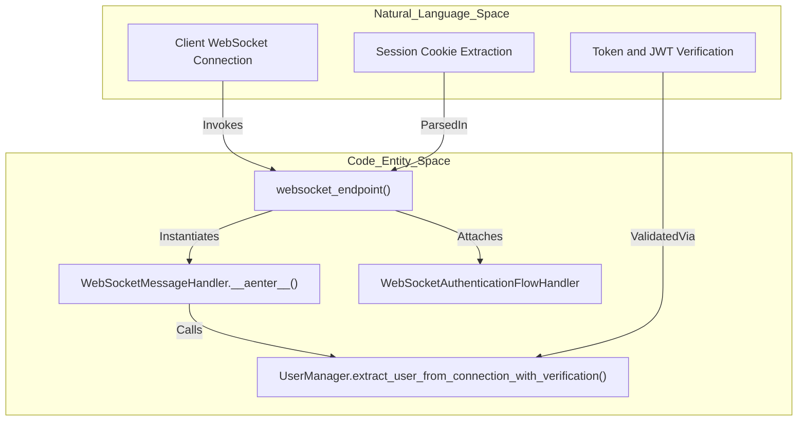
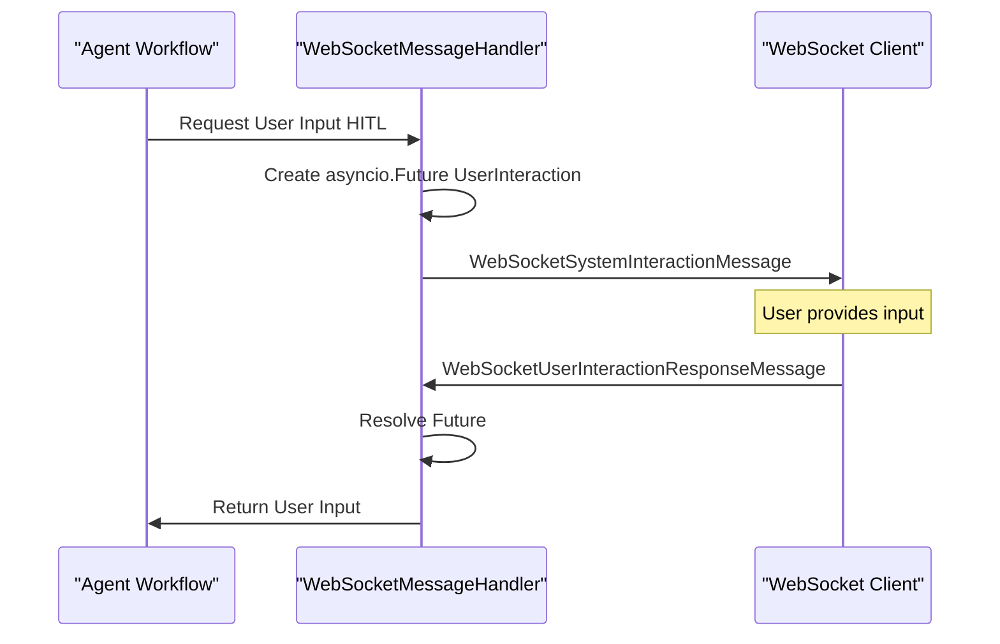
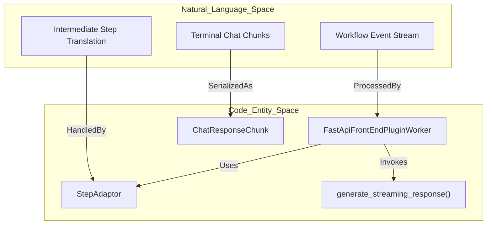

<!-- source: DeepWiki mcp.deepwiki.com · repo NVIDIA/NeMo-Agent-Toolkit · page 6.2 WebSocket Communication · fetched 2026-10-26 -->

# WebSocket Communication

<details>
<summary>Relevant source files</summary>

The following files were used as context for generating this wiki page:

- [docs/source/reference/rest-api/websockets.md](docs/source/reference/rest-api/websockets.md)
- [packages/nvidia_nat_core/src/nat/data_models/interactive.py](packages/nvidia_nat_core/src/nat/data_models/interactive.py)
- [packages/nvidia_nat_core/src/nat/data_models/user_info.py](packages/nvidia_nat_core/src/nat/data_models/user_info.py)
- [packages/nvidia_nat_core/src/nat/front_ends/fastapi/fastapi_front_end_config.py](packages/nvidia_nat_core/src/nat/front_ends/fastapi/fastapi_front_end_config.py)
- [packages/nvidia_nat_core/src/nat/front_ends/fastapi/fastapi_front_end_plugin_worker.py](packages/nvidia_nat_core/src/nat/front_ends/fastapi/fastapi_front_end_plugin_worker.py)
- [packages/nvidia_nat_core/src/nat/front_ends/fastapi/message_handler.py](packages/nvidia_nat_core/src/nat/front_ends/fastapi/message_handler.py)
- [packages/nvidia_nat_core/src/nat/front_ends/fastapi/message_validator.py](packages/nvidia_nat_core/src/nat/front_ends/fastapi/message_validator.py)
- [packages/nvidia_nat_core/src/nat/front_ends/fastapi/response_helpers.py](packages/nvidia_nat_core/src/nat/front_ends/fastapi/response_helpers.py)
- [packages/nvidia_nat_core/src/nat/front_ends/fastapi/routes/websocket.py](packages/nvidia_nat_core/src/nat/front_ends/fastapi/routes/websocket.py)
- [packages/nvidia_nat_core/src/nat/runtime/user_manager.py](packages/nvidia_nat_core/src/nat/runtime/user_manager.py)
- [packages/nvidia_nat_core/tests/nat/front_ends/fastapi/test_fastapi_front_end_config.py](packages/nvidia_nat_core/tests/nat/front_ends/fastapi/test_fastapi_front_end_config.py)
- [packages/nvidia_nat_core/tests/nat/front_ends/fastapi/test_message_handler.py](packages/nvidia_nat_core/tests/nat/front_ends/fastapi/test_message_handler.py)
- [packages/nvidia_nat_core/tests/nat/front_ends/fastapi/test_websocket_route_origin.py](packages/nvidia_nat_core/tests/nat/front_ends/fastapi/test_websocket_route_origin.py)
- [packages/nvidia_nat_core/tests/nat/front_ends/test_message_validator.py](packages/nvidia_nat_core/tests/nat/front_ends/test_message_validator.py)
- [packages/nvidia_nat_core/tests/nat/runtime/test_user_manager.py](packages/nvidia_nat_core/tests/nat/runtime/test_user_manager.py)
- [packages/nvidia_nat_core/tests/nat/server/test_unified_api_server.py](packages/nvidia_nat_core/tests/nat/server/test_unified_api_server.py)

</details>


This page documents the WebSocket communication layer in the NVIDIA NeMo Agent Toolkit (NAT) FastAPI server. The WebSocket mode enables real-time bidirectional streaming for agent workflows, supporting asynchronous workflow intermediate steps, human-in-the-loop (HITL) interactions, connection reconnection, and robust authentication flows including JWT and OAuth token validation.

---

## Purpose and Scope

The WebSocket communication layer provides:

1. **Real-time Streaming:** Streaming intermediate reasoning steps, tool calls, and final responses as they are produced during workflow execution `[packages/nvidia_nat_core/src/nat/front_ends/fastapi/message_handler.py:119-129]()`.
2. **Interactive Human-in-the-Loop (HITL) Execution:** Handling asynchronous user prompts during workflow execution such as text input, multi-choice, or approval prompts, implemented through an internal `asyncio.Future` mechanism `[packages/nvidia_nat_core/src/nat/front_ends/fastapi/message_handler.py:79-87]()`.
3. **Connection Resilience and Reconnection:** Allowing clients to reconnect to ongoing sessions and resume streaming without losing state, including recovery from pending HITL prompts and identity verification `[packages/nvidia_nat_core/src/nat/front_ends/fastapi/message_handler.py:133-156]()`.
4. **Authentication Handshakes:** Supporting user authentication over WebSocket via specialized auth messages (`auth_message`) or connection upgrade credentials (OAuth2, JWT, API Key, Basic auth, or trusted headers) `[packages/nvidia_nat_core/src/nat/front_ends/fastapi/message_handler.py:116-117]()`, `[docs/source/reference/rest-api/websockets.md:66-125]()`.

Sources: `[packages/nvidia_nat_core/src/nat/front_ends/fastapi/message_handler.py:79-156](), [docs/source/reference/rest-api/websockets.md:66-125]()`

---

## WebSocket Architecture and Core Components

The WebSocket server integrates with the session and workflow management system. The primary entry point is the websocket endpoint route registered via FastAPI `[packages/nvidia_nat_core/src/nat/front_ends/fastapi/routes/websocket.py:70-130]()`, which instantiates `WebSocketMessageHandler` to manage the connection lifecycle, validation, and session restoration `[packages/nvidia_nat_core/src/nat/front_ends/fastapi/message_handler.py:89-109]()`.

### Key Classes and Responsibilities

| Component | Purpose / Role | Code Reference |
| --------- | -------------- | -------------- |
| `WebSocketMessageHandler` | Manages the socket lifecycle, processes incoming messages, handles authentication states, and coordinates with `SessionManager`. | `[packages/nvidia_nat_core/src/nat/front_ends/fastapi/message_handler.py:89-109]()` |
| `MessageValidator` | Validates incoming JSON payloads against Pydantic models (e.g., `WebSocketUserMessage`, `WebSocketAuthMessage`) and handles schema mapping. | `[packages/nvidia_nat_core/src/nat/front_ends/fastapi/message_validator.py:66-79]()` |
| `UserManager` | Stateless credential resolver that extracts and verifies identity from cookies, JWT Bearer tokens, API keys, or trusted headers. | `[packages/nvidia_nat_core/src/nat/runtime/user_manager.py:54-76]()` |
| `WebSocketAuthenticationFlowHandler` | Coordinates authentication flow states and return URLs for OAuth/WebSocket token verification. | `[packages/nvidia_nat_core/src/nat/front_ends/fastapi/auth_flow_handlers/websocket_flow_handler.py:34-69]()` |
| `FastApiFrontEndPluginWorker` | Parent plugin worker managing FastAPI application setup, CORS configuration, and conversation handlers. | `[packages/nvidia_nat_core/src/nat/front_ends/fastapi/fastapi_front_end_plugin_worker.py:59-94]()` |

Sources: `[packages/nvidia_nat_core/src/nat/front_ends/fastapi/message_handler.py:89-109](), [packages/nvidia_nat_core/src/nat/front_ends/fastapi/message_validator.py:66-79](), [packages/nvidia_nat_core/src/nat/runtime/user_manager.py:54-76]()`

### Diagram: Connection and Authentication Code Space

This diagram bridges natural language connection concepts to concrete code entities in the codebase.

Title: "Authentication and Connection Routing Code Map"


Sources: `[packages/nvidia_nat_core/src/nat/front_ends/fastapi/routes/websocket.py:70-130](), [packages/nvidia_nat_core/src/nat/front_ends/fastapi/message_handler.py:89-117](), [packages/nvidia_nat_core/src/nat/runtime/user_manager.py:100-132]()`

---

## Message Protocol and Validation

Messages follow a structured JSON format containing a mandatory `type` field. The `MessageValidator` processes incoming dictionaries and maps them to appropriate Pydantic data models using an internal type-to-schema mapping `[packages/nvidia_nat_core/src/nat/front_ends/fastapi/message_validator.py:66-79]()`.

### Core WebSocket Message Types

| Message Type (`type`) | Pydantic Model Class | Purpose |
| --------------------- | -------------------- | ------- |
| `auth_message` | `WebSocketAuthMessage` | Client initiates authentication (JWT, API Key, or Basic credentials) `[docs/source/reference/rest-api/websockets.md:35]()`. |
| `user_message` | `WebSocketUserMessage` | Client sends user input or chat messages to trigger workflow execution `[docs/source/reference/rest-api/websockets.md:37]()`. |
| `system_intermediate_message` | `WebSocketSystemIntermediateStepMessage` | Server pushes intermediate reasoning steps, tool calls, or status updates `[docs/source/reference/rest-api/websockets.md:38]()`. |
| `system_response_message` | `WebSocketSystemResponseTokenMessage` | Server sends terminal tokens or final response chunks `[docs/source/reference/rest-api/websockets.md:39]()`. |
| `system_interaction_message` | `WebSocketSystemInteractionMessage` | Server requests human input (HITL prompts) `[docs/source/reference/rest-api/websockets.md:40]()`. |
| `user_interaction_message` | `WebSocketUserInteractionResponseMessage` | Client responds to an active HITL prompt `[docs/source/reference/rest-api/websockets.md:41]()`. |
| `observability_trace_message` | `WebSocketObservabilityTraceMessage` | Server sends trace and observability metadata for visualization `[docs/source/reference/rest-api/websockets.md:42]()`. |
| `error_message` | `WebSocketSystemResponseTokenMessage` | Server transmits structured validation or execution errors `[packages/nvidia_nat_core/src/nat/front_ends/fastapi/message_validator.py:78]()`. |

Sources: `[packages/nvidia_nat_core/src/nat/front_ends/fastapi/message_validator.py:66-79](), [docs/source/reference/rest-api/websockets.md:26-65]()`

---

## Authentication and OAuth Flows

The WebSocket server supports flexible authentication mechanisms at connection upgrade and during an active session via `auth_message` payloads `[docs/source/reference/rest-api/websockets.md:66-125]()`.

### Identity Credential Methods
The server accepts the following identity credentials, which can be restricted using `accepted_identity_credentials` in the configuration `[docs/source/reference/rest-api/websockets.md:70-90]`:
- **Session Cookies:** `nat-session` cookie or `?session=` query parameter `[packages/nvidia_nat_core/src/nat/front_ends/fastapi/routes/websocket.py:75-108]()`.
- **JWT Bearer Tokens:** Validated via configured `JwtAuthProvider` and `BearerTokenValidator` instances `[packages/nvidia_nat_core/src/nat/front_ends/fastapi/routes/websocket.py:56-67]()`.
- **API Keys:** Supplied via Authorization Bearer token or `X-API-Key` header `[packages/nvidia_nat_core/src/nat/runtime/user_manager.py:92-95]()`.
- **HTTP Basic Credentials:** Username and password credentials resolved into `BasicUserInfo` `[packages/nvidia_nat_core/src/nat/data_models/user_info.py:74-103]()`.
- **Trusted Identity Headers:** Upstream proxy-asserted headers like `X-User-ID` configured via `identity_header` `[docs/source/reference/rest-api/websockets.md:115-125]()`.

### JWT and OAuth Validation Configuration
To enforce JWT signature and claim verification against specific issuers (such as corporate OAuth2 providers), define named JWT authentication providers in configuration:

```yaml
authentication:
  corporate_jwt:
    _type: jwt
    issuer_url: https://identity.example.com
    jwks_uri: https://identity.example.com/.well-known/jwks.json
    audience: nemo-agent-toolkit
    scopes:
      - workflow:resume

general:
  front_end:
    _type: fastapi
    accepted_identity_credentials:
      - jwt
    identity_authentication:
      - corporate_jwt
```

When configured, `_get_jwt_validators` loads the validators from the shared session builder, matching incoming token issuers against the registered `issuer_url` `[packages/nvidia_nat_core/src/nat/front_ends/fastapi/routes/websocket.py:56-67]()`.

Sources: `[packages/nvidia_nat_core/src/nat/front_ends/fastapi/routes/websocket.py:56-118](), [packages/nvidia_nat_core/src/nat/runtime/user_manager.py:54-132](), [docs/source/reference/rest-api/websockets.md:66-125]()`

---

## Human-in-the-Loop (HITL) Interaction Flow

Workflows requiring human input (such as approval gates or interactive tool prompts) manage execution states via `UserInteraction` objects containing an `asyncio.Future` `[packages/nvidia_nat_core/src/nat/front_ends/fastapi/message_handler.py:79-88]()`.

1. **Prompt Initiation:** The workflow triggers an interactive prompt request `[packages/nvidia_nat_core/src/nat/front_ends/fastapi/message_handler.py:58-62]()`.
2. **Future Creation:** `WebSocketMessageHandler` instantiates an `asyncio.Future` (`UserInteraction.future`) and dispatches a `system_interaction_message` to the client `[packages/nvidia_nat_core/src/nat/front_ends/fastapi/message_handler.py:79-87]()`.
3. **Client Response:** The client replies with a `user_interaction_message`. The handler resolves the future with the received content, unblocking workflow execution `[packages/nvidia_nat_core/src/nat/front_ends/fastapi/message_handler.py:55]()`.
4. **Timeout & Grace Period:** Reconnections are subject to `_HITL_TIMEOUT_GRACE_PERIOD_SECONDS` to preserve pending interaction states across transient network disconnects `[packages/nvidia_nat_core/src/nat/front_ends/fastapi/message_handler.py:90]()`.

Title: "HITL Interaction Sequence Flow"


Sources: `[packages/nvidia_nat_core/src/nat/front_ends/fastapi/message_handler.py:79-88]()`

---

## Data Streaming Implementation

Data streaming coordinates asynchronous producer-consumer queues to broadcast workflow events and terminal response chunks over the WebSocket connection.

- **Queue Coordination:** `generate_streaming_response` manages an `AsyncIOProducerConsumerQueue` to stream items from workflow runners `[packages/nvidia_nat_core/src/nat/front_ends/fastapi/response_helpers.py:69-116]()`.
- **Step Adaptation:** The `StepAdaptor` converts internal execution steps and intermediate events into serialized WebSocket messaging structures `[packages/nvidia_nat_core/src/nat/front_ends/fastapi/message_handler.py:66]()`.
- **OpenAI Chat Compatibility:** Streaming responses format partial chunks using `ChatResponseChunk` to maintain API compatibility with OpenAI-style client libraries `[packages/nvidia_nat_core/src/nat/front_ends/fastapi/response_helpers.py:62-64]()`.

### Diagram: Streaming Pipeline Code Space

This diagram maps streaming concepts to concrete code components and modules.

Title: "Streaming Data Pipeline Code Map"



Sources: `[packages/nvidia_nat_core/src/nat/front_ends/fastapi/fastapi_front_end_plugin_worker.py:59-94](), [packages/nvidia_nat_core/src/nat/front_ends/fastapi/message_handler.py:65-66](), [packages/nvidia_nat_core/src/nat/data_models/api_server.py:35]()`

---

