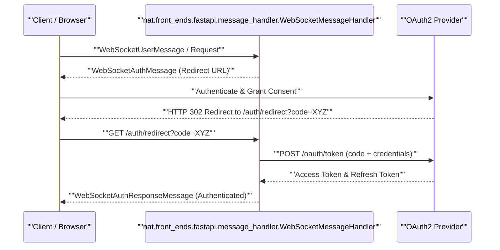

<!-- source: DeepWiki mcp.deepwiki.com · repo NVIDIA/NeMo-Agent-Toolkit · page 6.3 Authentication and Security · fetched 2026-10-26 -->

# Authentication and Security

<details>
<summary>Relevant source files</summary>

The following files were used as context for generating this wiki page:

- [.github/release.yml](.github/release.yml)
- [CHANGELOG.md](CHANGELOG.md)
- [SECURITY.md](SECURITY.md)
- [docs/source/build-workflows/about-building-workflows.md](docs/source/build-workflows/about-building-workflows.md)
- [docs/source/components/auth/api-authentication.md](docs/source/components/auth/api-authentication.md)
- [docs/source/extend/custom-components/memory.md](docs/source/extend/custom-components/memory.md)
- [docs/source/improve-workflows/profiler.md](docs/source/improve-workflows/profiler.md)
- [docs/source/release-notes.md](docs/source/release-notes.md)
- [docs/source/resources/security-considerations.md](docs/source/resources/security-considerations.md)
- [docs/source/run-workflows/observe/observe-workflow-with-mlflow.md](docs/source/run-workflows/observe/observe-workflow-with-mlflow.md)
- [examples/front_ends/simple_auth/src/nat_simple_auth/configs/config.yml](examples/front_ends/simple_auth/src/nat_simple_auth/configs/config.yml)
- [packages/nvidia_nat_core/src/nat/data_models/authentication.py](packages/nvidia_nat_core/src/nat/data_models/authentication.py)
- [packages/nvidia_nat_core/src/nat/front_ends/console/authentication_flow_handler.py](packages/nvidia_nat_core/src/nat/front_ends/console/authentication_flow_handler.py)
- [packages/nvidia_nat_core/src/nat/front_ends/console/console_front_end_plugin.py](packages/nvidia_nat_core/src/nat/front_ends/console/console_front_end_plugin.py)
- [packages/nvidia_nat_core/tests/nat/front_ends/auth_flow_handlers/test_console_flow_handler.py](packages/nvidia_nat_core/tests/nat/front_ends/auth_flow_handlers/test_console_flow_handler.py)
- [packages/nvidia_nat_core/tests/nat/front_ends/auth_flow_handlers/test_websocket_flow_handler.py](packages/nvidia_nat_core/tests/nat/front_ends/auth_flow_handlers/test_websocket_flow_handler.py)

</details>


## Purpose and Scope

This page covers the authentication mechanisms, identity resolution pipelines, per-user context isolation, preflight authentication hooks, and security best practices in the NVIDIA NeMo Agent Toolkit (NAT). It details API authentication options (JWT, API key, basic auth, and session cookies), user identity management via `UserManager`, trusted identity headers, OAuth2 interactive flows, WebSocket identity configuration, and server security configurations for production deployments.

Sources: [packages/nvidia_nat_core/src/nat/runtime/user_manager.py:54-97](), [packages/nvidia_nat_core/src/nat/front_ends/console/authentication_flow_handler.py:57-89](), [packages/nvidia_nat_core/src/nat/front_ends/console/console_front_end_plugin.py:108-123]()

---

## Authentication Architecture Overview

The toolkit implements a layered security model separating **Identity Resolution** (identifying users from incoming requests via `UserManager`) from **Authentication Providers** (validating tokens, managing credentials, and executing interactive flows). In v1.9.0+, preflight authentication hooks enable upfront validation for applicable authentication providers before workflow execution begins.

### Diagram: Authentication Components and Data Flow

```mermaid
graph TB
    subgraph "Identity_Resolution_Layer"
        REQ[""starlette.requests.Request""]
        WS[""starlette.websockets.WebSocket""]
        USER_MGR[""nat.runtime.user_manager.UserManager""]
        USER_INFO[""nat.data_models.user_info.UserInfo""]
    end
    
    subgraph "Validation_Layer"
        JWT_VAL[""nat.authentication.credential_validator.bearer_token_validator.BearerTokenValidator""]
        JWT_AUTH[""nat.authentication.jwt.jwt_auth_provider.JwtAuthProvider""]
        SESSION_MGR[""nat.runtime.session.SessionManager""]
    end
    
    subgraph "Execution_Context"
        MSG_H[""nat.front_ends.fastapi.message_handler.WebSocketMessageHandler""]
        WORKFLOW[""nat.builder.workflow_builder.WorkflowBuilder""]
        PREFLIGHT[""ConsoleFrontEndPlugin._run_preflight_auth""]
    end
    
    REQ -->| "Connection" | USER_MGR
    WS -->| "Connection" | USER_MGR
    USER_MGR -->| "Extracts & Verifies" | USER_INFO
    USER_INFO -->| "user_id" | SESSION_MGR
    SESSION_MGR -->| "Isolates State" | WORKFLOW
    WS -->| "Delegates" | MSG_H
    MSG_H -->| "Restores State" | USER_INFO
    JWT_AUTH -->| "Provides Validator" | JWT_VAL
    JWT_VAL -->| "Verifies Claims" | USER_MGR
    SESSION_MGR -->| "Triggers" | PREFLIGHT
```

Sources: [packages/nvidia_nat_core/src/nat/runtime/user_manager.py:54-97](), [packages/nvidia_nat_core/src/nat/data_models/user_info.py:105-146](), [packages/nvidia_nat_core/src/nat/front_ends/fastapi/message_handler.py:89-121](), [packages/nvidia_nat_core/src/nat/authentication/jwt/jwt_auth_provider.py:24-41](), [packages/nvidia_nat_core/src/nat/front_ends/console/console_front_end_plugin.py:108-123]()

---

## API Authentication Types

NAT supports multiple inbound API authentication mechanisms for HTTP and WebSocket endpoints, managed through configuration policies and verified at connection time.

### Supported Authentication Protocols

- **Session Cookie (`session_cookie`)**: Uses session identifier cookies (`nat-session`) to bind requests to a specific server session state and user identity.
- **JWT Bearer Token (`jwt`)**: Validates JSON Web Tokens passed in the `Authorization: Bearer <token>` header against trusted issuer policies (`JwtAuthProvider`).
- **API Key (`api_key`)**: Supports validation of static API keys supplied as Bearer tokens or via the `X-API-Key` header.
- **HTTP Basic Auth (`basic`)**: Standard username and password credentials validation (`BasicUserInfo`) for protecting endpoints, implemented in console and API controllers [packages/nvidia_nat_core/src/nat/front_ends/console/authentication_flow_handler.py:145-159]().

By default, all credential methods are accepted. You can restrict accepted identity credentials in the FastAPI front-end configuration (`FastApiFrontEndConfig`).

Sources: [packages/nvidia_nat_core/src/nat/front_ends/fastapi/fastapi_front_end_config.py:165-176](), [packages/nvidia_nat_core/src/nat/data_models/user_info.py:74-104](), [packages/nvidia_nat_core/src/nat/front_ends/console/authentication_flow_handler.py:145-159]()

---

## User Identity Resolution and `UserManager`

The `UserManager` class acts as a stateless resolver that inspects incoming HTTP requests or WebSocket connections and extracts a structured `UserInfo` instance [packages/nvidia_nat_core/src/nat/runtime/user_manager.py:54-76]().

### Identity Resolution Flow

1. **Trusted Identity Header**: If `identity_header` (e.g., `X-User-ID`) is configured, `UserManager` treats it as authoritative (used behind authenticated reverse proxies in isolated environments) [packages/nvidia_nat_core/src/nat/runtime/user_manager.py:77-79]().
2. **Session Cookie**: Extracts the `nat-session` cookie and creates a session-based identity [packages/nvidia_nat_core/src/nat/runtime/user_manager.py:81-84]().
3. **Authorization Header**: Inspects the `Authorization` header. If it contains a JWT, it verifies claims. Otherwise, it falls back to basic authentication parsing [packages/nvidia_nat_core/src/nat/runtime/user_manager.py:134-170]().
4. **API Key Header**: Inspects `X-API-Key` or Bearer tokens to build an API key identity [packages/nvidia_nat_core/src/nat/runtime/user_manager.py:92-95]().

Each resolved identity yields a deterministic UUID v5 user ID (`get_user_id()`) based on a cryptographic derivation from the underlying credential key [packages/nvidia_nat_core/src/nat/data_models/user_info.py:31-32](), [packages/nvidia_nat_core/src/nat/data_models/user_info.py:138-145](). To ensure strict isolation and privacy, the raw `user_id` parameter is no longer exposed directly to the LLM model context during execution.

Sources: [packages/nvidia_nat_core/src/nat/runtime/user_manager.py:54-131](), [packages/nvidia_nat_core/src/nat/data_models/user_info.py:105-146]()

---

## Per-User Context and Isolation

Per-user functions and workflows provide isolated state for multi-user deployments.

### Lifecycle Management
- **Lazy Instantiation**: Per-user components and tools are instantiated lazily when a user's first request is processed by the `SessionManager`.
- **State Isolation**: Each unique `user_id` receives a dedicated sandbox environment. Memory, conversation history, and variable stores do not leak across users.
- **WebSocket Reconnection Binding**: Conversation reconnections via WebSockets are strictly bound to user identity credentials to prevent cross-session leaks.
- **Session Purging**: Inactive user sessions are automatically cleaned up based on timeout configurations.

Sources: [packages/nvidia_nat_core/src/nat/runtime/session.py:58-93](), [packages/nvidia_nat_core/src/nat/runtime/user_manager.py:54-76]()

---

## OAuth2 and Interactive Authentication

NAT supports the OAuth 2.0 Authorization Code Flow, enabling workflows and tools to utilize user-delegated access tokens (such as authenticating against protected services or tools like `who_am_i` and MCP servers) [examples/front_ends/simple_auth/README.md:22-26]().

### Diagram: OAuth2 Authorization Code Flow



The `ConsoleAuthenticationFlowHandler` and WebSocket flow handlers manage these token exchanges locally or in web UI sessions using PKCE and confidential client configurations [packages/nvidia_nat_core/src/nat/front_ends/console/authentication_flow_handler.py:57-112](), [packages/nvidia_nat_core/tests/nat/front_ends/auth_flow_handlers/test_console_flow_handler.py:92-118](). Additionally, providers configured with `preflight_auth=True` execute proactive authentication challenges prior to workflow execution [packages/nvidia_nat_core/src/nat/front_ends/console/console_front_end_plugin.py:108-123]().

Sources: [packages/nvidia_nat_core/src/nat/front_ends/fastapi/message_handler.py:45-56](), [packages/nvidia_nat_core/src/nat/front_ends/console/authentication_flow_handler.py:57-112](), [examples/front_ends/simple_auth/README.md:22-65](), [packages/nvidia_nat_core/src/nat/front_ends/console/console_front_end_plugin.py:108-123]()

---

## Security Best Practices

- **Enforce HTTPS**: Ensure that all issuer URLs, JWKS URIs, and redirection endpoints use TLS/HTTPS in production. Insecure transport flags like `AUTHLIB_INSECURE_TRANSPORT=1` should only be used for local development [examples/front_ends/simple_auth/README.md:87]().
- **Credential Restriction**: Explicitly define `accepted_identity_credentials` in front-end configurations to disable unused or legacy authentication methods.
- **Trusted Headers Security**: Use `identity_header` options only behind a trusted, secure reverse proxy that overwrites client-supplied headers and runs in an isolated network [packages/nvidia_nat_core/src/nat/runtime/user_manager.py:77-79]().
- **Secret Management**: Pass sensitive tokens, client secrets, and API keys exclusively via secure environment variables (such as `${NAT_OAUTH_CLIENT_SECRET}` or `NVIDIA_API_KEY`) rather than hardcoding them in configuration YAML files [examples/front_ends/simple_auth/src/nat_simple_auth/configs/config.yml:57-58]().
- **Prevent LLM Credential Leakage**: Ensure that internal context identifiers such as `user_id` are isolated from prompt templates and are not exposed to the LLM.

Sources: [examples/front_ends/simple_auth/README.md:87](), [packages/nvidia_nat_core/src/nat/runtime/user_manager.py:77-79](), [examples/front_ends/simple_auth/src/nat_simple_auth/configs/config.yml:57-58]()

---

