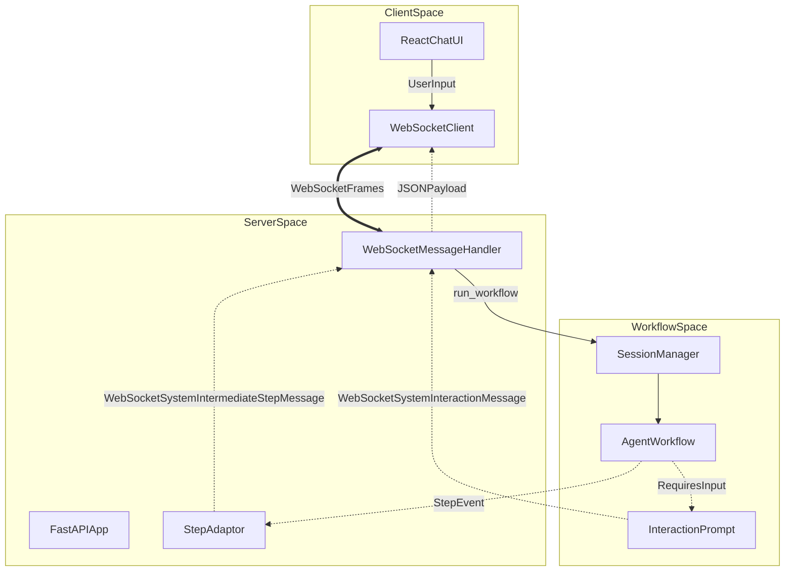
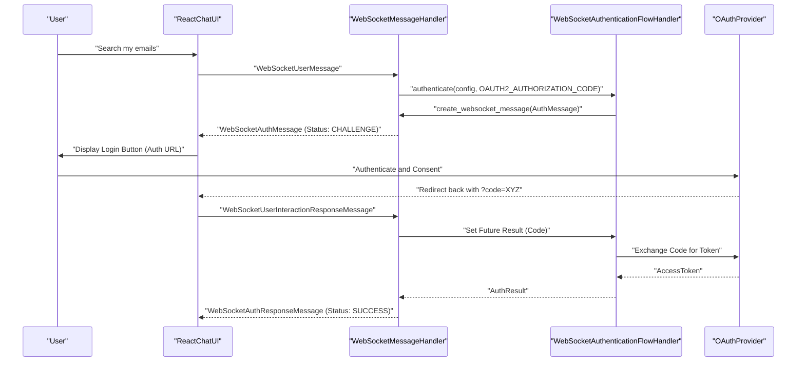

<!-- source: DeepWiki mcp.deepwiki.com · repo NVIDIA/NeMo-Agent-Toolkit · page 6.4 Built-In UI · fetched 2026-10-26 -->

# Built-In UI

<details>
<summary>Relevant source files</summary>

The following files were used as context for generating this wiki page:

- [docs/source/_static/hitl_settings.png](docs/source/_static/hitl_settings.png)
- [docs/source/_static/ui_home_page.png](docs/source/_static/ui_home_page.png)
- [docs/source/_static/ui_settings_example.png](docs/source/_static/ui_settings_example.png)
- [docs/source/_static/ui_simple_calculator_example.png](docs/source/_static/ui_simple_calculator_example.png)
- [examples/UI/README.md](examples/UI/README.md)
- [examples/front_ends/simple_auth/Dockerfile](examples/front_ends/simple_auth/Dockerfile)
- [examples/front_ends/simple_auth/README.md](examples/front_ends/simple_auth/README.md)

</details>


The Built-In UI provides a web-based chat interface bundled with the NVIDIA NeMo Agent Toolkit that enables interactive communication with deployed workflows. It acts as a specialized frontend supporting real-time streaming, tool visualization, human-in-the-loop (HITL) interactions, and OAuth 2.0 authentication flows [examples/UI/README.md:26-31]().

---

## Overview

The Built-In UI is designed to provide an out-of-the-box experience for testing and demonstrating agentic workflows. It bridges the gap between raw API endpoints and end-user interaction by rendering intermediate agent reasoning steps and tool execution states visually.

**Key Features:**
- **Web-Based Interactive Interface:** Provides a complete web UI for interacting with NeMo Agent Toolkit workflows through an intuitive chat interface with conversation history and real-time responses [examples/UI/README.md:26-26]().
- **Multi-Connection Support:** Supports both HTTP and WebSocket connection modes, enabling both simple request-response patterns and real-time streaming interactions [examples/UI/README.md:27-27]().
- **Real-Time Streaming:** Enables intermediate step streaming for enhanced user experience, allowing users to see agent reasoning and tool execution in real-time [examples/UI/README.md:28-28]().
- **Human-in-the-Loop Support:** Interactive prompts and OAuth consent handling for workflows requiring user input or authentication [examples/UI/README.md:31-31]().
- **Session Persistence:** Handles reconnection and state restoration by swapping handler states, allowing users to resume conversations even after network interruptions [packages/nvidia_nat_core/src/nat/front_ends/fastapi/message_handler.py:133-152]().

Sources: [examples/UI/README.md:18-46](), [packages/nvidia_nat_core/src/nat/front_ends/fastapi/message_handler.py:84-115]()

---

## Architecture and Data Flow

The UI operates as a client connecting to the `nat serve` FastAPI backend. While standard queries can leverage HTTP endpoints, advanced capabilities like HITL interruptions and OAuth challenges require a persistent WebSocket connection managed by `WebSocketMessageHandler` [packages/nvidia_nat_core/src/nat/front_ends/fastapi/message_handler.py:84-96]().

### Component Interaction Diagram
The following diagram maps user-facing concepts in natural language to the underlying code entities within the FastAPI backend and message handler layer, bridging Natural Language Space to Code Entity Space.

**Title: UI to Backend Communication Flow**


Sources: [packages/nvidia_nat_core/src/nat/front_ends/fastapi/message_handler.py:74-115](), [examples/UI/README.md:41-46]()

**Key Implementation Details:**
- **Message Validation:** Incoming messages from the UI are validated against structured schemas using `MessageValidator` [packages/nvidia_nat_core/src/nat/front_ends/fastapi/message_handler.py:98-98]().
- **Output Schema Mapping:** The handler dynamically maps workflow outputs to specific data models like `ChatResponse` or `ChatResponseChunk` based on the requested `WorkflowSchemaType` [packages/nvidia_nat_core/src/nat/front_ends/fastapi/message_handler.py:109-114]().
- **State Management:** The `UserInteraction` class tracks pending human response states via monotonic timestamps and an `asyncio.Future` to resolve downstream tool calls [packages/nvidia_nat_core/src/nat/front_ends/fastapi/message_handler.py:74-82]().

Sources: [packages/nvidia_nat_core/src/nat/front_ends/fastapi/message_handler.py:74-115]()

---

## Authentication Flow (OAuth 2.0)

The UI supports the `OAuth 2.0 Authorization Code Flow` natively, allowing agents to execute tools on behalf of an authenticated user by initiating an auth challenge when necessary [examples/front_ends/simple_auth/README.md:22-25]().

### OAuth 2.0 Sequence in UI
The following sequence diagram demonstrates how `WebSocketAuthenticationFlowHandler` manages the transition from chat interactions to authentication verification, linking user actions to code entities.

**Title: UI OAuth 2.0 Authorization Code Flow**


Sources: [examples/front_ends/simple_auth/README.md:35-65](), [packages/nvidia_nat_core/src/nat/data_models/authentication.py:57-68]()

**UI Configuration for OAuth:**
The UI behavior for login pages can be configured using the `NEXT_PUBLIC_NAT_OAUTH_MODE` environment variable [examples/front_ends/simple_auth/README.md:138-139]():
- `redirect` (default): Navigates the current browser tab to the provider and returns post-authentication [examples/front_ends/simple_auth/README.md:141-141]().
- `popup`: Opens the login page in a separate popup window while keeping the chat session active [examples/front_ends/simple_auth/README.md:142-142]().

Sources: [examples/front_ends/simple_auth/README.md:136-143]()

---

## Human-in-the-Loop (HITL) Interaction

The UI renders specialized interface components for workflows requiring human intervention via `hitl_approval_function`:

1. **Interaction Request**: The backend issues a `WebSocketSystemInteractionMessage` enclosing a `HumanPrompt` [packages/nvidia_nat_core/src/nat/front_ends/fastapi/message_handler.py:50-50]().
2. **Execution Suspension**: The `WebSocketMessageHandler` instantiates a `UserInteraction` tracker holding an `asyncio.Future`, pausing workflow progression until fulfilled [packages/nvidia_nat_core/src/nat/front_ends/fastapi/message_handler.py:74-82]().
3. **User Response**: Input provided through the UI is returned via a `WebSocketUserInteractionResponseMessage` [packages/nvidia_nat_core/src/nat/front_ends/fastapi/message_handler.py:53-53]().
4. **Resolution**: The message handler extracts the payload (`HumanResponse`) and resolves the pending future, allowing the agent workflow to resume [packages/nvidia_nat_core/src/nat/front_ends/fastapi/message_handler.py:154-156]().

For CLI deployments, `ConsoleFrontEndPlugin` executes similar prompts via `prompt_for_input_cli` with timeout controls and ANSI escape code support [packages/nvidia_nat_core/src/nat/front_ends/console/console_front_end_plugin.py:62-97]().

> [!IMPORTANT]
> Workflows requiring bidirectional signaling (such as HITL or OAuth flows) **must** utilize WebSocket connections, as standard HTTP request-response patterns do not support asynchronous server-initiated signaling [examples/UI/README.md:45-46]().

Sources: [packages/nvidia_nat_core/src/nat/front_ends/fastapi/message_handler.py:74-103](), [examples/UI/README.md:45-46](), [packages/nvidia_nat_core/src/nat/front_ends/console/console_front_end_plugin.py:62-97]()

---

## Deployment and Configuration

### Docker Deployment
Containerized deployment is supported through the provided `Dockerfile`, utilizing `uv` for dependency management [examples/front_ends/simple_auth/Dockerfile:17-53](). Local OAuth examples run an `Authlib`-based mock authentication server alongside the NAT server via Docker Compose [examples/front_ends/simple_auth/README.md:68-85]():

```bash
docker compose -f examples/front_ends/simple_auth/docker-compose.yml --project-directory examples/front_ends/simple_auth up -d
```
This boots up the mock OAuth2 provider on `http://localhost:5001` [examples/front_ends/simple_auth/README.md:76-85]().

### Server Configuration
To serve the backend workflows for the UI:
```bash
nat serve --config_file=config.yml
```
By default, the UI connects to the REST API at `http://localhost:8000` and the WebSocket endpoint at `ws://localhost:8000/websocket` [examples/front_ends/simple_auth/README.md:157-159]().

### Configuration Reference

| Field | Description | Source |
| :--- | :--- | :--- |
| `preflight_auth` | If `True`, triggers authentication at session initialization rather than deferring to first tool invocation. | [packages/nvidia_nat_core/src/nat/data_models/authentication.py:39-41]() |
| `NEXT_PUBLIC_NAT_OAUTH_MODE` | Controls UI login presentation mode (`redirect` or `popup`). | [examples/front_ends/simple_auth/README.md:138-142]() |
| `use_pkce` | Enables Proof Key for Code Exchange during OAuth2 authorization flows. | [packages/nvidia_nat_mcp/src/nat/plugins/mcp/auth/auth_provider_config.py:60-60]() |
| `NAT_OAUTH_CLIENT_ID` | Environment variable defining the OAuth client identifier. | [examples/front_ends/simple_auth/README.md:131-131]() |
| `NAT_OAUTH_CLIENT_SECRET` | Environment variable defining the OAuth client secret. | [examples/front_ends/simple_auth/README.md:132-132]() |
| `oauth_client_ttl` | Time-to-live (in seconds) for caching OAuth client credentials (0 disables). | [packages/nvidia_nat_mcp/src/nat/plugins/mcp/auth/auth_provider_config.py:67-70]() |

Sources: [examples/front_ends/simple_auth/README.md:126-160](), [packages/nvidia_nat_core/src/nat/data_models/authentication.py:31-42](), [packages/nvidia_nat_mcp/src/nat/plugins/mcp/auth/auth_provider_config.py:45-78](), [examples/front_ends/simple_auth/Dockerfile:1-53]()

---

