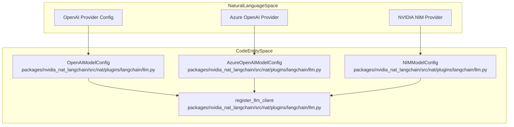
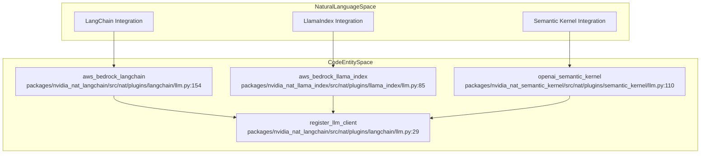

<!-- source: DeepWiki mcp.deepwiki.com · repo NVIDIA/NeMo-Agent-Toolkit · page 7 LLM Integration · fetched 2026-10-26 -->

# LLM Integration

Relevant source files

The following files were used as context for generating this wiki page:

- [packages/nvidia_nat_adk/src/nat/plugins/adk/llm.py](packages/nvidia_nat_adk/src/nat/plugins/adk/llm.py)
- [packages/nvidia_nat_agno/src/nat/plugins/agno/llm.py](packages/nvidia_nat_agno/src/nat/plugins/agno/llm.py)
- [packages/nvidia_nat_autogen/src/nat/plugins/autogen/llm.py](packages/nvidia_nat_autogen/src/nat/plugins/autogen/llm.py)
- [packages/nvidia_nat_autogen/tests/test_llm_autogen.py](packages/nvidia_nat_autogen/tests/test_llm_autogen.py)
- [packages/nvidia_nat_crewai/src/nat/plugins/crewai/llm.py](packages/nvidia_nat_crewai/src/nat/plugins/crewai/llm.py)
- [packages/nvidia_nat_langchain/src/nat/plugins/langchain/embedder.py](packages/nvidia_nat_langchain/src/nat/plugins/langchain/embedder.py)
- [packages/nvidia_nat_langchain/src/nat/plugins/langchain/llm.py](packages/nvidia_nat_langchain/src/nat/plugins/langchain/llm.py)
- [packages/nvidia_nat_langchain/tests/test_llm_langchain.py](packages/nvidia_nat_langchain/tests/test_llm_langchain.py)
- [packages/nvidia_nat_llama_index/src/nat/plugins/llama_index/embedder.py](packages/nvidia_nat_llama_index/src/nat/plugins/llama_index/embedder.py)
- [packages/nvidia_nat_llama_index/src/nat/plugins/llama_index/llm.py](packages/nvidia_nat_llama_index/src/nat/plugins/llama_index/llm.py)
- [packages/nvidia_nat_llama_index/tests/test_llm_llama_index.py](packages/nvidia_nat_llama_index/tests/test_llm_llama_index.py)
- [packages/nvidia_nat_semantic_kernel/src/nat/plugins/semantic_kernel/llm.py](packages/nvidia_nat_semantic_kernel/src/nat/plugins/semantic_kernel/llm.py)
- [packages/nvidia_nat_strands/src/nat/plugins/strands/llm.py](packages/nvidia_nat_strands/src/nat/plugins/strands/llm.py)
- [packages/nvidia_nat_strands/tests/test_strands_llm.py](packages/nvidia_nat_strands/tests/test_strands_llm.py)

## Purpose and Scope

This document provides a high-level overview of the LLM integration system in the NVIDIA NeMo Agent Toolkit. The toolkit provides a unified configuration and registration architecture for connecting multiple language model vendors (OpenAI, Azure OpenAI, NVIDIA NIM, AWS Bedrock, OCI, LiteLLM, Hugging Face, vLLM, and Dynamo) to diverse agent frameworks (LangChain, LlamaIndex, CrewAI, AutoGen, Agno, ADK, Semantic Kernel, Strands) [packages/nvidia_nat_langchain/src/nat/plugins/langchain/llm.py:34-43](), [packages/nvidia_nat_crewai/src/nat/plugins/crewai/llm.py:26-29](), [packages/nvidia_nat_strands/src/nat/plugins/strands/llm.py:19-24]().

This is a parent page. For deep technical details, refer to the following child pages:
- For provider abstractions, config models, and registration, see [LLM Provider Architecture](#7.1).
- For how framework-specific clients are instantiated from unified configs, see [Multi-Framework Client System](#7.2).
- For cross-cutting concerns like retries, thinking prompts, and SSL verification, see [Configuration Mixins](#7.3).
- For specific provider configurations and examples, see [Supported LLM Providers](#7.4).

---

## 7.1 LLM Provider Architecture

The LLM provider architecture establishes a clean separation between provider definitions, underlying Pydantic configuration models (`LLMBaseConfig`), and framework adapter registries. Providers are registered globally using registration decorators [packages/nvidia_nat_langchain/src/nat/plugins/langchain/llm.py:154-155](), mapping model configurations to factory functions that yield client wrapper instances.

For comprehensive details on the provider abstraction layer, configuration models, and registration lifecycle, see [LLM Provider Architecture](#7.1).

### Provider Mapping Natural Language to Code Entities

Sources:
- [packages/nvidia_nat_langchain/src/nat/plugins/langchain/llm.py:34-43]()
- [packages/nvidia_nat_llama_index/src/nat/plugins/llama_index/llm.py:28-32]()

---

## 7.2 Multi-Framework Client System

The multi-framework client system bridges unified YAML or Pydantic configurations to concrete framework instances (e.g., `ChatOpenAI`, `OpenAI`, `LLM`, `LiteLlm`) via the `@register_llm_client` decorator [packages/nvidia_nat_langchain/src/nat/plugins/langchain/llm.py:154-155](). Framework-specific plugins handle message format translation, responses API validation [packages/nvidia_nat_langchain/src/nat/plugins/langchain/llm.py:159](), and execution patching.

For details on client creation across LangChain, LlamaIndex, CrewAI, AutoGen, Agno, ADK, Semantic Kernel, and Strands, see [Multi-Framework Client System](#7.2).

### Framework Client Mapping Natural Language to Code Entities

Sources:
- [packages/nvidia_nat_langchain/src/nat/plugins/langchain/llm.py:29-155]()
- [packages/nvidia_nat_llama_index/src/nat/plugins/llama_index/llm.py:22-85]()
- [packages/nvidia_nat_semantic_kernel/src/nat/plugins/semantic_kernel/llm.py:21-110]()

---

## 7.3 Configuration Mixins

Provider configurations compose mixins to add robust cross-cutting capabilities without duplicating code. Key mixins include `RetryMixin` for automatic error recovery [packages/nvidia_nat_langchain/src/nat/plugins/langchain/llm.py:132-136](), `ThinkingMixin` for chain-of-thought prompt injection [packages/nvidia_nat_langchain/src/nat/plugins/langchain/llm.py:138-149](), and SSL verification handling [packages/nvidia_nat_crewai/src/nat/plugins/crewai/llm.py:30]().

For details on how these mixins compose into provider configurations and hook into framework clients, see [Configuration Mixins](#7.3).

Sources:
- [packages/nvidia_nat_langchain/src/nat/plugins/langchain/llm.py:32-33]()
- [packages/nvidia_nat_crewai/src/nat/plugins/crewai/llm.py:24-25]()

---

## 7.4 Supported LLM Providers

The toolkit supports a broad matrix of vendors and hosted backends including OpenAI, Azure OpenAI, NVIDIA NIM, AWS Bedrock, OCI, LiteLLM, HuggingFace, and NVIDIA Dynamo. Each provider model configures parameters such as base URLs, timeouts, API keys, and vendor-specific extensions (e.g., `nvext.agent_hints` for Dynamo KV cache optimization).

For complete configuration examples and provider availability across frameworks, see [Supported LLM Providers](#7.4).

Sources:
- [packages/nvidia_nat_langchain/src/nat/plugins/langchain/llm.py:34-43]()
- [packages/nvidia_nat_adk/src/nat/plugins/adk/llm.py:163-175]()

---

