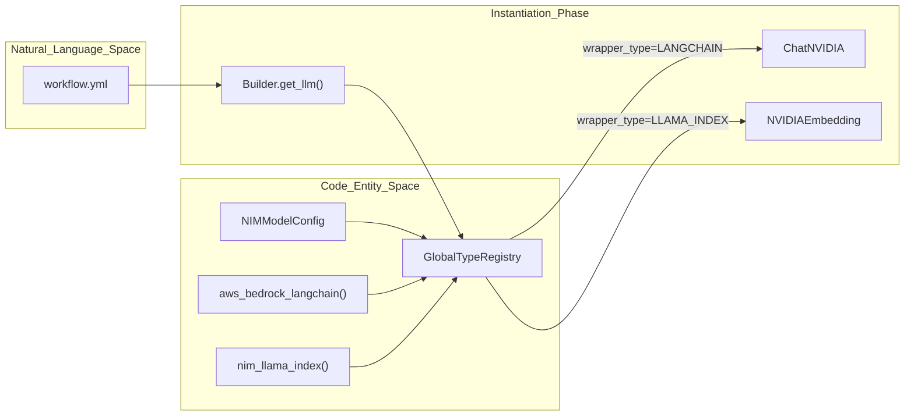
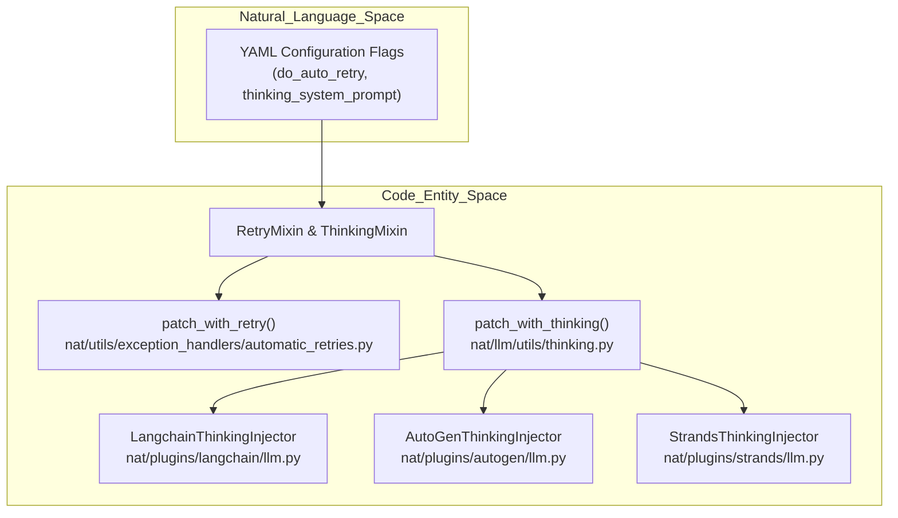

<!-- source: DeepWiki mcp.deepwiki.com · repo NVIDIA/NeMo-Agent-Toolkit · page 7.1 LLM Provider Architecture · fetched 2026-10-26 -->

# LLM Provider Architecture

Relevant source files

The following files were used as context for generating this wiki page:

- [packages/nvidia_nat_adk/src/nat/plugins/adk/llm.py](packages/nvidia_nat_adk/src/nat/plugins/adk/llm.py)
- [packages/nvidia_nat_agno/src/nat/plugins/agno/llm.py](packages/nvidia_nat_agno/src/nat/plugins/agno/llm.py)
- [packages/nvidia_nat_autogen/src/nat/plugins/autogen/llm.py](packages/nvidia_nat_autogen/src/nat/plugins/autogen/llm.py)
- [packages/nvidia_nat_autogen/tests/test_llm_autogen.py](packages/nvidia_nat_autogen/tests/test_llm_autogen.py)
- [packages/nvidia_nat_crewai/src/nat/plugins/crewai/llm.py](packages/nvidia_nat_crewai/src/nat/plugins/crewai/llm.py)
- [packages/nvidia_nat_langchain/src/nat/plugins/langchain/embedder.py](packages/nvidia_nat_langchain/src/nat/plugins/langchain/embedder.py)
- [packages/nvidia_nat_langchain/src/nat/plugins/langchain/llm.py](packages/nvidia_nat_langchain/src/nat/plugins/langchain/llm.py)
- [packages/nvidia_nat_langchain/tests/test_llm_langchain.py](packages/nvidia_nat_langchain/tests/test_llm_langchain.py)
- [packages/nvidia_nat_llama_index/src/nat/plugins/llama_index/embedder.py](packages/nvidia_nat_llama_index/src/nat/plugins/llama_index/embedder.py)
- [packages/nvidia_nat_llama_index/src/nat/plugins/llama_index/llm.py](packages/nvidia_nat_llama_index/src/nat/plugins/llama_index/llm.py)
- [packages/nvidia_nat_llama_index/tests/test_llm_llama_index.py](packages/nvidia_nat_llama_index/tests/test_llm_llama_index.py)
- [packages/nvidia_nat_semantic_kernel/src/nat/plugins/semantic_kernel/llm.py](packages/nvidia_nat_semantic_kernel/src/nat/plugins/semantic_kernel/llm.py)
- [packages/nvidia_nat_strands/src/nat/plugins/strands/llm.py](packages/nvidia_nat_strands/src/nat/plugins/strands/llm.py)
- [packages/nvidia_nat_strands/tests/test_strands_llm.py](packages/nvidia_nat_strands/tests/test_strands_llm.py)

## Purpose and Scope
The LLM Provider Architecture in the NVIDIA NeMo Agent Toolkit (NAT) provides a unified abstraction layer for configuring, registering, and instantiating Large Language Models (LLMs) and embedders across multiple underlying AI frameworks. It decouples model parameter definitions (such as API keys, base URLs, and sampling hyperparameters) from framework-specific client implementations (`LangChain`, `LlamaIndex`, `CrewAI`, `ADK`, `AutoGen`, `Agno`, `Strands`, `Semantic Kernel`), enabling a single YAML configuration to power multi-framework workflows.

Sources: [packages/nvidia_nat_langchain/src/nat/plugins/langchain/llm.py:17-43](), [packages/nvidia_nat_langchain/src/nat/plugins/langchain/embedder.py:16-30]()

---

## Two-Phase Registration Pattern

LLM and embedder integration uses a decoupled two-phase registration pattern to maintain modular boundaries across `nvidia_nat_core` and framework integration packages.

| Phase | Decorator | Responsibility | Implementation Location |
|---|---|---|---|
| **Provider Registration** | `@register_llm_provider` | Defines the configuration schema (Pydantic model) and the `_type` string used in workflow YAML specifications. | `packages/nvidia_nat_core/src/nat/llm/*.py` |
| **Client Registration** | `@register_llm_client` / `@register_embedder_client` | Maps a configuration type and an `LLMFrameworkEnum` wrapper type to a factory function yielding a framework-native client. | `packages/nvidia_nat_<framework>/src/nat/plugins/<framework>/llm.py` |

### Phase 1: Provider Registration
Provider configurations inherit from `LLMBaseConfig` and declare Pydantic validation fields. For instance, `OpenAIModelConfig` establishes parameters such as `api_key`, `model_name`, and `seed`. The metadata attribute dictates the expected `_type` token in YAML configurations.

### Phase 2: Client Registration
Framework-specific plugins utilize `@register_llm_client` or `@register_embedder_client` decorated asynchronous generator functions [packages/nvidia_nat_langchain/src/nat/plugins/langchain/llm.py:29](), [packages/nvidia_nat_langchain/src/nat/plugins/langchain/embedder.py:21](). These factories accept the validated configuration instance alongside a `Builder` reference and yield framework clients. Registrations are indexed in the global registry by the tuple `(config_type, LLMFrameworkEnum)` [packages/nvidia_nat_langchain/src/nat/plugins/langchain/llm.py:154-155](), [packages/nvidia_nat_llama_index/src/nat/plugins/llama_index/llm.py:85-86]().

At runtime, components request models via `builder.get_llm(llm_name="...", wrapper_type=LLMFrameworkEnum.LANGCHAIN)`, prompting the `Builder` to resolve the configuration schema and invoke the corresponding factory function [packages/nvidia_nat_langchain/src/nat/plugins/langchain/llm.py:27-29](), [packages/nvidia_nat_langchain/src/nat/plugins/langchain/llm.py:154-155]().

Sources: [packages/nvidia_nat_langchain/src/nat/plugins/langchain/llm.py:27-29](), [packages/nvidia_nat_langchain/src/nat/plugins/langchain/llm.py:154-155](), [packages/nvidia_nat_langchain/src/nat/plugins/langchain/embedder.py:21-21](), [packages/nvidia_nat_llama_index/src/nat/plugins/llama_index/llm.py:85-86]()

---

### Diagram: Registration and Resolution Flow (Natural Language Space to Code Entity Space)

This diagram bridges natural language configuration space to executable code entities using the global registry and factory functions.

Sources: [packages/nvidia_nat_langchain/src/nat/plugins/langchain/llm.py:27-29](), [packages/nvidia_nat_langchain/src/nat/plugins/langchain/llm.py:154-155](), [packages/nvidia_nat_llama_index/src/nat/plugins/llama_index/llm.py:133-134]()

---

## Model Configuration Class Hierarchy and Mixins

Provider configuration schemas inherit from base classes and incorporate mixins to inject cross-cutting concerns like automated retries or reasoning prompt injections.

### Configuration Mixins
*   **RetryMixin**: Adds fields `num_retries`, `retry_on_status_codes`, and `retry_on_errors`. Framework plugins consume this mixin to apply `patch_with_retry` [packages/nvidia_nat_langchain/src/nat/plugins/langchain/llm.py:32-32](), [packages/nvidia_nat_langchain/src/nat/plugins/langchain/llm.py:132-136]().
*   **ThinkingMixin**: Enables chain-of-thought or reasoning triggers via `thinking_system_prompt` [packages/nvidia_nat_langchain/src/nat/plugins/langchain/llm.py:33-33](), [packages/nvidia_nat_llama_index/src/nat/plugins/llama_index/llm.py:27-27]().
*   **SSLVerificationMixin**: Provides `verify_ssl` settings for underlying HTTP clients.

Sources: [packages/nvidia_nat_langchain/src/nat/plugins/langchain/llm.py:32-33](), [packages/nvidia_nat_langchain/src/nat/plugins/langchain/llm.py:132-136](), [packages/nvidia_nat_llama_index/src/nat/plugins/llama_index/llm.py:26-27]()

---

### Diagram: Thinking and Retry Patching Pipeline (Natural Language Space to Code Entity Space)

This diagram maps declarative configuration fields to the specific patching functions and framework injectors implemented in the codebase.

Sources: [packages/nvidia_nat_langchain/src/nat/plugins/langchain/llm.py:45-151](), [packages/nvidia_nat_strands/src/nat/plugins/strands/llm.py:73-137]()

---

## Supported LLM Providers and Framework Integration Matrix

Workflows specify providers using the `_type` identifier matching the registered configuration class.

| Provider | `_type` String | Config Class | Key Parameters |
|---|---|---|---|
| **NVIDIA NIM** | `nim` | `NIMModelConfig` | `model_name`, `api_key`, `base_url` |
| **OpenAI** | `openai` | `OpenAIModelConfig` | `model_name`, `api_key`, `seed` |
| **AWS Bedrock** | `aws_bedrock` | `AWSBedrockModelConfig` | `model_name`, `region_name` |
| **Azure OpenAI** | `azure_openai` | `AzureOpenAIModelConfig` | `azure_deployment`, `azure_endpoint`, `api_version` |
| **LiteLLM** | `litellm` | `LiteLlmModelConfig` | `model_name`, `api_key`, `base_url` |
| **Dynamo** | `dynamo` | `DynamoModelConfig` | `enable_nvext_hints` |
| **OCI** | `oci` | `OCIModelConfig` | `model_name`, `compartment_id` |
| **Hugging Face** | `huggingface` | `HuggingFaceConfig` | `model_name` |

### Framework Integration Matrix
The `LLMFrameworkEnum` enumerates supported execution frameworks:

| Framework | Enum Value | Plugin Package | Key Implementation File |
|---|---|---|---|
| **LangChain** | `LANGCHAIN` | `nvidia-nat-langchain` | `nat/plugins/langchain/llm.py` [packages/nvidia_nat_langchain/src/nat/plugins/langchain/llm.py:28-28]() |
| **LlamaIndex** | `LLAMA_INDEX` | `nvidia-nat-llama-index` | `nat/plugins/llama_index/llm.py` [packages/nvidia_nat_llama_index/src/nat/plugins/llama_index/llm.py:21-21]() |
| **CrewAI** | `CREWAI` | `nvidia-nat-crewai` | `nat/plugins/crewai/llm.py` [packages/nvidia_nat_crewai/src/nat/plugins/crewai/llm.py:20-20]() |
| **Agno** | `AGNO` | `nvidia-nat-agno` | `nat/plugins/agno/llm.py` [packages/nvidia_nat_agno/src/nat/plugins/agno/llm.py:20-20]() |
| **Strands** | `STRANDS` | `nvidia-nat-strands` | `nat/plugins/strands/llm.py` [packages/nvidia_nat_strands/src/nat/plugins/strands/llm.py:53-53]() |
| **Semantic Kernel** | `SEMANTIC_KERNEL` | `nvidia-nat-semantic-kernel` | `nat/plugins/semantic_kernel/llm.py` [packages/nvidia_nat_semantic_kernel/src/nat/plugins/semantic_kernel/llm.py:20-20]() |
| **ADK** | `ADK` | `nvidia-nat-adk` | `nat/plugins/adk/llm.py` [packages/nvidia_nat_adk/src/nat/plugins/adk/llm.py:20-20]() |

Sources: [packages/nvidia_nat_langchain/src/nat/plugins/langchain/llm.py:28-28](), [packages/nvidia_nat_llama_index/src/nat/plugins/llama_index/llm.py:21-21](), [packages/nvidia_nat_crewai/src/nat/plugins/crewai/llm.py:20-20](), [packages/nvidia_nat_agno/src/nat/plugins/agno/llm.py:20-20](), [packages/nvidia_nat_semantic_kernel/src/nat/plugins/semantic_kernel/llm.py:20-20](), [packages/nvidia_nat_strands/src/nat/plugins/strands/llm.py:53-53](), [packages/nvidia_nat_adk/src/nat/plugins/adk/llm.py:20-20]()

---

## The Patching and Thinking System

Framework integrations apply middleware-like patching during client creation to enforce uniform error handling and prompt transformations.

### `patch_with_retry`
Wraps native client methods with exponential backoff logic, inspecting error messages and HTTP status codes against configuration rules.

### `_patch_llm_based_on_config`
Internal patch functions inspect configuration traits:
1.  **Retry Application**: If `RetryMixin` is enabled, retry mechanisms wrap invocation methods [packages/nvidia_nat_langchain/src/nat/plugins/langchain/llm.py:132-136]().
2.  **Thinking Injection**: If `ThinkingMixin` is configured, a framework-specific `BaseThinkingInjector` prepends the `thinking_system_prompt` to the model message sequence [packages/nvidia_nat_langchain/src/nat/plugins/langchain/llm.py:138-149]().

### Framework Thinking Injectors
*   `LangchainThinkingInjector`: Modifies LangChain `BaseMessage` sequences or `SystemMessage` prompts [packages/nvidia_nat_langchain/src/nat/plugins/langchain/llm.py:89-126]().
*   `LlamaIndexThinkingInjector`: Inserts system instructions into LlamaIndex `ChatMessage` lists [packages/nvidia_nat_llama_index/src/nat/plugins/llama_index/llm.py:48-61]().
*   `CrewAIThinkingInjector`: Adjusts dictionary-based message payloads [packages/nvidia_nat_crewai/src/nat/plugins/crewai/llm.py:43-57]().
*   `SemanticKernelThinkingInjector`: Injects system prompts into `ChatHistory` containers [packages/nvidia_nat_semantic_kernel/src/nat/plugins/semantic_kernel/llm.py:43-70]().
*   `StrandsThinkingInjector`: Updates the positional or keyword `system_prompt` argument in Strands model calls [packages/nvidia_nat_strands/src/nat/plugins/strands/llm.py:84-118]().

Sources: [packages/nvidia_nat_langchain/src/nat/plugins/langchain/llm.py:81-151](), [packages/nvidia_nat_llama_index/src/nat/plugins/llama_index/llm.py:44-82](), [packages/nvidia_nat_crewai/src/nat/plugins/crewai/llm.py:41-72](), [packages/nvidia_nat_semantic_kernel/src/nat/plugins/semantic_kernel/llm.py:39-88](), [packages/nvidia_nat_strands/src/nat/plugins/strands/llm.py:73-137]()

---

## Responses API Support

NAT supports OpenAI's Responses API via `APITypeEnum.RESPONSES`, binding tools directly to the LLM backend.
*   **Validation**: `validate_no_responses_api` guards frameworks that do not support native responses routing, raising validation errors if invoked [packages/nvidia_nat_langchain/src/nat/plugins/langchain/llm.py:159-159](), [packages/nvidia_nat_llama_index/src/nat/plugins/llama_index/llm.py:90-90]().
*   **Instantiation**: Supported frameworks construct specialized response clients such as `OpenAIResponses` [packages/nvidia_nat_llama_index/src/nat/plugins/llama_index/llm.py:163-163](), [packages/nvidia_nat_agno/src/nat/plugins/agno/llm.py:119-120]().

Sources: [packages/nvidia_nat_langchain/src/nat/plugins/langchain/llm.py:159-160](), [packages/nvidia_nat_llama_index/src/nat/plugins/llama_index/llm.py:90-90](), [packages/nvidia_nat_agno/src/nat/plugins/agno/llm.py:118-120]()

---

## Dynamo LLM Provider and Hints System

`DynamoModelConfig` configures clients for NVIDIA Dynamo infrastructure, supporting KV cache management and `nvext.agent_hints`.
*   `_create_httpx_client_with_dynamo_hooks`: Constructs an `httpx` client injecting routing headers and prefix IDs [packages/nvidia_nat_langchain/src/nat/plugins/langchain/llm.py:36-37]().

Sources: [packages/nvidia_nat_langchain/src/nat/plugins/langchain/llm.py:36-37]()

---

