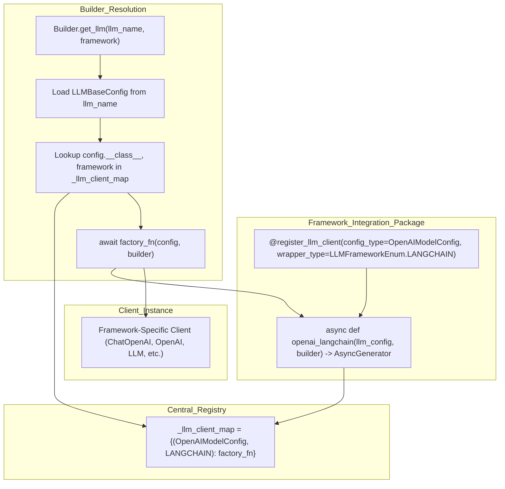
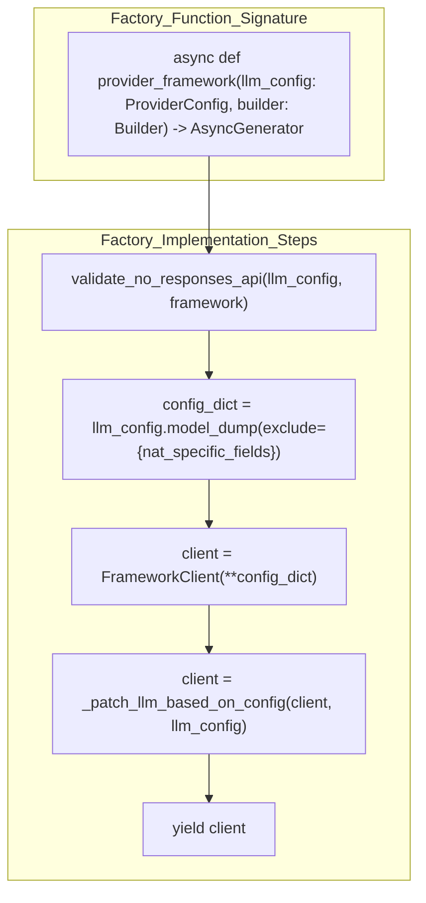
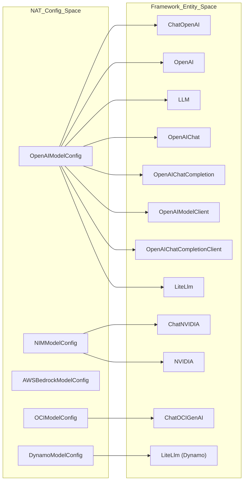
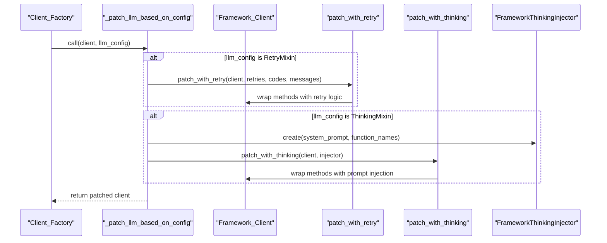
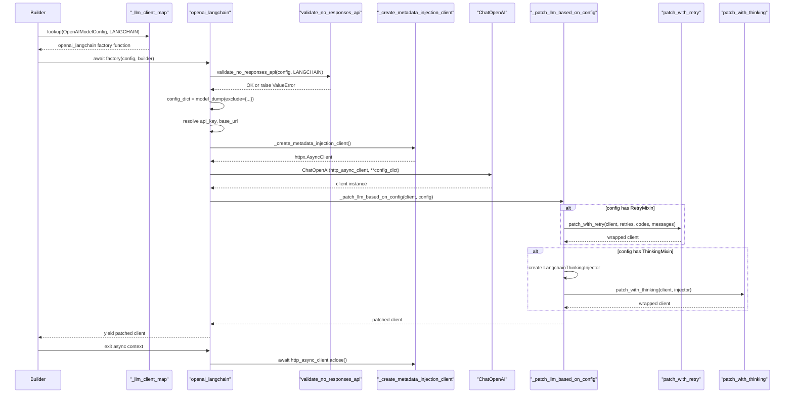

<!-- source: DeepWiki mcp.deepwiki.com · repo NVIDIA/NeMo-Agent-Toolkit · page 7.2 Multi-Framework Client System · fetched 2026-10-26 -->

# Multi-Framework Client System

<details>
<summary>Relevant source files</summary>

The following files were used as context for generating this wiki page:

- [examples/frameworks/adk_demo/src/nat_adk_demo/agent.py](examples/frameworks/adk_demo/src/nat_adk_demo/agent.py)
- [examples/frameworks/adk_demo/src/nat_adk_demo/register.py](examples/frameworks/adk_demo/src/nat_adk_demo/register.py)
- [packages/nvidia_nat_adk/src/nat/plugins/adk/llm.py](packages/nvidia_nat_adk/src/nat/plugins/adk/llm.py)
- [packages/nvidia_nat_adk/src/nat/plugins/adk/register.py](packages/nvidia_nat_adk/src/nat/plugins/adk/register.py)
- [packages/nvidia_nat_agno/src/nat/plugins/agno/llm.py](packages/nvidia_nat_agno/src/nat/plugins/agno/llm.py)
- [packages/nvidia_nat_autogen/src/nat/plugins/autogen/llm.py](packages/nvidia_nat_autogen/src/nat/plugins/autogen/llm.py)
- [packages/nvidia_nat_autogen/tests/test_llm_autogen.py](packages/nvidia_nat_autogen/tests/test_llm_autogen.py)
- [packages/nvidia_nat_crewai/src/nat/plugins/crewai/llm.py](packages/nvidia_nat_crewai/src/nat/plugins/crewai/llm.py)
- [packages/nvidia_nat_langchain/src/nat/plugins/langchain/embedder.py](packages/nvidia_nat_langchain/src/nat/plugins/langchain/embedder.py)
- [packages/nvidia_nat_langchain/src/nat/plugins/langchain/llm.py](packages/nvidia_nat_langchain/src/nat/plugins/langchain/llm.py)
- [packages/nvidia_nat_langchain/tests/test_llm_langchain.py](packages/nvidia_nat_langchain/tests/test_llm_langchain.py)
- [packages/nvidia_nat_llama_index/src/nat/plugins/llama_index/embedder.py](packages/nvidia_nat_llama_index/src/nat/plugins/llama_index/embedder.py)
- [packages/nvidia_nat_llama_index/src/nat/plugins/llama_index/llm.py](packages/nvidia_nat_llama_index/src/nat/plugins/llama_index/llm.py)
- [packages/nvidia_nat_llama_index/tests/test_llm_llama_index.py](packages/nvidia_nat_llama_index/tests/test_llm_llama_index.py)
- [packages/nvidia_nat_semantic_kernel/src/nat/plugins/semantic_kernel/llm.py](packages/nvidia_nat_semantic_kernel/src/nat/plugins/semantic_kernel/llm.py)
- [packages/nvidia_nat_strands/src/nat/plugins/strands/llm.py](packages/nvidia_nat_strands/src/nat/plugins/strands/llm.py)
- [packages/nvidia_nat_strands/tests/test_strands_llm.py](packages/nvidia_nat_strands/tests/test_strands_llm.py)
- [packages/nvidia_nat_test/src/nat/test/llm.py](packages/nvidia_nat_test/src/nat/test/llm.py)
- [packages/nvidia_nat_test/src/nat/test/register.py](packages/nvidia_nat_test/src/nat/test/register.py)
- [packages/nvidia_nat_test/tests/test_env_fixtures.py](packages/nvidia_nat_test/tests/test_env_fixtures.py)
- [packages/nvidia_nat_test/tests/test_test_llm.py](packages/nvidia_nat_test/tests/test_test_llm.py)

</details>


## Purpose and Scope

The Multi-Framework Client System enables LLM and embedder provider configurations to be instantiated as framework-specific client objects—such as LangChain's `ChatOpenAI` [packages/nvidia_nat_langchain/tests/test_llm_langchain.py:110-110](), LlamaIndex's `OpenAI` [packages/nvidia_nat_llama_index/src/nat/plugins/llama_index/llm.py:155-156](), CrewAI's `LLM` [packages/nvidia_nat_crewai/src/nat/plugins/crewai/llm.py:78-78](), Agno's `OpenAIChat` [packages/nvidia_nat_agno/src/nat/plugins/agno/llm.py:118-119](), Semantic Kernel's `OpenAIChatCompletion` [packages/nvidia_nat_semantic_kernel/src/nat/plugins/semantic_kernel/llm.py:114-114](), Strands' client wrappers [packages/nvidia_nat_strands/src/nat/plugins/strands/llm.py:140-141](), and Google ADK's `LiteLlm` [packages/nvidia_nat_adk/src/nat/plugins/adk/llm.py:41-41]()—through a unified two-tier registration architecture. This system decouples LLM provider definitions from framework implementations, allowing a single unified provider configuration to function seamlessly across multiple agent frameworks.

For information about LLM provider registration and configuration schema, see [LLM Provider Architecture](7.1). For details about retry and thinking mixins applied to clients during instantiation, see [Configuration Mixins](7.3).

Sources: [packages/nvidia_nat_langchain/src/nat/plugins/langchain/llm.py:1-55](), [packages/nvidia_nat_crewai/src/nat/plugins/crewai/llm.py:1-37](), [packages/nvidia_nat_strands/src/nat/plugins/strands/llm.py:15-68](), [packages/nvidia_nat_adk/src/nat/plugins/adk/llm.py:19-30]()

---

## Registration Architecture

The client system uses the `@register_llm_client` decorator to map `(config_type, framework_enum)` tuples to client factory functions [packages/nvidia_nat_langchain/src/nat/plugins/langchain/llm.py:154-154](). Each framework integration package declares specific registrations for the respective model providers it supports.

### Registration Decorator

Title: LLM Client Registration and Resolution Flow


Sources: [packages/nvidia_nat_langchain/src/nat/plugins/langchain/llm.py:154-154](), [packages/nvidia_nat_crewai/src/nat/plugins/crewai/llm.py:157-157](), [packages/nvidia_nat_llama_index/src/nat/plugins/llama_index/llm.py:152-152](), [packages/nvidia_nat_agno/src/nat/plugins/agno/llm.py:115-115](), [packages/nvidia_nat_semantic_kernel/src/nat/plugins/semantic_kernel/llm.py:110-110](), [packages/nvidia_nat_strands/src/nat/plugins/strands/llm.py:140-141](), [packages/nvidia_nat_adk/src/nat/plugins/adk/llm.py:33-34]()

The decorator is defined in `nat.cli.register_workflow` [packages/nvidia_nat_langchain/src/nat/plugins/langchain/llm.py:29-29]() and populates the global type registry with mappings [packages/nvidia_nat_test/src/nat/test/plugin.py:98-101](). When `Builder.get_llm()` is called with a target framework enum, it looks up the appropriate factory function and invokes it asynchronously to produce the framework-specific client.

Sources: [packages/nvidia_nat_langchain/src/nat/plugins/langchain/llm.py:27-29]()

---

## Client Factory Pattern

All framework integrations follow a common asynchronous generator pattern for client creation:

Title: Client Factory Implementation Lifecycle


Sources: [packages/nvidia_nat_langchain/src/nat/plugins/langchain/llm.py:154-161](), [packages/nvidia_nat_llama_index/src/nat/plugins/llama_index/llm.py:85-98](), [packages/nvidia_nat_strands/src/nat/plugins/strands/llm.py:140-151](), [packages/nvidia_nat_adk/src/nat/plugins/adk/llm.py:33-44]()

### Common Steps

1. **Validation**: Call `validate_no_responses_api()` to reject Responses API usage for frameworks that do not natively support tool binding at the engine level [packages/nvidia_nat_langchain/src/nat/plugins/langchain/llm.py:159-159](), [packages/nvidia_nat_crewai/src/nat/plugins/crewai/llm.py:80-80](), [packages/nvidia_nat_llama_index/src/nat/plugins/llama_index/llm.py:90-90](), [packages/nvidia_nat_strands/src/nat/plugins/strands/llm.py:67-67](), [packages/nvidia_nat_adk/src/nat/plugins/adk/llm.py:43-43]().
2. **Config Extraction**: Use Pydantic's `model_dump(exclude={...})` to strip NAT-specific control flags like `type`, `thinking`, and `api_type` [packages/nvidia_nat_langchain/src/nat/plugins/langchain/llm.py:161-161](), [packages/nvidia_nat_agno/src/nat/plugins/agno/llm.py:122-137](), [packages/nvidia_nat_adk/src/nat/plugins/adk/llm.py:45-57]().
3. **Client Creation**: Instantiate the target framework's native client class with the filtered configuration dictionary [packages/nvidia_nat_langchain/src/nat/plugins/langchain/llm.py:160-161]().
4. **Mixin Patching**: Apply `RetryMixin` and `ThinkingMixin` configuration behavior via helper patching functions like `_patch_llm_based_on_config()` [packages/nvidia_nat_langchain/src/nat/plugins/langchain/llm.py:81-151](), [packages/nvidia_nat_crewai/src/nat/plugins/crewai/llm.py:41-72](), [packages/nvidia_nat_adk/src/nat/plugins/adk/llm.py:164-184]().
5. **Yield**: Provide the resulting client instance to the caller via an async generator [packages/nvidia_nat_langchain/src/nat/plugins/langchain/llm.py:161-161]().

Sources: [packages/nvidia_nat_langchain/src/nat/plugins/langchain/llm.py:81-161]()

---

## Framework-Specific Implementations

Each framework integration package provides client factories for a specific subset of supported LLM providers.

| Provider | LangChain | LlamaIndex | CrewAI | Agno | Semantic Kernel | Strands | AutoGen | ADK |
|----------|-----------|------------|--------|------|-----------------|---------|---------|-----|
| **OpenAI** | ✓ | ✓ | ✓ | ✓ | ✓ | ✓ | ✓ | ✓ |
| **Azure OpenAI** | ✓ | ✓ | ✓ | - | ✓ | - | ✓ | ✓ |
| **NVIDIA NIM** | ✓ | ✓ | ✓ | ✓ | - | ✓ | ✓ | ✓ |
| **AWS Bedrock** | ✓ | ✓ | - | - | - | ✓ | ✓ | - |
| **LiteLLM** | ✓ | ✓ | ✓ | ✓ | - | - | ✓ | ✓ |
| **Dynamo** | ✓ | - | - | - | - | - | - | ✓ |
| **HuggingFace** | ✓ | - | - | - | - | - | - | - |
| **OCI** | ✓ | - | - | - | - | - | - | - |

Sources: [packages/nvidia_nat_langchain/src/nat/plugins/langchain/llm.py:154-161](), [packages/nvidia_nat_crewai/src/nat/plugins/crewai/llm.py:75-182](), [packages/nvidia_nat_llama_index/src/nat/plugins/llama_index/llm.py:85-180](), [packages/nvidia_nat_agno/src/nat/plugins/agno/llm.py:83-182](), [packages/nvidia_nat_semantic_kernel/src/nat/plugins/semantic_kernel/llm.py:91-124](), [packages/nvidia_nat_strands/src/nat/plugins/strands/llm.py:140-151](), [packages/nvidia_nat_adk/src/nat/plugins/adk/llm.py:33-165]()

### Framework-Specific Client Classes

Each framework maps uniform provider configurations into distinct code entities and runtime client classes:

Title: Mapping Provider Configs to Framework Code Entities


Sources: [packages/nvidia_nat_langchain/src/nat/plugins/langchain/llm.py:154-161](), [packages/nvidia_nat_llama_index/src/nat/plugins/llama_index/llm.py:152-180](), [packages/nvidia_nat_crewai/src/nat/plugins/crewai/llm.py:157-182](), [packages/nvidia_nat_agno/src/nat/plugins/agno/llm.py:116-154](), [packages/nvidia_nat_semantic_kernel/src/nat/plugins/semantic_kernel/llm.py:110-124](), [packages/nvidia_nat_strands/src/nat/plugins/strands/llm.py:140-151](), [packages/nvidia_nat_adk/src/nat/plugins/adk/llm.py:163-184]()

---

## Mixin Patching System

After creating the framework-specific client instance, each factory invokes a patching function (`_patch_llm_based_on_config`) to apply cross-cutting behaviors derived from `RetryMixin` and `ThinkingMixin`.

### Patching Flow

Title: LLM Client Patching Sequence


Sources: [packages/nvidia_nat_langchain/src/nat/plugins/langchain/llm.py:81-151](), [packages/nvidia_nat_crewai/src/nat/plugins/crewai/llm.py:41-72](), [packages/nvidia_nat_strands/src/nat/plugins/strands/llm.py:73-137]()

### RetryMixin Patching

When `llm_config` inherits from `RetryMixin`, the client is wrapped with automatic retry handling [packages/nvidia_nat_langchain/src/nat/plugins/langchain/llm.py:132-136]():

- **Retry Count**: `llm_config.num_retries` sets the maximum attempt threshold [packages/nvidia_nat_langchain/src/nat/plugins/langchain/llm.py:134-134]().
- **Status Codes**: `llm_config.retry_on_status_codes` defines HTTP status codes triggering retries [packages/nvidia_nat_langchain/src/nat/plugins/langchain/llm.py:135-135]().
- **Error Messages**: `llm_config.retry_on_errors` defines specific exception substrings triggering retries [packages/nvidia_nat_langchain/src/nat/plugins/langchain/llm.py:136-136]().

The `patch_with_retry()` utility is defined in `nat.utils.exception_handlers.automatic_retries` [packages/nvidia_nat_langchain/src/nat/plugins/langchain/llm.py:48-48]().

Sources: [packages/nvidia_nat_langchain/src/nat/plugins/langchain/llm.py:48-48](), [packages/nvidia_nat_langchain/src/nat/plugins/langchain/llm.py:132-136]()

### ThinkingMixin Patching

When `llm_config.thinking_system_prompt` is defined, a chain-of-thought system prompt is injected into requests [packages/nvidia_nat_langchain/src/nat/plugins/langchain/llm.py:138-149]():

- **System Prompt**: Content from `llm_config.thinking_system_prompt` is prepended or injected into message payloads.
- **Function Names**: Each framework integration explicitly targets execution methods (e.g., LangChain patches `["invoke", "ainvoke", "stream", "astream"]` [packages/nvidia_nat_langchain/src/nat/plugins/langchain/llm.py:143-148](), LlamaIndex patches `["chat", "stream_chat", "achat", "astream_chat"]` [packages/nvidia_nat_llama_index/src/nat/plugins/llama_index/llm.py:74-79]()).
- **Message Schema Adapters**: Framework-specific `ThinkingInjector` subclasses adapt to each framework's message type requirements.

Sources: [packages/nvidia_nat_langchain/src/nat/plugins/langchain/llm.py:138-149](), [packages/nvidia_nat_llama_index/src/nat/plugins/llama_index/llm.py:74-79]()

---

## Message Format Adaptation

Each framework uses distinct message structures, requiring specialized `ThinkingInjector` subclasses.

Title: Thinking Injector Class Hierarchy

```mermaid
classDiagram
    class BaseThinkingInjector {
        +str system_prompt
        +list~str~ function_names
        +inject(messages, *args, **kwargs) FunctionArgumentWrapper*
    }
    
    class LangchainThinkingInjector {
        +inject(messages: LanguageModelInput) FunctionArgumentWrapper
        -handle PromptValue, str, Sequence~BaseMessage~
        -insert/append SystemMessage
    }
    
    class LlamaIndexThinkingInjector {
        +inject(messages: Sequence~ChatMessage~) FunctionArgumentWrapper
        -find/modify system ChatMessage
    }
    
    class CrewAIThinkingInjector {
        +inject(messages: list~dict~) FunctionArgumentWrapper
        -find/modify dict with role=system
    }
    
    class AgnoThinkingInjector {
        +inject(messages: list~Message~) FunctionArgumentWrapper
        -find/modify Message with role=system
    }

    class AutoGenThinkingInjector {
        +inject(messages, *args, **kwargs) FunctionArgumentWrapper
        -prepend SystemMessage content
    }
    
    BaseThinkingInjector <|-- LangchainThinkingInjector
    BaseThinkingInjector <|-- LlamaIndexThinkingInjector
    BaseThinkingInjector <|-- CrewAIThinkingInjector
    BaseThinkingInjector <|-- AgnoThinkingInjector
    BaseThinkingInjector <|-- AutoGenThinkingInjector
```


Sources: [packages/nvidia_nat_langchain/src/nat/plugins/langchain/llm.py:89-126](), [packages/nvidia_nat_llama_index/src/nat/plugins/llama_index/llm.py:48-61](), [packages/nvidia_nat_crewai/src/nat/plugins/crewai/llm.py:43-57](), [packages/nvidia_nat_agno/src/nat/plugins/agno/llm.py:45-61]()

---

## Embedder Provider Support

Similar to LLMs, embedder clients are registered per-framework and provider using the `register_embedder_client` decorator [packages/nvidia_nat_langchain/src/nat/plugins/langchain/embedder.py:32-32]().

| Provider | LangChain | LlamaIndex |
|----------|-----------|------------|
| **NVIDIA NIM** | `NVIDIAEmbeddings` | `NVIDIAEmbedding` |
| **OpenAI** | `OpenAIEmbeddings` | `OpenAIEmbedding` |
| **Azure OpenAI** | `AzureOpenAIEmbeddings` | `AzureOpenAIEmbedding` |
| **HuggingFace** | `HuggingFaceEmbeddings` | - |

Sources: [packages/nvidia_nat_langchain/src/nat/plugins/langchain/embedder.py:32-137](), [packages/nvidia_nat_llama_index/src/nat/plugins/llama_index/embedder.py:27-97]()

---

## Example: LangChain Client Creation

The following sequence details execution flow when instantiating a LangChain OpenAI client:

Title: LangChain Client Creation Sequence


Sources: [packages/nvidia_nat_langchain/src/nat/plugins/langchain/llm.py:44-44]()

### Code Walkthrough

1. **Validation**:
   ```python
   validate_no_responses_api(llm_config, LLMFrameworkEnum.LANGCHAIN)
   ```
   [packages/nvidia_nat_langchain/src/nat/plugins/langchain/llm.py:159-159]()

2. **Config Extraction**:
   ```python
   config_dict = llm_config.model_dump(
       exclude={"type", "thinking", "api_type", "api_key", "base_url", "verify_ssl"},
       by_alias=True,
       exclude_none=True,
       exclude_unset=True,
   )
   ```
   [packages/nvidia_nat_langchain/src/nat/plugins/langchain/llm.py:161-161]()

3. **Client Instantiation & Patching**:
   ```python
   yield _patch_llm_based_on_config(client, llm_config)
   ```
   [packages/nvidia_nat_langchain/src/nat/plugins/langchain/llm.py:81-151]()

Sources: [packages/nvidia_nat_langchain/src/nat/plugins/langchain/llm.py:81-161]()

---

## Framework-Specific Features

### Dynamo Prefix Headers and Hooks

Integration plugins support specialized inference routing and caching hints (such as NVIDIA Dynamo) through custom `httpx` transport hooks [packages/nvidia_nat_langchain/src/nat/plugins/langchain/llm.py:37-37](). For instance, `_create_httpx_client_with_dynamo_hooks` wraps transport layers to inject performance and prefix affinity headers.

```python
async with _create_httpx_client_with_dynamo_hooks(config) as http_client:
    async_openai = AsyncOpenAI(
        api_key=config.api_key.get_secret_value() if config.api_key else "EMPTY",
        base_url=config.base_url,
        http_client=http_client,
    )
```

Sources: [packages/nvidia_nat_langchain/src/nat/plugins/langchain/llm.py:36-37]()

---

