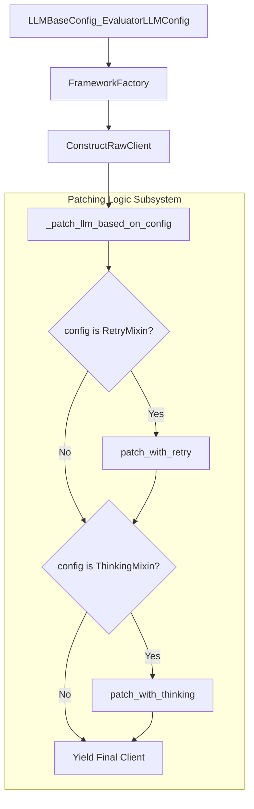
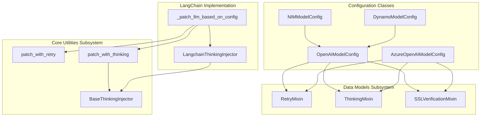
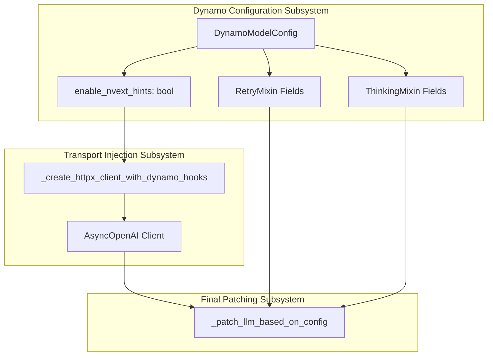

<!-- source: DeepWiki mcp.deepwiki.com · repo NVIDIA/NeMo-Agent-Toolkit · page 7.3 Configuration Mixins · fetched 2026-10-26 -->

# Configuration Mixins

Relevant source files

The following files were used as context for generating this wiki page:

- [packages/nvidia_nat_core/src/nat/data_models/evaluator.py](packages/nvidia_nat_core/src/nat/data_models/evaluator.py)
- [packages/nvidia_nat_core/src/nat/data_models/retry_mixin.py](packages/nvidia_nat_core/src/nat/data_models/retry_mixin.py)
- [packages/nvidia_nat_core/src/nat/utils/exception_handlers/automatic_retries.py](packages/nvidia_nat_core/src/nat/utils/exception_handlers/automatic_retries.py)
- [packages/nvidia_nat_core/tests/nat/data_models/test_retry_mixin.py](packages/nvidia_nat_core/tests/nat/data_models/test_retry_mixin.py)
- [packages/nvidia_nat_core/tests/nat/utils/test_retry_wrapper.py](packages/nvidia_nat_core/tests/nat/utils/test_retry_wrapper.py)

This page documents the behavioral mixins — `RetryMixin`, `ThinkingMixin`, and `SSLVerificationMixin` — that are composed into LLM and evaluator provider configurations to provide unified control over automatic retries, reasoning prompt injection, and TLS behavior across multiple frameworks.

---

## Overview

When an LLM client is constructed via a framework plugin (e.g., LangChain, LlamaIndex, AutoGen, CrewAI, Agno, Strands, Semantic Kernel, ADK), it is typically enriched at construction time by monkey-patching specific methods on the live object. This allows the toolkit to inject logic into third-party framework objects without requiring them to inherit from NAT base classes.

| Mixin | Purpose | Implementation Mechanism |
|---|---|---|
| `RetryMixin` | Automatic retry with status-code and message filtering | `patch_with_retry` wrapper |
| `ThinkingMixin` | System-prompt injection for chain-of-thought models | `patch_with_thinking` + framework injector |
| `SSLVerificationMixin` | Controls SSL certificate validation for HTTP clients | `verify_ssl` field passed to HTTP client factories |

Sources: [packages/nvidia_nat_langchain/src/nat/plugins/langchain/llm.py:132-150](), [packages/nvidia_nat_core/src/nat/data_models/retry_mixin.py:20-40](), [packages/nvidia_nat_core/src/nat/data_models/evaluator.py:35-40]()

---

## Mixin Data Models

### `RetryMixin`
Defined in `nat.data_models.retry_mixin.RetryMixin`, this mixin provides fields to configure the `patch_with_retry` utility [packages/nvidia_nat_core/src/nat/data_models/retry_mixin.py:20-40](). It is used across both LLM and Evaluator configurations to ensure robust network communication.
- `do_auto_retry`: Boolean to enable/disable the mechanism (default: `True`) [packages/nvidia_nat_core/src/nat/data_models/retry_mixin.py:20-25]().
- `num_retries`: Maximum number of retry attempts (default: 5). Validated via Pydantic to be greater than 0 [packages/nvidia_nat_core/src/nat/data_models/retry_mixin.py:26-30](), [packages/nvidia_nat_core/tests/nat/data_models/test_retry_mixin.py:35-38]().
- `retry_on_status_codes`: List of HTTP status codes (default: `[429, 500, 502, 503, 504]`) that trigger a retry [packages/nvidia_nat_core/src/nat/data_models/retry_mixin.py:31-33]().
- `retry_on_errors`: List of error message substrings (e.g., "Too Many Requests", "429") that trigger a retry [packages/nvidia_nat_core/src/nat/data_models/retry_mixin.py:34-40]().

### `ThinkingMixin`
Enables "Thinking" mode for models like NVIDIA Nemotron by injecting specific instructions into the conversation context.
- `thinking_system_prompt`: A string injected into the system message of every LLM call to guide the model's reasoning process [packages/nvidia_nat_langchain/src/nat/plugins/langchain/llm.py:138-142]().

### `SSLVerificationMixin`
- `verify_ssl`: A boolean (default `True`) determining if the underlying HTTP client should verify SSL certificates. It is often checked before client instantiation, and some clients (like LlamaIndex's `NVIDIAEmbedding`) may raise errors if set to `False` due to upstream limitations [packages/nvidia_nat_llama_index/src/nat/plugins/llama_index/embedder.py:56-58]().

Sources: [packages/nvidia_nat_core/src/nat/data_models/retry_mixin.py:20-40](), [packages/nvidia_nat_core/tests/nat/data_models/test_retry_mixin.py:26-56](), [packages/nvidia_nat_langchain/src/nat/plugins/langchain/llm.py:132-150](), [packages/nvidia_nat_llama_index/src/nat/plugins/llama_index/embedder.py:56-58]()

---

## The Patching Lifecycle

The `_patch_llm_based_on_config` function (or its framework-specific variant) is the central application point. It is called by framework-specific factory functions before yielding the client to the agent.

### Diagram: Client Enrichment Flow
This diagram maps Natural Language concepts to code entities involved in client patching.

Sources: [packages/nvidia_nat_langchain/src/nat/plugins/langchain/llm.py:81-151](), [packages/nvidia_nat_core/src/nat/data_models/retry_mixin.py:20-40](), [packages/nvidia_nat_core/src/nat/utils/exception_handlers/automatic_retries.py:174-189]()

---

## Framework-Specific Thinking Injectors

Because every framework represents messages differently (e.g., LangChain's `BaseMessage` vs. LlamaIndex's `ChatMessage`), each plugin defines a concrete `BaseThinkingInjector` to handle the specific data structure.

| Framework | Injector Class | Target Methods |
|---|---|---|
| **LangChain** | `LangchainThinkingInjector` | `invoke`, `ainvoke`, `stream`, `astream` |
| **LlamaIndex** | `LlamaIndexThinkingInjector` | `chat`, `stream_chat`, `achat`, `astream_chat` |
| **CrewAI** | `CrewAIThinkingInjector` | `call` |
| **Agno** | `AgnoThinkingInjector` | `invoke_stream`, `invoke`, `ainvoke`, `ainvoke_stream` |
| **Semantic Kernel** | `SemanticKernelThinkingInjector` | `get_chat_message_contents`, `get_streaming_chat_message_contents` |

Sources: [packages/nvidia_nat_langchain/src/nat/plugins/langchain/llm.py:89-150](), [packages/nvidia_nat_llama_index/src/nat/plugins/llama_index/llm.py:48-80](), [packages/nvidia_nat_crewai/src/nat/plugins/crewai/llm.py:43-70](), [packages/nvidia_nat_agno/src/nat/plugins/agno/llm.py:45-78](), [packages/nvidia_nat_semantic_kernel/src/nat/plugins/semantic_kernel/llm.py:43-86]()

---

## SSL Verification Handling

The `SSLVerificationMixin` is typically handled earlier in the client construction process than retries or thinking. It influences the creation of the underlying HTTP client used by the framework.

- In **LangChain**, it is used by `_create_metadata_injection_client` or passed via `http_clients` to embedding clients [packages/nvidia_nat_langchain/src/nat/plugins/langchain/llm.py:44-44](), [packages/nvidia_nat_langchain/src/nat/plugins/langchain/embedder.py:37-37]().
- In **LlamaIndex**, **Agno**, and **Semantic Kernel**, it is passed to the `http_clients` or `async_http_client` context managers [packages/nvidia_nat_llama_index/src/nat/plugins/llama_index/llm.py:116-118](), [packages/nvidia_nat_agno/src/nat/plugins/agno/llm.py:90-105](), [packages/nvidia_nat_semantic_kernel/src/nat/plugins/semantic_kernel/llm.py:99-105]().
- In **CrewAI** and **ADK**, it is processed by `_handle_litellm_verify_ssl` because these frameworks use LiteLLM internally [packages/nvidia_nat_adk/src/nat/plugins/adk/llm.py:27-27]().
- In **Dynamo**, it is passed to `_create_httpx_client_with_dynamo_hooks` which configures the underlying transport [packages/nvidia_nat_langchain/src/nat/plugins/langchain/llm.py:37-37]().

Sources: [packages/nvidia_nat_semantic_kernel/src/nat/plugins/semantic_kernel/llm.py:99-105](), [packages/nvidia_nat_langchain/src/nat/plugins/langchain/llm.py:37-44](), [packages/nvidia_nat_llama_index/src/nat/plugins/llama_index/llm.py:116-118](), [packages/nvidia_nat_adk/src/nat/plugins/adk/llm.py:68-68](), [packages/nvidia_nat_langchain/src/nat/plugins/langchain/embedder.py:37-37]()

---

## Code Entity Map

This diagram links natural language functional concepts directly to their concrete implementation classes and utility functions in the codebase.

Sources: [packages/nvidia_nat_langchain/src/nat/plugins/langchain/llm.py:81-151](), [packages/nvidia_nat_langchain/src/nat/plugins/langchain/llm.py:32-33](), [packages/nvidia_nat_core/src/nat/data_models/retry_mixin.py:20-40](), [packages/nvidia_nat_core/src/nat/utils/exception_handlers/automatic_retries.py:174-189]()

---

## Implementation Details: `patch_with_retry`

The `patch_with_retry` function in `nat.utils.exception_handlers.automatic_retries` implements exponential back-off and memory-optimized retries [packages/nvidia_nat_core/src/nat/utils/exception_handlers/automatic_retries.py:15-20]().

- **Memory Optimization**: It uses `_clear_exception_context` to break reference cycles by clearing exception tracebacks [packages/nvidia_nat_core/src/nat/utils/exception_handlers/automatic_retries.py:88-109]().
- **Shallow Copying**: To avoid mutation issues across retries without the overhead of deep copying, it defaults to shallow copying arguments via `_shallow_copy_args` [packages/nvidia_nat_core/src/nat/utils/exception_handlers/automatic_retries.py:68-72]().
- **Unified Logic**: The `_want_retry` helper centralizes the logic for checking status codes and message substrings, supporting wildcards like "4xx" or "5*" [packages/nvidia_nat_core/src/nat/utils/exception_handlers/automatic_retries.py:159-181]().

Sources: [packages/nvidia_nat_core/src/nat/utils/exception_handlers/automatic_retries.py:15-181](), [packages/nvidia_nat_core/tests/nat/utils/test_retry_wrapper.py:45-79]()

---

## Special Case: Dynamo LLM Mixin Integration

`DynamoModelConfig` extends `OpenAIModelConfig` and thus inherits all three mixins. However, it also introduces specialized fields for KV cache optimization and routing hints via `nvext.agent_hints`.

### Diagram: Dynamo Hint and Mixin Flow

- **Retry/Thinking Patching**: Even though Dynamo uses a custom transport for routing hints, it is still passed through `_patch_llm_based_on_config` to apply the toolkit's standard retry and thinking behaviors [packages/nvidia_nat_langchain/src/nat/plugins/langchain/llm.py:81-151]().
- **SSL Handling**: For Dynamo, `verify_ssl` is passed directly to the httpx client creator via `_create_httpx_client_with_dynamo_hooks` [packages/nvidia_nat_langchain/src/nat/plugins/langchain/llm.py:37-37]().
- **ADK Integration**: In the ADK plugin, `dynamo_adk` specifically handles `enable_nvext_hints` by wrapping an `AsyncOpenAI` client with a custom httpx transport before yielding the client [packages/nvidia_nat_adk/src/nat/plugins/adk/llm.py:164-200]().

Sources: [packages/nvidia_nat_langchain/src/nat/plugins/langchain/llm.py:37-151](), [packages/nvidia_nat_adk/src/nat/plugins/adk/llm.py:164-200]()

---

