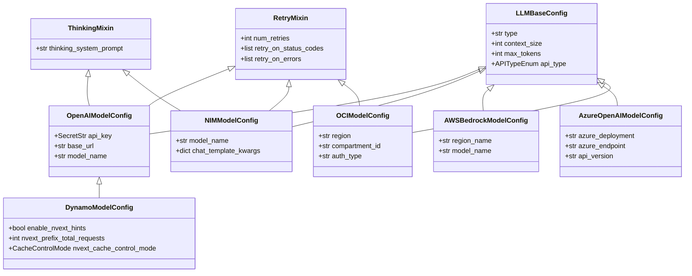
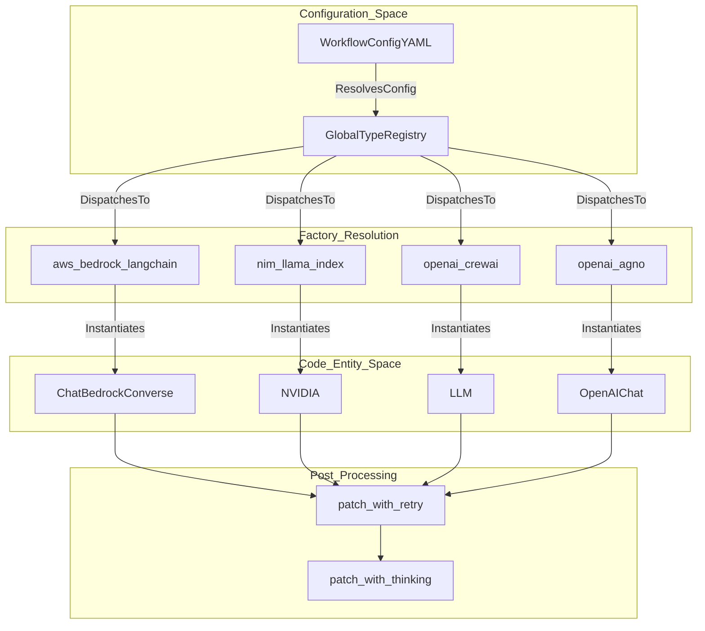

<!-- source: DeepWiki mcp.deepwiki.com · repo NVIDIA/NeMo-Agent-Toolkit · page 7.4 Supported LLM Providers · fetched 2026-10-26 -->

# Supported LLM Providers

<details>
<summary>Relevant source files</summary>

The following files were used as context for generating this wiki page:

- [ci/scripts/gitlab/model_health_check.sh](ci/scripts/gitlab/model_health_check.sh)
- [ci/scripts/gitlab/report_test_results.py](ci/scripts/gitlab/report_test_results.py)
- [ci/scripts/gitlab/tests.sh](ci/scripts/gitlab/tests.sh)
- [ci/scripts/model_health_check.py](ci/scripts/model_health_check.py)
- [docs/source/build-workflows/llms/using-local-llms.md](docs/source/build-workflows/llms/using-local-llms.md)
- [examples/documentation_guides/locally_hosted_llms/nim_config.yml](examples/documentation_guides/locally_hosted_llms/nim_config.yml)
- [examples/documentation_guides/locally_hosted_llms/vllm_config.yml](examples/documentation_guides/locally_hosted_llms/vllm_config.yml)
- [examples/documentation_guides/workflows/custom_workflow/custom_config.yml](examples/documentation_guides/workflows/custom_workflow/custom_config.yml)
- [packages/nvidia_nat_adk/src/nat/plugins/adk/llm.py](packages/nvidia_nat_adk/src/nat/plugins/adk/llm.py)
- [packages/nvidia_nat_agno/src/nat/plugins/agno/llm.py](packages/nvidia_nat_agno/src/nat/plugins/agno/llm.py)
- [packages/nvidia_nat_autogen/src/nat/plugins/autogen/llm.py](packages/nvidia_nat_autogen/src/nat/plugins/autogen/llm.py)
- [packages/nvidia_nat_autogen/tests/test_llm_autogen.py](packages/nvidia_nat_autogen/tests/test_llm_autogen.py)
- [packages/nvidia_nat_crewai/src/nat/plugins/crewai/llm.py](packages/nvidia_nat_crewai/src/nat/plugins/crewai/llm.py)
- [packages/nvidia_nat_langchain/src/nat/plugins/langchain/embedder.py](packages/nvidia_nat_langchain/src/nat/plugins/langchain/embedder.py)
- [packages/nvidia_nat_langchain/src/nat/plugins/langchain/llm.py](packages/nvidia_nat_langchain/src/nat/plugins/langchain/llm.py)
- [packages/nvidia_nat_langchain/tests/test_llm_langchain.py](packages/nvidia_nat_langchain/tests/test_llm_langchain.py)
- [packages/nvidia_nat_llama_index/src/nat/plugins/llama_index/embedder.py](packages/nvidia_nat_llama_index/src/nat/plugins/llama_index/embedder.py)
- [packages/nvidia_nat_llama_index/src/nat/plugins/llama_index/llm.py](packages/nvidia_nat_llama_index/src/nat/plugins/llama_index/llm.py)
- [packages/nvidia_nat_llama_index/tests/test_llm_llama_index.py](packages/nvidia_nat_llama_index/tests/test_llm_llama_index.py)
- [packages/nvidia_nat_semantic_kernel/src/nat/plugins/semantic_kernel/llm.py](packages/nvidia_nat_semantic_kernel/src/nat/plugins/semantic_kernel/llm.py)
- [packages/nvidia_nat_strands/src/nat/plugins/strands/llm.py](packages/nvidia_nat_strands/src/nat/plugins/strands/llm.py)
- [packages/nvidia_nat_strands/tests/test_strands_llm.py](packages/nvidia_nat_strands/tests/test_strands_llm.py)

</details>


This page details the concrete LLM provider implementations available in the NVIDIA NeMo Agent Toolkit (NAT). Each provider is defined by a configuration class (e.g., `OpenAIModelConfig`, `NIMModelConfig`, `AWSBedrockModelConfig`) that can be instantiated with framework-specific clients across supported agent frameworks like LangChain, LlamaIndex, CrewAI, Agno, Semantic Kernel, Strands, and AutoGen.

For information about the provider registration architecture and configuration models, see [LLM Provider Architecture](7.1). For details on multi-framework client instantiation, see [Multi-Framework Client System](7.2).

Sources: [packages/nvidia_nat_langchain/src/nat/plugins/langchain/llm.py:34-43](), [packages/nvidia_nat_llama_index/src/nat/plugins/llama_index/llm.py:28-32](), [packages/nvidia_nat_crewai/src/nat/plugins/crewai/llm.py:26-29]()

## Overview

The toolkit supports a wide array of LLM providers through a unified configuration system. This allows developers to switch between local NVIDIA NIMs, vLLM hosted instances, hosted OpenAI services, or cloud-based Bedrock/Azure endpoints by changing the YAML configuration.

| Provider | Configuration Class | Primary Use Case | Key Features |
|----------|-------------------|------------------|--------------|
| **NVIDIA NIM** | `NIMModelConfig` | NVIDIA inference microservices | Chat template control, OpenAI-compatible, model-gated fields, local/cloud hosting |
| **OpenAI** | `OpenAIModelConfig` | Direct OpenAI API access | Responses API support, seed control, optimizable fields |
| **AWS Bedrock** | `AWSBedrockModelConfig` | AWS-hosted foundation models | Multi-region support, IAM authentication, Converse API |
| **Azure OpenAI** | `AzureOpenAIModelConfig` | Azure-hosted OpenAI models | API version control, deployment names |
| **vLLM (Local)** | `OpenAIModelConfig` (OpenAI-compatible) | Self-hosted vLLM servers | OpenAI client reuse, offline/air-gapped execution |
| **LiteLLM** | `LiteLlmModelConfig` | Unified multi-provider interface | Provider abstraction layer, universal keys |
| **HuggingFace** | `HuggingFaceConfig` / `HuggingFaceInferenceLLMConfig` | Local pipelines & Serverless API | TGI/Inference Endpoints, device mapping |
| **Dynamo** | `DynamoModelConfig` | NVIDIA Dynamo optimization | nvext hints, prefix management, KV cache optimization |
| **OCI** | `OCIModelConfig` | Oracle Cloud GenAI | OCI-native foundation models, OCI SDK auth modes |

Sources: [packages/nvidia_nat_langchain/src/nat/plugins/langchain/llm.py:34-43](), [packages/nvidia_nat_llama_index/src/nat/plugins/llama_index/llm.py:28-32](), [packages/nvidia_nat_crewai/src/nat/plugins/crewai/llm.py:26-29](), [docs/source/build-workflows/llms/using-local-llms.md:20-21]()

## Provider Configuration Hierarchy

The toolkit uses a class hierarchy to ensure consistent behavior (like retries and thinking prompts) across all providers. Configuration mixins like `RetryMixin` and `ThinkingMixin` are composed into provider-specific models to provide uniform features like automatic retries and system prompt injection for reasoning models.

### Configuration Class Diagram



Sources: [packages/nvidia_nat_langchain/src/nat/plugins/langchain/llm.py:32-43](), [packages/nvidia_nat_llama_index/src/nat/plugins/llama_index/llm.py:24-27]()

## Supported Providers and Configuration Examples

### 1. NVIDIA NIM (Cloud and Local Hosting)
NAT provides first-class support for NVIDIA NIM through `NIMModelConfig`. NIM can run either in the cloud (`integrate.api.nvidia.com`) or locally via self-hosted Docker containers.

*   **Local NIM YAML Configuration Example:**
    ```yaml
    llms:
      nim_llm:
        _type: nim
        base_url: "http://localhost:8000/v1"
        model_name: nvidia/nemotron-3-nano
        temperature: 0.0
    ```
*   **Framework Mappings:**
    *   **LangChain:** Uses `ChatNVIDIA` [packages/nvidia_nat_langchain/tests/test_llm_langchain.py:59-67]().
    *   **LlamaIndex:** Uses `llama_index.llms.nvidia.NVIDIA` [packages/nvidia_nat_llama_index/src/nat/plugins/llama_index/llm.py:126-149]().
    *   **CrewAI:** Uses `crewai.LLM` with `nvidia_nim/` prefix [packages/nvidia_nat_crewai/src/nat/plugins/crewai/llm.py:130-154]().

Sources: [docs/source/build-workflows/llms/using-local-llms.md:111-129](), [examples/documentation_guides/locally_hosted_llms/nim_config.yml:26-31]()

### 2. vLLM Local Hosting (OpenAI-Compatible)
Because vLLM provides an OpenAI-compatible server API, local vLLM instances are configured using `OpenAIModelConfig` with a custom `base_url` and an `EMPTY` API key placeholder.

*   **vLLM YAML Configuration Example:**
    ```yaml
    llms:
      vllm_llm:
        _type: openai
        api_key: "EMPTY"
        base_url: "http://localhost:8000/v1"
        model_name: nvidia/NVIDIA-Nemotron-3-Nano-30B-A3B-BF16
    ```

Sources: [docs/source/build-workflows/llms/using-local-llms.md:138-142](), [examples/documentation_guides/locally_hosted_llms/vllm_config.yml:26-32]()

### 3. OpenAI and OpenAI-Compatible
The `OpenAIModelConfig` handles standard OpenAI API endpoints as well as any compliant third-party gateway.

*   **OpenAI YAML Configuration Example:**
    ```yaml
    llms:
      openai_llm:
        _type: openai
        model_name: gpt-4o-mini
        api_type: chat  # or 'responses' for native tool calling
    ```
*   **Responses API:** When `api_type: responses` is specified, NAT binds tools directly to model endpoints supporting OpenAI's Responses API [packages/nvidia_nat_langchain/tests/test_llm_langchain.py:122-131]().

Sources: [packages/nvidia_nat_langchain/src/nat/plugins/langchain/llm.py:32-43](), [packages/nvidia_nat_crewai/src/nat/plugins/crewai/llm.py:157-173]()

### 4. AWS Bedrock
AWS Bedrock integration uses `AWSBedrockModelConfig` and leverages the Bedrock Converse API across supported frameworks for unified tool calling.

*   **AWS Bedrock YAML Configuration Example:**
    ```yaml
    llms:
      bedrock_llm:
        _type: bedrock
        model_name: anthropic.claude-3-sonnet-20240229-v1:0
        region_name: us-east-1
    ```
*   **Framework Mappings:** LangChain uses `ChatBedrockConverse` [packages/nvidia_nat_langchain/src/nat/plugins/langchain/llm.py:154-161](); LlamaIndex uses `Bedrock` [packages/nvidia_nat_llama_index/src/nat/plugins/llama_index/llm.py:85-98]().

Sources: [packages/nvidia_nat_langchain/src/nat/plugins/langchain/llm.py:34](), [packages/nvidia_nat_llama_index/src/nat/plugins/llama_index/llm.py:28]()

### 5. Azure OpenAI
Azure OpenAI uses `AzureOpenAIModelConfig`, requiring explicit deployment names, endpoints, and API versions.

*   **Azure OpenAI YAML Configuration Example:**
    ```yaml
    llms:
      azure_llm:
        _type: azure_openai
        azure_deployment: test-deployment
        azure_endpoint: https://test.openai.azure.com/
        api_version: 2023-12-01-preview
        api_key: "your-azure-key"
    ```

Sources: [packages/nvidia_nat_langchain/src/nat/plugins/langchain/llm.py:35](), [packages/nvidia_nat_crewai/src/nat/plugins/crewai/llm.py:75-125]()

### 6. LiteLLM
LiteLLM provides a unified interface across dozens of LLM providers via `LiteLlmModelConfig`.

*   **LiteLLM YAML Configuration Example:**
    ```yaml
    llms:
      litellm_model:
        _type: litellm
        model_name: anthropic/claude-3-opus-20240229
        api_key: "your-litellm-key"
    ```

Sources: [packages/nvidia_nat_langchain/src/nat/plugins/langchain/llm.py:40](), [packages/nvidia_nat_agno/src/nat/plugins/agno/llm.py:157-175]()

### 7. HuggingFace (Local and Inference API)
Supports HuggingFace pipeline models and serverless Inference APIs via configuration wrappers.

*   **HuggingFace YAML Configuration Example:**
    ```yaml
    llms:
      hf_llm:
        _type: huggingface
        model_name: meta-llama/Meta-Llama-3-8B-Instruct
    ```

Sources: [packages/nvidia_nat_langchain/src/nat/plugins/langchain/llm.py:38-39]()

### 8. OCI Generative AI
OCI integration via `OCIModelConfig` connects to Oracle Cloud Infrastructure foundation models.

*   **OCI YAML Configuration Example:**
    ```yaml
    llms:
      oci_llm:
        _type: oci
        compartment_id: "ocid1.compartment.oc1..exampleuniqueID"
        region: us-ashburn-1
        auth_type: API_KEY
    ```

Sources: [packages/nvidia_nat_langchain/src/nat/plugins/langchain/llm.py:42]()

### 9. NVIDIA Dynamo
`DynamoModelConfig` extends OpenAI configurations to support high-performance KV cache optimization and routing hints (`nvext`).

*   **Dynamo YAML Configuration Example:**
    ```yaml
    llms:
      dynamo_llm:
        _type: dynamo
        base_url: "http://localhost:8000/v1"
        model_name: nvidia/nemotron-3-nano
        enable_nvext_hints: true
    ```

Sources: [packages/nvidia_nat_langchain/src/nat/plugins/langchain/llm.py:36]()

---

## Multi-Framework Client Resolution & Data Flow

NAT uses a plugin system to map a single configuration to different framework clients. This is handled by registration functions and factory resolvers.

### Client Resolution Data Flow Diagram

The following diagram bridges Configuration Space (YAML/Pydantic models) to Code Entity Space (Factory functions and Framework Clients).



Sources: [packages/nvidia_nat_langchain/src/nat/plugins/langchain/llm.py:154-169](), [packages/nvidia_nat_llama_index/src/nat/plugins/llama_index/llm.py:126-149](), [packages/nvidia_nat_crewai/src/nat/plugins/crewai/llm.py:157-173](), [packages/nvidia_nat_agno/src/nat/plugins/agno/llm.py:115-154]()

---

## Framework Support Matrix and Post-Instantiation Patching

| Framework | Key Providers Supported | Implementation File |
|-----------|-------------------------|---------------------|
| **LangChain** | All (NIM, OpenAI, Bedrock, Azure, OCI, LiteLLM, vLLM) | `packages/nvidia_nat_langchain/src/nat/plugins/langchain/llm.py` |
| **LlamaIndex** | NIM, OpenAI, Bedrock, Azure, LiteLLM, vLLM | `packages/nvidia_nat_llama_index/src/nat/plugins/llama_index/llm.py` |
| **CrewAI** | NIM, OpenAI, Azure, LiteLLM, vLLM | `packages/nvidia_nat_crewai/src/nat/plugins/crewai/llm.py` |
| **Agno** | NIM, OpenAI, LiteLLM, vLLM | `packages/nvidia_nat_agno/src/nat/plugins/agno/llm.py` |
| **Semantic Kernel** | OpenAI, Azure | `packages/nvidia_nat_semantic_kernel/src/nat/plugins/semantic_kernel/llm.py` |
| **Strands** | NIM, OpenAI, Bedrock, Azure, LiteLLM, vLLM | `packages/nvidia_nat_strands/src/nat/plugins/strands/llm.py` |

### Post-Instantiation Patching
After a framework client is instantiated, NAT applies common wrappers:
1.  **Automatic Retries:** `patch_with_retry` is applied if the configuration inherits from `RetryMixin` [packages/nvidia_nat_langchain/src/nat/plugins/langchain/llm.py:132-136]().
2.  **Thinking Injection:** `patch_with_thinking` injects specialized system prompts and parsers for reasoning models across LangChain, LlamaIndex, CrewAI, and Agno [packages/nvidia_nat_langchain/src/nat/plugins/langchain/llm.py:138-149](), [packages/nvidia_nat_llama_index/src/nat/plugins/llama_index/llm.py:69-80](), [packages/nvidia_nat_crewai/src/nat/plugins/crewai/llm.py:65-70](), [packages/nvidia_nat_agno/src/nat/plugins/agno/llm.py:69-78]().

Sources: [packages/nvidia_nat_langchain/src/nat/plugins/langchain/llm.py:81-151](), [packages/nvidia_nat_llama_index/src/nat/plugins/llama_index/llm.py:44-82](), [packages/nvidia_nat_crewai/src/nat/plugins/crewai/llm.py:41-72](), [packages/nvidia_nat_agno/src/nat/plugins/agno/llm.py:41-80]()

---

