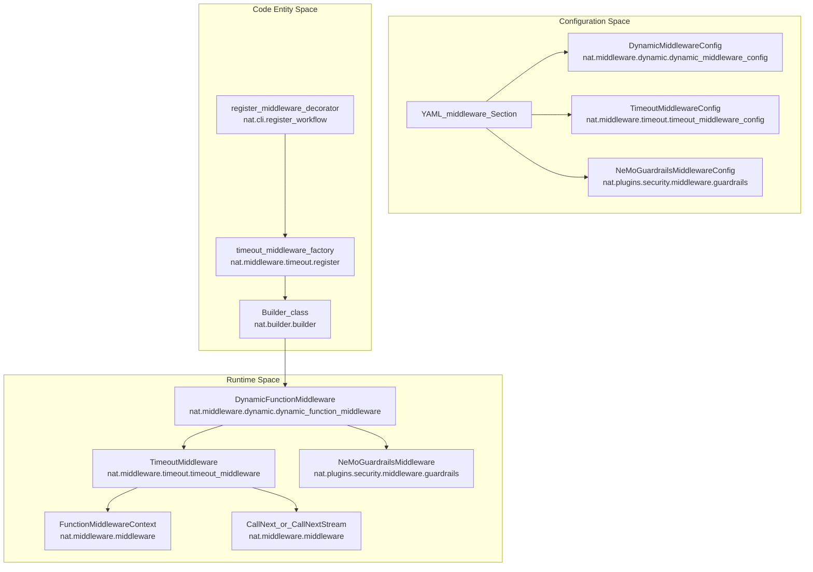
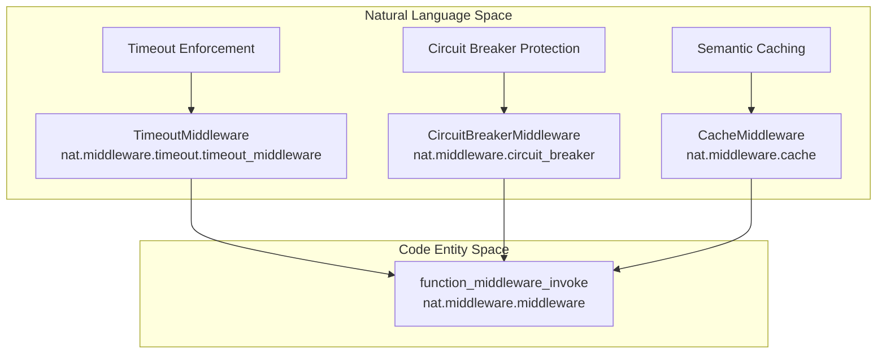

<!-- source: DeepWiki mcp.deepwiki.com · repo NVIDIA/NeMo-Agent-Toolkit · page 8 Middleware System · fetched 2026-10-26 -->

# Middleware System

Relevant source files

The following files were used as context for generating this wiki page:

- [docs/source/build-workflows/advanced/middleware.md](docs/source/build-workflows/advanced/middleware.md)
- [packages/nvidia_nat_core/src/nat/middleware/register.py](packages/nvidia_nat_core/src/nat/middleware/register.py)
- [packages/nvidia_nat_core/src/nat/middleware/timeout/__init__.py](packages/nvidia_nat_core/src/nat/middleware/timeout/__init__.py)
- [packages/nvidia_nat_core/src/nat/middleware/timeout/register.py](packages/nvidia_nat_core/src/nat/middleware/timeout/register.py)
- [packages/nvidia_nat_core/src/nat/middleware/timeout/timeout_middleware.py](packages/nvidia_nat_core/src/nat/middleware/timeout/timeout_middleware.py)
- [packages/nvidia_nat_core/src/nat/middleware/timeout/timeout_middleware_config.py](packages/nvidia_nat_core/src/nat/middleware/timeout/timeout_middleware_config.py)
- [packages/nvidia_nat_core/tests/nat/middleware/test_timeout_middleware.py](packages/nvidia_nat_core/tests/nat/middleware/test_timeout_middleware.py)

## Purpose and Scope

The Middleware System provides a powerful mechanism for adding cross-cutting concerns to functions and components in the NeMo Agent Toolkit without modifying the implementation itself. Like middleware in web frameworks (Express.js, FastAPI, etc.), middleware wraps calls with a four-phase execution pattern: **preprocess** inputs, **call next** (delegate to the next link), **postprocess** outputs, and **continue** to return or yield the final result [docs/source/build-workflows/advanced/middleware.md:20-28]().

Middleware components are first-class entities in the toolkit, configured in YAML and built by the workflow builder. They enable features such as caching, logging, timeout enforcement, and Human-in-the-Loop (HITL) gating to be applied to functions, LLMs, retrievers, and other toolkit components [docs/source/build-workflows/advanced/middleware.md:29-30](), [packages/nvidia_nat_core/src/nat/middleware/timeout/register.py:25-39]().

This is a **parent page** providing a high-level overview. Detailed information is available in the following child pages:
- **[Middleware Architecture](#8.1)**: Detailed explanation of the middleware chain, `InvocationContext`, pre/post-invoke phases, and execution flow.
- **[Built-in Middleware](#8.2)**: Documentation for `TimeoutMiddleware`, `LoggingMiddleware`, `CacheMiddleware`, `CircuitBreakerMiddleware`, `HITLMiddleware`, and other components.
- **[Custom Middleware Development](#8.3)**: Guide for creating, registering, and configuring custom middleware with lifecycle management.

Sources: [docs/source/build-workflows/advanced/middleware.md:18-30](), [packages/nvidia_nat_core/src/nat/middleware/timeout/register.py:25-39]()

---

## Architecture Overview

The middleware system follows a component-based architecture where middleware are configured in a `middleware:` section and built before functions and function groups [docs/source/build-workflows/advanced/middleware.md:33-35](). They wrap a function's `ainvoke` or `astream` methods, forming an onion structure where control flows inward through preprocessing, down to the function, and back out through postprocessing [docs/source/build-workflows/advanced/middleware.md:36-40]().

### Natural Language Space to Code Entity Space

The following diagram bridges high-level configuration concepts to specific code entities within the toolkit, mapping natural language configuration domains to concrete Pydantic classes and runtime modules.

Title: "Middleware Configuration to Code Entity Mapping"

For details on the execution flow, context management, and chaining mechanics, see **[Middleware Architecture](#8.1)**.

Sources: [docs/source/build-workflows/advanced/middleware.md:33-43](), [packages/nvidia_nat_core/src/nat/middleware/timeout/timeout_middleware.py:35-53](), [packages/nvidia_nat_core/src/nat/middleware/timeout/timeout_middleware_config.py:24-36]()

---

## Built-in Middleware Components

The toolkit provides several production-ready middleware implementations for common enterprise requirements. These include logging, caching, timeout enforcement, circuit breakers, and Human-in-the-Loop (HITL) approval gates [packages/nvidia_nat_core/src/nat/middleware/register.py:18-22]().

### Natural Language Space to Execution Entity Space

The following diagram bridges natural language concepts of runtime safety and control to the specific execution classes and sequence handlers in the codebase.

Title: "Runtime Middleware Execution to Code Mapping"

For a comprehensive catalog of built-in middleware configuration schemas and usage examples, see **[Built-in Middleware](#8.2)**.

Sources: [packages/nvidia_nat_core/src/nat/middleware/register.py:18-22](), [packages/nvidia_nat_core/src/nat/middleware/timeout/timeout_middleware.py:47-53]()

---

## Custom Middleware Development

Developers can extend the toolkit by creating custom middleware components [docs/source/build-workflows/advanced/middleware.md:79-83](). This involves defining a Pydantic configuration class inheriting from `DynamicMiddlewareConfig`, implementing the middleware logic by subclassing `DynamicFunctionMiddleware`, and registering the factory using the `@register_middleware` decorator [packages/nvidia_nat_core/src/nat/middleware/timeout/timeout_middleware_config.py:24-24](), [packages/nvidia_nat_core/src/nat/middleware/timeout/timeout_middleware.py:35-43](), [packages/nvidia_nat_core/src/nat/middleware/timeout/register.py:25-26]().

For a step-by-step implementation guide, registration patterns, and lifecycle management details, see **[Custom Middleware Development](#8.3)**.

Sources: [docs/source/build-workflows/advanced/middleware.md:79-101](), [packages/nvidia_nat_core/src/nat/middleware/timeout/timeout_middleware.py:35-43](), [packages/nvidia_nat_core/src/nat/middleware/timeout/register.py:25-26]()

---

